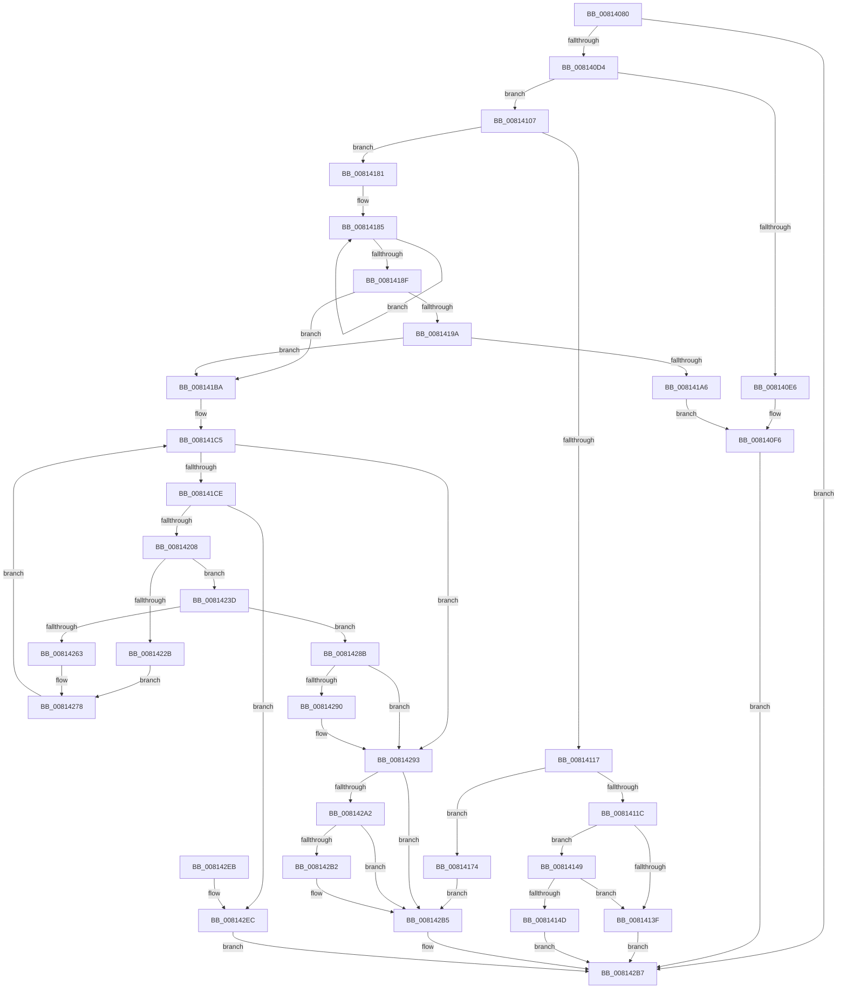

# SdbpCheckMatchingFiles

- RVA: `0x00814080`–`0x0081430D` (길이 `653` bytes)
- VA: `0x0000000140814080`
- 실행 섹션: `PAGE`
- PDB 이름 있음: `예`; PDB Function 태그: `아니요`
- unwind 정보 RVA: `0x000D9970`
- 디코드: `178`개 명령, `653/653` bytes 표시
- 미해석 바이트: `0` (있으면 어셈블리에 `.byte`로 보존)

> 이 문서는 커널 이미지의 기계어와 PDB 기호를 분석해 생성했습니다. 4번과 5번은 함수 원형과 자료형을 바이너리 사용 방식에서 추정한 C 해석이며 원본 소스 복구 결과는 아닙니다.

## 1. Dependencies

- 직접 호출 지점: **16**; 고유 호출 대상: **10**
- 직접 호출자로 확인된 함수: **0**
- RIP 상대 이미지 참조: **5**

### Outgoing calls
- `0x008140C7` → [SdbFindFirstTag](../95/SdbFindFirstTag_function_0095E34C.md) (function, `0x0095E34C`)
- `0x008140D9` → [SdbGetStringTagPtr](../95/SdbGetStringTagPtr_function_0095DDA8.md) (function, `0x0095DDA8`)
- `0x008140FD` → [AslLogCallPrintf](../95/AslLogCallPrintf_function_0095E4EC.md) (function, `0x0095E4EC`)
- `0x0081412F` → [SdbpCheckAllAttributes](SdbpCheckAllAttributes_function_008187EC.md) (function, `0x008187EC`)
- `0x00814136` → [AslFileNotFound](../70/AslFileNotFound_function_00705144.md) (function, `0x00705144`)
- `0x0081416A` → [AslLogCallPrintf](../95/AslLogCallPrintf_function_0095E4EC.md) (function, `0x0095E4EC`)
- `0x0081419D` → [SdbpInitializeSearchDBContext](SdbpInitializeSearchDBContext_function_00816210.md) (function, `0x00816210`)
- `0x008141FB` → [SdbpResolveMatchingFile](SdbpResolveMatchingFile_function_00816A20.md) (function, `0x00816A20`)
- `0x00814222` → [AslFileMappingCreate](../95/AslFileMappingCreate_function_00958448.md) (function, `0x00958448`)
- `0x0081422E` → [AslFree](../95/AslFree_function_0095B674.md) (function, `0x0095B674`)
- `0x0081425A` → [SdbpCheckAllAttributes](SdbpCheckAllAttributes_function_008187EC.md) (function, `0x008187EC`)
- `0x00814267` → [AslFileMappingDelete](../95/AslFileMappingDelete_function_0095B728.md) (function, `0x0095B728`)
- `0x00814273` → [AslFree](../95/AslFree_function_0095B674.md) (function, `0x0095B674`)
- `0x008142BB` → [AslFileMappingDelete](../95/AslFileMappingDelete_function_0095B728.md) (function, `0x0095B728`)
- `0x008142C3` → [AslFree](../95/AslFree_function_0095B674.md) (function, `0x0095B674`)
- `0x00814302` → [AslLogCallPrintf](../95/AslLogCallPrintf_function_0095E4EC.md) (function, `0x0095E4EC`)

### Direct callers
- 이 함수 시작 RVA로 연결되는 직접 call은 확인되지 않았습니다. 간접 호출은 완전히 역산할 수 없습니다.

### Static image references
- `0x008140E6` → RVA `0x0003C7D8` (`.rdata`; read)
- `0x008140F6` → RVA `0x0003C758` (`.rdata`; read)
- `0x00814151` → RVA `0x0003CD50` (`.rdata`; read)
- `0x008141A6` → RVA `0x0003C9C0` (`.rdata`; read)
- `0x008142EC` → RVA `0x0003CD30` (`.rdata`; read)

## 2. Other-region calls and transfers

- 다른 실행 섹션으로 향하는 call: **0**
- 별도 외부 분기/꼬리 이동을 확인하지 못했습니다.

## 3. Assembly (complete function range)

```asm
00814080  48 8B C4                        mov rax, rsp
00814083  48 89 58 20                     mov qword ptr [rax + 0x20], rbx
00814087  4C 89 40 18                     mov qword ptr [rax + 0x18], r8
0081408B  48 89 50 10                     mov qword ptr [rax + 0x10], rdx
0081408F  48 89 48 08                     mov qword ptr [rax + 8], rcx
00814093  55                              push rbp
00814094  56                              push rsi
00814095  57                              push rdi
00814096  41 54                           push r12
00814098  41 55                           push r13
0081409A  41 56                           push r14
0081409C  41 57                           push r15
0081409E  48 8B EC                        mov rbp, rsp
008140A1  48 83 EC 50                     sub rsp, 0x50
008140A5  33 FF                           xor edi, edi
008140A7  49 8B D8                        mov rbx, r8
008140AA  4C 8B FA                        mov r15, rdx
008140AD  89 7D E0                        mov dword ptr [rbp - 0x20], edi
008140B0  8B 55 60                        mov edx, dword ptr [rbp + 0x60]
008140B3  48 8B CB                        mov rcx, rbx
008140B6  41 B8 01 60 00 00               mov r8d, 0x6001
008140BC  48 89 7D F0                     mov qword ptr [rbp - 0x10], rdi
008140C0  44 8B F7                        mov r14d, edi
008140C3  48 89 7D E8                     mov qword ptr [rbp - 0x18], rdi
008140C7  E8 80 A2 14 00                  call 0x14095e34c
008140CC  85 C0                           test eax, eax
008140CE  0F 84 E3 01 00 00               je 0x1408142b7
008140D4  8B D0                           mov edx, eax
008140D6  48 8B CB                        mov rcx, rbx
008140D9  E8 CA 9C 14 00                  call 0x14095dda8
008140DE  4C 8B E0                        mov r12, rax
008140E1  48 85 C0                        test rax, rax
008140E4  75 21                           jne 0x140814107
008140E6  4C 8D 0D EB 86 82 FF            lea r9, [rip - 0x7d7915]
008140ED  41 B8 88 0C 00 00               mov r8d, 0xc88
008140F3  8D 4F 01                        lea ecx, [rdi + 1]
008140F6  48 8D 15 5B 86 82 FF            lea rdx, [rip - 0x7d79a5]
008140FD  E8 EA A3 14 00                  call 0x14095e4ec
00814102  E9 B0 01 00 00                  jmp 0x1408142b7
00814107  66 41 83 3C 24 2A               cmp word ptr [r12], 0x2a
0081410D  48 8B 75 68                     mov rsi, qword ptr [rbp + 0x68]
00814111  48 8B 46 08                     mov rax, qword ptr [rsi + 8]
00814115  75 6A                           jne 0x140814181
00814117  48 85 C0                        test rax, rax
0081411A  74 58                           je 0x140814174
0081411C  44 8B 4D 60                     mov r9d, dword ptr [rbp + 0x60]
00814120  48 8D 4D E0                     lea rcx, [rbp - 0x20]
00814124  4C 8B C3                        mov r8, rbx
00814127  48 89 44 24 20                  mov qword ptr [rsp + 0x20], rax
0081412C  49 8B D7                        mov rdx, r15
0081412F  E8 B8 46 00 00                  call 0x1408187ec
00814134  8B C8                           mov ecx, eax
00814136  E8 09 10 EF FF                  call 0x140705144
0081413B  85 C0                           test eax, eax
0081413D  74 0A                           je 0x140814149
0081413F  BF 01 00 00 00                  mov edi, 1
00814144  E9 6E 01 00 00                  jmp 0x1408142b7
00814149  85 C9                           test ecx, ecx
0081414B  79 F2                           jns 0x14081413f
0081414D  89 4C 24 20                     mov dword ptr [rsp + 0x20], ecx
00814151  4C 8D 0D F8 8B 82 FF            lea r9, [rip - 0x7d7408]
00814158  B9 01 00 00 00                  mov ecx, 1
0081415D  48 8D 15 F4 85 82 FF            lea rdx, [rip - 0x7d7a0c]
00814164  41 B8 A1 0C 00 00               mov r8d, 0xca1
0081416A  E8 7D A3 14 00                  call 0x14095e4ec
0081416F  E9 43 01 00 00                  jmp 0x1408142b7
00814174  BB 01 00 00 00                  mov ebx, 1
00814179  89 5D E0                        mov dword ptr [rbp - 0x20], ebx
0081417C  E9 34 01 00 00                  jmp 0x1408142b5
00814181  49 83 CD FF                     or r13, 0xffffffffffffffff
00814185  49 FF C5                        inc r13
00814188  66 43 39 3C 6C                  cmp word ptr [r12 + r13*2], di
0081418D  75 F6                           jne 0x140814185
0081418F  8B 06                           mov eax, dword ptr [rsi]
00814191  BB 01 00 00 00                  mov ebx, 1
00814196  84 C3                           test bl, al
00814198  75 20                           jne 0x1408141ba
0081419A  48 8B CE                        mov rcx, rsi
0081419D  E8 6E 20 00 00                  call 0x140816210
008141A2  85 C0                           test eax, eax
008141A4  75 14                           jne 0x1408141ba
008141A6  4C 8D 0D 13 88 82 FF            lea r9, [rip - 0x7d77ed]
008141AD  41 B8 C3 0C 00 00               mov r8d, 0xcc3
008141B3  8B CB                           mov ecx, ebx
008141B5  E9 3C FF FF FF                  jmp 0x1408140f6
008141BA  48 8B 56 48                     mov rdx, qword ptr [rsi + 0x48]
008141BE  44 8B FF                        mov r15d, edi
008141C1  48 89 55 F8                     mov qword ptr [rbp - 8], rdx
008141C5  44 3B 3A                        cmp r15d, dword ptr [rdx]
008141C8  0F 8D C5 00 00 00               jge 0x140814293
008141CE  48 83 C2 08                     add rdx, 8
008141D2  49 63 C7                        movsxd rax, r15d
008141D5  48 8D 4D F0                     lea rcx, [rbp - 0x10]
008141D9  45 8B CD                        mov r9d, r13d
008141DC  48 89 4C 24 28                  mov qword ptr [rsp + 0x28], rcx
008141E1  4D 8B C4                        mov r8, r12
008141E4  48 8B 4D 48                     mov rcx, qword ptr [rbp + 0x48]
008141E8  48 8D 04 40                     lea rax, [rax + rax*2]
008141EC  48 C1 E0 04                     shl rax, 4
008141F0  48 03 C2                        add rax, rdx
008141F3  48 8B D6                        mov rdx, rsi
008141F6  48 89 44 24 20                  mov qword ptr [rsp + 0x20], rax
008141FB  E8 20 28 00 00                  call 0x140816a20
00814200  85 C0                           test eax, eax
00814202  0F 84 E4 00 00 00               je 0x1408142ec
00814208  4C 8B 75 F0                     mov r14, qword ptr [rbp - 0x10]
0081420C  48 8D 4D 68                     lea rcx, [rbp + 0x68]
00814210  49 8B D6                        mov rdx, r14
00814213  48 89 7D 68                     mov qword ptr [rbp + 0x68], rdi
00814217  45 33 C9                        xor r9d, r9d
0081421A  48 89 7C 24 20                  mov qword ptr [rsp + 0x20], rdi
0081421F  45 33 C0                        xor r8d, r8d
00814222  E8 21 42 14 00                  call 0x140958448
00814227  85 C0                           test eax, eax
00814229  79 12                           jns 0x14081423d
0081422B  49 8B D6                        mov rdx, r14
0081422E  E8 41 74 14 00                  call 0x14095b674
00814233  48 8B 45 68                     mov rax, qword ptr [rbp + 0x68]
00814237  48 89 45 E8                     mov qword ptr [rbp - 0x18], rax
0081423B  EB 3B                           jmp 0x140814278
0081423D  48 8B 45 68                     mov rax, qword ptr [rbp + 0x68]
00814241  48 8D 4D E0                     lea rcx, [rbp - 0x20]
00814245  44 8B 4D 60                     mov r9d, dword ptr [rbp + 0x60]
00814249  4C 8B 45 50                     mov r8, qword ptr [rbp + 0x50]
0081424D  48 8B 55 48                     mov rdx, qword ptr [rbp + 0x48]
00814251  48 89 45 E8                     mov qword ptr [rbp - 0x18], rax
00814255  48 89 44 24 20                  mov qword ptr [rsp + 0x20], rax
0081425A  E8 8D 45 00 00                  call 0x1408187ec
0081425F  85 C0                           test eax, eax
00814261  79 28                           jns 0x14081428b
00814263  48 8B 4D E8                     mov rcx, qword ptr [rbp - 0x18]
00814267  E8 BC 74 14 00                  call 0x14095b728
0081426C  49 8B D6                        mov rdx, r14
0081426F  48 89 7D E8                     mov qword ptr [rbp - 0x18], rdi
00814273  E8 FC 73 14 00                  call 0x14095b674
00814278  48 8B 55 F8                     mov rdx, qword ptr [rbp - 8]
0081427C  4C 8B F7                        mov r14, rdi
0081427F  48 89 7D F0                     mov qword ptr [rbp - 0x10], rdi
00814283  44 03 FB                        add r15d, ebx
00814286  E9 3A FF FF FF                  jmp 0x1408141c5
0081428B  45 85 FF                        test r15d, r15d
0081428E  7E 03                           jle 0x140814293
00814290  89 5E 50                        mov dword ptr [rsi + 0x50], ebx
00814293  41 0F B7 04 24                  movzx eax, word ptr [r12]
00814298  66 83 E8 25                     sub ax, 0x25
0081429C  66 83 F8 37                     cmp ax, 0x37
008142A0  77 13                           ja 0x1408142b5
008142A2  48 B9 01 02 00 00 00 00 80 00   movabs rcx, 0x80000000000201
008142AC  48 0F A3 C1                     bt rcx, rax
008142B0  73 03                           jae 0x1408142b5
008142B2  89 5E 50                        mov dword ptr [rsi + 0x50], ebx
008142B5  8B FB                           mov edi, ebx
008142B7  48 8B 4D E8                     mov rcx, qword ptr [rbp - 0x18]
008142BB  E8 68 74 14 00                  call 0x14095b728
008142C0  49 8B D6                        mov rdx, r14
008142C3  E8 AC 73 14 00                  call 0x14095b674
008142C8  48 8B 45 40                     mov rax, qword ptr [rbp + 0x40]
008142CC  8B 4D E0                        mov ecx, dword ptr [rbp - 0x20]
008142CF  48 8B 9C 24 A8 00 00 00         mov rbx, qword ptr [rsp + 0xa8]
008142D7  89 08                           mov dword ptr [rax], ecx
008142D9  8B C7                           mov eax, edi
008142DB  48 83 C4 50                     add rsp, 0x50
008142DF  41 5F                           pop r15
008142E1  41 5E                           pop r14
008142E3  41 5D                           pop r13
008142E5  41 5C                           pop r12
008142E7  5F                              pop rdi
008142E8  5E                              pop rsi
008142E9  5D                              pop rbp
008142EA  C3                              ret
008142EB  CC                              int3
008142EC  4C 8D 0D 3D 8A 82 FF            lea r9, [rip - 0x7d75c3]
008142F3  41 B8 DB 0C 00 00               mov r8d, 0xcdb
008142F9  48 8D 15 58 84 82 FF            lea rdx, [rip - 0x7d7ba8]
00814300  8B CB                           mov ecx, ebx
00814302  E8 E5 A1 14 00                  call 0x14095e4ec
00814307  4C 8B 75 F0                     mov r14, qword ptr [rbp - 0x10]
0081430B  EB AA                           jmp 0x1408142b7
```

## 4. C-style interpretation (structured pseudocode)

```c
__int64 __fastcall SdbpCheckMatchingFiles(__int64 a1, __int64 a2, __int64 a3, __int64 a4, unsigned int a5, __int64 a6)
{
    __int64 result;
    __int64 v_r13;
    __int64 v_r15;
    __int64 v_rdi;
    __int64 v_rsp;
    unsigned __int64 v_stack_m40;
    unsigned __int64 v_stack_m48;
    unsigned __int64 v_stack_m50;
    unsigned int v_stack_m58;
    unsigned __int64 v_stack_m60;
    unsigned __int64 v_stack_m68;
    unsigned __int64 v_stack_p10;
    unsigned __int64 v_stack_p18;
    unsigned __int64 v_stack_p20;
    unsigned __int64 v_stack_p30;
    unsigned __int64 v_stack_p8;

    *(unsigned __int64 *)(v_rsp + 32) = v_rbx;
    *(unsigned __int64 *)(v_rsp + 24) = a3;
    *(unsigned __int64 *)(v_rsp + 16) = a2;
    *(unsigned __int64 *)(v_rsp + 8) = a1;
    v_rsp = (v_rsp) - (80);
    v_rdi = 0;
    v_stack_m58 = 0;
    v_stack_m48 = 0;
    v_stack_m50 = 0;
    result = SdbFindFirstTag(a3, (unsigned int)(a5), (unsigned int)(0x6001ULL), a4);
    if ((unsigned int)(result) == 0) goto loc_008142B7;
    result = SdbGetStringTagPtr(a3, (unsigned int)((unsigned int)(result)), (unsigned int)(0x6001ULL), a4);
    if (result != 0) goto loc_00814107;
loc_008140F6:
    result = AslLogCallPrintf(v_rdi + 1, v_rip - 8223141, (unsigned int)(0xC88ULL), v_rip - 8222997);
    goto loc_008142B7;
loc_00814107:
    if ((*(unsigned __int16 *)(result)) != 42) goto loc_00814181;
    if (*(unsigned __int64 *)(a6 + 8) == 0) goto loc_00814174;
    v_stack_m68 = *(unsigned __int64 *)(a6 + 8);
    result = SdbpCheckAllAttributes(v_stack_m58, a2, a3, (unsigned int)(a5));
    result = AslFileNotFound((unsigned int)((unsigned int)(result)), a2, a3, (unsigned int)(a5));
    if ((unsigned int)(result) == 0) goto loc_00814149;
loc_0081413F:
    goto loc_008142B7;
loc_00814149:
    if (!sign_flag) goto loc_0081413F;
    v_stack_m68 = (unsigned int)((unsigned int)((unsigned int)(result)));
    result = AslLogCallPrintf(1, v_rip - 8223244, (unsigned int)(0xCA1ULL), v_rip - 8221704);
    goto loc_008142B7;
loc_00814174:
    v_stack_m58 = 1;
    goto loc_008142B5;
loc_00814181:
    v_r13 = (v_r13) | (-1);
loc_00814185:
    v_r13 = (v_r13) + 1;
    if ((*(unsigned __int16 *)(result + v_r13 * 2)) != 1) goto loc_00814185;
    if (((1) & ((unsigned __int8)((unsigned int)(*(unsigned int *)(a6))))) != 0) goto loc_008141BA;
    result = SdbpInitializeSearchDBContext(a6, v_rip - 8223244, (unsigned int)(0xCA1ULL), v_rip - 8221704);
    if ((unsigned int)(result) != 0) goto loc_008141BA;
    goto loc_008140F6;
loc_008141BA:
    v_stack_m40 = *(unsigned __int64 *)(a6 + 72);
loc_008141C5:
    if (1 >= (*(unsigned int *)(*(unsigned __int64 *)(a6 + 72)))) goto loc_00814293;
    a2 = (*(unsigned __int64 *)(a6 + 72)) + (8);
    v_stack_m60 = v_stack_m48;
    result = ((int)(1) + (int)(1) * 2) << (4);
    result = (result) + (a2);
    v_stack_m68 = result;
    result = SdbpResolveMatchingFile(v_stack_p10, a6, result, (unsigned int)((unsigned int)(v_r13)));
    if ((unsigned int)(result) == 0) goto loc_008142EC;
    v_stack_p30 = 1;
    a4 = 0;
    v_stack_m68 = 1;
    a3 = 0;
    result = AslFileMappingCreate(a6, v_stack_m48, a3, a4);
    if (!sign_flag) goto loc_0081423D;
    result = AslFree(a6, v_stack_m48, a3, a4);
    v_stack_m50 = a6;
    goto loc_00814278;
loc_0081423D:
    v_stack_m50 = a6;
    v_stack_m68 = a6;
    result = SdbpCheckAllAttributes(v_stack_m58, v_stack_p10, v_stack_p18, (unsigned int)(a5));
    if (!sign_flag) goto loc_0081428B;
    result = AslFileMappingDelete(v_stack_m50, v_stack_p10, v_stack_p18, (unsigned int)(a5));
    v_stack_m50 = 1;
    result = AslFree(v_stack_m50, v_stack_m48, v_stack_p18, (unsigned int)(a5));
loc_00814278:
    v_stack_m48 = 1;
    v_r15 = (unsigned int)((1) + (1));
    goto loc_008141C5;
loc_0081428B:
    if (!(condition_is_less_or_equal)) {
        *(unsigned int *)(a6 + 80) = 1;
    }
    result = (unsigned __int16)((*(unsigned __int16 *)(result)) - (37));
    if (((unsigned __int16)(result)) > 55) goto loc_008142B5;
    if (((unsigned __int16)(result)) < 55) {
        *(unsigned int *)(a6 + 80) = 1;
    }
loc_008142B7:
    result = AslFileMappingDelete(v_stack_m50, v_stack_m40, v_stack_p18, (unsigned int)(a5));
    result = AslFree(v_stack_m50, 1, v_stack_p18, (unsigned int)(a5));
    *(unsigned int *)(v_stack_p8) = (unsigned int)((unsigned int)(v_stack_m58));
    v_rsp = (v_rsp) + (80);
    return 1;
loc_008142EC:
    result = AslLogCallPrintf((unsigned int)((unsigned int)(v_stack_p20)), v_rip - 8223656, (unsigned int)(0xCDBULL), v_rip - 8222147);
    goto loc_008142B7;
}
```

## 5. (Beta) C Style

```c
int64_t SdbpCheckMatchingFiles(int64_t Arg1, int64_t Arg2, int64_t Arg3, int64_t Arg4, uint32_t Arg5, void *Arg6)
{
    uint8_t *arg6 = (uint8_t *)Arg6;

    int64_t result;
    int64_t local_r13;
    int64_t local_r15;
    int64_t local_rdi;
    int64_t local_rsp;
    uint64_t v_stack_m40;
    uint64_t v_stack_m48;
    uint64_t v_stack_m50;
    uint32_t v_stack_m58;
    uint64_t v_stack_m60;
    uint64_t v_stack_m68;
    uint64_t v_stack_p10;
    uint64_t v_stack_p18;
    uint64_t v_stack_p20;
    uint64_t v_stack_p30;
    uint64_t v_stack_p8;

    *(uint64_t *)(local_rsp + 0x20) = local_rbx;
    *(uint64_t *)(local_rsp + 0x18) = Arg3;
    *(uint64_t *)(local_rsp + 0x10) = Arg2;
    *(uint64_t *)(local_rsp + 0x8) = Arg1;
    local_rsp = (local_rsp) - (80);
    local_rdi = 0;
    v_stack_m58 = 0;
    v_stack_m48 = 0;
    v_stack_m50 = 0;
    result = SdbFindFirstTag(Arg3, (uint32_t)(Arg5), (uint32_t)(0x6001ULL), Arg4);
    if ((uint32_t)(result) == 0) goto loc_008142B7;
    result = SdbGetStringTagPtr(Arg3, (uint32_t)((uint32_t)(result)), (uint32_t)(0x6001ULL), Arg4);
    if (result != 0) goto loc_00814107;
loc_008140F6:
    result = AslLogCallPrintf(local_rdi + 1, v_rip - 8223141, (uint32_t)(0xC88ULL), v_rip - 8222997);
    goto loc_008142B7;
loc_00814107:
    if ((*(uint16_t *)(result)) != 42) goto loc_00814181;
    if (*(uint64_t *)(arg6 + 0x8) == 0) goto loc_00814174;
    v_stack_m68 = *(uint64_t *)(arg6 + 0x8);
    result = SdbpCheckAllAttributes(v_stack_m58, Arg2, Arg3, (uint32_t)(Arg5));
    result = AslFileNotFound((uint32_t)((uint32_t)(result)), Arg2, Arg3, (uint32_t)(Arg5));
    if ((uint32_t)(result) == 0) goto loc_00814149;
loc_0081413F:
    goto loc_008142B7;
loc_00814149:
    if (!sign_flag) goto loc_0081413F;
    v_stack_m68 = (uint32_t)((uint32_t)((uint32_t)(result)));
    result = AslLogCallPrintf(1, v_rip - 8223244, (uint32_t)(0xCA1ULL), v_rip - 8221704);
    goto loc_008142B7;
loc_00814174:
    v_stack_m58 = 1;
    goto loc_008142B5;
loc_00814181:
    local_r13 = (local_r13) | (-1);
loc_00814185:
    local_r13 = (local_r13) + 1;
    if ((*(uint16_t *)(result + local_r13 * 2)) != 1) goto loc_00814185;
    if (((1) & ((uint8_t)((uint32_t)(*(uint32_t *)(arg6))))) != 0) goto loc_008141BA;
    result = SdbpInitializeSearchDBContext(Arg6, v_rip - 8223244, (uint32_t)(0xCA1ULL), v_rip - 8221704);
    if ((uint32_t)(result) != 0) goto loc_008141BA;
    goto loc_008140F6;
loc_008141BA:
    v_stack_m40 = *(uint64_t *)(arg6 + 0x48);
loc_008141C5:
    if (1 >= (*(uint32_t *)(*(uint64_t *)(arg6 + 0x48)))) goto loc_00814293;
    Arg2 = (*(uint64_t *)(arg6 + 0x48)) + (8);
    v_stack_m60 = v_stack_m48;
    result = ((int32_t)(1) + (int32_t)(1) * 2) << (4);
    result = (result) + (Arg2);
    v_stack_m68 = result;
    result = SdbpResolveMatchingFile(v_stack_p10, Arg6, result, (uint32_t)((uint32_t)(local_r13)));
    if ((uint32_t)(result) == 0) goto loc_008142EC;
    v_stack_p30 = 1;
    Arg4 = 0;
    v_stack_m68 = 1;
    Arg3 = 0;
    result = AslFileMappingCreate(Arg6, v_stack_m48, Arg3, Arg4);
    if (!sign_flag) goto loc_0081423D;
    result = AslFree(Arg6, v_stack_m48, Arg3, Arg4);
    v_stack_m50 = Arg6;
    goto loc_00814278;
loc_0081423D:
    v_stack_m50 = Arg6;
    v_stack_m68 = Arg6;
    result = SdbpCheckAllAttributes(v_stack_m58, v_stack_p10, v_stack_p18, (uint32_t)(Arg5));
    if (!sign_flag) goto loc_0081428B;
    result = AslFileMappingDelete(v_stack_m50, v_stack_p10, v_stack_p18, (uint32_t)(Arg5));
    v_stack_m50 = 1;
    result = AslFree(v_stack_m50, v_stack_m48, v_stack_p18, (uint32_t)(Arg5));
loc_00814278:
    v_stack_m48 = 1;
    local_r15 = (uint32_t)((1) + (1));
    goto loc_008141C5;
loc_0081428B:
    if (!(condition_is_less_or_equal)) {
        *(uint32_t *)(arg6 + 0x50) = 1;
    }
    result = (uint16_t)((*(uint16_t *)(result)) - (37));
    if (((uint16_t)(result)) > 55) goto loc_008142B5;
    if (((uint16_t)(result)) < 55) {
        *(uint32_t *)(arg6 + 0x50) = 1;
    }
loc_008142B7:
    result = AslFileMappingDelete(v_stack_m50, v_stack_m40, v_stack_p18, (uint32_t)(Arg5));
    result = AslFree(v_stack_m50, 1, v_stack_p18, (uint32_t)(Arg5));
    *(uint32_t *)(v_stack_p8) = (uint32_t)((uint32_t)(v_stack_m58));
    local_rsp = (local_rsp) + (80);
    return 1;
loc_008142EC:
    result = AslLogCallPrintf((uint32_t)((uint32_t)(v_stack_p20)), v_rip - 8223656, (uint32_t)(0xCDBULL), v_rip - 8222147);
    goto loc_008142B7;
}
```

### 관측된 메모리 오프셋

구조체 형식이 확인되지 않은 접근은 인자 기준의 오프셋으로만 기록했습니다.

| 기준 인자 | 오프셋 표현 | 폭 (bit) | 접근 |
|---|---:|---:|---|
| `Arg6` | `+ 0x0` | `32` | `R` |
| `Arg6` | `+ 0x8` | `64` | `R` |
| `Arg6` | `+ 0x48` | `64` | `R` |
| `Arg6` | `+ 0x50` | `32` | `W` |

## 6. Execution-region graph

[열기: 2D/3D 그래프와 함수 탐색 컨트롤 패널](../../../control-panel.html?section=page&rva=0x00814080&view=graph)

- 2D 그래프는 위에서 아래로 흐르고, 3D 그래프는 빈 공간을 드래그해 회전합니다. Shift+드래그는 이동, 휠은 확대·축소, 함수 노드 선택은 대상 보고서 이동입니다.

### Static fallback


