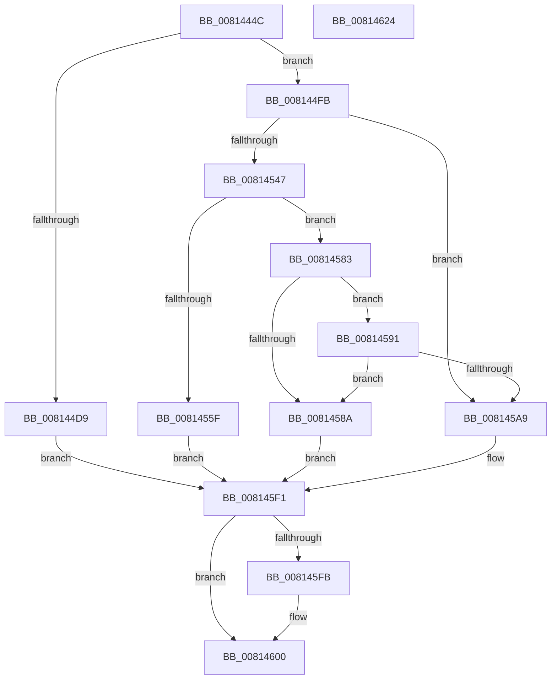

# SdbpCheckMatchingRegistryEntry

- RVA: `0x0081444C`–`0x00814625` (길이 `473` bytes)
- VA: `0x000000014081444C`
- 실행 섹션: `PAGE`
- PDB 이름 있음: `예`; PDB Function 태그: `아니요`
- unwind 정보 RVA: `0x000D9A0C`
- 디코드: `116`개 명령, `473/473` bytes 표시
- 미해석 바이트: `0` (있으면 어셈블리에 `.byte`로 보존)

> 이 문서는 커널 이미지의 기계어와 PDB 기호를 분석해 생성했습니다. 4번과 5번은 함수 원형과 자료형을 바이너리 사용 방식에서 추정한 C 해석이며 원본 소스 복구 결과는 아닙니다.

## 1. Dependencies

- 직접 호출 지점: **10**; 고유 호출 대상: **8**
- 직접 호출자로 확인된 함수: **1**
- RIP 상대 이미지 참조: **5**

### Outgoing calls
- `0x008144D0` → [RtlStringCchPrintfW](../../text/48/RtlStringCchPrintfW_function_00482D5C.md) (function, `0x00482D5C`)
- `0x008144F1` → [AslLogCallPrintf](../95/AslLogCallPrintf_function_0095E4EC.md) (function, `0x0095E4EC`)
- `0x00814503` → [RtlInitUnicodeString](../../text/42/RtlInitUnicodeString_function_0042A780.md) (function, `0x0042A780`)
- `0x0081453E` → [ZwOpenKey](../../text/6A/ZwOpenKey_function_006AD310.md) (function, `0x006AD310`)
- `0x00814556` → [ZwQuerySystemInformation](../../text/6A/ZwQuerySystemInformation_function_006AD790.md) (function, `0x006AD790`)
- `0x0081457C` → [AslLogCallPrintf](../95/AslLogCallPrintf_function_0095E4EC.md) (function, `0x0095E4EC`)
- `0x008145A0` → [ZwOpenKey](../../text/6A/ZwOpenKey_function_006AD310.md) (function, `0x006AD310`)
- `0x008145EA` → [SdbpCheckMatchingRegistryValue](SdbpCheckMatchingRegistryValue_function_0081462C.md) (function, `0x0081462C`)
- `0x008145FB` → [ZwClose](../../text/6A/ZwClose_function_006AD2B0.md) (function, `0x006AD2B0`)
- `0x0081460C` → [_security_check_cookie](../../text/6A/_security_check_cookie_function_006AC640.md) (function, `0x006AC640`)

### Direct callers
- [SdbpCheckMatchingRegistry](SdbpCheckMatchingRegistry_function_00814320.md) at `0x00814404`

### Static image references
- `0x00814467` → RVA `0x00E0A740` (`.data`; read)
- `0x008144A7` → RVA `0x0003C4B8` (`.rdata`; read)
- `0x008144D9` → RVA `0x0003C490` (`.rdata`; read)
- `0x008144E6` → RVA `0x0003C470` (`.rdata`; read)
- `0x0081455F` → RVA `0x0003C440` (`.rdata`; read)

## 2. Other-region calls and transfers

- 다른 실행 섹션으로 향하는 call: **7**
  - `0x008144D0` → [RtlStringCchPrintfW](../../text/48/RtlStringCchPrintfW_function_00482D5C.md) (`PAGE` → `.text`)
  - `0x00814503` → [RtlInitUnicodeString](../../text/42/RtlInitUnicodeString_function_0042A780.md) (`PAGE` → `.text`)
  - `0x0081453E` → [ZwOpenKey](../../text/6A/ZwOpenKey_function_006AD310.md) (`PAGE` → `.text`)
  - `0x00814556` → [ZwQuerySystemInformation](../../text/6A/ZwQuerySystemInformation_function_006AD790.md) (`PAGE` → `.text`)
  - `0x008145A0` → [ZwOpenKey](../../text/6A/ZwOpenKey_function_006AD310.md) (`PAGE` → `.text`)
  - `0x008145FB` → [ZwClose](../../text/6A/ZwClose_function_006AD2B0.md) (`PAGE` → `.text`)
  - `0x0081460C` → [_security_check_cookie](../../text/6A/_security_check_cookie_function_006AC640.md) (`PAGE` → `.text`)
- 별도 외부 분기/꼬리 이동을 확인하지 못했습니다.

## 3. Assembly (complete function range)

```asm
0081444C  40 55                           push rbp
0081444E  56                              push rsi
0081444F  57                              push rdi
00814450  41 54                           push r12
00814452  41 55                           push r13
00814454  41 56                           push r14
00814456  41 57                           push r15
00814458  48 8D AC 24 30 FE FF FF         lea rbp, [rsp - 0x1d0]
00814460  48 81 EC D0 02 00 00            sub rsp, 0x2d0
00814467  48 8B 05 D2 62 5F 00            mov rax, qword ptr [rip + 0x5f62d2]
0081446E  48 33 C4                        xor rax, rsp
00814471  48 89 85 C0 01 00 00            mov qword ptr [rbp + 0x1c0], rax
00814478  48 8B B5 50 02 00 00            mov rsi, qword ptr [rbp + 0x250]
0081447F  45 33 ED                        xor r13d, r13d
00814482  0F 57 C9                        xorps xmm1, xmm1
00814485  66 44 89 6D B0                  mov word ptr [rbp - 0x50], r13w
0081448A  33 C0                           xor eax, eax
0081448C  4C 89 6C 24 50                  mov qword ptr [rsp + 0x50], r13
00814491  4D 8B E1                        mov r12, r9
00814494  48 89 45 98                     mov qword ptr [rbp - 0x68], rax
00814498  45 8B F0                        mov r14d, r8d
0081449B  44 89 2E                        mov dword ptr [rsi], r13d
0081449E  4C 8B FA                        mov r15, rdx
008144A1  89 45 A0                        mov dword ptr [rbp - 0x60], eax
008144A4  0F 57 C0                        xorps xmm0, xmm0
008144A7  4C 8D 05 0A 80 82 FF            lea r8, [rip - 0x7d7ff6]
008144AE  4C 8B C9                        mov r9, rcx
008144B1  BA 04 01 00 00                  mov edx, 0x104
008144B6  48 8D 4D B0                     lea rcx, [rbp - 0x50]
008144BA  41 8B FD                        mov edi, r13d
008144BD  0F 11 45 88                     movups xmmword ptr [rbp - 0x78], xmm0
008144C1  0F 11 4C 24 58                  movups xmmword ptr [rsp + 0x58], xmm1
008144C6  0F 11 4C 24 68                  movups xmmword ptr [rsp + 0x68], xmm1
008144CB  0F 11 4C 24 78                  movups xmmword ptr [rsp + 0x78], xmm1
008144D0  E8 87 E8 C6 FF                  call 0x140482d5c
008144D5  85 C0                           test eax, eax
008144D7  79 22                           jns 0x1408144fb
008144D9  4C 8D 0D B0 7F 82 FF            lea r9, [rip - 0x7d8050]
008144E0  41 B8 D1 05 00 00               mov r8d, 0x5d1
008144E6  48 8D 15 83 7F 82 FF            lea rdx, [rip - 0x7d807d]
008144ED  41 8D 4D 01                     lea ecx, [r13 + 1]
008144F1  E8 F6 9F 14 00                  call 0x14095e4ec
008144F6  E9 F6 00 00 00                  jmp 0x1408145f1
008144FB  48 8D 55 B0                     lea rdx, [rbp - 0x50]
008144FF  48 8D 4D 88                     lea rcx, [rbp - 0x78]
00814503  E8 78 62 C1 FF                  call 0x14042a780
00814508  48 8D 45 88                     lea rax, [rbp - 0x78]
0081450C  C7 44 24 58 30 00 00 00         mov dword ptr [rsp + 0x58], 0x30
00814514  0F 57 C0                        xorps xmm0, xmm0
00814517  48 89 44 24 68                  mov qword ptr [rsp + 0x68], rax
0081451C  4C 8D 44 24 58                  lea r8, [rsp + 0x58]
00814521  4C 89 6C 24 60                  mov qword ptr [rsp + 0x60], r13
00814526  BA 19 00 02 00                  mov edx, 0x20019
0081452B  C7 44 24 70 40 02 00 00         mov dword ptr [rsp + 0x70], 0x240
00814533  48 8D 4C 24 50                  lea rcx, [rsp + 0x50]
00814538  F3 0F 7F 44 24 78               movdqu xmmword ptr [rsp + 0x78], xmm0
0081453E  E8 CD 8D E9 FF                  call 0x1406ad310
00814543  85 C0                           test eax, eax
00814545  79 62                           jns 0x1408145a9
00814547  45 33 C9                        xor r9d, r9d
0081454A  48 8D 55 98                     lea rdx, [rbp - 0x68]
0081454E  45 8D 41 0C                     lea r8d, [r9 + 0xc]
00814552  41 8D 49 01                     lea ecx, [r9 + 1]
00814556  E8 35 92 E9 FF                  call 0x1406ad790
0081455B  85 C0                           test eax, eax
0081455D  79 24                           jns 0x140814583
0081455F  4C 8D 0D DA 7E 82 FF            lea r9, [rip - 0x7d8126]
00814566  89 44 24 20                     mov dword ptr [rsp + 0x20], eax
0081456A  41 B8 F4 05 00 00               mov r8d, 0x5f4
00814570  48 8D 15 F9 7E 82 FF            lea rdx, [rip - 0x7d8107]
00814577  B9 01 00 00 00                  mov ecx, 1
0081457C  E8 6B 9F 14 00                  call 0x14095e4ec
00814581  EB 6E                           jmp 0x1408145f1
00814583  66 83 7D 98 09                  cmp word ptr [rbp - 0x68], 9
00814588  74 07                           je 0x140814591
0081458A  BF 01 00 00 00                  mov edi, 1
0081458F  EB 60                           jmp 0x1408145f1
00814591  4C 8D 44 24 58                  lea r8, [rsp + 0x58]
00814596  BA 19 02 02 00                  mov edx, 0x20219
0081459B  48 8D 4C 24 50                  lea rcx, [rsp + 0x50]
008145A0  E8 6B 8D E9 FF                  call 0x1406ad310
008145A5  85 C0                           test eax, eax
008145A7  78 E1                           js 0x14081458a
008145A9  48 8B 85 48 02 00 00            mov rax, qword ptr [rbp + 0x248]
008145B0  4D 8B CC                        mov r9, r12
008145B3  48 8B 4C 24 50                  mov rcx, qword ptr [rsp + 0x50]
008145B8  45 8B C6                        mov r8d, r14d
008145BB  48 89 74 24 40                  mov qword ptr [rsp + 0x40], rsi
008145C0  49 8B D7                        mov rdx, r15
008145C3  48 89 44 24 38                  mov qword ptr [rsp + 0x38], rax
008145C8  48 8B 85 40 02 00 00            mov rax, qword ptr [rbp + 0x240]
008145CF  48 89 44 24 30                  mov qword ptr [rsp + 0x30], rax
008145D4  48 8B 85 38 02 00 00            mov rax, qword ptr [rbp + 0x238]
008145DB  48 89 44 24 28                  mov qword ptr [rsp + 0x28], rax
008145E0  8B 85 30 02 00 00               mov eax, dword ptr [rbp + 0x230]
008145E6  89 44 24 20                     mov dword ptr [rsp + 0x20], eax
008145EA  E8 3D 00 00 00                  call 0x14081462c
008145EF  8B F8                           mov edi, eax
008145F1  48 8B 4C 24 50                  mov rcx, qword ptr [rsp + 0x50]
008145F6  48 85 C9                        test rcx, rcx
008145F9  74 05                           je 0x140814600
008145FB  E8 B0 8C E9 FF                  call 0x1406ad2b0
00814600  8B C7                           mov eax, edi
00814602  48 8B 8D C0 01 00 00            mov rcx, qword ptr [rbp + 0x1c0]
00814609  48 33 CC                        xor rcx, rsp
0081460C  E8 2F 80 E9 FF                  call 0x1406ac640
00814611  48 81 C4 D0 02 00 00            add rsp, 0x2d0
00814618  41 5F                           pop r15
0081461A  41 5E                           pop r14
0081461C  41 5D                           pop r13
0081461E  41 5C                           pop r12
00814620  5F                              pop rdi
00814621  5E                              pop rsi
00814622  5D                              pop rbp
00814623  C3                              ret
00814624  CC                              int3
```

## 4. C-style interpretation (structured pseudocode)

```c
__int64 __fastcall SdbpCheckMatchingRegistryEntry(__int64 a1, __int64 a2, int a3, __int64 a4, unsigned int a5, __int64 a6, __int64 a7, __int64 a8, __int64 a9)
{
    __int64 result;
    __int64 v_r13;
    __int64 v_rsp;
    unsigned __int64 v_stack_m208;
    unsigned __int16 v_stack_m258;
    unsigned int v_stack_m268;
    unsigned __int64 v_stack_m270;
    unsigned __int64 v_stack_m280;
    unsigned __int64 v_stack_m290;
    unsigned int v_stack_m298;
    unsigned __int64 v_stack_m2A0;
    unsigned __int64 v_stack_m2A8;
    unsigned __int64 v_stack_m2B0;
    unsigned __int64 v_stack_m2B8;
    unsigned __int64 v_stack_m2C8;
    unsigned __int64 v_stack_m2D0;
    unsigned __int64 v_stack_m2D8;
    unsigned __int64 v_stack_m2E0;
    unsigned int v_stack_m2E8;
    unsigned __int64 v_stack_m48;

    v_rsp = (v_rsp) - (720);
    result = (*(unsigned __int64 *)(v_rip + 6251218)) ^ (v_rsp);
    v_stack_m48 = result;
    v_r13 = 0;
    v_stack_m258 = 0;
    result = 0;
    v_stack_m2B8 = 0;
    v_stack_m270 = 0;
    *(unsigned int *)(a9) = 0;
    v_stack_m268 = 0;
    v_stack_m280 = v_xmm0;
    v_stack_m2B0 = v_xmm1;
    v_stack_m2A0 = v_xmm1;
    v_stack_m290 = v_xmm1;
    result = RtlStringCchPrintfW(v_stack_m258, 260, v_rip - 8224758, a1);
    if (!sign_flag) goto loc_008144FB;
    result = AslLogCallPrintf(v_r13 + 1, v_rip - 8224893, (unsigned int)(0x5D1ULL), v_rip - 8224848);
    goto loc_008145F1;
loc_008144FB:
    result = RtlInitUnicodeString(v_stack_m280, v_stack_m258, (unsigned int)(0x5D1ULL), v_rip - 8224848);
    v_stack_m2B0 = 48;
    v_stack_m2A0 = v_stack_m280;
    v_stack_m2A8 = 0;
    v_stack_m298 = 576;
    v_stack_m290 = v_xmm0;
    result = ZwOpenKey(v_stack_m2B8, (unsigned int)(0x20019ULL), v_stack_m2B0, v_rip - 8224848);
    if (!sign_flag) goto loc_008145A9;
    a4 = 0;
    result = ZwQuerySystemInformation(a4 + 1, v_stack_m270, a4 + 12, a4);
    if (!sign_flag) goto loc_00814583;
    v_stack_m2E8 = (unsigned int)(result);
    result = AslLogCallPrintf(1, v_rip - 8225031, (unsigned int)(0x5F4ULL), v_rip - 8225062);
    goto loc_008145F1;
loc_00814583:
    if (v_stack_m270 == 9) goto loc_00814591;
loc_0081458A:
    goto loc_008145F1;
loc_00814591:
    result = ZwOpenKey(v_stack_m2B8, (unsigned int)(0x20219ULL), v_stack_m2B0, v_rip - 8225062);
    if (sign_flag) goto loc_0081458A;
loc_008145A9:
    v_stack_m2C8 = a9;
    v_stack_m2D0 = a8;
    v_stack_m2D8 = a7;
    v_stack_m2E0 = a6;
    v_stack_m2E8 = (unsigned int)((unsigned int)(a5));
    result = SdbpCheckMatchingRegistryValue(v_stack_m2B8, a2, (unsigned int)((unsigned int)((unsigned int)(a3))), 0);
loc_008145F1:
    if (v_stack_m2B8 != 0) {
        result = ZwClose(v_stack_m2B8, a2, (unsigned int)((unsigned int)((unsigned int)(a3))), 0);
    }
    a1 = (v_stack_m48) ^ (v_rsp);
    result = _security_check_cookie(a1, a2, (unsigned int)((unsigned int)((unsigned int)(a3))), 0);
    v_rsp = (v_rsp) + (720);
    return result;
}
```

## 5. (Beta) C Style

```c
int64_t SdbpCheckMatchingRegistryEntry(int64_t Arg1, int64_t Arg2, int32_t Arg3, int64_t Arg4, uint32_t Arg5, int64_t Arg6, int64_t Arg7, int64_t Arg8, void *Arg9)
{
    uint8_t *arg9 = (uint8_t *)Arg9;

    int64_t result;
    int64_t local_r13;
    int64_t local_rsp;
    uint64_t v_stack_m208;
    uint16_t v_stack_m258;
    uint32_t v_stack_m268;
    uint64_t v_stack_m270;
    uint64_t v_stack_m280;
    uint64_t v_stack_m290;
    uint32_t v_stack_m298;
    uint64_t v_stack_m2A0;
    uint64_t v_stack_m2A8;
    uint64_t v_stack_m2B0;
    uint64_t v_stack_m2B8;
    uint64_t v_stack_m2C8;
    uint64_t v_stack_m2D0;
    uint64_t v_stack_m2D8;
    uint64_t v_stack_m2E0;
    uint32_t v_stack_m2E8;
    uint64_t v_stack_m48;

    local_rsp = (local_rsp) - (720);
    result = (*(uint64_t *)(v_rip + 0x5F62D2)) ^ (local_rsp);
    v_stack_m48 = result;
    local_r13 = 0;
    v_stack_m258 = 0;
    result = 0;
    v_stack_m2B8 = 0;
    v_stack_m270 = 0;
    *(uint32_t *)(arg9) = 0;
    v_stack_m268 = 0;
    v_stack_m280 = v_xmm0;
    v_stack_m2B0 = v_xmm1;
    v_stack_m2A0 = v_xmm1;
    v_stack_m290 = v_xmm1;
    result = RtlStringCchPrintfW(v_stack_m258, 260, v_rip - 8224758, Arg1);
    if (!sign_flag) goto loc_008144FB;
    result = AslLogCallPrintf(local_r13 + 1, v_rip - 8224893, (uint32_t)(0x5D1ULL), v_rip - 8224848);
    goto loc_008145F1;
loc_008144FB:
    result = RtlInitUnicodeString(v_stack_m280, v_stack_m258, (uint32_t)(0x5D1ULL), v_rip - 8224848);
    v_stack_m2B0 = 48;
    v_stack_m2A0 = v_stack_m280;
    v_stack_m2A8 = 0;
    v_stack_m298 = 576;
    v_stack_m290 = v_xmm0;
    result = ZwOpenKey(v_stack_m2B8, (uint32_t)(0x20019ULL), v_stack_m2B0, v_rip - 8224848);
    if (!sign_flag) goto loc_008145A9;
    Arg4 = 0;
    result = ZwQuerySystemInformation(Arg4 + 1, v_stack_m270, Arg4 + 12, Arg4);
    if (!sign_flag) goto loc_00814583;
    v_stack_m2E8 = (uint32_t)(result);
    result = AslLogCallPrintf(1, v_rip - 8225031, (uint32_t)(0x5F4ULL), v_rip - 8225062);
    goto loc_008145F1;
loc_00814583:
    if (v_stack_m270 == 9) goto loc_00814591;
loc_0081458A:
    goto loc_008145F1;
loc_00814591:
    result = ZwOpenKey(v_stack_m2B8, (uint32_t)(0x20219ULL), v_stack_m2B0, v_rip - 8225062);
    if (sign_flag) goto loc_0081458A;
loc_008145A9:
    v_stack_m2C8 = Arg9;
    v_stack_m2D0 = Arg8;
    v_stack_m2D8 = Arg7;
    v_stack_m2E0 = Arg6;
    v_stack_m2E8 = (uint32_t)((uint32_t)(Arg5));
    result = SdbpCheckMatchingRegistryValue(v_stack_m2B8, Arg2, (uint32_t)((uint32_t)((uint32_t)(Arg3))), 0);
loc_008145F1:
    if (v_stack_m2B8 != 0) {
        result = ZwClose(v_stack_m2B8, Arg2, (uint32_t)((uint32_t)((uint32_t)(Arg3))), 0);
    }
    Arg1 = (v_stack_m48) ^ (local_rsp);
    result = _security_check_cookie(Arg1, Arg2, (uint32_t)((uint32_t)((uint32_t)(Arg3))), 0);
    local_rsp = (local_rsp) + (720);
    return result;
}
```

### 관측된 메모리 오프셋

구조체 형식이 확인되지 않은 접근은 인자 기준의 오프셋으로만 기록했습니다.

| 기준 인자 | 오프셋 표현 | 폭 (bit) | 접근 |
|---|---:|---:|---|
| `Arg9` | `+ 0x0` | `32` | `W` |

## 6. Execution-region graph

[열기: 2D/3D 그래프와 함수 탐색 컨트롤 패널](../../../control-panel.html?section=page&rva=0x0081444C&view=graph)

- 2D 그래프는 위에서 아래로 흐르고, 3D 그래프는 빈 공간을 드래그해 회전합니다. Shift+드래그는 이동, 휠은 확대·축소, 함수 노드 선택은 대상 보고서 이동입니다.

### Static fallback


