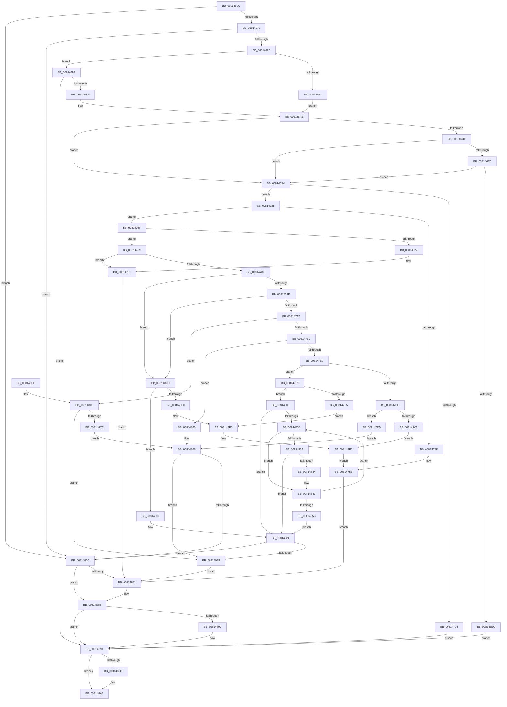

# SdbpCheckMatchingRegistryValue

- RVA: `0x0081462C`–`0x0081493F` (길이 `787` bytes)
- VA: `0x000000014081462C`
- 실행 섹션: `PAGE`
- PDB 이름 있음: `예`; PDB Function 태그: `아니요`
- unwind 정보 RVA: `0x000D9A30`
- 디코드: `215`개 명령, `787/787` bytes 표시
- 미해석 바이트: `0` (있으면 어셈블리에 `.byte`로 보존)

> 이 문서는 커널 이미지의 기계어와 PDB 기호를 분석해 생성했습니다. 4번과 5번은 함수 원형과 자료형을 바이너리 사용 방식에서 추정한 C 해석이며 원본 소스 복구 결과는 아닙니다.

## 1. Dependencies

- 직접 호출 지점: **17**; 고유 호출 대상: **10**
- 직접 호출자로 확인된 함수: **2**
- RIP 상대 이미지 참조: **5**

### Outgoing calls
- `0x00814686` → [wcsicmp](../../text/50/wcsicmp_function_00500080.md) (function, `0x00500080`)
- `0x0081469A` → [AslStringDuplicate](../95/AslStringDuplicate_function_00958604.md) (function, `0x00958604`)
- `0x008146B2` → [RtlInitUnicodeString](../../text/42/RtlInitUnicodeString_function_0042A780.md) (function, `0x0042A780`)
- `0x008146D5` → [ZwQueryValueKey](../../text/6A/ZwQueryValueKey_function_006AD3B0.md) (function, `0x006AD3B0`)
- `0x008146F7` → [AslAlloc](../95/AslAlloc_function_0095BD34.md) (function, `0x0095BD34`)
- `0x0081471B` → [AslLogCallPrintf](../95/AslLogCallPrintf_function_0095E4EC.md) (function, `0x0095E4EC`)
- `0x00814742` → [ZwQueryValueKey](../../text/6A/ZwQueryValueKey_function_006AD3B0.md) (function, `0x006AD3B0`)
- `0x00814765` → [AslLogCallPrintf](../95/AslLogCallPrintf_function_0095E4EC.md) (function, `0x0095E4EC`)
- `0x008147E8` → [AslAlloc](../95/AslAlloc_function_0095BD34.md) (function, `0x0095BD34`)
- `0x0081480A` → [memcpy](../../text/6C/memcpy_function_006C6840.md) (function, `0x006C6840`)
- `0x00814886` → [AslFree](../95/AslFree_function_0095B674.md) (function, `0x0095B674`)
- `0x00814893` → [AslFree](../95/AslFree_function_0095B674.md) (function, `0x0095B674`)
- `0x008148A0` → [AslFree](../95/AslFree_function_0095B674.md) (function, `0x0095B674`)
- `0x008148D3` → [memcmp](../../text/6C/memcmp_function_006C6B10.md) (function, `0x006C6B10`)
- `0x008148E3` → [AslAlloc](../95/AslAlloc_function_0095BD34.md) (function, `0x0095BD34`)
- `0x00814911` → [memcpy](../../text/6C/memcpy_function_006C6840.md) (function, `0x006C6840`)
- `0x00814928` → [AslStringPatternMatchExW](../95/AslStringPatternMatchExW_function_0095E850.md) (function, `0x0095E850`)

### Direct callers
- [SdbpCheckMatchingRegistryEntry](SdbpCheckMatchingRegistryEntry_function_0081444C.md) at `0x008145EA`
- [SdbpCheckMatchingWildcardRegistryEntry](SdbpCheckMatchingWildcardRegistryEntry_function_0081523C.md) at `0x008152D0`

### Static image references
- `0x0081467C` → RVA `0x0003C568` (`.rdata`; read)
- `0x00814704` → RVA `0x0003C548` (`.rdata`; read)
- `0x00814711` → RVA `0x0003C528` (`.rdata`; read)
- `0x0081474E` → RVA `0x0003C510` (`.rdata`; read)
- `0x008147C3` → RVA `0x0003C4E8` (`.rdata`; read)

## 2. Other-region calls and transfers

- 다른 실행 섹션으로 향하는 call: **7**
  - `0x00814686` → [wcsicmp](../../text/50/wcsicmp_function_00500080.md) (`PAGE` → `.text`)
  - `0x008146B2` → [RtlInitUnicodeString](../../text/42/RtlInitUnicodeString_function_0042A780.md) (`PAGE` → `.text`)
  - `0x008146D5` → [ZwQueryValueKey](../../text/6A/ZwQueryValueKey_function_006AD3B0.md) (`PAGE` → `.text`)
  - `0x00814742` → [ZwQueryValueKey](../../text/6A/ZwQueryValueKey_function_006AD3B0.md) (`PAGE` → `.text`)
  - `0x0081480A` → [memcpy](../../text/6C/memcpy_function_006C6840.md) (`PAGE` → `.text`)
  - `0x008148D3` → [memcmp](../../text/6C/memcmp_function_006C6B10.md) (`PAGE` → `.text`)
  - `0x00814911` → [memcpy](../../text/6C/memcpy_function_006C6840.md) (`PAGE` → `.text`)
- 별도 외부 분기/꼬리 이동을 확인하지 못했습니다.

## 3. Assembly (complete function range)

```asm
0081462C  48 89 5C 24 08                  mov qword ptr [rsp + 8], rbx
00814631  4C 89 4C 24 20                  mov qword ptr [rsp + 0x20], r9
00814636  55                              push rbp
00814637  56                              push rsi
00814638  57                              push rdi
00814639  41 54                           push r12
0081463B  41 55                           push r13
0081463D  41 56                           push r14
0081463F  41 57                           push r15
00814641  48 8B EC                        mov rbp, rsp
00814644  48 83 EC 50                     sub rsp, 0x50
00814648  33 C0                           xor eax, eax
0081464A  0F 57 C0                        xorps xmm0, xmm0
0081464D  48 89 45 E0                     mov qword ptr [rbp - 0x20], rax
00814651  45 8B E0                        mov r12d, r8d
00814654  89 45 48                        mov dword ptr [rbp + 0x48], eax
00814657  4C 8B F2                        mov r14, rdx
0081465A  4C 8B E9                        mov r13, rcx
0081465D  44 8B F8                        mov r15d, eax
00814660  8B F0                           mov esi, eax
00814662  8B D8                           mov ebx, eax
00814664  8B F8                           mov edi, eax
00814666  0F 11 45 E8                     movups xmmword ptr [rbp - 0x18], xmm0
0081466A  48 85 D2                        test rdx, rdx
0081466D  0F 84 F9 01 00 00               je 0x14081486c
00814673  66 39 02                        cmp word ptr [rdx], ax
00814676  0F 84 F0 01 00 00               je 0x14081486c
0081467C  48 8D 15 E5 7E 82 FF            lea rdx, [rip - 0x7d811b]
00814683  49 8B CE                        mov rcx, r14
00814686  E8 F5 B9 CE FF                  call 0x140500080
0081468B  85 C0                           test eax, eax
0081468D  75 04                           jne 0x140814693
0081468F  33 D2                           xor edx, edx
00814691  EB 1B                           jmp 0x1408146ae
00814693  49 8B D6                        mov rdx, r14
00814696  48 8D 4D E0                     lea rcx, [rbp - 0x20]
0081469A  E8 65 3F 14 00                  call 0x140958604
0081469F  4C 8B 7D E0                     mov r15, qword ptr [rbp - 0x20]
008146A3  85 C0                           test eax, eax
008146A5  0F 88 ED 01 00 00               js 0x140814898
008146AB  49 8B D7                        mov rdx, r15
008146AE  48 8D 4D E8                     lea rcx, [rbp - 0x18]
008146B2  E8 C9 60 C1 FF                  call 0x14042a780
008146B7  45 33 C9                        xor r9d, r9d
008146BA  48 8D 45 48                     lea rax, [rbp + 0x48]
008146BE  48 89 44 24 28                  mov qword ptr [rsp + 0x28], rax
008146C3  48 8D 55 E8                     lea rdx, [rbp - 0x18]
008146C7  21 5C 24 20                     and dword ptr [rsp + 0x20], ebx
008146CB  49 8B CD                        mov rcx, r13
008146CE  45 8D 71 01                     lea r14d, [r9 + 1]
008146D2  45 8B C6                        mov r8d, r14d
008146D5  E8 D6 8C E9 FF                  call 0x1406ad3b0
008146DA  85 C0                           test eax, eax
008146DC  79 16                           jns 0x1408146f4
008146DE  3D 05 00 00 80                  cmp eax, 0x80000005
008146E3  74 0F                           je 0x1408146f4
008146E5  3D 23 00 00 C0                  cmp eax, 0xc0000023
008146EA  74 08                           je 0x1408146f4
008146EC  41 8B FE                        mov edi, r14d
008146EF  E9 A4 01 00 00                  jmp 0x140814898
008146F4  8B 55 48                        mov edx, dword ptr [rbp + 0x48]
008146F7  E8 38 76 14 00                  call 0x14095bd34
008146FC  48 8B D8                        mov rbx, rax
008146FF  48 85 C0                        test rax, rax
00814702  75 21                           jne 0x140814725
00814704  4C 8D 0D 3D 7E 82 FF            lea r9, [rip - 0x7d81c3]
0081470B  41 B8 B5 04 00 00               mov r8d, 0x4b5
00814711  48 8D 15 10 7E 82 FF            lea rdx, [rip - 0x7d81f0]
00814718  41 8B CE                        mov ecx, r14d
0081471B  E8 CC 9D 14 00                  call 0x14095e4ec
00814720  E9 73 01 00 00                  jmp 0x140814898
00814725  48 8D 45 48                     lea rax, [rbp + 0x48]
00814729  4C 8B CB                        mov r9, rbx
0081472C  48 89 44 24 28                  mov qword ptr [rsp + 0x28], rax
00814731  48 8D 55 E8                     lea rdx, [rbp - 0x18]
00814735  8B 45 48                        mov eax, dword ptr [rbp + 0x48]
00814738  45 8B C6                        mov r8d, r14d
0081473B  49 8B CD                        mov rcx, r13
0081473E  89 44 24 20                     mov dword ptr [rsp + 0x20], eax
00814742  E8 69 8C E9 FF                  call 0x1406ad3b0
00814747  45 33 ED                        xor r13d, r13d
0081474A  85 C0                           test eax, eax
0081474C  79 21                           jns 0x14081476f
0081474E  4C 8D 0D BB 7D 82 FF            lea r9, [rip - 0x7d8245]
00814755  41 B8 C0 04 00 00               mov r8d, 0x4c0
0081475B  41 8B CE                        mov ecx, r14d
0081475E  48 8D 15 C3 7D 82 FF            lea rdx, [rip - 0x7d823d]
00814765  E8 82 9D 14 00                  call 0x14095e4ec
0081476A  E9 14 01 00 00                  jmp 0x140814883
0081476F  8B 43 04                        mov eax, dword ptr [rbx + 4]
00814772  45 85 E4                        test r12d, r12d
00814775  75 12                           jne 0x140814789
00814777  48 8B 85 80 00 00 00            mov rax, qword ptr [rbp + 0x80]
0081477E  44 89 30                        mov dword ptr [rax], r14d
00814781  41 8B FE                        mov edi, r14d
00814784  E9 FA 00 00 00                  jmp 0x140814883
00814789  41 3B C4                        cmp eax, r12d
0081478C  75 F3                           jne 0x140814781
0081478E  44 8B 73 08                     mov r14d, dword ptr [rbx + 8]
00814792  4C 03 F3                        add r14, rbx
00814795  83 E8 01                        sub eax, 1
00814798  0F 84 3E 01 00 00               je 0x1408148dc
0081479E  83 E8 01                        sub eax, 1
008147A1  0F 84 35 01 00 00               je 0x1408148dc
008147A7  83 E8 01                        sub eax, 1
008147AA  0F 84 10 01 00 00               je 0x1408148c0
008147B0  83 E8 01                        sub eax, 1
008147B3  0F 84 A7 00 00 00               je 0x140814860
008147B9  83 E8 03                        sub eax, 3
008147BC  74 23                           je 0x1408147e1
008147BE  83 F8 04                        cmp eax, 4
008147C1  74 12                           je 0x1408147d5
008147C3  4C 8D 0D 1E 7D 82 FF            lea r9, [rip - 0x7d82e2]
008147CA  41 B8 47 05 00 00               mov r8d, 0x547
008147D0  E9 28 01 00 00                  jmp 0x1408148fd
008147D5  49 8B 06                        mov rax, qword ptr [r14]
008147D8  48 39 45 68                     cmp qword ptr [rbp + 0x68], rax
008147DC  E9 85 00 00 00                  jmp 0x140814866
008147E1  8B 53 0C                        mov edx, dword ptr [rbx + 0xc]
008147E4  48 83 C2 02                     add rdx, 2
008147E8  E8 47 75 14 00                  call 0x14095bd34
008147ED  48 8B F0                        mov rsi, rax
008147F0  48 85 C0                        test rax, rax
008147F3  75 0B                           jne 0x140814800
008147F5  41 B8 FC 04 00 00               mov r8d, 0x4fc
008147FB  E9 F6 00 00 00                  jmp 0x1408148f6
00814800  44 8B 43 0C                     mov r8d, dword ptr [rbx + 0xc]
00814804  49 8B D6                        mov rdx, r14
00814807  48 8B CE                        mov rcx, rsi
0081480A  E8 31 20 EB FF                  call 0x1406c6840
0081480F  8B 43 0C                        mov eax, dword ptr [rbx + 0xc]
00814812  48 8B CE                        mov rcx, rsi
00814815  48 D1 E8                        shr rax, 1
00814818  66 44 89 2C 46                  mov word ptr [rsi + rax*2], r13w
0081481D  8B 43 0C                        mov eax, dword ptr [rbx + 0xc]
00814820  48 83 E0 FE                     and rax, 0xfffffffffffffffe
00814824  48 03 C6                        add rax, rsi
00814827  48 3B F0                        cmp rsi, rax
0081482A  0F 83 F1 00 00 00               jae 0x140814921
00814830  48 8D 41 02                     lea rax, [rcx + 2]
00814834  66 44 39 29                     cmp word ptr [rcx], r13w
00814838  75 0F                           jne 0x140814849
0081483A  66 44 39 28                     cmp word ptr [rax], r13w
0081483E  0F 84 DD 00 00 00               je 0x140814921
00814844  66 C7 01 3B 00                  mov word ptr [rcx], 0x3b
00814849  48 8B C8                        mov rcx, rax
0081484C  8B 43 0C                        mov eax, dword ptr [rbx + 0xc]
0081484F  48 83 E0 FE                     and rax, 0xfffffffffffffffe
00814853  48 03 C6                        add rax, rsi
00814856  48 3B C8                        cmp rcx, rax
00814859  72 D5                           jb 0x140814830
0081485B  E9 C1 00 00 00                  jmp 0x140814921
00814860  41 8B 06                        mov eax, dword ptr [r14]
00814863  39 45 60                        cmp dword ptr [rbp + 0x60], eax
00814866  0F 85 C9 00 00 00               jne 0x140814935
0081486C  48 8B 85 80 00 00 00            mov rax, qword ptr [rbp + 0x80]
00814873  C7 00 01 00 00 00               mov dword ptr [rax], 1
00814879  BF 01 00 00 00                  mov edi, 1
0081487E  48 85 DB                        test rbx, rbx
00814881  74 08                           je 0x14081488b
00814883  48 8B D3                        mov rdx, rbx
00814886  E8 E9 6D 14 00                  call 0x14095b674
0081488B  48 85 F6                        test rsi, rsi
0081488E  74 08                           je 0x140814898
00814890  48 8B D6                        mov rdx, rsi
00814893  E8 DC 6D 14 00                  call 0x14095b674
00814898  4D 85 FF                        test r15, r15
0081489B  74 08                           je 0x1408148a5
0081489D  49 8B D7                        mov rdx, r15
008148A0  E8 CF 6D 14 00                  call 0x14095b674
008148A5  48 8B 9C 24 90 00 00 00         mov rbx, qword ptr [rsp + 0x90]
008148AD  8B C7                           mov eax, edi
008148AF  48 83 C4 50                     add rsp, 0x50
008148B3  41 5F                           pop r15
008148B5  41 5E                           pop r14
008148B7  41 5D                           pop r13
008148B9  41 5C                           pop r12
008148BB  5F                              pop rdi
008148BC  5E                              pop rsi
008148BD  5D                              pop rbp
008148BE  C3                              ret
008148BF  CC                              int3
008148C0  8B 43 0C                        mov eax, dword ptr [rbx + 0xc]
008148C3  4C 8B 45 78                     mov r8, qword ptr [rbp + 0x78]
008148C7  4C 3B C0                        cmp r8, rax
008148CA  75 69                           jne 0x140814935
008148CC  48 8B 4D 70                     mov rcx, qword ptr [rbp + 0x70]
008148D0  49 8B D6                        mov rdx, r14
008148D3  E8 38 22 EB FF                  call 0x1406c6b10
008148D8  85 C0                           test eax, eax
008148DA  EB 8A                           jmp 0x140814866
008148DC  8B 53 0C                        mov edx, dword ptr [rbx + 0xc]
008148DF  48 83 C2 02                     add rdx, 2
008148E3  E8 4C 74 14 00                  call 0x14095bd34
008148E8  48 8B F0                        mov rsi, rax
008148EB  48 85 C0                        test rax, rax
008148EE  75 17                           jne 0x140814907
008148F0  41 B8 E5 04 00 00               mov r8d, 0x4e5
008148F6  4C 8D 0D 4B 7C 82 FF            lea r9, [rip - 0x7d83b5]
008148FD  B9 01 00 00 00                  mov ecx, 1
00814902  E9 57 FE FF FF                  jmp 0x14081475e
00814907  44 8B 43 0C                     mov r8d, dword ptr [rbx + 0xc]
0081490B  49 8B D6                        mov rdx, r14
0081490E  48 8B CE                        mov rcx, rsi
00814911  E8 2A 1F EB FF                  call 0x1406c6840
00814916  8B 43 0C                        mov eax, dword ptr [rbx + 0xc]
00814919  48 D1 E8                        shr rax, 1
0081491C  66 44 89 2C 46                  mov word ptr [rsi + rax*2], r13w
00814921  48 8B 4D 58                     mov rcx, qword ptr [rbp + 0x58]
00814925  48 8B D6                        mov rdx, rsi
00814928  E8 23 9F 14 00                  call 0x14095e850
0081492D  85 C0                           test eax, eax
0081492F  0F 85 37 FF FF FF               jne 0x14081486c
00814935  BF 01 00 00 00                  mov edi, 1
0081493A  E9 44 FF FF FF                  jmp 0x140814883
```

## 4. C-style interpretation (structured pseudocode)

```c
__int64 __fastcall SdbpCheckMatchingRegistryValue(__int64 a1, __int64 a2, int a3, __int64 a4, unsigned int a5, __int64 a6, __int64 a7, __int64 a8, __int64 a9)
{
    __int64 result;
    __int64 v_r13;
    __int64 v_r14;
    __int64 v_rsp;
    unsigned __int64 v_stack_m50;
    unsigned __int64 v_stack_m58;
    unsigned __int64 v_stack_m60;
    unsigned int v_stack_m68;
    unsigned int v_stack_p10;
    unsigned __int64 v_stack_p20;
    unsigned __int64 v_stack_p8;

    v_stack_p8 = v_rbx;
    v_stack_p20 = a4;
    v_rsp = (v_rsp) - (80);
    result = 0;
    v_stack_m58 = 0;
    v_stack_p10 = 0;
    v_stack_m50 = v_xmm0;
    if (a2 == 0) goto loc_0081486C;
    if ((*(unsigned __int16 *)(a2)) == 0) goto loc_0081486C;
    result = wcsicmp(a2, v_rip - 8225051, a3, a4);
    if ((unsigned int)(result) != 0) goto loc_00814693;
    a2 = 0;
    goto loc_008146AE;
loc_00814693:
    result = AslStringDuplicate(v_stack_m58, 0, a3, a4);
    if (sign_flag) goto loc_00814898;
loc_008146AE:
    result = RtlInitUnicodeString(v_stack_m50, v_stack_m58, a3, a4);
    a4 = 0;
    v_stack_m60 = v_stack_p10;
    result = ZwQueryValueKey(a1, v_stack_m50, (unsigned int)((unsigned int)(a4 + 1)), a4);
    if (!sign_flag) goto loc_008146F4;
    if (((unsigned int)(result)) == 0x80000005ULL) goto loc_008146F4;
    if (((unsigned int)(result)) == 0xC0000023ULL) goto loc_008146F4;
    goto loc_00814898;
loc_008146F4:
    result = AslAlloc(a1, (unsigned int)(v_stack_p10), (unsigned int)((unsigned int)(a4 + 1)), a4);
    if (result != 0) goto loc_00814725;
    result = AslLogCallPrintf((unsigned int)((unsigned int)(a4 + 1)), v_rip - 8225264, (unsigned int)(0x4B5ULL), v_rip - 8225219);
    goto loc_00814898;
loc_00814725:
    v_stack_m60 = v_stack_p10;
    v_stack_m68 = (unsigned int)((unsigned int)(v_stack_p10));
    result = ZwQueryValueKey(a1, v_stack_m50, (unsigned int)((unsigned int)(a4 + 1)), result);
    v_r13 = 0;
    if (!sign_flag) goto loc_0081476F;
loc_0081475E:
    result = AslLogCallPrintf((unsigned int)((unsigned int)(a4 + 1)), v_rip - 8225341, (unsigned int)(0x4C0ULL), v_rip - 8225349);
    goto loc_00814883;
loc_0081476F:
    if ((unsigned int)((unsigned int)(a3)) != 0) goto loc_00814789;
    *(unsigned int *)(a9) = (unsigned int)(a4 + 1);
loc_00814781:
    goto loc_00814883;
loc_00814789:
    if (((unsigned int)(a9)) != ((unsigned int)((unsigned int)(a3)))) goto loc_00814781;
    v_r14 = ((unsigned int)(*(unsigned int *)(result + 8))) + (result);
    result = (unsigned int)((a9) - (1));
    if (condition_is_equal) goto loc_008148DC;
    result = (unsigned int)((result) - (1));
    if (condition_is_equal) goto loc_008148DC;
    result = (unsigned int)((result) - (1));
    if (condition_is_equal) goto loc_008148C0;
    result = (unsigned int)((result) - (1));
    if (condition_is_equal) goto loc_00814860;
    result = (unsigned int)((result) - (3));
    if (condition_is_equal) goto loc_008147E1;
    if (((unsigned int)(result)) == 4) goto loc_008147D5;
    goto loc_008148FD;
loc_008147D5:
    goto loc_00814866;
loc_008147E1:
    a2 = ((unsigned int)(*(unsigned int *)(result + 12))) + (2);
    result = AslAlloc((unsigned int)((unsigned int)(a4 + 1)), a2, (unsigned int)(0x547ULL), v_rip - 8225506);
    if (result != 0) goto loc_00814800;
    goto loc_008148F6;
loc_00814800:
    result = memcpy(result, v_r14, (unsigned int)(*(unsigned int *)(result + 12)), v_rip - 8225506);
    result = ((unsigned int)(*(unsigned int *)(result + 12))) >> (1);
    *(unsigned __int16 *)(result + result * 2) = 0;
    result = ((unsigned int)(*(unsigned int *)(result + 12))) & (-2);
    result = (result) + (result);
    if (result >= result) goto loc_00814921;
loc_00814830:
    if ((*(unsigned __int16 *)(result)) != 0) goto loc_00814849;
    if ((*(unsigned __int16 *)(result + 2)) == 0) goto loc_00814921;
    *(unsigned __int16 *)(result) = 59;
loc_00814849:
    result = ((unsigned int)(*(unsigned int *)(result + 12))) & (-2);
    result = (result) + (result);
    if ((result + 2) < result) goto loc_00814830;
    goto loc_00814921;
loc_00814860:
loc_00814866:
    if (a5 != ((unsigned int)((unsigned int)(*(unsigned int *)(v_r14))))) goto loc_00814935;
loc_0081486C:
    *(unsigned int *)(a9) = 1;
    result = a9;
    if (result != 0) {
        a2 = result;
        result = AslFree(result + 2, a2, (unsigned int)(*(unsigned int *)(result + 12)), v_rip - 8225506);
    }
    if (result != 0) {
        a2 = result;
        result = AslFree(result + 2, a2, (unsigned int)(*(unsigned int *)(result + 12)), v_rip - 8225506);
    }
    if (v_stack_m58 != 0) {
        a2 = v_stack_m58;
        result = AslFree(result + 2, a2, (unsigned int)(*(unsigned int *)(result + 12)), v_rip - 8225506);
    }
    v_rsp = (v_rsp) + (80);
    return 1;
loc_008148C0:
    if (a8 != ((unsigned int)(*(unsigned int *)(v_stack_p8 + 12)))) goto loc_00814935;
    result = memcmp(a7, v_r14, a8, v_rip - 8225506);
    goto loc_00814866;
loc_008148DC:
    a2 = ((unsigned int)(*(unsigned int *)(v_stack_p8 + 12))) + (2);
    result = AslAlloc(a7, a2, a8, v_rip - 8225506);
    if (result != 0) goto loc_00814907;
loc_008148F6:
loc_008148FD:
    goto loc_0081475E;
loc_00814907:
    result = memcpy(result, v_r14, (unsigned int)(*(unsigned int *)(v_stack_p8 + 12)), v_rip - 8225717);
    result = ((unsigned int)(*(unsigned int *)(v_stack_p8 + 12))) >> (1);
    *(unsigned __int16 *)(result + result * 2) = 0;
loc_00814921:
    result = AslStringPatternMatchExW(v_stack_p20, result, (unsigned int)(*(unsigned int *)(v_stack_p8 + 12)), v_rip - 8225717);
    if ((unsigned int)(result) != 0) goto loc_0081486C;
loc_00814935:
    goto loc_00814883;
}
```

## 5. (Beta) C Style

```c
int64_t SdbpCheckMatchingRegistryValue(int64_t Arg1, int64_t Arg2, int32_t Arg3, int64_t Arg4, uint32_t Arg5, int64_t Arg6, int64_t Arg7, int64_t Arg8, void *Arg9)
{
    uint8_t *arg9 = (uint8_t *)Arg9;

    int64_t result;
    int64_t local_r13;
    int64_t local_r14;
    int64_t local_rsp;
    uint64_t v_stack_m50;
    uint64_t v_stack_m58;
    uint64_t v_stack_m60;
    uint32_t v_stack_m68;
    uint32_t v_stack_p10;
    uint64_t v_stack_p20;
    uint64_t v_stack_p8;

    v_stack_p8 = local_rbx;
    v_stack_p20 = Arg4;
    local_rsp = (local_rsp) - (80);
    result = 0;
    v_stack_m58 = 0;
    v_stack_p10 = 0;
    v_stack_m50 = v_xmm0;
    if (Arg2 == 0) goto loc_0081486C;
    if ((*(uint16_t *)(Arg2)) == 0) goto loc_0081486C;
    result = wcsicmp(Arg2, v_rip - 8225051, Arg3, Arg4);
    if ((uint32_t)(result) != 0) goto loc_00814693;
    Arg2 = 0;
    goto loc_008146AE;
loc_00814693:
    result = AslStringDuplicate(v_stack_m58, 0, Arg3, Arg4);
    if (sign_flag) goto loc_00814898;
loc_008146AE:
    result = RtlInitUnicodeString(v_stack_m50, v_stack_m58, Arg3, Arg4);
    Arg4 = 0;
    v_stack_m60 = v_stack_p10;
    result = ZwQueryValueKey(Arg1, v_stack_m50, (uint32_t)((uint32_t)(Arg4 + 1)), Arg4);
    if (!sign_flag) goto loc_008146F4;
    if (((uint32_t)(result)) == 0x80000005ULL) goto loc_008146F4;
    if (((uint32_t)(result)) == 0xC0000023ULL) goto loc_008146F4;
    goto loc_00814898;
loc_008146F4:
    result = AslAlloc(Arg1, (uint32_t)(v_stack_p10), (uint32_t)((uint32_t)(Arg4 + 1)), Arg4);
    if (result != 0) goto loc_00814725;
    result = AslLogCallPrintf((uint32_t)((uint32_t)(Arg4 + 1)), v_rip - 8225264, (uint32_t)(0x4B5ULL), v_rip - 8225219);
    goto loc_00814898;
loc_00814725:
    v_stack_m60 = v_stack_p10;
    v_stack_m68 = (uint32_t)((uint32_t)(v_stack_p10));
    result = ZwQueryValueKey(Arg1, v_stack_m50, (uint32_t)((uint32_t)(Arg4 + 1)), result);
    local_r13 = 0;
    if (!sign_flag) goto loc_0081476F;
loc_0081475E:
    result = AslLogCallPrintf((uint32_t)((uint32_t)(Arg4 + 1)), v_rip - 8225341, (uint32_t)(0x4C0ULL), v_rip - 8225349);
    goto loc_00814883;
loc_0081476F:
    if ((uint32_t)((uint32_t)(Arg3)) != 0) goto loc_00814789;
    *(uint32_t *)(arg9) = (uint32_t)(Arg4 + 1);
loc_00814781:
    goto loc_00814883;
loc_00814789:
    if (((uint32_t)(Arg9)) != ((uint32_t)((uint32_t)(Arg3)))) goto loc_00814781;
    local_r14 = ((uint32_t)(*(uint32_t *)(result + 0x8))) + (result);
    result = (uint32_t)((Arg9) - (1));
    if (condition_is_equal) goto loc_008148DC;
    result = (uint32_t)((result) - (1));
    if (condition_is_equal) goto loc_008148DC;
    result = (uint32_t)((result) - (1));
    if (condition_is_equal) goto loc_008148C0;
    result = (uint32_t)((result) - (1));
    if (condition_is_equal) goto loc_00814860;
    result = (uint32_t)((result) - (3));
    if (condition_is_equal) goto loc_008147E1;
    if (((uint32_t)(result)) == 4) goto loc_008147D5;
    goto loc_008148FD;
loc_008147D5:
    goto loc_00814866;
loc_008147E1:
    Arg2 = ((uint32_t)(*(uint32_t *)(result + 0xC))) + (2);
    result = AslAlloc((uint32_t)((uint32_t)(Arg4 + 1)), Arg2, (uint32_t)(0x547ULL), v_rip - 8225506);
    if (result != 0) goto loc_00814800;
    goto loc_008148F6;
loc_00814800:
    result = memcpy(result, local_r14, (uint32_t)(*(uint32_t *)(result + 0xC)), v_rip - 8225506);
    result = ((uint32_t)(*(uint32_t *)(result + 0xC))) >> (1);
    *(uint16_t *)(result + result * 2) = 0;
    result = ((uint32_t)(*(uint32_t *)(result + 0xC))) & (-2);
    result = (result) + (result);
    if (result >= result) goto loc_00814921;
loc_00814830:
    if ((*(uint16_t *)(result)) != 0) goto loc_00814849;
    if ((*(uint16_t *)(result + 0x2)) == 0) goto loc_00814921;
    *(uint16_t *)(result) = 59;
loc_00814849:
    result = ((uint32_t)(*(uint32_t *)(result + 0xC))) & (-2);
    result = (result) + (result);
    if ((result + 2) < result) goto loc_00814830;
    goto loc_00814921;
loc_00814860:
loc_00814866:
    if (Arg5 != ((uint32_t)((uint32_t)(*(uint32_t *)(local_r14))))) goto loc_00814935;
loc_0081486C:
    *(uint32_t *)(arg9) = 1;
    result = Arg9;
    if (result != 0) {
        Arg2 = result;
        result = AslFree(result + 2, Arg2, (uint32_t)(*(uint32_t *)(result + 0xC)), v_rip - 8225506);
    }
    if (result != 0) {
        Arg2 = result;
        result = AslFree(result + 2, Arg2, (uint32_t)(*(uint32_t *)(result + 0xC)), v_rip - 8225506);
    }
    if (v_stack_m58 != 0) {
        Arg2 = v_stack_m58;
        result = AslFree(result + 2, Arg2, (uint32_t)(*(uint32_t *)(result + 0xC)), v_rip - 8225506);
    }
    local_rsp = (local_rsp) + (80);
    return 1;
loc_008148C0:
    if (Arg8 != ((uint32_t)(*(uint32_t *)(v_stack_p8 + 0xC)))) goto loc_00814935;
    result = memcmp(Arg7, local_r14, Arg8, v_rip - 8225506);
    goto loc_00814866;
loc_008148DC:
    Arg2 = ((uint32_t)(*(uint32_t *)(v_stack_p8 + 0xC))) + (2);
    result = AslAlloc(Arg7, Arg2, Arg8, v_rip - 8225506);
    if (result != 0) goto loc_00814907;
loc_008148F6:
loc_008148FD:
    goto loc_0081475E;
loc_00814907:
    result = memcpy(result, local_r14, (uint32_t)(*(uint32_t *)(v_stack_p8 + 0xC)), v_rip - 8225717);
    result = ((uint32_t)(*(uint32_t *)(v_stack_p8 + 0xC))) >> (1);
    *(uint16_t *)(result + result * 2) = 0;
loc_00814921:
    result = AslStringPatternMatchExW(v_stack_p20, result, (uint32_t)(*(uint32_t *)(v_stack_p8 + 0xC)), v_rip - 8225717);
    if ((uint32_t)(result) != 0) goto loc_0081486C;
loc_00814935:
    goto loc_00814883;
}
```

### 관측된 메모리 오프셋

구조체 형식이 확인되지 않은 접근은 인자 기준의 오프셋으로만 기록했습니다.

| 기준 인자 | 오프셋 표현 | 폭 (bit) | 접근 |
|---|---:|---:|---|
| `Arg9` | `+ 0x0` | `32` | `W` |

## 6. Execution-region graph

[열기: 2D/3D 그래프와 함수 탐색 컨트롤 패널](../../../control-panel.html?section=page&rva=0x0081462C&view=graph)

- 2D 그래프는 위에서 아래로 흐르고, 3D 그래프는 빈 공간을 드래그해 회전합니다. Shift+드래그는 이동, 휠은 확대·축소, 함수 노드 선택은 대상 보고서 이동입니다.

### Static fallback


