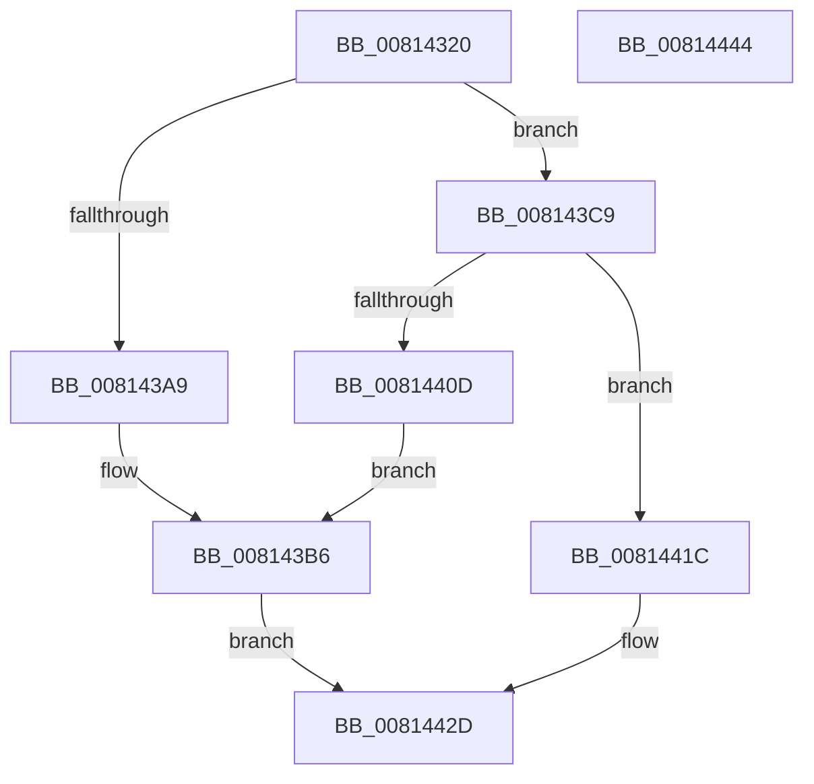

# SdbpCheckMatchingRegistry

- RVA: `0x00814320`–`0x00814445` (길이 `293` bytes)
- VA: `0x0000000140814320`
- 실행 섹션: `PAGE`
- PDB 이름 있음: `예`; PDB Function 태그: `아니요`
- unwind 정보 RVA: `0x000D99F4`
- 디코드: `77`개 명령, `293/293` bytes 표시
- 미해석 바이트: `0` (있으면 어셈블리에 `.byte`로 보존)

> 이 문서는 커널 이미지의 기계어와 PDB 기호를 분석해 생성했습니다. 4번과 5번은 함수 원형과 자료형을 바이너리 사용 방식에서 추정한 C 해석이며 원본 소스 복구 결과는 아닙니다.

## 1. Dependencies

- 직접 호출 지점: **3**; 고유 호출 대상: **3**
- 직접 호출자로 확인된 함수: **0**
- RIP 상대 이미지 참조: **3**

### Outgoing calls
- `0x008143A0` → [SdbpGetRegistryMatchingAttributes](SdbpGetRegistryMatchingAttributes_function_00815D5C.md) (function, `0x00815D5C`)
- `0x008143C2` → [AslLogCallPrintf](../95/AslLogCallPrintf_function_0095E4EC.md) (function, `0x0095E4EC`)
- `0x00814404` → [SdbpCheckMatchingRegistryEntry](SdbpCheckMatchingRegistryEntry_function_0081444C.md) (function, `0x0081444C`)

### Direct callers
- 이 함수 시작 RVA로 연결되는 직접 call은 확인되지 않았습니다. 간접 호출은 완전히 역산할 수 없습니다.

### Static image references
- `0x008143A9` → RVA `0x0003C388` (`.rdata`; read)
- `0x008143B6` → RVA `0x0003C368` (`.rdata`; read)
- `0x0081440D` → RVA `0x0003C340` (`.rdata`; read)

## 2. Other-region calls and transfers

- 다른 실행 섹션으로 향하는 call: **0**
- 별도 외부 분기/꼬리 이동을 확인하지 못했습니다.

## 3. Assembly (complete function range)

```asm
00814320  4C 8B DC                        mov r11, rsp
00814323  49 89 5B 10                     mov qword ptr [r11 + 0x10], rbx
00814327  49 89 7B 18                     mov qword ptr [r11 + 0x18], rdi
0081432B  55                              push rbp
0081432C  49 8D 6B B9                     lea rbp, [r11 - 0x47]
00814330  48 81 EC 90 00 00 00            sub rsp, 0x90
00814337  8B 55 6F                        mov edx, dword ptr [rbp + 0x6f]
0081433A  4C 8D 4D 27                     lea r9, [rbp + 0x27]
0081433E  33 DB                           xor ebx, ebx
00814340  48 8B F9                        mov rdi, rcx
00814343  89 19                           mov dword ptr [rcx], ebx
00814345  49 8B C0                        mov rax, r8
00814348  48 8D 4D 07                     lea rcx, [rbp + 7]
0081434C  89 5D 03                        mov dword ptr [rbp + 3], ebx
0081434F  49 89 4B B0                     mov qword ptr [r11 - 0x50], rcx
00814353  4C 8D 45 2F                     lea r8, [rbp + 0x2f]
00814357  48 8D 4D 0F                     lea rcx, [rbp + 0xf]
0081435B  48 89 5D 2F                     mov qword ptr [rbp + 0x2f], rbx
0081435F  49 89 4B A8                     mov qword ptr [r11 - 0x58], rcx
00814363  48 8D 4D 17                     lea rcx, [rbp + 0x17]
00814367  49 89 4B A0                     mov qword ptr [r11 - 0x60], rcx
0081436B  48 8D 4D 4F                     lea rcx, [rbp + 0x4f]
0081436F  49 89 4B 98                     mov qword ptr [r11 - 0x68], rcx
00814373  48 8D 4D 1F                     lea rcx, [rbp + 0x1f]
00814377  49 89 4B 90                     mov qword ptr [r11 - 0x70], rcx
0081437B  48 8D 4D FF                     lea rcx, [rbp - 1]
0081437F  49 89 4B 88                     mov qword ptr [r11 - 0x78], rcx
00814383  48 8B C8                        mov rcx, rax
00814386  48 89 5D 27                     mov qword ptr [rbp + 0x27], rbx
0081438A  89 5D FF                        mov dword ptr [rbp - 1], ebx
0081438D  48 89 5D 1F                     mov qword ptr [rbp + 0x1f], rbx
00814391  89 5D 4F                        mov dword ptr [rbp + 0x4f], ebx
00814394  48 89 5D 17                     mov qword ptr [rbp + 0x17], rbx
00814398  48 89 5D 0F                     mov qword ptr [rbp + 0xf], rbx
0081439C  48 89 5D 07                     mov qword ptr [rbp + 7], rbx
008143A0  E8 B7 19 00 00                  call 0x140815d5c
008143A5  85 C0                           test eax, eax
008143A7  75 20                           jne 0x1408143c9
008143A9  4C 8D 0D D8 7F 82 FF            lea r9, [rip - 0x7d8028]
008143B0  41 B8 B8 06 00 00               mov r8d, 0x6b8
008143B6  48 8D 15 AB 7F 82 FF            lea rdx, [rip - 0x7d8055]
008143BD  B9 01 00 00 00                  mov ecx, 1
008143C2  E8 25 A1 14 00                  call 0x14095e4ec
008143C7  EB 64                           jmp 0x14081442d
008143C9  4C 8B 4D 1F                     mov r9, qword ptr [rbp + 0x1f]
008143CD  48 8D 45 03                     lea rax, [rbp + 3]
008143D1  44 8B 45 FF                     mov r8d, dword ptr [rbp - 1]
008143D5  48 8B 55 27                     mov rdx, qword ptr [rbp + 0x27]
008143D9  48 8B 4D 2F                     mov rcx, qword ptr [rbp + 0x2f]
008143DD  48 89 44 24 40                  mov qword ptr [rsp + 0x40], rax
008143E2  48 8B 45 07                     mov rax, qword ptr [rbp + 7]
008143E6  48 89 44 24 38                  mov qword ptr [rsp + 0x38], rax
008143EB  48 8B 45 0F                     mov rax, qword ptr [rbp + 0xf]
008143EF  48 89 44 24 30                  mov qword ptr [rsp + 0x30], rax
008143F4  48 8B 45 17                     mov rax, qword ptr [rbp + 0x17]
008143F8  48 89 44 24 28                  mov qword ptr [rsp + 0x28], rax
008143FD  8B 45 4F                        mov eax, dword ptr [rbp + 0x4f]
00814400  89 44 24 20                     mov dword ptr [rsp + 0x20], eax
00814404  E8 43 00 00 00                  call 0x14081444c
00814409  85 C0                           test eax, eax
0081440B  75 0F                           jne 0x14081441c
0081440D  4C 8D 0D 2C 7F 82 FF            lea r9, [rip - 0x7d80d4]
00814414  41 B8 C9 06 00 00               mov r8d, 0x6c9
0081441A  EB 9A                           jmp 0x1408143b6
0081441C  48 8B 4D 77                     mov rcx, qword ptr [rbp + 0x77]
00814420  BB 01 00 00 00                  mov ebx, 1
00814425  89 59 50                        mov dword ptr [rcx + 0x50], ebx
00814428  8B 4D 03                        mov ecx, dword ptr [rbp + 3]
0081442B  89 0F                           mov dword ptr [rdi], ecx
0081442D  4C 8D 9C 24 90 00 00 00         lea r11, [rsp + 0x90]
00814435  8B C3                           mov eax, ebx
00814437  49 8B 5B 18                     mov rbx, qword ptr [r11 + 0x18]
0081443B  49 8B 7B 20                     mov rdi, qword ptr [r11 + 0x20]
0081443F  49 8B E3                        mov rsp, r11
00814442  5D                              pop rbp
00814443  C3                              ret
00814444  CC                              int3
```

## 4. C-style interpretation (structured pseudocode)

```c
__int64 __fastcall SdbpCheckMatchingRegistry(__int64 a1, __int64 a2, __int64 a3)
{
    __int64 result;
    __int64 v_rbx;
    __int64 v_rsp;
    unsigned __int64 v_stack_m58;
    unsigned __int64 v_stack_m60;
    unsigned __int64 v_stack_m68;
    unsigned __int64 v_stack_m70;
    unsigned int v_stack_m78;
    unsigned __int64 v_stack_m8;

    *(unsigned __int64 *)(v_rsp + 16) = v_rbx;
    *(unsigned __int64 *)(v_rsp + 24) = v_rdi;
    v_rsp = (v_rsp) - (144);
    v_rbx = 0;
    *(unsigned int *)(a1) = 0;
    *(unsigned int *)(v_rsp - 71 + 3) = 0;
    *(unsigned __int64 *)(v_rsp - 80) = v_rsp - 71 + 7;
    *(unsigned __int64 *)(v_rsp - 71 + 47) = 0;
    *(unsigned __int64 *)(v_rsp - 88) = v_rsp - 71 + 15;
    *(unsigned __int64 *)(v_rsp - 96) = v_rsp - 71 + 23;
    *(unsigned __int64 *)(v_rsp - 104) = v_rsp - 71 + 79;
    *(unsigned __int64 *)(v_rsp - 112) = v_rsp - 71 + 31;
    *(unsigned __int64 *)(v_rsp - 120) = v_rsp - 71 - 1;
    *(unsigned __int64 *)(v_rsp - 71 + 39) = 0;
    *(unsigned int *)(v_rsp - 71 - 1) = 0;
    *(unsigned __int64 *)(v_rsp - 71 + 31) = 0;
    *(unsigned int *)(v_rsp - 71 + 79) = 0;
    *(unsigned __int64 *)(v_rsp - 71 + 23) = 0;
    *(unsigned __int64 *)(v_rsp - 71 + 15) = 0;
    *(unsigned __int64 *)(v_rsp - 71 + 7) = 0;
    result = SdbpGetRegistryMatchingAttributes(a3, (unsigned int)(*(unsigned int *)(v_rsp - 71 + 111)), v_rsp - 71 + 47, v_rsp - 71 + 39);
    if ((unsigned int)(result) != 0) goto loc_008143C9;
loc_008143B6:
    result = AslLogCallPrintf(1, v_rip - 8224853, (unsigned int)(0x6B8ULL), v_rip - 8224808);
    goto loc_0081442D;
loc_008143C9:
    v_stack_m58 = v_rsp - 71 + 3;
    v_stack_m60 = *(unsigned __int64 *)(v_rsp - 71 + 7);
    v_stack_m68 = *(unsigned __int64 *)(v_rsp - 71 + 15);
    v_stack_m70 = *(unsigned __int64 *)(v_rsp - 71 + 23);
    v_stack_m78 = (unsigned int)((unsigned int)(*(unsigned int *)(v_rsp - 71 + 79)));
    result = SdbpCheckMatchingRegistryEntry(*(unsigned __int64 *)(v_rsp - 71 + 47), *(unsigned __int64 *)(v_rsp - 71 + 39), (unsigned int)(*(unsigned int *)(v_rsp - 71 - 1)), *(unsigned __int64 *)(v_rsp - 71 + 31));
    if ((unsigned int)(result) != 0) goto loc_0081441C;
    goto loc_008143B6;
loc_0081441C:
    *(unsigned int *)(*(unsigned __int64 *)(v_rsp - 71 + 119) + 80) = 1;
    *(unsigned int *)(a1) = (unsigned int)((unsigned int)(*(unsigned int *)(v_rsp - 71 + 3)));
loc_0081442D:
    return 1;
}
```

## 5. (Beta) C Style

```c
int64_t SdbpCheckMatchingRegistry(void *Arg1, int64_t Arg2, int64_t Arg3)
{
    uint8_t *arg1 = (uint8_t *)Arg1;

    int64_t result;
    int64_t local_rbx;
    int64_t local_rsp;
    uint64_t v_stack_m58;
    uint64_t v_stack_m60;
    uint64_t v_stack_m68;
    uint64_t v_stack_m70;
    uint32_t v_stack_m78;
    uint64_t v_stack_m8;

    *(uint64_t *)(local_rsp + 0x10) = local_rbx;
    *(uint64_t *)(local_rsp + 0x18) = local_rdi;
    local_rsp = (local_rsp) - (144);
    local_rbx = 0;
    *(uint32_t *)(arg1) = 0;
    *(uint32_t *)(local_rsp - 0x47 + 0x3) = 0;
    *(uint64_t *)(local_rsp - 0x50) = local_rsp - 71 + 7;
    *(uint64_t *)(local_rsp - 0x47 + 0x2F) = 0;
    *(uint64_t *)(local_rsp - 0x58) = local_rsp - 71 + 15;
    *(uint64_t *)(local_rsp - 0x60) = local_rsp - 71 + 23;
    *(uint64_t *)(local_rsp - 0x68) = local_rsp - 71 + 79;
    *(uint64_t *)(local_rsp - 0x70) = local_rsp - 71 + 31;
    *(uint64_t *)(local_rsp - 0x78) = local_rsp - 71 - 1;
    *(uint64_t *)(local_rsp - 0x47 + 0x27) = 0;
    *(uint32_t *)(local_rsp - 0x47 - 0x1) = 0;
    *(uint64_t *)(local_rsp - 0x47 + 0x1F) = 0;
    *(uint32_t *)(local_rsp - 0x47 + 0x4F) = 0;
    *(uint64_t *)(local_rsp - 0x47 + 0x17) = 0;
    *(uint64_t *)(local_rsp - 0x47 + 0xF) = 0;
    *(uint64_t *)(local_rsp - 0x47 + 0x7) = 0;
    result = SdbpGetRegistryMatchingAttributes(Arg3, (uint32_t)(*(uint32_t *)(local_rsp - 0x47 + 0x6F)), local_rsp - 71 + 47, local_rsp - 71 + 39);
    if ((uint32_t)(result) != 0) goto loc_008143C9;
loc_008143B6:
    result = AslLogCallPrintf(1, v_rip - 8224853, (uint32_t)(0x6B8ULL), v_rip - 8224808);
    goto loc_0081442D;
loc_008143C9:
    v_stack_m58 = local_rsp - 71 + 3;
    v_stack_m60 = *(uint64_t *)(local_rsp - 0x47 + 0x7);
    v_stack_m68 = *(uint64_t *)(local_rsp - 0x47 + 0xF);
    v_stack_m70 = *(uint64_t *)(local_rsp - 0x47 + 0x17);
    v_stack_m78 = (uint32_t)((uint32_t)(*(uint32_t *)(local_rsp - 0x47 + 0x4F)));
    result = SdbpCheckMatchingRegistryEntry(*(uint64_t *)(local_rsp - 0x47 + 0x2F), *(uint64_t *)(local_rsp - 0x47 + 0x27), (uint32_t)(*(uint32_t *)(local_rsp - 0x47 - 0x1)), *(uint64_t *)(local_rsp - 0x47 + 0x1F));
    if ((uint32_t)(result) != 0) goto loc_0081441C;
    goto loc_008143B6;
loc_0081441C:
    *(uint32_t *)(*(uint64_t *)(local_rsp - 0x47 + 0x77) + 0x50) = 1;
    *(uint32_t *)(arg1) = (uint32_t)((uint32_t)(*(uint32_t *)(local_rsp - 0x47 + 0x3)));
loc_0081442D:
    return 1;
}
```

### 관측된 메모리 오프셋

구조체 형식이 확인되지 않은 접근은 인자 기준의 오프셋으로만 기록했습니다.

| 기준 인자 | 오프셋 표현 | 폭 (bit) | 접근 |
|---|---:|---:|---|
| `Arg1` | `+ 0x0` | `32` | `W` |

## 6. Execution-region graph

[열기: 2D/3D 그래프와 함수 탐색 컨트롤 패널](../../../control-panel.html?section=page&rva=0x00814320&view=graph)

- 2D 그래프는 위에서 아래로 흐르고, 3D 그래프는 빈 공간을 드래그해 회전합니다. Shift+드래그는 이동, 휠은 확대·축소, 함수 노드 선택은 대상 보고서 이동입니다.

### Static fallback


