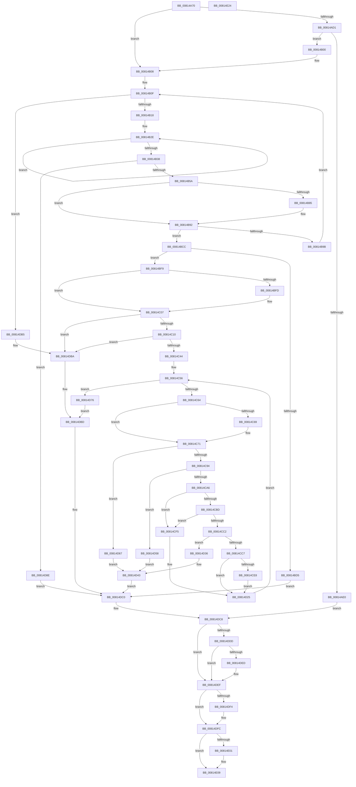

# SdbpCheckMatchingTextEntry

- RVA: `0x00814A70`–`0x00814E25` (길이 `949` bytes)
- VA: `0x0000000140814A70`
- 실행 섹션: `PAGE`
- PDB 이름 있음: `예`; PDB Function 태그: `아니요`
- unwind 정보 RVA: `0x000AFEC4`
- 디코드: `240`개 명령, `949/949` bytes 표시
- 미해석 바이트: `0` (있으면 어셈블리에 `.byte`로 보존)

> 이 문서는 커널 이미지의 기계어와 PDB 기호를 분석해 생성했습니다. 4번과 5번은 함수 원형과 자료형을 바이너리 사용 방식에서 추정한 C 해석이며 원본 소스 복구 결과는 아닙니다.

## 1. Dependencies

- 직접 호출 지점: **19**; 고유 호출 대상: **13**
- 직접 호출자로 확인된 함수: **1**
- RIP 상대 이미지 참조: **7**

### Outgoing calls
- `0x00814AD4` → [SdbpInitializeSearchDBContext](SdbpInitializeSearchDBContext_function_00816210.md) (function, `0x00816210`)
- `0x00814AF6` → [AslLogCallPrintf](../95/AslLogCallPrintf_function_0095E4EC.md) (function, `0x0095E4EC`)
- `0x00814B4D` → [SdbpResolveMatchingFile](SdbpResolveMatchingFile_function_00816A20.md) (function, `0x00816A20`)
- `0x00814B72` → [AslFileMappingCreate](../95/AslFileMappingCreate_function_00958448.md) (function, `0x00958448`)
- `0x00814B88` → [AslFileMappingEnsureMappedAs](AslFileMappingEnsureMappedAs_function_0081A6BC.md) (function, `0x0081A6BC`)
- `0x00814B92` → [AslFileNotFound](../70/AslFileNotFound_function_00705144.md) (function, `0x00705144`)
- `0x00814B9E` → [AslFileMappingDelete](../95/AslFileMappingDelete_function_0095B728.md) (function, `0x0095B728`)
- `0x00814BAD` → [AslFree](../95/AslFree_function_0095B674.md) (function, `0x0095B674`)
- `0x00814BEF` → [AslLogCallPrintf](../95/AslLogCallPrintf_function_0095E4EC.md) (function, `0x0095E4EC`)
- `0x00814C17` → [AslFileMappingGetViewBase](AslFileMappingGetViewBase_function_0081AB84.md) (function, `0x0081AB84`)
- `0x00814C81` → [AslAlloc](../95/AslAlloc_function_0095BD34.md) (function, `0x0095BD34`)
- `0x00814CAC` → [memcpy](../../text/6C/memcpy_function_006C6840.md) (function, `0x006C6840`)
- `0x00814CDE` → [AslStringSearchW](AslStringSearchW_function_00819A18.md) (function, `0x00819A18`)
- `0x00814D07` → [AslStringSearchA](AslStringSearchA_function_00819980.md) (function, `0x00819980`)
- `0x00814D2C` → [AslFree](../95/AslFree_function_0095B674.md) (function, `0x0095B674`)
- `0x00814D51` → [AslLogCallPrintf](../95/AslLogCallPrintf_function_0095E4EC.md) (function, `0x0095E4EC`)
- `0x00814DA9` → [AslLogCallPrintf](../95/AslLogCallPrintf_function_0095E4EC.md) (function, `0x0095E4EC`)
- `0x00814DF7` → [AslFree](../95/AslFree_function_0095B674.md) (function, `0x0095B674`)
- `0x00814E04` → [AslFileMappingDelete](../95/AslFileMappingDelete_function_0095B728.md) (function, `0x0095B728`)

### Direct callers
- [SdbpCheckMatchingText](SdbpCheckMatchingText_function_00814950.md) at `0x00814A17`

### Static image references
- `0x00814AE0` → RVA `0x0003C9C0` (`.rdata`; read)
- `0x00814AED` → RVA `0x0003C9A0` (`.rdata`; read)
- `0x00814BD9` → RVA `0x0003C960` (`.rdata`; read)
- `0x00814D36` → RVA `0x0003C908` (`.rdata`; read)
- `0x00814D58` → RVA `0x0003C920` (`.rdata`; read)
- `0x00814D67` → RVA `0x0003C940` (`.rdata`; read)
- `0x00814D93` → RVA `0x0003C978` (`.rdata`; read)

## 2. Other-region calls and transfers

- 다른 실행 섹션으로 향하는 call: **1**
  - `0x00814CAC` → [memcpy](../../text/6C/memcpy_function_006C6840.md) (`PAGE` → `.text`)
- 별도 외부 분기/꼬리 이동을 확인하지 못했습니다.

## 3. Assembly (complete function range)

```asm
00814A70  48 8B C4                        mov rax, rsp
00814A73  48 89 58 08                     mov qword ptr [rax + 8], rbx
00814A77  4C 89 48 20                     mov qword ptr [rax + 0x20], r9
00814A7B  4C 89 40 18                     mov qword ptr [rax + 0x18], r8
00814A7F  55                              push rbp
00814A80  56                              push rsi
00814A81  57                              push rdi
00814A82  41 54                           push r12
00814A84  41 55                           push r13
00814A86  41 56                           push r14
00814A88  41 57                           push r15
00814A8A  48 83 EC 40                     sub rsp, 0x40
00814A8E  4C 8B BC 24 B8 00 00 00         mov r15, qword ptr [rsp + 0xb8]
00814A96  45 33 D2                        xor r10d, r10d
00814A99  48 8B B4 24 C0 00 00 00         mov rsi, qword ptr [rsp + 0xc0]
00814AA1  41 8B DA                        mov ebx, r10d
00814AA4  4C 89 50 B8                     mov qword ptr [rax - 0x48], r10
00814AA8  4C 8B F2                        mov r14, rdx
00814AAB  48 89 58 C0                     mov qword ptr [rax - 0x40], rbx
00814AAF  4C 8B E1                        mov r12, rcx
00814AB2  8B 02                           mov eax, dword ptr [rdx]
00814AB4  41 8D 6A 01                     lea ebp, [r10 + 1]
00814AB8  44 89 94 24 88 00 00 00         mov dword ptr [rsp + 0x88], r10d
00814AC0  45 8B EA                        mov r13d, r10d
00814AC3  45 89 17                        mov dword ptr [r15], r10d
00814AC6  41 8B FA                        mov edi, r10d
00814AC9  44 89 16                        mov dword ptr [rsi], r10d
00814ACC  40 84 C5                        test bpl, al
00814ACF  75 37                           jne 0x140814b08
00814AD1  48 8B CA                        mov rcx, rdx
00814AD4  E8 37 17 00 00                  call 0x140816210
00814AD9  45 33 D2                        xor r10d, r10d
00814ADC  85 C0                           test eax, eax
00814ADE  75 20                           jne 0x140814b00
00814AE0  4C 8D 0D D9 7E 82 FF            lea r9, [rip - 0x7d8127]
00814AE7  41 B8 81 07 00 00               mov r8d, 0x781
00814AED  48 8D 15 AC 7E 82 FF            lea rdx, [rip - 0x7d8154]
00814AF4  8B CD                           mov ecx, ebp
00814AF6  E8 F1 99 14 00                  call 0x14095e4ec
00814AFB  E9 C8 02 00 00                  jmp 0x140814dc8
00814B00  4C 8B 84 24 90 00 00 00         mov r8, qword ptr [rsp + 0x90]
00814B08  49 8B 6E 48                     mov rbp, qword ptr [r14 + 0x48]
00814B0C  41 8B F2                        mov esi, r10d
00814B0F  3B 75 00                        cmp esi, dword ptr [rbp]
00814B12  0F 8D 9D 02 00 00               jge 0x140814db5
00814B18  48 63 C6                        movsxd rax, esi
00814B1B  48 8D 04 40                     lea rax, [rax + rax*2]
00814B1F  48 C1 E0 04                     shl rax, 4
00814B23  48 83 C0 08                     add rax, 8
00814B27  48 03 C5                        add rax, rbp
00814B2A  49 83 C9 FF                     or r9, 0xffffffffffffffff
00814B2E  49 FF C1                        inc r9
00814B31  66 47 39 14 48                  cmp word ptr [r8 + r9*2], r10w
00814B36  75 F6                           jne 0x140814b2e
00814B38  48 8D 4C 24 30                  lea rcx, [rsp + 0x30]
00814B3D  49 8B D6                        mov rdx, r14
00814B40  48 89 4C 24 28                  mov qword ptr [rsp + 0x28], rcx
00814B45  49 8B CC                        mov rcx, r12
00814B48  48 89 44 24 20                  mov qword ptr [rsp + 0x20], rax
00814B4D  E8 CE 1E 00 00                  call 0x140816a20
00814B52  85 C0                           test eax, eax
00814B54  0F 84 34 02 00 00               je 0x140814d8e
00814B5A  48 8B 7C 24 30                  mov rdi, qword ptr [rsp + 0x30]
00814B5F  48 8D 4C 24 38                  lea rcx, [rsp + 0x38]
00814B64  4C 21 6C 24 20                  and qword ptr [rsp + 0x20], r13
00814B69  48 8B D7                        mov rdx, rdi
00814B6C  45 33 C9                        xor r9d, r9d
00814B6F  45 33 C0                        xor r8d, r8d
00814B72  E8 D1 38 14 00                  call 0x140958448
00814B77  48 8B 5C 24 38                  mov rbx, qword ptr [rsp + 0x38]
00814B7C  45 33 D2                        xor r10d, r10d
00814B7F  8B C8                           mov ecx, eax
00814B81  85 C0                           test eax, eax
00814B83  78 0D                           js 0x140814b92
00814B85  48 8B CB                        mov rcx, rbx
00814B88  E8 2F 5B 00 00                  call 0x14081a6bc
00814B8D  8B C8                           mov ecx, eax
00814B8F  45 33 D2                        xor r10d, r10d
00814B92  E8 AD 05 EF FF                  call 0x140705144
00814B97  85 C0                           test eax, eax
00814B99  74 31                           je 0x140814bcc
00814B9B  48 8B CB                        mov rcx, rbx
00814B9E  E8 85 6B 14 00                  call 0x14095b728
00814BA3  33 DB                           xor ebx, ebx
00814BA5  48 8B D7                        mov rdx, rdi
00814BA8  48 89 5C 24 38                  mov qword ptr [rsp + 0x38], rbx
00814BAD  E8 C2 6A 14 00                  call 0x14095b674
00814BB2  4C 8B 84 24 90 00 00 00         mov r8, qword ptr [rsp + 0x90]
00814BBA  45 33 D2                        xor r10d, r10d
00814BBD  41 8B FA                        mov edi, r10d
00814BC0  4C 89 54 24 30                  mov qword ptr [rsp + 0x30], r10
00814BC5  FF C6                           inc esi
00814BC7  E9 43 FF FF FF                  jmp 0x140814b0f
00814BCC  BD 01 00 00 00                  mov ebp, 1
00814BD1  85 C9                           test ecx, ecx
00814BD3  79 24                           jns 0x140814bf9
00814BD5  89 4C 24 20                     mov dword ptr [rsp + 0x20], ecx
00814BD9  4C 8D 0D 80 7D 82 FF            lea r9, [rip - 0x7d8280]
00814BE0  8B CD                           mov ecx, ebp
00814BE2  48 8D 15 B7 7D 82 FF            lea rdx, [rip - 0x7d8249]
00814BE9  41 B8 B9 07 00 00               mov r8d, 0x7b9
00814BEF  E8 F8 98 14 00                  call 0x14095e4ec
00814BF4  E9 C7 01 00 00                  jmp 0x140814dc0
00814BF9  85 F6                           test esi, esi
00814BFB  7E 0A                           jle 0x140814c07
00814BFD  48 8B 84 24 C0 00 00 00         mov rax, qword ptr [rsp + 0xc0]
00814C05  89 28                           mov dword ptr [rax], ebp
00814C07  48 85 DB                        test rbx, rbx
00814C0A  0F 84 AA 01 00 00               je 0x140814dba
00814C10  48 8B 53 18                     mov rdx, qword ptr [rbx + 0x18]
00814C14  48 8B CB                        mov rcx, rbx
00814C17  E8 68 5F 00 00                  call 0x14081ab84
00814C1C  44 8B B4 24 B0 00 00 00         mov r14d, dword ptr [rsp + 0xb0]
00814C24  41 8B F2                        mov esi, r10d
00814C27  44 8B A4 24 A0 00 00 00         mov r12d, dword ptr [rsp + 0xa0]
00814C2F  4C 3B F2                        cmp r14, rdx
00814C32  48 89 44 24 30                  mov qword ptr [rsp + 0x30], rax
00814C37  44 0F 43 F2                     cmovae r14d, edx
00814C3B  45 3B E6                        cmp r12d, r14d
00814C3E  0F 87 76 01 00 00               ja 0x140814dba
00814C44  83 BC 24 A8 00 00 00 03         cmp dword ptr [rsp + 0xa8], 3
00814C4C  45 8B FA                        mov r15d, r10d
00814C4F  41 0F 94 C7                     sete r15b
00814C53  44 03 FD                        add r15d, ebp
00814C56  B9 00 10 00 00                  mov ecx, 0x1000
00814C5B  41 3B F6                        cmp esi, r14d
00814C5E  0F 83 12 01 00 00               jae 0x140814d76
00814C64  41 3B F4                        cmp esi, r12d
00814C67  76 08                           jbe 0x140814c71
00814C69  41 8B C7                        mov eax, r15d
00814C6C  41 2B C4                        sub eax, r12d
00814C6F  03 F0                           add esi, eax
00814C71  41 8B EE                        mov ebp, r14d
00814C74  2B EE                           sub ebp, esi
00814C76  3B E9                           cmp ebp, ecx
00814C78  0F 47 E9                        cmova ebp, ecx
00814C7B  8B D5                           mov edx, ebp
00814C7D  48 83 C2 02                     add rdx, 2
00814C81  E8 AE 70 14 00                  call 0x14095bd34
00814C86  48 89 44 24 38                  mov qword ptr [rsp + 0x38], rax
00814C8B  48 85 C0                        test rax, rax
00814C8E  0F 84 D3 00 00 00               je 0x140814d67
00814C94  8B D6                           mov edx, esi
00814C96  48 03 54 24 30                  add rdx, qword ptr [rsp + 0x30]
00814C9B  48 3B 54 24 30                  cmp rdx, qword ptr [rsp + 0x30]
00814CA0  0F 82 B2 00 00 00               jb 0x140814d58
00814CA6  44 8B C5                        mov r8d, ebp
00814CA9  48 8B C8                        mov rcx, rax
00814CAC  E8 8F 1B EB FF                  call 0x1406c6840
00814CB1  8B 8C 24 A8 00 00 00            mov ecx, dword ptr [rsp + 0xa8]
00814CB8  83 E9 01                        sub ecx, 1
00814CBB  74 38                           je 0x140814cf5
00814CBD  83 E9 01                        sub ecx, 1
00814CC0  74 33                           je 0x140814cf5
00814CC2  83 F9 01                        cmp ecx, 1
00814CC5  75 6F                           jne 0x140814d36
00814CC7  4C 8B 84 24 98 00 00 00         mov r8, qword ptr [rsp + 0x98]
00814CCF  45 8B CC                        mov r9d, r12d
00814CD2  48 8B 4C 24 38                  mov rcx, qword ptr [rsp + 0x38]
00814CD7  8B D5                           mov edx, ebp
00814CD9  41 D1 E9                        shr r9d, 1
00814CDC  D1 EA                           shr edx, 1
00814CDE  E8 35 4D 00 00                  call 0x140819a18
00814CE3  48 85 C0                        test rax, rax
00814CE6  74 3D                           je 0x140814d25
00814CE8  C7 84 24 88 00 00 00 01 00 00 00  mov dword ptr [rsp + 0x88], 1
00814CF3  EB 30                           jmp 0x140814d25
00814CF5  4C 8B 84 24 98 00 00 00         mov r8, qword ptr [rsp + 0x98]
00814CFD  45 8B CC                        mov r9d, r12d
00814D00  48 8B 4C 24 38                  mov rcx, qword ptr [rsp + 0x38]
00814D05  8B D5                           mov edx, ebp
00814D07  E8 74 4C 00 00                  call 0x140819980
00814D0C  8B 8C 24 88 00 00 00            mov ecx, dword ptr [rsp + 0x88]
00814D13  48 85 C0                        test rax, rax
00814D16  B8 01 00 00 00                  mov eax, 1
00814D1B  0F 45 C8                        cmovne ecx, eax
00814D1E  89 8C 24 88 00 00 00            mov dword ptr [rsp + 0x88], ecx
00814D25  48 8B 54 24 38                  mov rdx, qword ptr [rsp + 0x38]
00814D2A  03 F5                           add esi, ebp
00814D2C  E8 43 69 14 00                  call 0x14095b674
00814D31  E9 20 FF FF FF                  jmp 0x140814c56
00814D36  4C 8D 0D CB 7B 82 FF            lea r9, [rip - 0x7d8435]
00814D3D  41 B8 29 08 00 00               mov r8d, 0x829
00814D43  BD 01 00 00 00                  mov ebp, 1
00814D48  48 8D 15 51 7C 82 FF            lea rdx, [rip - 0x7d83af]
00814D4F  8B CD                           mov ecx, ebp
00814D51  E8 96 97 14 00                  call 0x14095e4ec
00814D56  EB 68                           jmp 0x140814dc0
00814D58  4C 8D 0D C1 7B 82 FF            lea r9, [rip - 0x7d843f]
00814D5F  41 B8 07 08 00 00               mov r8d, 0x807
00814D65  EB DC                           jmp 0x140814d43
00814D67  4C 8D 0D D2 7B 82 FF            lea r9, [rip - 0x7d842e]
00814D6E  41 B8 00 08 00 00               mov r8d, 0x800
00814D74  EB CD                           jmp 0x140814d43
00814D76  48 8B 84 24 B8 00 00 00         mov rax, qword ptr [rsp + 0xb8]
00814D7E  BD 01 00 00 00                  mov ebp, 1
00814D83  8B 94 24 88 00 00 00            mov edx, dword ptr [rsp + 0x88]
00814D8A  89 10                           mov dword ptr [rax], edx
00814D8C  EB 2F                           jmp 0x140814dbd
00814D8E  BD 01 00 00 00                  mov ebp, 1
00814D93  4C 8D 0D DE 7B 82 FF            lea r9, [rip - 0x7d8422]
00814D9A  8B CD                           mov ecx, ebp
00814D9C  48 8D 15 FD 7B 82 FF            lea rdx, [rip - 0x7d8403]
00814DA3  41 B8 99 07 00 00               mov r8d, 0x799
00814DA9  E8 3E 97 14 00                  call 0x14095e4ec
00814DAE  48 8B 7C 24 30                  mov rdi, qword ptr [rsp + 0x30]
00814DB3  EB 0B                           jmp 0x140814dc0
00814DB5  BD 01 00 00 00                  mov ebp, 1
00814DBA  45 89 17                        mov dword ptr [r15], r10d
00814DBD  44 8B ED                        mov r13d, ebp
00814DC0  48 8B B4 24 C0 00 00 00         mov rsi, qword ptr [rsp + 0xc0]
00814DC8  48 8B 84 24 90 00 00 00         mov rax, qword ptr [rsp + 0x90]
00814DD0  0F B7 00                        movzx eax, word ptr [rax]
00814DD3  66 83 E8 25                     sub ax, 0x25
00814DD7  66 83 F8 37                     cmp ax, 0x37
00814DDB  77 12                           ja 0x140814def
00814DDD  48 B9 01 02 00 00 00 00 80 00   movabs rcx, 0x80000000000201
00814DE7  48 0F A3 C1                     bt rcx, rax
00814DEB  73 02                           jae 0x140814def
00814DED  89 2E                           mov dword ptr [rsi], ebp
00814DEF  48 85 FF                        test rdi, rdi
00814DF2  74 08                           je 0x140814dfc
00814DF4  48 8B D7                        mov rdx, rdi
00814DF7  E8 78 68 14 00                  call 0x14095b674
00814DFC  48 85 DB                        test rbx, rbx
00814DFF  74 08                           je 0x140814e09
00814E01  48 8B CB                        mov rcx, rbx
00814E04  E8 1F 69 14 00                  call 0x14095b728
00814E09  48 8B 9C 24 80 00 00 00         mov rbx, qword ptr [rsp + 0x80]
00814E11  41 8B C5                        mov eax, r13d
00814E14  48 83 C4 40                     add rsp, 0x40
00814E18  41 5F                           pop r15
00814E1A  41 5E                           pop r14
00814E1C  41 5D                           pop r13
00814E1E  41 5C                           pop r12
00814E20  5F                              pop rdi
00814E21  5E                              pop rsi
00814E22  5D                              pop rbp
00814E23  C3                              ret
00814E24  CC                              int3
```

## 4. C-style interpretation (structured pseudocode)

```c
__int64 __fastcall SdbpCheckMatchingTextEntry(__int64 a1, __int64 a2, __int64 a3, __int64 a4, unsigned int a5, unsigned int a6, unsigned int a7, __int64 a8, __int64 a9)
{
    __int64 result;
    __int64 v_r10;
    __int64 v_r14;
    __int64 v_r15;
    __int64 v_rbp;
    __int64 v_rbx;
    __int64 v_rsi;
    __int64 v_rsp;
    unsigned __int64 v_stack_m40;
    unsigned __int64 v_stack_m48;
    unsigned __int64 v_stack_m50;
    unsigned __int64 v_stack_m58;
    unsigned int v_stack_p10;
    unsigned __int64 v_stack_p18;
    unsigned __int64 v_stack_p20;
    unsigned __int64 v_stack_p8;

    *(unsigned __int64 *)(v_rsp + 8) = v_rbx;
    *(unsigned __int64 *)(v_rsp + 32) = a4;
    *(unsigned __int64 *)(v_rsp + 24) = a3;
    v_rsp = (v_rsp) - (64);
    v_r10 = 0;
    *(unsigned __int64 *)(v_rsp - 72) = 0;
    *(unsigned __int64 *)(v_rsp - 64) = 0;
    v_stack_p10 = 0;
    *(unsigned int *)(a8) = 0;
    *(unsigned int *)(a9) = 0;
    if ((((unsigned __int8)(v_r10 + 1)) & ((unsigned __int8)((unsigned int)(*(unsigned int *)(a2))))) != 0) goto loc_00814B08;
    result = SdbpInitializeSearchDBContext(a2, a2, a3, a4);
    v_r10 = 0;
    if ((unsigned int)(result) != 0) goto loc_00814B00;
    result = AslLogCallPrintf((unsigned int)((unsigned int)(v_r10 + 1)), v_rip - 8225108, (unsigned int)(0x781ULL), v_rip - 8225063);
    goto loc_00814DC8;
loc_00814B00:
loc_00814B08:
loc_00814B0F:
    if (0 >= (*(unsigned int *)(*(unsigned __int64 *)(a2 + 72)))) goto loc_00814DB5;
    result = ((int)(0) + (int)(0) * 2) << (4);
    result = (result) + (8);
    result = (result) + (*(unsigned __int64 *)(a2 + 72));
    a4 = (v_rip - 8225063) | (-1);
loc_00814B2E:
    a4 = (a4) + 1;
    if ((*(unsigned __int16 *)(v_stack_p18 + a4 * 2)) != 0) goto loc_00814B2E;
    v_stack_m50 = v_stack_m48;
    v_stack_m58 = result;
    result = SdbpResolveMatchingFile(a1, a2, v_stack_p18, a4);
    if ((unsigned int)(result) == 0) goto loc_00814D8E;
    a4 = 0;
    a3 = 0;
    result = AslFileMappingCreate(v_stack_m40, v_stack_m48, a3, a4);
    v_r10 = 0;
    if (!(sign_flag)) {
        a1 = v_stack_m40;
        result = AslFileMappingEnsureMappedAs(a1, v_stack_m48, a3, a4);
        a1 = (unsigned int)(result);
        v_r10 = 0;
    }
    result = AslFileNotFound(a1, v_stack_m48, a3, a4);
    if ((unsigned int)(result) == 0) goto loc_00814BCC;
    result = AslFileMappingDelete(v_stack_m40, v_stack_m48, a3, a4);
    v_rbx = 0;
    v_stack_m40 = 0;
    result = AslFree(v_stack_m40, v_stack_m48, a3, a4);
    v_r10 = 0;
    v_stack_m48 = 0;
    v_rsi = (unsigned int)((0) + 1);
    goto loc_00814B0F;
loc_00814BCC:
    if (!sign_flag) goto loc_00814BF9;
    v_stack_m58 = (unsigned int)(v_stack_m40);
    result = AslLogCallPrintf(1, v_rip - 8225353, (unsigned int)(0x7B9ULL), v_rip - 8225408);
    goto loc_00814DC0;
loc_00814BF9:
    if (!(condition_is_less_or_equal)) {
        result = a9;
        *(unsigned int *)(result) = 1;
    }
    if (0 == 0) goto loc_00814DBA;
    result = AslFileMappingGetViewBase(0, *(unsigned __int64 *)(v_rbx + 24), (unsigned int)(0x7B9ULL), v_rip - 8225408);
    v_stack_m48 = result;
    v_r14 = (unsigned int)(a7);
    if (((unsigned int)(a7)) >= (*(unsigned __int64 *)(v_rbx + 24))) { v_r14 = (unsigned int)(*(unsigned __int64 *)(v_rbx + 24)); }
    if (((unsigned int)((unsigned int)(a5))) > ((unsigned int)(v_r14))) goto loc_00814DBA;
    v_r15 = (a6 == 3) ? 1 : 0;
    v_r15 = (unsigned int)((v_r15) + (1));
loc_00814C56:
    if (0 >= ((unsigned int)(v_r14))) goto loc_00814D76;
    v_rsi = 0;
    if (0 >= = ((unsigned int)((unsigned int)(a5)))) {
        result = (unsigned int)(v_r15);
        result = (unsigned int)((result) - ((unsigned int)((unsigned int)(a5))));
        v_rsi = (unsigned int)((0) + ((unsigned int)(result)));
    }
    v_rbp = (unsigned int)(((unsigned int)((unsigned int)(v_r14))) - ((unsigned int)(v_rsi)));
    if (((unsigned int)(v_rbp)) > ((unsigned int)((unsigned int)(0x1000ULL)))) { v_rbp = (unsigned int)((unsigned int)(0x1000ULL)); }
    a2 = ((unsigned int)((unsigned int)(v_rbp))) + (2);
    result = AslAlloc((unsigned int)(0x1000ULL), a2, (unsigned int)(0x7B9ULL), v_rip - 8225408);
    v_stack_m40 = result;
    if (result == 0) goto loc_00814D67;
    a2 = ((unsigned int)((unsigned int)(v_rsi))) + (v_stack_m48);
    if (a2 < v_stack_m48) goto loc_00814D58;
    result = memcpy(result, a2, (unsigned int)((unsigned int)(v_rbp)), v_rip - 8225408);
    a1 = (unsigned int)(((unsigned int)(a6)) - (1));
    if (condition_is_equal) goto loc_00814CF5;
    a1 = (unsigned int)((a1) - (1));
    if (condition_is_equal) goto loc_00814CF5;
    if (((unsigned int)(a1)) != 1) goto loc_00814D36;
    a4 = (unsigned int)(((unsigned int)((unsigned int)((unsigned int)(a5)))) >> (1));
    a2 = (unsigned int)(((unsigned int)((unsigned int)(v_rbp))) >> (1));
    result = AslStringSearchW(v_stack_m40, a2, v_stack_p20, a4);
    if (result == 0) goto loc_00814D25;
    v_stack_p10 = 1;
    goto loc_00814D25;
loc_00814CF5:
    result = AslStringSearchA(v_stack_m40, (unsigned int)((unsigned int)(v_rbp)), v_stack_p20, (unsigned int)((unsigned int)((unsigned int)(a5))));
    a1 = (unsigned int)(v_stack_p10);
    if (result != 0) { a1 = 1; }
    v_stack_p10 = (unsigned int)(a1);
loc_00814D25:
    v_rsi = (unsigned int)((v_rsi) + ((unsigned int)(v_rbp)));
    result = AslFree(a1, v_stack_m40, v_stack_p20, (unsigned int)((unsigned int)((unsigned int)(a5))));
    goto loc_00814C56;
loc_00814D36:
loc_00814D43:
    result = AslLogCallPrintf(1, v_rip - 8225711, (unsigned int)(0x829ULL), v_rip - 8225845);
    goto loc_00814DC0;
loc_00814D58:
    goto loc_00814D43;
loc_00814D67:
    goto loc_00814D43;
loc_00814D76:
    *(unsigned int *)(a8) = (unsigned int)((unsigned int)(v_stack_p10));
    goto loc_00814DBD;
loc_00814D8E:
    result = AslLogCallPrintf(1, v_rip - 8225795, (unsigned int)(0x799ULL), v_rip - 8225826);
    goto loc_00814DC0;
loc_00814DB5:
loc_00814DBA:
    *(unsigned int *)(v_r15) = 0;
loc_00814DBD:
loc_00814DC0:
loc_00814DC8:
    result = (unsigned __int16)((*(unsigned __int16 *)(v_stack_p18)) - (37));
    if (((unsigned __int16)(result)) > 55) goto loc_00814DEF;
    if (((unsigned __int16)(result)) < 55) {
        *(unsigned int *)(a9) = 1;
    }
    if (v_stack_m48 != 0) {
        a2 = v_stack_m48;
        result = AslFree(1, a2, (unsigned int)(0x799ULL), v_rip - 8225826);
    }
    if (0 != 0) {
        a1 = 0;
        result = AslFileMappingDelete(a1, a2, (unsigned int)(0x799ULL), v_rip - 8225826);
    }
    v_rsp = (v_rsp) + (64);
    return 1;
}
```

## 5. (Beta) C Style

```c
int64_t SdbpCheckMatchingTextEntry(int64_t Arg1, void *Arg2, int64_t Arg3, int64_t Arg4, uint32_t Arg5, uint32_t Arg6, uint32_t Arg7, void *Arg8, void *Arg9)
{
    uint8_t *arg2 = (uint8_t *)Arg2;
    uint8_t *arg8 = (uint8_t *)Arg8;
    uint8_t *arg9 = (uint8_t *)Arg9;

    int64_t result;
    int64_t local_r10;
    int64_t local_r14;
    int64_t local_r15;
    int64_t local_rbp;
    int64_t local_rbx;
    int64_t local_rsi;
    int64_t local_rsp;
    uint64_t v_stack_m40;
    uint64_t v_stack_m48;
    uint64_t v_stack_m50;
    uint64_t v_stack_m58;
    uint32_t v_stack_p10;
    uint64_t v_stack_p18;
    uint64_t v_stack_p20;
    uint64_t v_stack_p8;

    *(uint64_t *)(local_rsp + 0x8) = local_rbx;
    *(uint64_t *)(local_rsp + 0x20) = Arg4;
    *(uint64_t *)(local_rsp + 0x18) = Arg3;
    local_rsp = (local_rsp) - (64);
    local_r10 = 0;
    *(uint64_t *)(local_rsp - 0x48) = 0;
    *(uint64_t *)(local_rsp - 0x40) = 0;
    v_stack_p10 = 0;
    *(uint32_t *)(arg8) = 0;
    *(uint32_t *)(arg9) = 0;
    if ((((uint8_t)(local_r10 + 1)) & ((uint8_t)((uint32_t)(*(uint32_t *)(arg2))))) != 0) goto loc_00814B08;
    result = SdbpInitializeSearchDBContext(Arg2, Arg2, Arg3, Arg4);
    local_r10 = 0;
    if ((uint32_t)(result) != 0) goto loc_00814B00;
    result = AslLogCallPrintf((uint32_t)((uint32_t)(local_r10 + 1)), v_rip - 8225108, (uint32_t)(0x781ULL), v_rip - 8225063);
    goto loc_00814DC8;
loc_00814B00:
loc_00814B08:
loc_00814B0F:
    if (0 >= (*(uint32_t *)(*(uint64_t *)(arg2 + 0x48)))) goto loc_00814DB5;
    result = ((int32_t)(0) + (int32_t)(0) * 2) << (4);
    result = (result) + (8);
    result = (result) + (*(uint64_t *)(arg2 + 0x48));
    Arg4 = (v_rip - 8225063) | (-1);
loc_00814B2E:
    Arg4 = (Arg4) + 1;
    if ((*(uint16_t *)(v_stack_p18 + Arg4 * 2)) != 0) goto loc_00814B2E;
    v_stack_m50 = v_stack_m48;
    v_stack_m58 = result;
    result = SdbpResolveMatchingFile(Arg1, Arg2, v_stack_p18, Arg4);
    if ((uint32_t)(result) == 0) goto loc_00814D8E;
    Arg4 = 0;
    Arg3 = 0;
    result = AslFileMappingCreate(v_stack_m40, v_stack_m48, Arg3, Arg4);
    local_r10 = 0;
    if (!(sign_flag)) {
        Arg1 = v_stack_m40;
        result = AslFileMappingEnsureMappedAs(Arg1, v_stack_m48, Arg3, Arg4);
        Arg1 = (uint32_t)(result);
        local_r10 = 0;
    }
    result = AslFileNotFound(Arg1, v_stack_m48, Arg3, Arg4);
    if ((uint32_t)(result) == 0) goto loc_00814BCC;
    result = AslFileMappingDelete(v_stack_m40, v_stack_m48, Arg3, Arg4);
    local_rbx = 0;
    v_stack_m40 = 0;
    result = AslFree(v_stack_m40, v_stack_m48, Arg3, Arg4);
    local_r10 = 0;
    v_stack_m48 = 0;
    local_rsi = (uint32_t)((0) + 1);
    goto loc_00814B0F;
loc_00814BCC:
    if (!sign_flag) goto loc_00814BF9;
    v_stack_m58 = (uint32_t)(v_stack_m40);
    result = AslLogCallPrintf(1, v_rip - 8225353, (uint32_t)(0x7B9ULL), v_rip - 8225408);
    goto loc_00814DC0;
loc_00814BF9:
    if (!(condition_is_less_or_equal)) {
        result = Arg9;
        *(uint32_t *)(result) = 1;
    }
    if (0 == 0) goto loc_00814DBA;
    result = AslFileMappingGetViewBase(0, *(uint64_t *)(local_rbx + 0x18), (uint32_t)(0x7B9ULL), v_rip - 8225408);
    v_stack_m48 = result;
    local_r14 = (uint32_t)(Arg7);
    if (((uint32_t)(Arg7)) >= (*(uint64_t *)(local_rbx + 0x18))) { local_r14 = (uint32_t)(*(uint64_t *)(local_rbx + 0x18)); }
    if (((uint32_t)((uint32_t)(Arg5))) > ((uint32_t)(local_r14))) goto loc_00814DBA;
    local_r15 = (Arg6 == 3) ? 1 : 0;
    local_r15 = (uint32_t)((local_r15) + (1));
loc_00814C56:
    if (0 >= ((uint32_t)(local_r14))) goto loc_00814D76;
    local_rsi = 0;
    if (0 >= = ((uint32_t)((uint32_t)(Arg5)))) {
        result = (uint32_t)(local_r15);
        result = (uint32_t)((result) - ((uint32_t)((uint32_t)(Arg5))));
        local_rsi = (uint32_t)((0) + ((uint32_t)(result)));
    }
    local_rbp = (uint32_t)(((uint32_t)((uint32_t)(local_r14))) - ((uint32_t)(local_rsi)));
    if (((uint32_t)(local_rbp)) > ((uint32_t)((uint32_t)(0x1000ULL)))) { local_rbp = (uint32_t)((uint32_t)(0x1000ULL)); }
    Arg2 = ((uint32_t)((uint32_t)(local_rbp))) + (2);
    result = AslAlloc((uint32_t)(0x1000ULL), Arg2, (uint32_t)(0x7B9ULL), v_rip - 8225408);
    v_stack_m40 = result;
    if (result == 0) goto loc_00814D67;
    Arg2 = ((uint32_t)((uint32_t)(local_rsi))) + (v_stack_m48);
    if (Arg2 < v_stack_m48) goto loc_00814D58;
    result = memcpy(result, Arg2, (uint32_t)((uint32_t)(local_rbp)), v_rip - 8225408);
    Arg1 = (uint32_t)(((uint32_t)(Arg6)) - (1));
    if (condition_is_equal) goto loc_00814CF5;
    Arg1 = (uint32_t)((Arg1) - (1));
    if (condition_is_equal) goto loc_00814CF5;
    if (((uint32_t)(Arg1)) != 1) goto loc_00814D36;
    Arg4 = (uint32_t)(((uint32_t)((uint32_t)((uint32_t)(Arg5)))) >> (1));
    Arg2 = (uint32_t)(((uint32_t)((uint32_t)(local_rbp))) >> (1));
    result = AslStringSearchW(v_stack_m40, Arg2, v_stack_p20, Arg4);
    if (result == 0) goto loc_00814D25;
    v_stack_p10 = 1;
    goto loc_00814D25;
loc_00814CF5:
    result = AslStringSearchA(v_stack_m40, (uint32_t)((uint32_t)(local_rbp)), v_stack_p20, (uint32_t)((uint32_t)((uint32_t)(Arg5))));
    Arg1 = (uint32_t)(v_stack_p10);
    if (result != 0) { Arg1 = 1; }
    v_stack_p10 = (uint32_t)(Arg1);
loc_00814D25:
    local_rsi = (uint32_t)((local_rsi) + ((uint32_t)(local_rbp)));
    result = AslFree(Arg1, v_stack_m40, v_stack_p20, (uint32_t)((uint32_t)((uint32_t)(Arg5))));
    goto loc_00814C56;
loc_00814D36:
loc_00814D43:
    result = AslLogCallPrintf(1, v_rip - 8225711, (uint32_t)(0x829ULL), v_rip - 8225845);
    goto loc_00814DC0;
loc_00814D58:
    goto loc_00814D43;
loc_00814D67:
    goto loc_00814D43;
loc_00814D76:
    *(uint32_t *)(arg8) = (uint32_t)((uint32_t)(v_stack_p10));
    goto loc_00814DBD;
loc_00814D8E:
    result = AslLogCallPrintf(1, v_rip - 8225795, (uint32_t)(0x799ULL), v_rip - 8225826);
    goto loc_00814DC0;
loc_00814DB5:
loc_00814DBA:
    *(uint32_t *)(local_r15) = 0;
loc_00814DBD:
loc_00814DC0:
loc_00814DC8:
    result = (uint16_t)((*(uint16_t *)(v_stack_p18)) - (37));
    if (((uint16_t)(result)) > 55) goto loc_00814DEF;
    if (((uint16_t)(result)) < 55) {
        *(uint32_t *)(arg9) = 1;
    }
    if (v_stack_m48 != 0) {
        Arg2 = v_stack_m48;
        result = AslFree(1, Arg2, (uint32_t)(0x799ULL), v_rip - 8225826);
    }
    if (0 != 0) {
        Arg1 = 0;
        result = AslFileMappingDelete(Arg1, Arg2, (uint32_t)(0x799ULL), v_rip - 8225826);
    }
    local_rsp = (local_rsp) + (64);
    return 1;
}
```

### 관측된 메모리 오프셋

구조체 형식이 확인되지 않은 접근은 인자 기준의 오프셋으로만 기록했습니다.

| 기준 인자 | 오프셋 표현 | 폭 (bit) | 접근 |
|---|---:|---:|---|
| `Arg2` | `+ 0x0` | `32` | `R` |
| `Arg2` | `+ 0x48` | `64` | `R` |
| `Arg8` | `+ 0x0` | `32` | `W` |
| `Arg9` | `+ 0x0` | `32` | `W` |

## 6. Execution-region graph

[열기: 2D/3D 그래프와 함수 탐색 컨트롤 패널](../../../control-panel.html?section=page&rva=0x00814A70&view=graph)

- 2D 그래프는 위에서 아래로 흐르고, 3D 그래프는 빈 공간을 드래그해 회전합니다. Shift+드래그는 이동, 휠은 확대·축소, 함수 노드 선택은 대상 보고서 이동입니다.

### Static fallback


