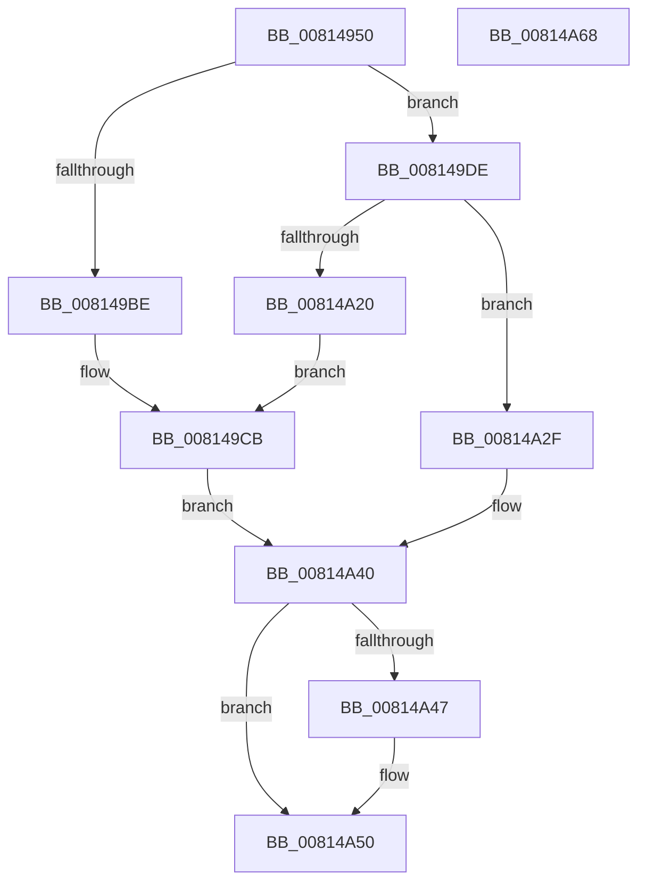

# SdbpCheckMatchingText

- RVA: `0x00814950`–`0x00814A69` (길이 `281` bytes)
- VA: `0x0000000140814950`
- 실행 섹션: `PAGE`
- PDB 이름 있음: `예`; PDB Function 태그: `아니요`
- unwind 정보 RVA: `0x000D99DC`
- 디코드: `79`개 명령, `281/281` bytes 표시
- 미해석 바이트: `0` (있으면 어셈블리에 `.byte`로 보존)

> 이 문서는 커널 이미지의 기계어와 PDB 기호를 분석해 생성했습니다. 4번과 5번은 함수 원형과 자료형을 바이너리 사용 방식에서 추정한 C 해석이며 원본 소스 복구 결과는 아닙니다.

## 1. Dependencies

- 직접 호출 지점: **4**; 고유 호출 대상: **4**
- 직접 호출자로 확인된 함수: **0**
- RIP 상대 이미지 참조: **3**

### Outgoing calls
- `0x008149B5` → [SdbpGetMatchingTextAttributes](SdbpGetMatchingTextAttributes_function_00815B38.md) (function, `0x00815B38`)
- `0x008149D7` → [AslLogCallPrintf](../95/AslLogCallPrintf_function_0095E4EC.md) (function, `0x0095E4EC`)
- `0x00814A17` → [SdbpCheckMatchingTextEntry](SdbpCheckMatchingTextEntry_function_00814A70.md) (function, `0x00814A70`)
- `0x00814A4B` → [AslFree](../95/AslFree_function_0095B674.md) (function, `0x0095B674`)

### Direct callers
- 이 함수 시작 RVA로 연결되는 직접 call은 확인되지 않았습니다. 간접 호출은 완전히 역산할 수 없습니다.

### Static image references
- `0x008149BE` → RVA `0x0003C8E0` (`.rdata`; read)
- `0x008149CB` → RVA `0x0003C8C8` (`.rdata`; read)
- `0x00814A20` → RVA `0x0003C8A0` (`.rdata`; read)

## 2. Other-region calls and transfers

- 다른 실행 섹션으로 향하는 call: **0**
- 별도 외부 분기/꼬리 이동을 확인하지 못했습니다.

## 3. Assembly (complete function range)

```asm
00814950  4C 8B DC                        mov r11, rsp
00814953  49 89 73 10                     mov qword ptr [r11 + 0x10], rsi
00814957  49 89 7B 18                     mov qword ptr [r11 + 0x18], rdi
0081495B  55                              push rbp
0081495C  41 56                           push r14
0081495E  41 57                           push r15
00814960  48 8B EC                        mov rbp, rsp
00814963  48 83 EC 70                     sub rsp, 0x70
00814967  33 F6                           xor esi, esi
00814969  C7 45 20 00 20 00 00            mov dword ptr [rbp + 0x20], 0x2000
00814970  21 31                           and dword ptr [rcx], esi
00814972  4C 8D 4D F0                     lea r9, [rbp - 0x10]
00814976  21 75 EC                        and dword ptr [rbp - 0x14], esi
00814979  4C 8B F1                        mov r14, rcx
0081497C  21 75 E8                        and dword ptr [rbp - 0x18], esi
0081497F  48 8D 4D 20                     lea rcx, [rbp + 0x20]
00814983  48 21 75 F8                     and qword ptr [rbp - 8], rsi
00814987  49 8B C0                        mov rax, r8
0081498A  48 21 75 F0                     and qword ptr [rbp - 0x10], rsi
0081498E  4C 8D 45 F8                     lea r8, [rbp - 8]
00814992  21 75 E4                        and dword ptr [rbp - 0x1c], esi
00814995  4C 8B FA                        mov r15, rdx
00814998  8B 55 40                        mov edx, dword ptr [rbp + 0x40]
0081499B  21 75 E0                        and dword ptr [rbp - 0x20], esi
0081499E  49 89 4B A8                     mov qword ptr [r11 - 0x58], rcx
008149A2  48 8D 4D E0                     lea rcx, [rbp - 0x20]
008149A6  49 89 4B A0                     mov qword ptr [r11 - 0x60], rcx
008149AA  48 8D 4D E4                     lea rcx, [rbp - 0x1c]
008149AE  49 89 4B 98                     mov qword ptr [r11 - 0x68], rcx
008149B2  48 8B C8                        mov rcx, rax
008149B5  E8 7E 11 00 00                  call 0x140815b38
008149BA  85 C0                           test eax, eax
008149BC  75 20                           jne 0x1408149de
008149BE  4C 8D 0D 1B 7F 82 FF            lea r9, [rip - 0x7d80e5]
008149C5  41 B8 86 08 00 00               mov r8d, 0x886
008149CB  48 8D 15 F6 7E 82 FF            lea rdx, [rip - 0x7d810a]
008149D2  B9 01 00 00 00                  mov ecx, 1
008149D7  E8 10 9B 14 00                  call 0x14095e4ec
008149DC  EB 62                           jmp 0x140814a40
008149DE  48 8B 7D 48                     mov rdi, qword ptr [rbp + 0x48]
008149E2  48 8D 45 E8                     lea rax, [rbp - 0x18]
008149E6  4C 8B 4D F0                     mov r9, qword ptr [rbp - 0x10]
008149EA  48 8B D7                        mov rdx, rdi
008149ED  4C 8B 45 F8                     mov r8, qword ptr [rbp - 8]
008149F1  49 8B CF                        mov rcx, r15
008149F4  48 89 44 24 40                  mov qword ptr [rsp + 0x40], rax
008149F9  48 8D 45 EC                     lea rax, [rbp - 0x14]
008149FD  48 89 44 24 38                  mov qword ptr [rsp + 0x38], rax
00814A02  8B 45 20                        mov eax, dword ptr [rbp + 0x20]
00814A05  89 44 24 30                     mov dword ptr [rsp + 0x30], eax
00814A09  8B 45 E0                        mov eax, dword ptr [rbp - 0x20]
00814A0C  89 44 24 28                     mov dword ptr [rsp + 0x28], eax
00814A10  8B 45 E4                        mov eax, dword ptr [rbp - 0x1c]
00814A13  89 44 24 20                     mov dword ptr [rsp + 0x20], eax
00814A17  E8 54 00 00 00                  call 0x140814a70
00814A1C  85 C0                           test eax, eax
00814A1E  75 0F                           jne 0x140814a2f
00814A20  4C 8D 0D 79 7E 82 FF            lea r9, [rip - 0x7d8187]
00814A27  41 B8 97 08 00 00               mov r8d, 0x897
00814A2D  EB 9C                           jmp 0x1408149cb
00814A2F  8B 4D E8                        mov ecx, dword ptr [rbp - 0x18]
00814A32  BE 01 00 00 00                  mov esi, 1
00814A37  09 4F 50                        or dword ptr [rdi + 0x50], ecx
00814A3A  8B 4D EC                        mov ecx, dword ptr [rbp - 0x14]
00814A3D  41 89 0E                        mov dword ptr [r14], ecx
00814A40  48 83 7D F0 00                  cmp qword ptr [rbp - 0x10], 0
00814A45  74 09                           je 0x140814a50
00814A47  48 8B 55 F0                     mov rdx, qword ptr [rbp - 0x10]
00814A4B  E8 24 6C 14 00                  call 0x14095b674
00814A50  4C 8D 5C 24 70                  lea r11, [rsp + 0x70]
00814A55  8B C6                           mov eax, esi
00814A57  49 8B 73 28                     mov rsi, qword ptr [r11 + 0x28]
00814A5B  49 8B 7B 30                     mov rdi, qword ptr [r11 + 0x30]
00814A5F  49 8B E3                        mov rsp, r11
00814A62  41 5F                           pop r15
00814A64  41 5E                           pop r14
00814A66  5D                              pop rbp
00814A67  C3                              ret
00814A68  CC                              int3
```

## 4. C-style interpretation (structured pseudocode)

```c
__int64 __fastcall SdbpCheckMatchingText(__int64 a1, __int64 a2, __int64 a3, __int64 a4, unsigned int a5, __int64 a6)
{
    __int64 result;
    __int64 v_rsi;
    __int64 v_rsp;
    unsigned __int64 v_stack_m18;
    unsigned __int64 v_stack_m20;
    unsigned __int64 v_stack_m28;
    unsigned int v_stack_m2C;
    unsigned int v_stack_m30;
    unsigned int v_stack_m34;
    unsigned int v_stack_m38;
    unsigned __int64 v_stack_m48;
    unsigned __int64 v_stack_m50;
    unsigned int v_stack_m58;
    unsigned int v_stack_m60;
    unsigned int v_stack_m68;
    unsigned int v_stack_p8;

    *(unsigned __int64 *)(v_rsp + 16) = v_rsi;
    *(unsigned __int64 *)(v_rsp + 24) = v_rdi;
    v_rsp = (v_rsp) - (112);
    v_rsi = 0;
    v_stack_p8 = 0x2000ULL;
    *(unsigned __int64 *)(v_rsp - 88) = v_stack_p8;
    *(unsigned __int64 *)(v_rsp - 96) = v_stack_m38;
    *(unsigned __int64 *)(v_rsp - 104) = v_stack_m34;
    result = SdbpGetMatchingTextAttributes(a3, (unsigned int)(a5), v_stack_m20, v_stack_m28);
    if ((unsigned int)(result) != 0) goto loc_008149DE;
loc_008149CB:
    result = AslLogCallPrintf(1, v_rip - 8225034, (unsigned int)(0x886ULL), v_rip - 8224997);
    goto loc_00814A40;
loc_008149DE:
    v_stack_m48 = v_stack_m30;
    v_stack_m50 = v_stack_m2C;
    v_stack_m58 = (unsigned int)((unsigned int)(v_stack_p8));
    v_stack_m60 = (unsigned int)((unsigned int)(v_stack_m38));
    v_stack_m68 = (unsigned int)((unsigned int)(v_stack_m34));
    result = SdbpCheckMatchingTextEntry(a2, a6, v_stack_m20, v_stack_m28);
    if ((unsigned int)(result) != 0) goto loc_00814A2F;
    goto loc_008149CB;
loc_00814A2F:
    *(unsigned int *)(a1) = (unsigned int)((unsigned int)(v_stack_m2C));
loc_00814A40:
    if (v_stack_m28 != 0) {
        a2 = v_stack_m28;
        result = AslFree((unsigned int)(v_stack_m2C), a2, (unsigned int)(0x897ULL), v_rip - 8225159);
    }
    return 1;
}
```

## 5. (Beta) C Style

```c
int64_t SdbpCheckMatchingText(void *Arg1, int64_t Arg2, int64_t Arg3, int64_t Arg4, uint32_t Arg5, void *Arg6)
{
    uint8_t *arg1 = (uint8_t *)Arg1;
    uint8_t *arg6 = (uint8_t *)Arg6;

    int64_t result;
    int64_t local_rsi;
    int64_t local_rsp;
    uint64_t v_stack_m18;
    uint64_t v_stack_m20;
    uint64_t v_stack_m28;
    uint32_t v_stack_m2C;
    uint32_t v_stack_m30;
    uint32_t v_stack_m34;
    uint32_t v_stack_m38;
    uint64_t v_stack_m48;
    uint64_t v_stack_m50;
    uint32_t v_stack_m58;
    uint32_t v_stack_m60;
    uint32_t v_stack_m68;
    uint32_t v_stack_p8;

    *(uint64_t *)(local_rsp + 0x10) = local_rsi;
    *(uint64_t *)(local_rsp + 0x18) = local_rdi;
    local_rsp = (local_rsp) - (112);
    local_rsi = 0;
    v_stack_p8 = 0x2000ULL;
    *(uint64_t *)(local_rsp - 0x58) = v_stack_p8;
    *(uint64_t *)(local_rsp - 0x60) = v_stack_m38;
    *(uint64_t *)(local_rsp - 0x68) = v_stack_m34;
    result = SdbpGetMatchingTextAttributes(Arg3, (uint32_t)(Arg5), v_stack_m20, v_stack_m28);
    if ((uint32_t)(result) != 0) goto loc_008149DE;
loc_008149CB:
    result = AslLogCallPrintf(1, v_rip - 8225034, (uint32_t)(0x886ULL), v_rip - 8224997);
    goto loc_00814A40;
loc_008149DE:
    v_stack_m48 = v_stack_m30;
    v_stack_m50 = v_stack_m2C;
    v_stack_m58 = (uint32_t)((uint32_t)(v_stack_p8));
    v_stack_m60 = (uint32_t)((uint32_t)(v_stack_m38));
    v_stack_m68 = (uint32_t)((uint32_t)(v_stack_m34));
    result = SdbpCheckMatchingTextEntry(Arg2, Arg6, v_stack_m20, v_stack_m28);
    if ((uint32_t)(result) != 0) goto loc_00814A2F;
    goto loc_008149CB;
loc_00814A2F:
    *(uint32_t *)(arg1) = (uint32_t)((uint32_t)(v_stack_m2C));
loc_00814A40:
    if (v_stack_m28 != 0) {
        Arg2 = v_stack_m28;
        result = AslFree((uint32_t)(v_stack_m2C), Arg2, (uint32_t)(0x897ULL), v_rip - 8225159);
    }
    return 1;
}
```

### 관측된 메모리 오프셋

구조체 형식이 확인되지 않은 접근은 인자 기준의 오프셋으로만 기록했습니다.

| 기준 인자 | 오프셋 표현 | 폭 (bit) | 접근 |
|---|---:|---:|---|
| `Arg1` | `+ 0x0` | `32` | `R/W` |
| `Arg1` | `+ 0x0` | `32` | `W` |
| `Arg6` | `+ 0x50` | `32` | `R/W` |

## 6. Execution-region graph

[열기: 2D/3D 그래프와 함수 탐색 컨트롤 패널](../../../control-panel.html?section=page&rva=0x00814950&view=graph)

- 2D 그래프는 위에서 아래로 흐르고, 3D 그래프는 빈 공간을 드래그해 회전합니다. Shift+드래그는 이동, 휠은 확대·축소, 함수 노드 선택은 대상 보고서 이동입니다.

### Static fallback


