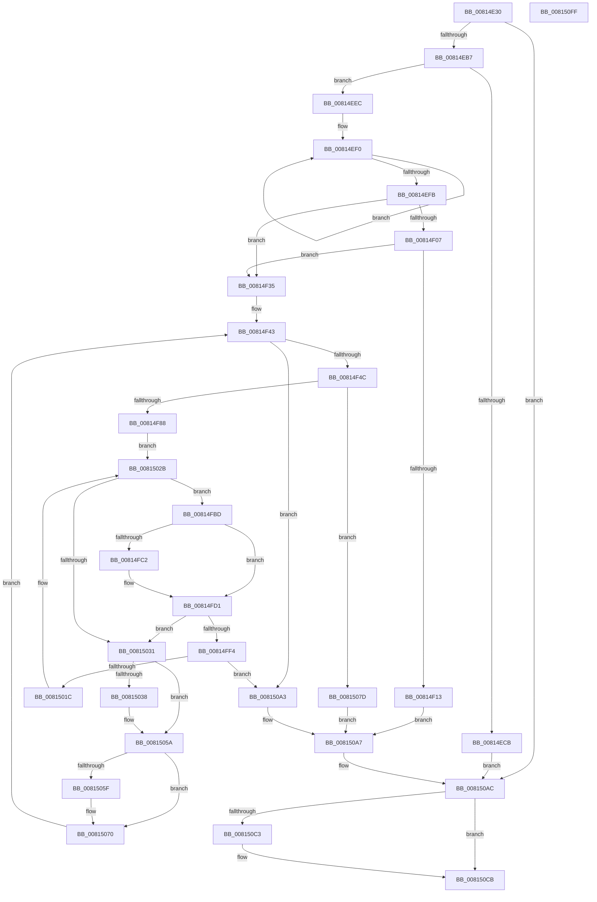

# SdbpCheckMatchingWildcardFiles

- RVA: `0x00814E30`–`0x00815100` (길이 `720` bytes)
- VA: `0x0000000140814E30`
- 실행 섹션: `PAGE`
- PDB 이름 있음: `예`; PDB Function 태그: `아니요`
- unwind 정보 RVA: `0x000D9948`
- 디코드: `181`개 명령, `720/720` bytes 표시
- 미해석 바이트: `0` (있으면 어셈블리에 `.byte`로 보존)

> 이 문서는 커널 이미지의 기계어와 PDB 기호를 분석해 생성했습니다. 4번과 5번은 함수 원형과 자료형을 바이너리 사용 방식에서 추정한 C 해석이며 원본 소스 복구 결과는 아닙니다.

## 1. Dependencies

- 직접 호출 지점: **20**; 고유 호출 대상: **14**
- 직접 호출자로 확인된 함수: **0**
- RIP 상대 이미지 참조: **6**

### Outgoing calls
- `0x00814EAA` → [SdbFindFirstTag](../95/SdbFindFirstTag_function_0095E34C.md) (function, `0x0095E34C`)
- `0x00814EBC` → [SdbGetStringTagPtr](../95/SdbGetStringTagPtr_function_0095DDA8.md) (function, `0x0095DDA8`)
- `0x00814EE2` → [AslLogCallPrintf](../95/AslLogCallPrintf_function_0095E4EC.md) (function, `0x0095E4EC`)
- `0x00814F0A` → [SdbpInitializeSearchDBContext](SdbpInitializeSearchDBContext_function_00816210.md) (function, `0x00816210`)
- `0x00814F29` → [AslLogCallPrintf](../95/AslLogCallPrintf_function_0095E4EC.md) (function, `0x0095E4EC`)
- `0x00814F7B` → [SdbpResolveMatchingFile](SdbpResolveMatchingFile_function_00816A20.md) (function, `0x00816A20`)
- `0x00814F8D` → [AslPathWildcardFindClose](AslPathWildcardFindClose_function_0081B4F0.md) (function, `0x0081B4F0`)
- `0x00814F9F` → [memset](../../text/6C/memset_function_006C6C40.md) (function, `0x006C6C40`)
- `0x00814FB6` → [AslPathWildcardFindFirst](AslPathWildcardFindFirst_function_0081B534.md) (function, `0x0081B534`)
- `0x00814FC5` → [AslFileMappingDelete](../95/AslFileMappingDelete_function_0095B728.md) (function, `0x0095B728`)
- `0x00814FE6` → [AslFileMappingCreate](../95/AslFileMappingCreate_function_00958448.md) (function, `0x00958448`)
- `0x0081500F` → [SdbpCheckAllAttributes](SdbpCheckAllAttributes_function_008187EC.md) (function, `0x008187EC`)
- `0x00815026` → [AslPathWildcardFindNext](AslPathWildcardFindNext_function_0081BB2C.md) (function, `0x0081BB2C`)
- `0x00815055` → [AslLogCallPrintf](../95/AslLogCallPrintf_function_0095E4EC.md) (function, `0x0095E4EC`)
- `0x00815062` → [AslFree](../95/AslFree_function_0095B674.md) (function, `0x0095B674`)
- `0x00815093` → [AslLogCallPrintf](../95/AslLogCallPrintf_function_0095E4EC.md) (function, `0x0095E4EC`)
- `0x008150B1` → [AslPathWildcardFindClose](AslPathWildcardFindClose_function_0081B4F0.md) (function, `0x0081B4F0`)
- `0x008150B9` → [AslFileMappingDelete](../95/AslFileMappingDelete_function_0095B728.md) (function, `0x0095B728`)
- `0x008150C6` → [AslFree](../95/AslFree_function_0095B674.md) (function, `0x0095B674`)
- `0x008150DF` → [_security_check_cookie](../../text/6A/_security_check_cookie_function_006AC640.md) (function, `0x006AC640`)

### Direct callers
- 이 함수 시작 RVA로 연결되는 직접 call은 확인되지 않았습니다. 간접 호출은 완전히 역산할 수 없습니다.

### Static image references
- `0x00814E4F` → RVA `0x00E0A740` (`.data`; read)
- `0x00814ECB` → RVA `0x0003C7D8` (`.rdata`; read)
- `0x00814ED8` → RVA `0x0003CD10` (`.rdata`; read)
- `0x00814F13` → RVA `0x0003C9C0` (`.rdata`; read)
- `0x00815038` → RVA `0x0003CCD0` (`.rdata`; read)
- `0x0081507D` → RVA `0x0003CD30` (`.rdata`; read)

## 2. Other-region calls and transfers

- 다른 실행 섹션으로 향하는 call: **2**
  - `0x00814F9F` → [memset](../../text/6C/memset_function_006C6C40.md) (`PAGE` → `.text`)
  - `0x008150DF` → [_security_check_cookie](../../text/6A/_security_check_cookie_function_006AC640.md) (`PAGE` → `.text`)
- 별도 외부 분기/꼬리 이동을 확인하지 못했습니다.

## 3. Assembly (complete function range)

```asm
00814E30  48 89 5C 24 20                  mov qword ptr [rsp + 0x20], rbx
00814E35  55                              push rbp
00814E36  56                              push rsi
00814E37  57                              push rdi
00814E38  41 54                           push r12
00814E3A  41 55                           push r13
00814E3C  41 56                           push r14
00814E3E  41 57                           push r15
00814E40  48 8D AC 24 70 FE FF FF         lea rbp, [rsp - 0x190]
00814E48  48 81 EC 90 02 00 00            sub rsp, 0x290
00814E4F  48 8B 05 EA 58 5F 00            mov rax, qword ptr [rip + 0x5f58ea]
00814E56  48 33 C4                        xor rax, rsp
00814E59  48 89 85 80 01 00 00            mov qword ptr [rbp + 0x180], rax
00814E60  4C 8B B5 F8 01 00 00            mov r14, qword ptr [rbp + 0x1f8]
00814E67  33 C0                           xor eax, eax
00814E69  4D 8B F8                        mov r15, r8
00814E6C  4C 89 44 24 60                  mov qword ptr [rsp + 0x60], r8
00814E71  48 89 54 24 58                  mov qword ptr [rsp + 0x58], rdx
00814E76  4C 8B E1                        mov r12, rcx
00814E79  8B 95 F0 01 00 00               mov edx, dword ptr [rbp + 0x1f0]
00814E7F  41 B8 01 60 00 00               mov r8d, 0x6001
00814E85  48 89 4C 24 50                  mov qword ptr [rsp + 0x50], rcx
00814E8A  8B D8                           mov ebx, eax
00814E8C  49 8B CF                        mov rcx, r15
00814E8F  89 44 24 30                     mov dword ptr [rsp + 0x30], eax
00814E93  89 44 24 34                     mov dword ptr [rsp + 0x34], eax
00814E97  8B F8                           mov edi, eax
00814E99  48 89 44 24 40                  mov qword ptr [rsp + 0x40], rax
00814E9E  8B F0                           mov esi, eax
00814EA0  48 89 44 24 38                  mov qword ptr [rsp + 0x38], rax
00814EA5  48 89 44 24 48                  mov qword ptr [rsp + 0x48], rax
00814EAA  E8 9D 94 14 00                  call 0x14095e34c
00814EAF  85 C0                           test eax, eax
00814EB1  0F 84 F5 01 00 00               je 0x1408150ac
00814EB7  8B D0                           mov edx, eax
00814EB9  49 8B CF                        mov rcx, r15
00814EBC  E8 E7 8E 14 00                  call 0x14095dda8
00814EC1  4C 8B E8                        mov r13, rax
00814EC4  33 C0                           xor eax, eax
00814EC6  4D 85 ED                        test r13, r13
00814EC9  75 21                           jne 0x140814eec
00814ECB  4C 8D 0D 06 79 82 FF            lea r9, [rip - 0x7d86fa]
00814ED2  41 B8 55 0D 00 00               mov r8d, 0xd55
00814ED8  48 8D 15 31 7E 82 FF            lea rdx, [rip - 0x7d81cf]
00814EDF  8D 4E 01                        lea ecx, [rsi + 1]
00814EE2  E8 05 96 14 00                  call 0x14095e4ec
00814EE7  E9 C0 01 00 00                  jmp 0x1408150ac
00814EEC  49 83 CC FF                     or r12, 0xffffffffffffffff
00814EF0  49 FF C4                        inc r12
00814EF3  66 43 39 44 65 00               cmp word ptr [r13 + r12*2], ax
00814EF9  75 F5                           jne 0x140814ef0
00814EFB  41 8B 06                        mov eax, dword ptr [r14]
00814EFE  BB 01 00 00 00                  mov ebx, 1
00814F03  84 C3                           test bl, al
00814F05  75 2E                           jne 0x140814f35
00814F07  49 8B CE                        mov rcx, r14
00814F0A  E8 01 13 00 00                  call 0x140816210
00814F0F  85 C0                           test eax, eax
00814F11  75 22                           jne 0x140814f35
00814F13  4C 8D 0D A6 7A 82 FF            lea r9, [rip - 0x7d855a]
00814F1A  41 B8 63 0D 00 00               mov r8d, 0xd63
00814F20  48 8D 15 E9 7D 82 FF            lea rdx, [rip - 0x7d8217]
00814F27  8B CB                           mov ecx, ebx
00814F29  E8 BE 95 14 00                  call 0x14095e4ec
00814F2E  8B DE                           mov ebx, esi
00814F30  E9 72 01 00 00                  jmp 0x1408150a7
00814F35  49 8B 56 48                     mov rdx, qword ptr [r14 + 0x48]
00814F39  33 C0                           xor eax, eax
00814F3B  48 89 54 24 68                  mov qword ptr [rsp + 0x68], rdx
00814F40  44 8B F8                        mov r15d, eax
00814F43  44 3B 3A                        cmp r15d, dword ptr [rdx]
00814F46  0F 8D 57 01 00 00               jge 0x1408150a3
00814F4C  48 83 C2 08                     add rdx, 8
00814F50  49 63 C7                        movsxd rax, r15d
00814F53  48 8D 4C 24 40                  lea rcx, [rsp + 0x40]
00814F58  45 8B CC                        mov r9d, r12d
00814F5B  48 89 4C 24 28                  mov qword ptr [rsp + 0x28], rcx
00814F60  4D 8B C5                        mov r8, r13
00814F63  48 8B 4C 24 58                  mov rcx, qword ptr [rsp + 0x58]
00814F68  48 8D 04 40                     lea rax, [rax + rax*2]
00814F6C  48 C1 E0 04                     shl rax, 4
00814F70  48 03 C2                        add rax, rdx
00814F73  49 8B D6                        mov rdx, r14
00814F76  48 89 44 24 20                  mov qword ptr [rsp + 0x20], rax
00814F7B  E8 A0 1A 00 00                  call 0x140816a20
00814F80  85 C0                           test eax, eax
00814F82  0F 84 F5 00 00 00               je 0x14081507d
00814F88  48 8D 4C 24 48                  lea rcx, [rsp + 0x48]
00814F8D  E8 5E 65 00 00                  call 0x14081b4f0
00814F92  33 D2                           xor edx, edx
00814F94  48 8D 4C 24 70                  lea rcx, [rsp + 0x70]
00814F99  41 B8 08 02 00 00               mov r8d, 0x208
00814F9F  E8 9C 1C EB FF                  call 0x1406c6c40
00814FA4  48 8B 7C 24 40                  mov rdi, qword ptr [rsp + 0x40]
00814FA9  4C 8D 4C 24 48                  lea r9, [rsp + 0x48]
00814FAE  4C 8B C7                        mov r8, rdi
00814FB1  48 8D 4C 24 70                  lea rcx, [rsp + 0x70]
00814FB6  E8 79 65 00 00                  call 0x14081b534
00814FBB  EB 6E                           jmp 0x14081502b
00814FBD  48 85 F6                        test rsi, rsi
00814FC0  74 0F                           je 0x140814fd1
00814FC2  48 8B CE                        mov rcx, rsi
00814FC5  E8 5E 67 14 00                  call 0x14095b728
00814FCA  33 C9                           xor ecx, ecx
00814FCC  48 89 4C 24 38                  mov qword ptr [rsp + 0x38], rcx
00814FD1  48 89 4C 24 20                  mov qword ptr [rsp + 0x20], rcx
00814FD6  48 8D 54 24 70                  lea rdx, [rsp + 0x70]
00814FDB  48 8D 4C 24 38                  lea rcx, [rsp + 0x38]
00814FE0  45 33 C9                        xor r9d, r9d
00814FE3  45 33 C0                        xor r8d, r8d
00814FE6  E8 5D 34 14 00                  call 0x140958448
00814FEB  48 8B 74 24 38                  mov rsi, qword ptr [rsp + 0x38]
00814FF0  85 C0                           test eax, eax
00814FF2  78 3D                           js 0x140815031
00814FF4  44 8B 8D F0 01 00 00            mov r9d, dword ptr [rbp + 0x1f0]
00814FFB  48 8D 4C 24 34                  lea rcx, [rsp + 0x34]
00815000  4C 8B 44 24 60                  mov r8, qword ptr [rsp + 0x60]
00815005  48 8B 54 24 58                  mov rdx, qword ptr [rsp + 0x58]
0081500A  48 89 74 24 20                  mov qword ptr [rsp + 0x20], rsi
0081500F  E8 D8 37 00 00                  call 0x1408187ec
00815014  85 C0                           test eax, eax
00815016  0F 89 87 00 00 00               jns 0x1408150a3
0081501C  4C 8B 44 24 48                  mov r8, qword ptr [rsp + 0x48]
00815021  48 8D 4C 24 70                  lea rcx, [rsp + 0x70]
00815026  E8 01 6B 00 00                  call 0x14081bb2c
0081502B  33 C9                           xor ecx, ecx
0081502D  85 C0                           test eax, eax
0081502F  79 8C                           jns 0x140814fbd
00815031  3D 06 00 00 80                  cmp eax, 0x80000006
00815036  74 22                           je 0x14081505a
00815038  4C 8D 0D 91 7C 82 FF            lea r9, [rip - 0x7d836f]
0081503F  89 44 24 20                     mov dword ptr [rsp + 0x20], eax
00815043  41 B8 B1 0D 00 00               mov r8d, 0xdb1
00815049  48 8D 15 C0 7C 82 FF            lea rdx, [rip - 0x7d8340]
00815050  B9 03 00 00 00                  mov ecx, 3
00815055  E8 92 94 14 00                  call 0x14095e4ec
0081505A  48 85 FF                        test rdi, rdi
0081505D  74 11                           je 0x140815070
0081505F  48 8B D7                        mov rdx, rdi
00815062  E8 0D 66 14 00                  call 0x14095b674
00815067  33 C0                           xor eax, eax
00815069  8B F8                           mov edi, eax
0081506B  48 89 44 24 40                  mov qword ptr [rsp + 0x40], rax
00815070  48 8B 54 24 68                  mov rdx, qword ptr [rsp + 0x68]
00815075  44 03 FB                        add r15d, ebx
00815078  E9 C6 FE FF FF                  jmp 0x140814f43
0081507D  4C 8D 0D AC 7C 82 FF            lea r9, [rip - 0x7d8354]
00815084  41 B8 7B 0D 00 00               mov r8d, 0xd7b
0081508A  48 8D 15 7F 7C 82 FF            lea rdx, [rip - 0x7d8381]
00815091  8B CB                           mov ecx, ebx
00815093  E8 54 94 14 00                  call 0x14095e4ec
00815098  48 8B 7C 24 40                  mov rdi, qword ptr [rsp + 0x40]
0081509D  8B 5C 24 30                     mov ebx, dword ptr [rsp + 0x30]
008150A1  EB 04                           jmp 0x1408150a7
008150A3  41 89 5E 50                     mov dword ptr [r14 + 0x50], ebx
008150A7  4C 8B 64 24 50                  mov r12, qword ptr [rsp + 0x50]
008150AC  48 8D 4C 24 48                  lea rcx, [rsp + 0x48]
008150B1  E8 3A 64 00 00                  call 0x14081b4f0
008150B6  48 8B CE                        mov rcx, rsi
008150B9  E8 6A 66 14 00                  call 0x14095b728
008150BE  48 85 FF                        test rdi, rdi
008150C1  74 08                           je 0x1408150cb
008150C3  48 8B D7                        mov rdx, rdi
008150C6  E8 A9 65 14 00                  call 0x14095b674
008150CB  8B 4C 24 34                     mov ecx, dword ptr [rsp + 0x34]
008150CF  8B C3                           mov eax, ebx
008150D1  41 89 0C 24                     mov dword ptr [r12], ecx
008150D5  48 8B 8D 80 01 00 00            mov rcx, qword ptr [rbp + 0x180]
008150DC  48 33 CC                        xor rcx, rsp
008150DF  E8 5C 75 E9 FF                  call 0x1406ac640
008150E4  48 8B 9C 24 E8 02 00 00         mov rbx, qword ptr [rsp + 0x2e8]
008150EC  48 81 C4 90 02 00 00            add rsp, 0x290
008150F3  41 5F                           pop r15
008150F5  41 5E                           pop r14
008150F7  41 5D                           pop r13
008150F9  41 5C                           pop r12
008150FB  5F                              pop rdi
008150FC  5E                              pop rsi
008150FD  5D                              pop rbp
008150FE  C3                              ret
008150FF  CC                              int3
```

## 4. C-style interpretation (structured pseudocode)

```c
__int64 __fastcall SdbpCheckMatchingWildcardFiles(__int64 a1, __int64 a2, __int64 a3, __int64 a4, unsigned int a5, __int64 a6)
{
    __int64 result;
    __int64 v_r12;
    __int64 v_r15;
    __int64 v_rdi;
    __int64 v_rsp;
    unsigned __int64 v_stack_m1C8;
    unsigned __int64 v_stack_m258;
    unsigned __int64 v_stack_m260;
    unsigned __int64 v_stack_m268;
    unsigned __int64 v_stack_m270;
    unsigned __int64 v_stack_m278;
    unsigned __int64 v_stack_m280;
    unsigned __int64 v_stack_m288;
    unsigned __int64 v_stack_m290;
    unsigned int v_stack_m294;
    unsigned int v_stack_m298;
    unsigned __int64 v_stack_m2A0;
    unsigned __int64 v_stack_m2A8;
    unsigned __int64 v_stack_m48;
    unsigned __int64 v_stack_p20;

    v_stack_p20 = v_rbx;
    v_rsp = (v_rsp) - (656);
    result = (*(unsigned __int64 *)(v_rip + 6248682)) ^ (v_rsp);
    v_stack_m48 = result;
    result = 0;
    v_stack_m268 = a3;
    v_stack_m270 = a2;
    v_stack_m278 = a1;
    v_stack_m298 = 0;
    v_stack_m294 = 0;
    v_stack_m288 = 0;
    v_stack_m290 = 0;
    v_stack_m280 = 0;
    result = SdbFindFirstTag(a3, (unsigned int)(a5), (unsigned int)(0x6001ULL), a4);
    if ((unsigned int)(result) == 0) goto loc_008150AC;
    result = SdbGetStringTagPtr(a3, (unsigned int)((unsigned int)(result)), (unsigned int)(0x6001ULL), a4);
    result = 0;
    if (0 != 0) goto loc_00814EEC;
    result = AslLogCallPrintf(0 + 1, v_rip - 8225231, (unsigned int)(0xD55ULL), v_rip - 8226554);
    goto loc_008150AC;
loc_00814EEC:
    v_r12 = (a1) | (-1);
loc_00814EF0:
    v_r12 = (v_r12) + 1;
    if ((*(unsigned __int16 *)(result + v_r12 * 2)) != ((unsigned __int16)(result))) goto loc_00814EF0;
    if (((1) & ((unsigned __int8)((unsigned int)(*(unsigned int *)(a6))))) != 0) goto loc_00814F35;
    result = SdbpInitializeSearchDBContext(a6, v_rip - 8225231, (unsigned int)(0xD55ULL), v_rip - 8226554);
    if ((unsigned int)(result) != 0) goto loc_00814F35;
    result = AslLogCallPrintf(1, v_rip - 8225303, (unsigned int)(0xD63ULL), v_rip - 8226138);
    goto loc_008150A7;
loc_00814F35:
    result = 0;
    v_stack_m260 = *(unsigned __int64 *)(a6 + 72);
loc_00814F43:
    if (0 >= (*(unsigned int *)(*(unsigned __int64 *)(a6 + 72)))) goto loc_008150A3;
    a2 = (*(unsigned __int64 *)(a6 + 72)) + (8);
    v_stack_m2A0 = v_stack_m288;
    result = ((int)(0) + (int)(0) * 2) << (4);
    result = (result) + (a2);
    v_stack_m2A8 = result;
    result = SdbpResolveMatchingFile(v_stack_m270, a6, 0, (unsigned int)((unsigned int)(v_r12)));
    if ((unsigned int)(result) == 0) goto loc_0081507D;
    result = AslPathWildcardFindClose(v_stack_m280, a6, 0, (unsigned int)((unsigned int)(v_r12)));
    a2 = 0;
    result = memset(v_stack_m258, a2, 520, (unsigned int)((unsigned int)(v_r12)));
    result = AslPathWildcardFindFirst(v_stack_m258, a2, v_stack_m288, v_stack_m280);
    goto loc_0081502B;
loc_00814FBD:
    if (0 != 0) {
        a1 = 0;
        result = AslFileMappingDelete(a1, a2, v_stack_m288, v_stack_m280);
        a1 = 0;
        v_stack_m290 = 0;
    }
    v_stack_m2A8 = 0;
    a4 = 0;
    a3 = 0;
    result = AslFileMappingCreate(v_stack_m290, v_stack_m258, a3, a4);
    if (sign_flag) goto loc_00815031;
    v_stack_m2A8 = v_stack_m290;
    result = SdbpCheckAllAttributes(v_stack_m294, v_stack_m270, v_stack_m268, (unsigned int)(a5));
    if (!sign_flag) goto loc_008150A3;
    result = AslPathWildcardFindNext(v_stack_m258, v_stack_m270, v_stack_m280, (unsigned int)(a5));
loc_0081502B:
    a1 = 0;
    if (!sign_flag) goto loc_00814FBD;
loc_00815031:
    if (((unsigned int)(result)) != 0x80000006ULL) {
        a4 = v_rip - 8225647;
        v_stack_m2A8 = (unsigned int)(result);
        a3 = 0xDB1ULL;
        a2 = v_rip - 8225600;
        a1 = 3;
        result = AslLogCallPrintf(a1, a2, a3, a4);
    }
    v_rdi = v_stack_m288;
    if (v_stack_m288 != 0) {
        a2 = v_stack_m288;
        result = AslFree(a1, a2, a3, a4);
        result = 0;
        v_rdi = 0;
        v_stack_m288 = 0;
    }
    v_r15 = (unsigned int)((0) + (0));
    goto loc_00814F43;
loc_0081507D:
    result = AslLogCallPrintf(0, v_rip - 8225665, (unsigned int)(0xD7BULL), v_rip - 8225620);
    goto loc_008150A7;
loc_008150A3:
    *(unsigned int *)(a6 + 80) = (unsigned int)((unsigned int)(v_stack_m298));
loc_008150A7:
loc_008150AC:
    result = AslPathWildcardFindClose(v_stack_m280, v_rip - 8225665, (unsigned int)(0xD7BULL), v_rip - 8225620);
    result = AslFileMappingDelete(v_stack_m290, v_rip - 8225665, (unsigned int)(0xD7BULL), v_rip - 8225620);
    if (v_stack_m288 != 0) {
        a2 = v_stack_m288;
        result = AslFree(v_stack_m290, a2, (unsigned int)(0xD7BULL), v_rip - 8225620);
    }
    *(unsigned int *)(v_stack_m278) = (unsigned int)((unsigned int)(v_stack_m294));
    a1 = (v_stack_m48) ^ (v_rsp);
    result = _security_check_cookie(a1, a2, (unsigned int)(0xD7BULL), v_rip - 8225620);
    v_rsp = (v_rsp) + (656);
    return result;
}
```

## 5. (Beta) C Style

```c
int64_t SdbpCheckMatchingWildcardFiles(int64_t Arg1, int64_t Arg2, int64_t Arg3, int64_t Arg4, uint32_t Arg5, void *Arg6)
{
    uint8_t *arg6 = (uint8_t *)Arg6;

    int64_t result;
    int64_t local_r12;
    int64_t local_r15;
    int64_t local_rdi;
    int64_t local_rsp;
    uint64_t v_stack_m1C8;
    uint64_t v_stack_m258;
    uint64_t v_stack_m260;
    uint64_t v_stack_m268;
    uint64_t v_stack_m270;
    uint64_t v_stack_m278;
    uint64_t v_stack_m280;
    uint64_t v_stack_m288;
    uint64_t v_stack_m290;
    uint32_t v_stack_m294;
    uint32_t v_stack_m298;
    uint64_t v_stack_m2A0;
    uint64_t v_stack_m2A8;
    uint64_t v_stack_m48;
    uint64_t v_stack_p20;

    v_stack_p20 = local_rbx;
    local_rsp = (local_rsp) - (656);
    result = (*(uint64_t *)(v_rip + 0x5F58EA)) ^ (local_rsp);
    v_stack_m48 = result;
    result = 0;
    v_stack_m268 = Arg3;
    v_stack_m270 = Arg2;
    v_stack_m278 = Arg1;
    v_stack_m298 = 0;
    v_stack_m294 = 0;
    v_stack_m288 = 0;
    v_stack_m290 = 0;
    v_stack_m280 = 0;
    result = SdbFindFirstTag(Arg3, (uint32_t)(Arg5), (uint32_t)(0x6001ULL), Arg4);
    if ((uint32_t)(result) == 0) goto loc_008150AC;
    result = SdbGetStringTagPtr(Arg3, (uint32_t)((uint32_t)(result)), (uint32_t)(0x6001ULL), Arg4);
    result = 0;
    if (0 != 0) goto loc_00814EEC;
    result = AslLogCallPrintf(0 + 1, v_rip - 8225231, (uint32_t)(0xD55ULL), v_rip - 8226554);
    goto loc_008150AC;
loc_00814EEC:
    local_r12 = (Arg1) | (-1);
loc_00814EF0:
    local_r12 = (local_r12) + 1;
    if ((*(uint16_t *)(result + local_r12 * 2)) != ((uint16_t)(result))) goto loc_00814EF0;
    if (((1) & ((uint8_t)((uint32_t)(*(uint32_t *)(arg6))))) != 0) goto loc_00814F35;
    result = SdbpInitializeSearchDBContext(Arg6, v_rip - 8225231, (uint32_t)(0xD55ULL), v_rip - 8226554);
    if ((uint32_t)(result) != 0) goto loc_00814F35;
    result = AslLogCallPrintf(1, v_rip - 8225303, (uint32_t)(0xD63ULL), v_rip - 8226138);
    goto loc_008150A7;
loc_00814F35:
    result = 0;
    v_stack_m260 = *(uint64_t *)(arg6 + 0x48);
loc_00814F43:
    if (0 >= (*(uint32_t *)(*(uint64_t *)(arg6 + 0x48)))) goto loc_008150A3;
    Arg2 = (*(uint64_t *)(arg6 + 0x48)) + (8);
    v_stack_m2A0 = v_stack_m288;
    result = ((int32_t)(0) + (int32_t)(0) * 2) << (4);
    result = (result) + (Arg2);
    v_stack_m2A8 = result;
    result = SdbpResolveMatchingFile(v_stack_m270, Arg6, 0, (uint32_t)((uint32_t)(local_r12)));
    if ((uint32_t)(result) == 0) goto loc_0081507D;
    result = AslPathWildcardFindClose(v_stack_m280, Arg6, 0, (uint32_t)((uint32_t)(local_r12)));
    Arg2 = 0;
    result = memset(v_stack_m258, Arg2, 520, (uint32_t)((uint32_t)(local_r12)));
    result = AslPathWildcardFindFirst(v_stack_m258, Arg2, v_stack_m288, v_stack_m280);
    goto loc_0081502B;
loc_00814FBD:
    if (0 != 0) {
        Arg1 = 0;
        result = AslFileMappingDelete(Arg1, Arg2, v_stack_m288, v_stack_m280);
        Arg1 = 0;
        v_stack_m290 = 0;
    }
    v_stack_m2A8 = 0;
    Arg4 = 0;
    Arg3 = 0;
    result = AslFileMappingCreate(v_stack_m290, v_stack_m258, Arg3, Arg4);
    if (sign_flag) goto loc_00815031;
    v_stack_m2A8 = v_stack_m290;
    result = SdbpCheckAllAttributes(v_stack_m294, v_stack_m270, v_stack_m268, (uint32_t)(Arg5));
    if (!sign_flag) goto loc_008150A3;
    result = AslPathWildcardFindNext(v_stack_m258, v_stack_m270, v_stack_m280, (uint32_t)(Arg5));
loc_0081502B:
    Arg1 = 0;
    if (!sign_flag) goto loc_00814FBD;
loc_00815031:
    if (((uint32_t)(result)) != 0x80000006ULL) {
        Arg4 = v_rip - 8225647;
        v_stack_m2A8 = (uint32_t)(result);
        Arg3 = 0xDB1ULL;
        Arg2 = v_rip - 8225600;
        Arg1 = 3;
        result = AslLogCallPrintf(Arg1, Arg2, Arg3, Arg4);
    }
    local_rdi = v_stack_m288;
    if (v_stack_m288 != 0) {
        Arg2 = v_stack_m288;
        result = AslFree(Arg1, Arg2, Arg3, Arg4);
        result = 0;
        local_rdi = 0;
        v_stack_m288 = 0;
    }
    local_r15 = (uint32_t)((0) + (0));
    goto loc_00814F43;
loc_0081507D:
    result = AslLogCallPrintf(0, v_rip - 8225665, (uint32_t)(0xD7BULL), v_rip - 8225620);
    goto loc_008150A7;
loc_008150A3:
    *(uint32_t *)(arg6 + 0x50) = (uint32_t)((uint32_t)(v_stack_m298));
loc_008150A7:
loc_008150AC:
    result = AslPathWildcardFindClose(v_stack_m280, v_rip - 8225665, (uint32_t)(0xD7BULL), v_rip - 8225620);
    result = AslFileMappingDelete(v_stack_m290, v_rip - 8225665, (uint32_t)(0xD7BULL), v_rip - 8225620);
    if (v_stack_m288 != 0) {
        Arg2 = v_stack_m288;
        result = AslFree(v_stack_m290, Arg2, (uint32_t)(0xD7BULL), v_rip - 8225620);
    }
    *(uint32_t *)(v_stack_m278) = (uint32_t)((uint32_t)(v_stack_m294));
    Arg1 = (v_stack_m48) ^ (local_rsp);
    result = _security_check_cookie(Arg1, Arg2, (uint32_t)(0xD7BULL), v_rip - 8225620);
    local_rsp = (local_rsp) + (656);
    return result;
}
```

### 관측된 메모리 오프셋

구조체 형식이 확인되지 않은 접근은 인자 기준의 오프셋으로만 기록했습니다.

| 기준 인자 | 오프셋 표현 | 폭 (bit) | 접근 |
|---|---:|---:|---|
| `Arg6` | `+ 0x0` | `32` | `R` |
| `Arg6` | `+ 0x48` | `64` | `R` |
| `Arg6` | `+ 0x50` | `32` | `W` |

## 6. Execution-region graph

[열기: 2D/3D 그래프와 함수 탐색 컨트롤 패널](../../../control-panel.html?section=page&rva=0x00814E30&view=graph)

- 2D 그래프는 위에서 아래로 흐르고, 3D 그래프는 빈 공간을 드래그해 회전합니다. Shift+드래그는 이동, 휠은 확대·축소, 함수 노드 선택은 대상 보고서 이동입니다.

### Static fallback


