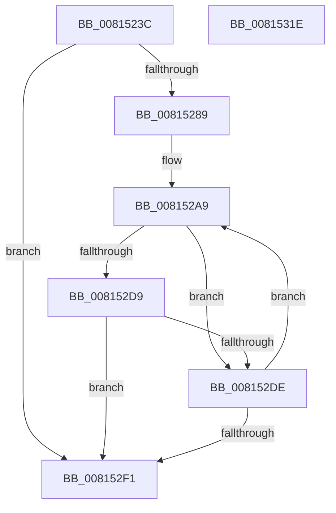

# SdbpCheckMatchingWildcardRegistryEntry

- RVA: `0x0081523C`–`0x0081531F` (길이 `227` bytes)
- VA: `0x000000014081523C`
- 실행 섹션: `PAGE`
- PDB 이름 있음: `예`; PDB Function 태그: `아니요`
- unwind 정보 RVA: `0x0008C11C`
- 디코드: `62`개 명령, `227/227` bytes 표시
- 미해석 바이트: `0` (있으면 어셈블리에 `.byte`로 보존)

> 이 문서는 커널 이미지의 기계어와 PDB 기호를 분석해 생성했습니다. 4번과 5번은 함수 원형과 자료형을 바이너리 사용 방식에서 추정한 C 해석이며 원본 소스 복구 결과는 아닙니다.

## 1. Dependencies

- 직접 호출 지점: **4**; 고유 호출 대상: **4**
- 직접 호출자로 확인된 함수: **1**
- RIP 상대 이미지 참조: **0**

### Outgoing calls
- `0x00815280` → [AslRegWildcardFindFirst](AslRegWildcardFindFirst_function_0081C2F0.md) (function, `0x0081C2F0`)
- `0x008152D0` → [SdbpCheckMatchingRegistryValue](SdbpCheckMatchingRegistryValue_function_0081462C.md) (function, `0x0081462C`)
- `0x008152E8` → [AslRegWildcardFindNext](AslRegWildcardFindNext_function_0081C3B0.md) (function, `0x0081C3B0`)
- `0x008152F6` → [AslRegWildcardFindClose](AslRegWildcardFindClose_function_0081C27C.md) (function, `0x0081C27C`)

### Direct callers
- [SdbpCheckMatchingWildcardRegistry](SdbpCheckMatchingWildcardRegistry_function_00815110.md) at `0x008151F4`

### Static image references
- 디코드된 RIP-relative 메모리 참조가 없습니다.

## 2. Other-region calls and transfers

- 다른 실행 섹션으로 향하는 call: **0**
- 별도 외부 분기/꼬리 이동을 확인하지 못했습니다.

## 3. Assembly (complete function range)

```asm
0081523C  48 8B C4                        mov rax, rsp
0081523F  48 89 58 08                     mov qword ptr [rax + 8], rbx
00815243  48 89 68 10                     mov qword ptr [rax + 0x10], rbp
00815247  48 89 70 18                     mov qword ptr [rax + 0x18], rsi
0081524B  57                              push rdi
0081524C  41 54                           push r12
0081524E  41 55                           push r13
00815250  41 56                           push r14
00815252  41 57                           push r15
00815254  48 83 EC 60                     sub rsp, 0x60
00815258  48 8B 9C 24 D0 00 00 00         mov rbx, qword ptr [rsp + 0xd0]
00815260  33 FF                           xor edi, edi
00815262  45 8B E0                        mov r12d, r8d
00815265  48 89 78 D0                     mov qword ptr [rax - 0x30], rdi
00815269  4C 8B EA                        mov r13, rdx
0081526C  48 89 78 C8                     mov qword ptr [rax - 0x38], rdi
00815270  4C 8B C1                        mov r8, rcx
00815273  48 8D 50 D0                     lea rdx, [rax - 0x30]
00815277  48 8D 48 C8                     lea rcx, [rax - 0x38]
0081527B  89 3B                           mov dword ptr [rbx], edi
0081527D  4D 8B F9                        mov r15, r9
00815280  E8 6B 70 00 00                  call 0x14081c2f0
00815285  85 C0                           test eax, eax
00815287  78 68                           js 0x1408152f1
00815289  48 8B BC 24 C8 00 00 00         mov rdi, qword ptr [rsp + 0xc8]
00815291  48 8B B4 24 C0 00 00 00         mov rsi, qword ptr [rsp + 0xc0]
00815299  48 8B AC 24 B8 00 00 00         mov rbp, qword ptr [rsp + 0xb8]
008152A1  44 8B B4 24 B0 00 00 00         mov r14d, dword ptr [rsp + 0xb0]
008152A9  48 8B 4C 24 50                  mov rcx, qword ptr [rsp + 0x50]
008152AE  4D 8B CF                        mov r9, r15
008152B1  48 89 5C 24 40                  mov qword ptr [rsp + 0x40], rbx
008152B6  45 8B C4                        mov r8d, r12d
008152B9  48 89 7C 24 38                  mov qword ptr [rsp + 0x38], rdi
008152BE  49 8B D5                        mov rdx, r13
008152C1  48 89 74 24 30                  mov qword ptr [rsp + 0x30], rsi
008152C6  48 89 6C 24 28                  mov qword ptr [rsp + 0x28], rbp
008152CB  44 89 74 24 20                  mov dword ptr [rsp + 0x20], r14d
008152D0  E8 57 F3 FF FF                  call 0x14081462c
008152D5  85 C0                           test eax, eax
008152D7  74 05                           je 0x1408152de
008152D9  83 3B 00                        cmp dword ptr [rbx], 0
008152DC  75 13                           jne 0x1408152f1
008152DE  48 8B 54 24 58                  mov rdx, qword ptr [rsp + 0x58]
008152E3  48 8D 4C 24 50                  lea rcx, [rsp + 0x50]
008152E8  E8 C3 70 00 00                  call 0x14081c3b0
008152ED  85 C0                           test eax, eax
008152EF  79 B8                           jns 0x1408152a9
008152F1  48 8B 4C 24 58                  mov rcx, qword ptr [rsp + 0x58]
008152F6  E8 81 6F 00 00                  call 0x14081c27c
008152FB  4C 8D 5C 24 60                  lea r11, [rsp + 0x60]
00815300  B8 01 00 00 00                  mov eax, 1
00815305  49 8B 5B 30                     mov rbx, qword ptr [r11 + 0x30]
00815309  49 8B 6B 38                     mov rbp, qword ptr [r11 + 0x38]
0081530D  49 8B 73 40                     mov rsi, qword ptr [r11 + 0x40]
00815311  49 8B E3                        mov rsp, r11
00815314  41 5F                           pop r15
00815316  41 5E                           pop r14
00815318  41 5D                           pop r13
0081531A  41 5C                           pop r12
0081531C  5F                              pop rdi
0081531D  C3                              ret
0081531E  CC                              int3
```

## 4. C-style interpretation (structured pseudocode)

```c
__int64 __fastcall SdbpCheckMatchingWildcardRegistryEntry(__int64 a1, __int64 a2, int a3, __int64 a4, unsigned int a5, __int64 a6, __int64 a7, __int64 a8, __int64 a9)
{
    __int64 result;
    __int64 v_rdi;
    __int64 v_rsp;
    unsigned __int64 v_stack_m28;
    unsigned __int64 v_stack_m30;
    unsigned __int64 v_stack_m38;
    unsigned __int64 v_stack_m48;
    unsigned __int64 v_stack_m50;
    unsigned __int64 v_stack_m58;
    unsigned __int64 v_stack_m60;
    unsigned int v_stack_m68;

    *(unsigned __int64 *)(v_rsp + 8) = v_rbx;
    *(unsigned __int64 *)(v_rsp + 16) = v_rbp;
    *(unsigned __int64 *)(v_rsp + 24) = v_rsi;
    v_rsp = (v_rsp) - (96);
    v_rdi = 0;
    *(unsigned __int64 *)(v_rsp - 48) = 0;
    *(unsigned __int64 *)(v_rsp - 56) = 0;
    *(unsigned int *)(a9) = 0;
    result = AslRegWildcardFindFirst(v_rsp - 56, v_rsp - 48, a1, a4);
    if (sign_flag) goto loc_008152F1;
loc_008152A9:
    v_stack_m48 = a9;
    v_stack_m50 = a8;
    v_stack_m58 = a7;
    v_stack_m60 = a6;
    v_stack_m68 = (unsigned int)((unsigned int)(a5));
    result = SdbpCheckMatchingRegistryValue(v_stack_m38, a2, (unsigned int)((unsigned int)((unsigned int)(a3))), a4);
    if ((unsigned int)(result) == 0) goto loc_008152DE;
    if ((*(unsigned int *)(a9)) != 0) goto loc_008152F1;
loc_008152DE:
    result = AslRegWildcardFindNext(v_stack_m38, v_stack_m30, (unsigned int)((unsigned int)((unsigned int)(a3))), a4);
    if (!sign_flag) goto loc_008152A9;
loc_008152F1:
    result = AslRegWildcardFindClose(v_stack_m30, v_stack_m30, (unsigned int)((unsigned int)((unsigned int)(a3))), a4);
    return 1;
}
```

## 5. (Beta) C Style

```c
int64_t SdbpCheckMatchingWildcardRegistryEntry(int64_t Arg1, int64_t Arg2, int32_t Arg3, int64_t Arg4, uint32_t Arg5, int64_t Arg6, int64_t Arg7, int64_t Arg8, void *Arg9)
{
    uint8_t *arg9 = (uint8_t *)Arg9;

    int64_t result;
    int64_t local_rdi;
    int64_t local_rsp;
    uint64_t v_stack_m28;
    uint64_t v_stack_m30;
    uint64_t v_stack_m38;
    uint64_t v_stack_m48;
    uint64_t v_stack_m50;
    uint64_t v_stack_m58;
    uint64_t v_stack_m60;
    uint32_t v_stack_m68;

    *(uint64_t *)(local_rsp + 0x8) = local_rbx;
    *(uint64_t *)(local_rsp + 0x10) = local_rbp;
    *(uint64_t *)(local_rsp + 0x18) = local_rsi;
    local_rsp = (local_rsp) - (96);
    local_rdi = 0;
    *(uint64_t *)(local_rsp - 0x30) = 0;
    *(uint64_t *)(local_rsp - 0x38) = 0;
    *(uint32_t *)(arg9) = 0;
    result = AslRegWildcardFindFirst(local_rsp - 56, local_rsp - 48, Arg1, Arg4);
    if (sign_flag) goto loc_008152F1;
loc_008152A9:
    v_stack_m48 = Arg9;
    v_stack_m50 = Arg8;
    v_stack_m58 = Arg7;
    v_stack_m60 = Arg6;
    v_stack_m68 = (uint32_t)((uint32_t)(Arg5));
    result = SdbpCheckMatchingRegistryValue(v_stack_m38, Arg2, (uint32_t)((uint32_t)((uint32_t)(Arg3))), Arg4);
    if ((uint32_t)(result) == 0) goto loc_008152DE;
    if ((*(uint32_t *)(arg9)) != 0) goto loc_008152F1;
loc_008152DE:
    result = AslRegWildcardFindNext(v_stack_m38, v_stack_m30, (uint32_t)((uint32_t)((uint32_t)(Arg3))), Arg4);
    if (!sign_flag) goto loc_008152A9;
loc_008152F1:
    result = AslRegWildcardFindClose(v_stack_m30, v_stack_m30, (uint32_t)((uint32_t)((uint32_t)(Arg3))), Arg4);
    return 1;
}
```

### 관측된 메모리 오프셋

구조체 형식이 확인되지 않은 접근은 인자 기준의 오프셋으로만 기록했습니다.

| 기준 인자 | 오프셋 표현 | 폭 (bit) | 접근 |
|---|---:|---:|---|
| `Arg9` | `+ 0x0` | `32` | `R` |
| `Arg9` | `+ 0x0` | `32` | `W` |

## 6. Execution-region graph

[열기: 2D/3D 그래프와 함수 탐색 컨트롤 패널](../../../control-panel.html?section=page&rva=0x0081523C&view=graph)

- 2D 그래프는 위에서 아래로 흐르고, 3D 그래프는 빈 공간을 드래그해 회전합니다. Shift+드래그는 이동, 휠은 확대·축소, 함수 노드 선택은 대상 보고서 이동입니다.

### Static fallback


