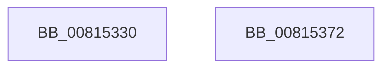

# SdbpCheckOSKind

- RVA: `0x00815330`–`0x00815373` (길이 `67` bytes)
- VA: `0x0000000140815330`
- 실행 섹션: `PAGE`
- PDB 이름 있음: `예`; PDB Function 태그: `아니요`
- unwind 정보 RVA: `0x0005CAAC`
- 디코드: `20`개 명령, `67/67` bytes 표시
- 미해석 바이트: `0` (있으면 어셈블리에 `.byte`로 보존)

> 이 문서는 커널 이미지의 기계어와 PDB 기호를 분석해 생성했습니다. 4번과 5번은 함수 원형과 자료형을 바이너리 사용 방식에서 추정한 C 해석이며 원본 소스 복구 결과는 아닙니다.

## 1. Dependencies

- 직접 호출 지점: **1**; 고유 호출 대상: **1**
- 직접 호출자로 확인된 함수: **0**
- RIP 상대 이미지 참조: **0**

### Outgoing calls
- `0x0081534D` → [SdbReadDWORDTag](../95/SdbReadDWORDTag_function_0095D408.md) (function, `0x0095D408`)

### Direct callers
- 이 함수 시작 RVA로 연결되는 직접 call은 확인되지 않았습니다. 간접 호출은 완전히 역산할 수 없습니다.

### Static image references
- 디코드된 RIP-relative 메모리 참조가 없습니다.

## 2. Other-region calls and transfers

- 다른 실행 섹션으로 향하는 call: **0**
- 별도 외부 분기/꼬리 이동을 확인하지 못했습니다.

## 3. Assembly (complete function range)

```asm
00815330  48 89 5C 24 08                  mov qword ptr [rsp + 8], rbx
00815335  57                              push rdi
00815336  48 83 EC 20                     sub rsp, 0x20
0081533A  49 8B C0                        mov rax, r8
0081533D  48 8B DA                        mov rbx, rdx
00815340  8B 54 24 50                     mov edx, dword ptr [rsp + 0x50]
00815344  48 8B F9                        mov rdi, rcx
00815347  48 8B C8                        mov rcx, rax
0081534A  45 33 C0                        xor r8d, r8d
0081534D  E8 B6 80 14 00                  call 0x14095d408
00815352  85 83 38 02 00 00               test dword ptr [rbx + 0x238], eax
00815358  B8 00 00 00 00                  mov eax, 0
0081535D  48 8B 5C 24 30                  mov rbx, qword ptr [rsp + 0x30]
00815362  0F 95 C0                        setne al
00815365  89 07                           mov dword ptr [rdi], eax
00815367  B8 01 00 00 00                  mov eax, 1
0081536C  48 83 C4 20                     add rsp, 0x20
00815370  5F                              pop rdi
00815371  C3                              ret
00815372  CC                              int3
```

## 4. C-style interpretation (structured pseudocode)

```c
__int64 __fastcall SdbpCheckOSKind(__int64 a1, __int64 a2, __int64 a3, __int64 a4, unsigned int a5)
{
    __int64 result;
    __int64 v_rsp;
    unsigned __int64 v_stack_p8;

    v_stack_p8 = v_rbx;
    v_rsp = (v_rsp) - (32);
    a3 = 0;
    result = SdbReadDWORDTag(a3, (unsigned int)(a5), a3, a4);
    result = (((*(unsigned int *)(a2 + 568)) & ((unsigned int)(result))) != 0) ? 1 : 0;
    *(unsigned int *)(a1) = (unsigned int)(result);
    v_rsp = (v_rsp) + (32);
    return 1;
}
```

## 5. (Beta) C Style

```c
int64_t SdbpCheckOSKind(void *Arg1, void *Arg2, int64_t Arg3, int64_t Arg4, uint32_t Arg5)
{
    uint8_t *arg1 = (uint8_t *)Arg1;
    uint8_t *arg2 = (uint8_t *)Arg2;

    int64_t result;
    int64_t local_rsp;
    uint64_t v_stack_p8;

    v_stack_p8 = local_rbx;
    local_rsp = (local_rsp) - (32);
    Arg3 = 0;
    result = SdbReadDWORDTag(Arg3, (uint32_t)(Arg5), Arg3, Arg4);
    result = (((*(uint32_t *)(arg2 + 0x238)) & ((uint32_t)(result))) != 0) ? 1 : 0;
    *(uint32_t *)(arg1) = (uint32_t)(result);
    local_rsp = (local_rsp) + (32);
    return 1;
}
```

### 관측된 메모리 오프셋

구조체 형식이 확인되지 않은 접근은 인자 기준의 오프셋으로만 기록했습니다.

| 기준 인자 | 오프셋 표현 | 폭 (bit) | 접근 |
|---|---:|---:|---|
| `Arg1` | `+ 0x0` | `32` | `W` |
| `Arg2` | `+ 0x238` | `32` | `R` |

## 6. Execution-region graph

[열기: 2D/3D 그래프와 함수 탐색 컨트롤 패널](../../../control-panel.html?section=page&rva=0x00815330&view=graph)

- 2D 그래프는 위에서 아래로 흐르고, 3D 그래프는 빈 공간을 드래그해 회전합니다. Shift+드래그는 이동, 휠은 확대·축소, 함수 노드 선택은 대상 보고서 이동입니다.

### Static fallback


