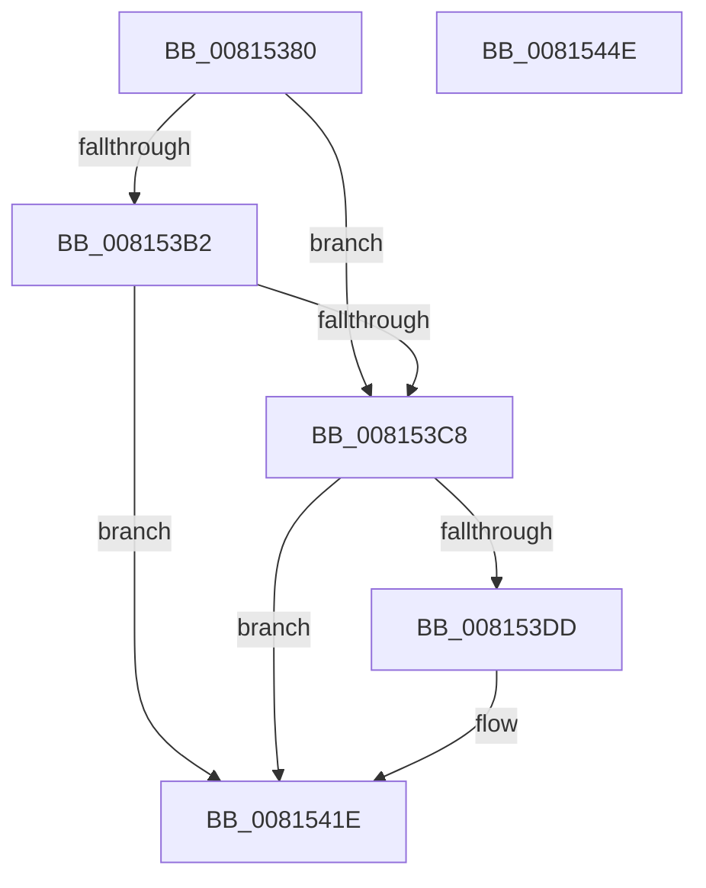

# SdbpCheckPackageAttributes

- RVA: `0x00815380`–`0x0081544F` (길이 `207` bytes)
- VA: `0x0000000140815380`
- 실행 섹션: `PAGE`
- PDB 이름 있음: `예`; PDB Function 태그: `아니요`
- unwind 정보 RVA: `0x000D9920`
- 디코드: `51`개 명령, `207/207` bytes 표시
- 미해석 바이트: `0` (있으면 어셈블리에 `.byte`로 보존)

> 이 문서는 커널 이미지의 기계어와 PDB 기호를 분석해 생성했습니다. 4번과 5번은 함수 원형과 자료형을 바이너리 사용 방식에서 추정한 C 해석이며 원본 소스 복구 결과는 아닙니다.

## 1. Dependencies

- 직접 호출 지점: **5**; 고유 호출 대상: **4**
- 직접 호출자로 확인된 함수: **0**
- RIP 상대 이미지 참조: **2**

### Outgoing calls
- `0x0081539D` → [SdbGetTagFromTagID](../95/SdbGetTagFromTagID_function_0095E3C0.md) (function, `0x0095E3C0`)
- `0x008153B9` → [SdbGetTagFromTagID](../95/SdbGetTagFromTagID_function_0095E3C0.md) (function, `0x0095E3C0`)
- `0x00815403` → [wil_details_FeatureReporting_ReportUsageToService](../../text/53/wil_details_FeatureReporting_ReportUsageToService_function_0053E6E4.md) (function, `0x0053E6E4`)
- `0x00815419` → [wil_details_FeatureStateCache_TryEnableDeviceUsageFastPath](../../text/53/wil_details_FeatureStateCache_TryEnableDeviceUsageFastPath_function_0053E774.md) (function, `0x0053E774`)
- `0x00815432` → [SdbpCheckApplicationTypeAttributes](../../text/69/SdbpCheckApplicationTypeAttributes_function_0069C93C.md) (function, `0x0069C93C`)

### Direct callers
- 이 함수 시작 RVA로 연결되는 직접 call은 확인되지 않았습니다. 간접 호출은 완전히 역산할 수 없습니다.

### Static image references
- `0x008153CE` → RVA `0x00FC4E40` (`.data`; read)
- `0x008153FC` → RVA `0x000E05A8` (`.rdata`; read)

## 2. Other-region calls and transfers

- 다른 실행 섹션으로 향하는 call: **3**
  - `0x00815403` → [wil_details_FeatureReporting_ReportUsageToService](../../text/53/wil_details_FeatureReporting_ReportUsageToService_function_0053E6E4.md) (`PAGE` → `.text`)
  - `0x00815419` → [wil_details_FeatureStateCache_TryEnableDeviceUsageFastPath](../../text/53/wil_details_FeatureStateCache_TryEnableDeviceUsageFastPath_function_0053E774.md) (`PAGE` → `.text`)
  - `0x00815432` → [SdbpCheckApplicationTypeAttributes](../../text/69/SdbpCheckApplicationTypeAttributes_function_0069C93C.md) (`PAGE` → `.text`)
- 별도 외부 분기/꼬리 이동을 확인하지 못했습니다.

## 3. Assembly (complete function range)

```asm
00815380  48 89 5C 24 08                  mov qword ptr [rsp + 8], rbx
00815385  48 89 74 24 10                  mov qword ptr [rsp + 0x10], rsi
0081538A  41 56                           push r14
0081538C  48 83 EC 30                     sub rsp, 0x30
00815390  8B 54 24 60                     mov edx, dword ptr [rsp + 0x60]
00815394  48 8B F1                        mov rsi, rcx
00815397  49 8B C8                        mov rcx, r8
0081539A  49 8B D8                        mov rbx, r8
0081539D  E8 1E 90 14 00                  call 0x14095e3c0
008153A2  B9 56 70 00 00                  mov ecx, 0x7056
008153A7  41 BE 01 00 00 00               mov r14d, 1
008153AD  66 3B C1                        cmp ax, cx
008153B0  74 16                           je 0x1408153c8
008153B2  8B 54 24 60                     mov edx, dword ptr [rsp + 0x60]
008153B6  48 8B CB                        mov rcx, rbx
008153B9  E8 02 90 14 00                  call 0x14095e3c0
008153BE  B9 59 70 00 00                  mov ecx, 0x7059
008153C3  66 3B C1                        cmp ax, cx
008153C6  75 56                           jne 0x14081541e
008153C8  48 83 64 24 20 00               and qword ptr [rsp + 0x20], 0
008153CE  8B 0D 6C FA 7A 00               mov ecx, dword ptr [rip + 0x7afa6c]
008153D4  89 4C 24 20                     mov dword ptr [rsp + 0x20], ecx
008153D8  F6 C1 10                        test cl, 0x10
008153DB  75 41                           jne 0x14081541e
008153DD  48 8B 44 24 20                  mov rax, qword ptr [rsp + 0x20]
008153E2  41 0B CE                        or ecx, r14d
008153E5  48 89 44 24 20                  mov qword ptr [rsp + 0x20], rax
008153EA  4D 8B CE                        mov r9, r14
008153ED  89 4C 24 20                     mov dword ptr [rsp + 0x20], ecx
008153F1  41 B8 03 00 00 00               mov r8d, 3
008153F7  48 8B 54 24 20                  mov rdx, qword ptr [rsp + 0x20]
008153FC  48 8D 0D A5 B1 8C FF            lea rcx, [rip - 0x734e5b]
00815403  E8 DC 92 D2 FF                  call 0x14053e6e4
00815408  48 8B 4C 24 20                  mov rcx, qword ptr [rsp + 0x20]
0081540D  4C 8D 05 94 B1 8C FF            lea r8, [rip - 0x734e6c]
00815414  BA 03 00 00 00                  mov edx, 3
00815419  E8 56 93 D2 FF                  call 0x14053e774
0081541E  48 8B 44 24 68                  mov rax, qword ptr [rsp + 0x68]
00815423  48 8B D3                        mov rdx, rbx
00815426  44 8B 44 24 60                  mov r8d, dword ptr [rsp + 0x60]
0081542B  48 8B CE                        mov rcx, rsi
0081542E  4C 8B 48 58                     mov r9, qword ptr [rax + 0x58]
00815432  E8 05 75 E8 FF                  call 0x14069c93c
00815437  85 C0                           test eax, eax
00815439  41 0F 45 C6                     cmovne eax, r14d
0081543D  48 8B 5C 24 40                  mov rbx, qword ptr [rsp + 0x40]
00815442  48 8B 74 24 48                  mov rsi, qword ptr [rsp + 0x48]
00815447  48 83 C4 30                     add rsp, 0x30
0081544B  41 5E                           pop r14
0081544D  C3                              ret
0081544E  CC                              int3
```

## 4. C-style interpretation (structured pseudocode)

```c
__int64 __fastcall SdbpCheckPackageAttributes(__int64 a1, __int64 a2, __int64 a3, __int64 a4, unsigned int a5, __int64 a6)
{
    __int64 result;
    __int64 v_rsp;
    unsigned __int64 v_stack_m18;
    unsigned __int64 v_stack_p10;
    unsigned __int64 v_stack_p8;

    v_stack_p8 = v_rbx;
    v_stack_p10 = v_rsi;
    v_rsp = (v_rsp) - (48);
    result = SdbGetTagFromTagID(a3, (unsigned int)(a5), a3, a4);
    if (((unsigned __int16)(result)) == ((unsigned __int16)((unsigned int)(0x7056ULL)))) goto loc_008153C8;
    result = SdbGetTagFromTagID(a3, (unsigned int)(a5), a3, a4);
    if (((unsigned __int16)(result)) != ((unsigned __int16)((unsigned int)(0x7059ULL)))) goto loc_0081541E;
loc_008153C8:
    v_stack_m18 = (unsigned int)((unsigned int)(*(unsigned int *)(v_rip + 8059500)));
    if ((((unsigned __int8)((unsigned int)(*(unsigned int *)(v_rip + 8059500)))) & (16)) == 0) {
        result = v_stack_m18;
        a1 = (unsigned int)(((unsigned int)(*(unsigned int *)(v_rip + 8059500))) | (1));
        v_stack_m18 = result;
        a4 = 1;
        v_stack_m18 = (unsigned int)(a1);
        a3 = 3;
        a2 = v_stack_m18;
        a1 = v_rip - 7556699;
        result = wil_details_FeatureReporting_ReportUsageToService(a1, a2, a3, a4);
        a1 = v_stack_m18;
        a3 = v_rip - 7556716;
        a2 = 3;
        result = wil_details_FeatureStateCache_TryEnableDeviceUsageFastPath(a1, a2, a3, a4);
    }
    result = SdbpCheckApplicationTypeAttributes(a1, a3, (unsigned int)(a5), *(unsigned __int64 *)(a6 + 88));
    if ((unsigned int)(result) != 0) { result = 1; }
    v_rsp = (v_rsp) + (48);
    return result;
}
```

## 5. (Beta) C Style

```c
int64_t SdbpCheckPackageAttributes(int64_t Arg1, int64_t Arg2, int64_t Arg3, int64_t Arg4, uint32_t Arg5, void *Arg6)
{
    uint8_t *arg6 = (uint8_t *)Arg6;

    int64_t result;
    int64_t local_rsp;
    uint64_t v_stack_m18;
    uint64_t v_stack_p10;
    uint64_t v_stack_p8;

    v_stack_p8 = local_rbx;
    v_stack_p10 = local_rsi;
    local_rsp = (local_rsp) - (48);
    result = SdbGetTagFromTagID(Arg3, (uint32_t)(Arg5), Arg3, Arg4);
    if (((uint16_t)(result)) == ((uint16_t)((uint32_t)(0x7056ULL)))) goto loc_008153C8;
    result = SdbGetTagFromTagID(Arg3, (uint32_t)(Arg5), Arg3, Arg4);
    if (((uint16_t)(result)) != ((uint16_t)((uint32_t)(0x7059ULL)))) goto loc_0081541E;
loc_008153C8:
    v_stack_m18 = (uint32_t)((uint32_t)(*(uint32_t *)(v_rip + 0x7AFA6C)));
    if ((((uint8_t)((uint32_t)(*(uint32_t *)(v_rip + 0x7AFA6C)))) & (16)) == 0) {
        result = v_stack_m18;
        Arg1 = (uint32_t)(((uint32_t)(*(uint32_t *)(v_rip + 0x7AFA6C))) | (1));
        v_stack_m18 = result;
        Arg4 = 1;
        v_stack_m18 = (uint32_t)(Arg1);
        Arg3 = 3;
        Arg2 = v_stack_m18;
        Arg1 = v_rip - 7556699;
        result = wil_details_FeatureReporting_ReportUsageToService(Arg1, Arg2, Arg3, Arg4);
        Arg1 = v_stack_m18;
        Arg3 = v_rip - 7556716;
        Arg2 = 3;
        result = wil_details_FeatureStateCache_TryEnableDeviceUsageFastPath(Arg1, Arg2, Arg3, Arg4);
    }
    result = SdbpCheckApplicationTypeAttributes(Arg1, Arg3, (uint32_t)(Arg5), *(uint64_t *)(arg6 + 0x58));
    if ((uint32_t)(result) != 0) { result = 1; }
    local_rsp = (local_rsp) + (48);
    return result;
}
```

### 관측된 메모리 오프셋

구조체 형식이 확인되지 않은 접근은 인자 기준의 오프셋으로만 기록했습니다.

| 기준 인자 | 오프셋 표현 | 폭 (bit) | 접근 |
|---|---:|---:|---|
| `Arg6` | `+ 0x58` | `64` | `R` |

## 6. Execution-region graph

[열기: 2D/3D 그래프와 함수 탐색 컨트롤 패널](../../../control-panel.html?section=page&rva=0x00815380&view=graph)

- 2D 그래프는 위에서 아래로 흐르고, 3D 그래프는 빈 공간을 드래그해 회전합니다. Shift+드래그는 이동, 휠은 확대·축소, 함수 노드 선택은 대상 보고서 이동입니다.

### Static fallback


