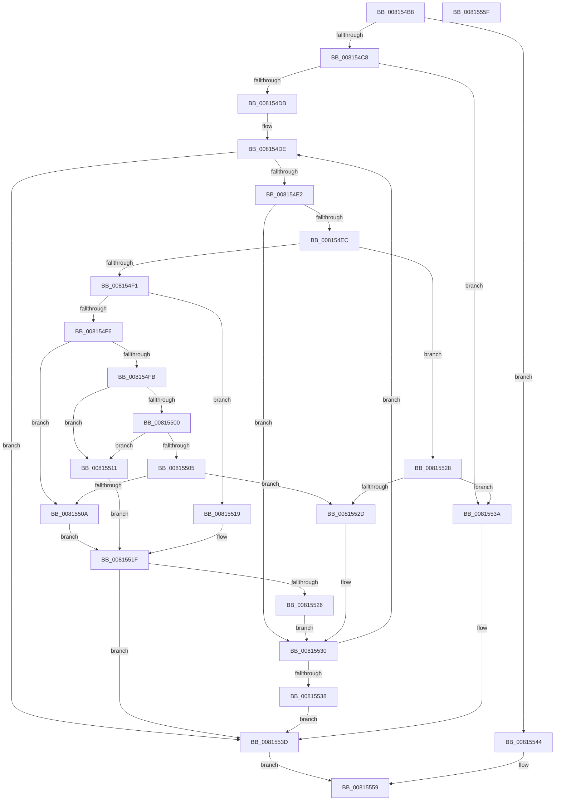

# SdbpCheckRuntimePlatformImpl

- RVA: `0x008154B8`–`0x00815560` (길이 `168` bytes)
- VA: `0x00000001408154B8`
- 실행 섹션: `PAGE`
- PDB 이름 있음: `예`; PDB Function 태그: `아니요`
- unwind 정보 RVA: `0x00071750`
- 디코드: `60`개 명령, `168/168` bytes 표시
- 미해석 바이트: `0` (있으면 어셈블리에 `.byte`로 보존)

> 이 문서는 커널 이미지의 기계어와 PDB 기호를 분석해 생성했습니다. 4번과 5번은 함수 원형과 자료형을 바이너리 사용 방식에서 추정한 C 해석이며 원본 소스 복구 결과는 아닙니다.

## 1. Dependencies

- 직접 호출 지점: **0**; 고유 호출 대상: **0**
- 직접 호출자로 확인된 함수: **2**
- RIP 상대 이미지 참조: **0**

### Outgoing calls
- 직접 디코드된 call 명령이 없습니다.

### Direct callers
- [SdbpCheckRuntimePlatform](SdbpCheckRuntimePlatform_function_00815460.md) at `0x0081549C`
- [SdbpOpenLocalDatabaseEx](SdbpOpenLocalDatabaseEx_function_0081770C.md) at `0x008177F7`

### Static image references
- 디코드된 RIP-relative 메모리 참조가 없습니다.

## 2. Other-region calls and transfers

- 다른 실행 섹션으로 향하는 call: **0**
- 별도 외부 분기/꼬리 이동을 확인하지 못했습니다.

## 3. Assembly (complete function range)

```asm
008154B8  48 89 5C 24 08                  mov qword ptr [rsp + 8], rbx
008154BD  45 8B D8                        mov r11d, r8d
008154C0  48 8B D9                        mov rbx, rcx
008154C3  F6 C2 02                        test dl, 2
008154C6  74 7C                           je 0x140815544
008154C8  45 33 D2                        xor r10d, r10d
008154CB  41 8B C2                        mov eax, r10d
008154CE  45 8D 42 01                     lea r8d, [r10 + 1]
008154D2  41 81 F9 00 00 00 C0            cmp r9d, 0xc0000000
008154D9  74 5F                           je 0x14081553a
008154DB  41 8B CA                        mov ecx, r10d
008154DE  85 C0                           test eax, eax
008154E0  75 5B                           jne 0x14081553d
008154E2  41 8B D1                        mov edx, r9d
008154E5  D3 EA                           shr edx, cl
008154E7  F6 C2 40                        test dl, 0x40
008154EA  74 44                           je 0x140815530
008154EC  83 E2 3F                        and edx, 0x3f
008154EF  74 37                           je 0x140815528
008154F1  83 EA 05                        sub edx, 5
008154F4  74 23                           je 0x140815519
008154F6  83 EA 04                        sub edx, 4
008154F9  74 0F                           je 0x14081550a
008154FB  83 EA 02                        sub edx, 2
008154FE  74 11                           je 0x140815511
00815500  41 2B D0                        sub edx, r8d
00815503  74 0C                           je 0x140815511
00815505  41 3B D0                        cmp edx, r8d
00815508  75 23                           jne 0x14081552d
0081550A  41 8B C3                        mov eax, r11d
0081550D  D1 E8                           shr eax, 1
0081550F  EB 0E                           jmp 0x14081551f
00815511  41 8B C3                        mov eax, r11d
00815514  C1 E8 02                        shr eax, 2
00815517  EB 06                           jmp 0x14081551f
00815519  41 8B C3                        mov eax, r11d
0081551C  C1 E8 03                        shr eax, 3
0081551F  41 23 C0                        and eax, r8d
00815522  85 C0                           test eax, eax
00815524  75 17                           jne 0x14081553d
00815526  EB 08                           jmp 0x140815530
00815528  45 84 D8                        test r8b, r11b
0081552B  75 0D                           jne 0x14081553a
0081552D  41 8B C2                        mov eax, r10d
00815530  83 C1 08                        add ecx, 8
00815533  83 F9 18                        cmp ecx, 0x18
00815536  7C A6                           jl 0x1408154de
00815538  EB 03                           jmp 0x14081553d
0081553A  41 8B C0                        mov eax, r8d
0081553D  89 03                           mov dword ptr [rbx], eax
0081553F  41 8B C0                        mov eax, r8d
00815542  EB 15                           jmp 0x140815559
00815544  41 BA 00 00 00 00               mov r10d, 0
0081554A  45 85 D9                        test r9d, r11d
0081554D  B8 01 00 00 00                  mov eax, 1
00815552  41 0F 95 C2                     setne r10b
00815556  44 89 11                        mov dword ptr [rcx], r10d
00815559  48 8B 5C 24 08                  mov rbx, qword ptr [rsp + 8]
0081555E  C3                              ret
0081555F  CC                              int3
```

## 4. C-style interpretation (structured pseudocode)

```c
__int64 __fastcall SdbpCheckRuntimePlatformImpl(__int64 a1, unsigned __int8 a2, int a3, int a4)
{
    __int64 result;
    __int64 v_r10;
    unsigned __int64 v_stack_p8;

    v_stack_p8 = v_rbx;
    if (((a2) & (2)) == 0) goto loc_00815544;
    v_r10 = 0;
    if (a4 == 0xC0000000ULL) goto loc_0081553A;
loc_008154DE:
    if (0 != 0) goto loc_0081553D;
    a2 = (unsigned int)(((unsigned int)(a4)) >> (0));
    if (((a2) & (64)) == 0) goto loc_00815530;
    a2 = (unsigned int)((a2) & (63));
    if (condition_is_equal) goto loc_00815528;
    a2 = (unsigned int)((a2) - (5));
    if (condition_is_equal) goto loc_00815519;
    a2 = (unsigned int)((a2) - (4));
    if (condition_is_equal) goto loc_0081550A;
    a2 = (unsigned int)((a2) - (2));
    if (condition_is_equal) goto loc_00815511;
    a2 = (unsigned int)((a2) - ((unsigned int)(v_r10 + 1)));
    if (condition_is_equal) goto loc_00815511;
    if (a2 != ((unsigned int)(v_r10 + 1))) goto loc_0081552D;
loc_0081550A:
    result = (unsigned int)(((unsigned int)((unsigned int)((unsigned int)(a3)))) >> (1));
    goto loc_0081551F;
loc_00815511:
    result = (unsigned int)(((unsigned int)((unsigned int)((unsigned int)(a3)))) >> (2));
    goto loc_0081551F;
loc_00815519:
    result = (unsigned int)(((unsigned int)((unsigned int)((unsigned int)(a3)))) >> (3));
loc_0081551F:
    result = (unsigned int)((result) & ((unsigned int)(v_r10 + 1)));
    if ((unsigned int)(result) != 0) goto loc_0081553D;
    goto loc_00815530;
loc_00815528:
    if ((((unsigned __int8)(v_r10 + 1)) & ((unsigned __int8)((unsigned int)(a3)))) != 0) goto loc_0081553A;
loc_0081552D:
loc_00815530:
    a1 = (unsigned int)((0) + (8));
    if (((unsigned int)(a1)) < 24) goto loc_008154DE;
    goto loc_0081553D;
loc_0081553A:
loc_0081553D:
    *(unsigned int *)(a1) = (unsigned int)((unsigned int)((unsigned int)(v_r10 + 1)));
    goto loc_00815559;
loc_00815544:
    v_r10 = (((a4) & ((unsigned int)((unsigned int)(a3)))) != 0) ? 1 : 0;
    *(unsigned int *)(a1) = (unsigned int)(v_r10);
loc_00815559:
    return 1;
}
```

## 5. (Beta) C Style

```c
int64_t SdbpCheckRuntimePlatformImpl(void *Arg1, uint8_t Arg2, int32_t Arg3, int32_t Arg4)
{
    uint8_t *arg1 = (uint8_t *)Arg1;

    int64_t result;
    int64_t local_r10;
    uint64_t v_stack_p8;

    v_stack_p8 = local_rbx;
    if (((Arg2) & (2)) == 0) goto loc_00815544;
    local_r10 = 0;
    if (Arg4 == 0xC0000000ULL) goto loc_0081553A;
loc_008154DE:
    if (0 != 0) goto loc_0081553D;
    Arg2 = (uint32_t)(((uint32_t)(Arg4)) >> (0));
    if (((Arg2) & (64)) == 0) goto loc_00815530;
    Arg2 = (uint32_t)((Arg2) & (63));
    if (condition_is_equal) goto loc_00815528;
    Arg2 = (uint32_t)((Arg2) - (5));
    if (condition_is_equal) goto loc_00815519;
    Arg2 = (uint32_t)((Arg2) - (4));
    if (condition_is_equal) goto loc_0081550A;
    Arg2 = (uint32_t)((Arg2) - (2));
    if (condition_is_equal) goto loc_00815511;
    Arg2 = (uint32_t)((Arg2) - ((uint32_t)(local_r10 + 1)));
    if (condition_is_equal) goto loc_00815511;
    if (Arg2 != ((uint32_t)(local_r10 + 1))) goto loc_0081552D;
loc_0081550A:
    result = (uint32_t)(((uint32_t)((uint32_t)((uint32_t)(Arg3)))) >> (1));
    goto loc_0081551F;
loc_00815511:
    result = (uint32_t)(((uint32_t)((uint32_t)((uint32_t)(Arg3)))) >> (2));
    goto loc_0081551F;
loc_00815519:
    result = (uint32_t)(((uint32_t)((uint32_t)((uint32_t)(Arg3)))) >> (3));
loc_0081551F:
    result = (uint32_t)((result) & ((uint32_t)(local_r10 + 1)));
    if ((uint32_t)(result) != 0) goto loc_0081553D;
    goto loc_00815530;
loc_00815528:
    if ((((uint8_t)(local_r10 + 1)) & ((uint8_t)((uint32_t)(Arg3)))) != 0) goto loc_0081553A;
loc_0081552D:
loc_00815530:
    Arg1 = (uint32_t)((0) + (8));
    if (((uint32_t)(Arg1)) < 24) goto loc_008154DE;
    goto loc_0081553D;
loc_0081553A:
loc_0081553D:
    *(uint32_t *)(arg1) = (uint32_t)((uint32_t)((uint32_t)(local_r10 + 1)));
    goto loc_00815559;
loc_00815544:
    local_r10 = (((Arg4) & ((uint32_t)((uint32_t)(Arg3)))) != 0) ? 1 : 0;
    *(uint32_t *)(arg1) = (uint32_t)(local_r10);
loc_00815559:
    return 1;
}
```

### 관측된 메모리 오프셋

구조체 형식이 확인되지 않은 접근은 인자 기준의 오프셋으로만 기록했습니다.

| 기준 인자 | 오프셋 표현 | 폭 (bit) | 접근 |
|---|---:|---:|---|
| `Arg1` | `+ 0x0` | `32` | `W` |

## 6. Execution-region graph

[열기: 2D/3D 그래프와 함수 탐색 컨트롤 패널](../../../control-panel.html?section=page&rva=0x008154B8&view=graph)

- 2D 그래프는 위에서 아래로 흐르고, 3D 그래프는 빈 공간을 드래그해 회전합니다. Shift+드래그는 이동, 휠은 확대·축소, 함수 노드 선택은 대상 보고서 이동입니다.

### Static fallback


