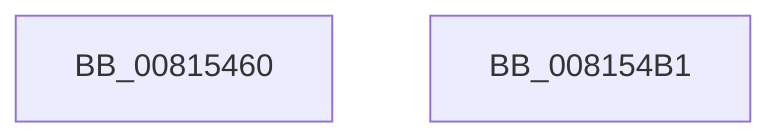

# SdbpCheckRuntimePlatform

- RVA: `0x00815460`–`0x008154B2` (길이 `82` bytes)
- VA: `0x0000000140815460`
- 실행 섹션: `PAGE`
- PDB 이름 있음: `예`; PDB Function 태그: `아니요`
- unwind 정보 RVA: `0x00060BC4`
- 디코드: `22`개 명령, `82/82` bytes 표시
- 미해석 바이트: `0` (있으면 어셈블리에 `.byte`로 보존)

> 이 문서는 커널 이미지의 기계어와 PDB 기호를 분석해 생성했습니다. 4번과 5번은 함수 원형과 자료형을 바이너리 사용 방식에서 추정한 C 해석이며 원본 소스 복구 결과는 아닙니다.

## 1. Dependencies

- 직접 호출 지점: **2**; 고유 호출 대상: **2**
- 직접 호출자로 확인된 함수: **0**
- RIP 상대 이미지 참조: **0**

### Outgoing calls
- `0x00815488` → [SdbReadDWORDTag](../95/SdbReadDWORDTag_function_0095D408.md) (function, `0x0095D408`)
- `0x0081549C` → [SdbpCheckRuntimePlatformImpl](SdbpCheckRuntimePlatformImpl_function_008154B8.md) (function, `0x008154B8`)

### Direct callers
- 이 함수 시작 RVA로 연결되는 직접 call은 확인되지 않았습니다. 간접 호출은 완전히 역산할 수 없습니다.

### Static image references
- 디코드된 RIP-relative 메모리 참조가 없습니다.

## 2. Other-region calls and transfers

- 다른 실행 섹션으로 향하는 call: **0**
- 별도 외부 분기/꼬리 이동을 확인하지 못했습니다.

## 3. Assembly (complete function range)

```asm
00815460  48 89 5C 24 08                  mov qword ptr [rsp + 8], rbx
00815465  48 89 74 24 10                  mov qword ptr [rsp + 0x10], rsi
0081546A  57                              push rdi
0081546B  48 83 EC 20                     sub rsp, 0x20
0081546F  8B 9A 28 02 00 00               mov ebx, dword ptr [rdx + 0x228]
00815475  49 8B F8                        mov rdi, r8
00815478  8B 54 24 50                     mov edx, dword ptr [rsp + 0x50]
0081547C  48 8B F1                        mov rsi, rcx
0081547F  48 8B CF                        mov rcx, rdi
00815482  41 B8 FF 00 00 00               mov r8d, 0xff
00815488  E8 7B 7F 14 00                  call 0x14095d408
0081548D  8B 97 30 0A 00 00               mov edx, dword ptr [rdi + 0xa30]
00815493  44 8B C8                        mov r9d, eax
00815496  44 8B C3                        mov r8d, ebx
00815499  48 8B CE                        mov rcx, rsi
0081549C  E8 17 00 00 00                  call 0x1408154b8
008154A1  48 8B 5C 24 30                  mov rbx, qword ptr [rsp + 0x30]
008154A6  48 8B 74 24 38                  mov rsi, qword ptr [rsp + 0x38]
008154AB  48 83 C4 20                     add rsp, 0x20
008154AF  5F                              pop rdi
008154B0  C3                              ret
008154B1  CC                              int3
```

## 4. C-style interpretation (structured pseudocode)

```c
__int64 __fastcall SdbpCheckRuntimePlatform(__int64 a1, __int64 a2, __int64 a3, __int64 a4, unsigned int a5)
{
    __int64 result;
    __int64 v_rsp;
    unsigned __int64 v_stack_p10;
    unsigned __int64 v_stack_p8;

    v_stack_p8 = v_rbx;
    v_stack_p10 = v_rsi;
    v_rsp = (v_rsp) - (32);
    result = SdbReadDWORDTag(a3, (unsigned int)(a5), 255, a4);
    result = SdbpCheckRuntimePlatformImpl(a1, (unsigned int)(*(unsigned int *)(a3 + 2608)), (unsigned int)((unsigned int)((unsigned int)(*(unsigned int *)(a2 + 552)))), (unsigned int)((unsigned int)(result)));
    v_rsp = (v_rsp) + (32);
    return result;
}
```

## 5. (Beta) C Style

```c
int64_t SdbpCheckRuntimePlatform(int64_t Arg1, void *Arg2, void *Arg3, int64_t Arg4, uint32_t Arg5)
{
    uint8_t *arg2 = (uint8_t *)Arg2;
    uint8_t *arg3 = (uint8_t *)Arg3;

    int64_t result;
    int64_t local_rsp;
    uint64_t v_stack_p10;
    uint64_t v_stack_p8;

    v_stack_p8 = local_rbx;
    v_stack_p10 = local_rsi;
    local_rsp = (local_rsp) - (32);
    result = SdbReadDWORDTag(Arg3, (uint32_t)(Arg5), 255, Arg4);
    result = SdbpCheckRuntimePlatformImpl(Arg1, (uint32_t)(*(uint32_t *)(arg3 + 0xA30)), (uint32_t)((uint32_t)((uint32_t)(*(uint32_t *)(arg2 + 0x228)))), (uint32_t)((uint32_t)(result)));
    local_rsp = (local_rsp) + (32);
    return result;
}
```

### 관측된 메모리 오프셋

구조체 형식이 확인되지 않은 접근은 인자 기준의 오프셋으로만 기록했습니다.

| 기준 인자 | 오프셋 표현 | 폭 (bit) | 접근 |
|---|---:|---:|---|
| `Arg2` | `+ 0x228` | `32` | `R` |
| `Arg3` | `+ 0xA30` | `32` | `R` |

## 6. Execution-region graph

[열기: 2D/3D 그래프와 함수 탐색 컨트롤 패널](../../../control-panel.html?section=page&rva=0x00815460&view=graph)

- 2D 그래프는 위에서 아래로 흐르고, 3D 그래프는 빈 공간을 드래그해 회전합니다. Shift+드래그는 이동, 휠은 확대·축소, 함수 노드 선택은 대상 보고서 이동입니다.

### Static fallback


