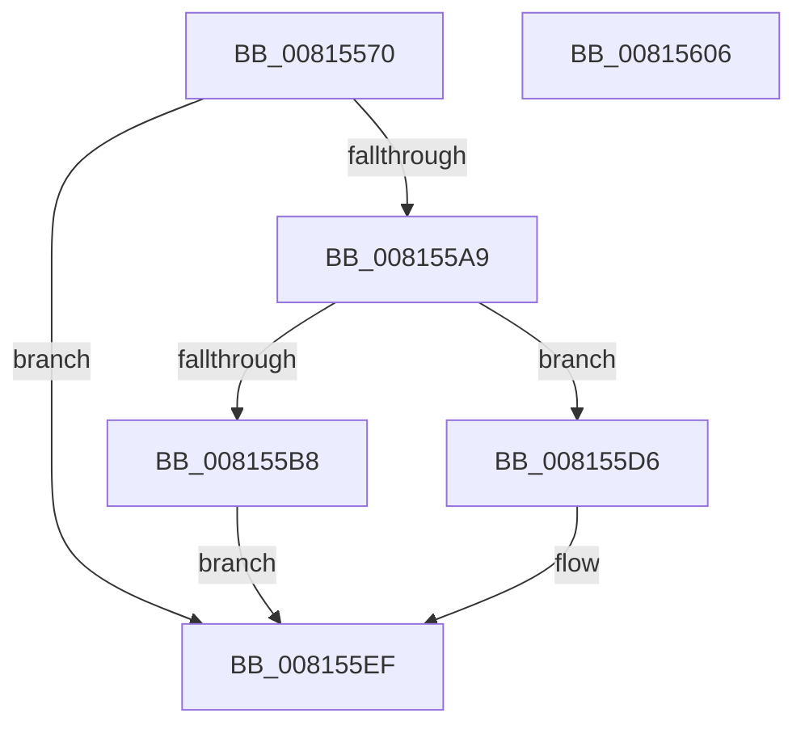

# SdbpCheckSdbCapability

- RVA: `0x00815570`–`0x00815607` (길이 `151` bytes)
- VA: `0x0000000140815570`
- 실행 섹션: `PAGE`
- PDB 이름 있음: `예`; PDB Function 태그: `아니요`
- unwind 정보 RVA: `0x000701D4`
- 디코드: `45`개 명령, `151/151` bytes 표시
- 미해석 바이트: `0` (있으면 어셈블리에 `.byte`로 보존)

> 이 문서는 커널 이미지의 기계어와 PDB 기호를 분석해 생성했습니다. 4번과 5번은 함수 원형과 자료형을 바이너리 사용 방식에서 추정한 C 해석이며 원본 소스 복구 결과는 아닙니다.

## 1. Dependencies

- 직접 호출 지점: **4**; 고유 호출 대상: **4**
- 직접 호출자로 확인된 함수: **0**
- RIP 상대 이미지 참조: **2**

### Outgoing calls
- `0x008155A0` → [SdbFindFirstTag](../95/SdbFindFirstTag_function_0095E34C.md) (function, `0x0095E34C`)
- `0x008155AE` → [SdbGetStringTagPtr](../95/SdbGetStringTagPtr_function_0095DDA8.md) (function, `0x0095DDA8`)
- `0x008155CF` → [AslLogCallPrintf](../95/AslLogCallPrintf_function_0095E4EC.md) (function, `0x0095E4EC`)
- `0x008155E1` → [SdbpIsSdbCapabilityPresent](SdbpIsSdbCapabilityPresent_function_00816350.md) (function, `0x00816350`)

### Direct callers
- 이 함수 시작 RVA로 연결되는 직접 call은 확인되지 않았습니다. 간접 호출은 완전히 역산할 수 없습니다.

### Static image references
- `0x008155B8` → RVA `0x0003C7D8` (`.rdata`; read)
- `0x008155C5` → RVA `0x0003C7A8` (`.rdata`; read)

## 2. Other-region calls and transfers

- 다른 실행 섹션으로 향하는 call: **0**
- 별도 외부 분기/꼬리 이동을 확인하지 못했습니다.

## 3. Assembly (complete function range)

```asm
00815570  48 89 5C 24 10                  mov qword ptr [rsp + 0x10], rbx
00815575  48 89 6C 24 18                  mov qword ptr [rsp + 0x18], rbp
0081557A  56                              push rsi
0081557B  57                              push rdi
0081557C  41 56                           push r14
0081557E  48 83 EC 20                     sub rsp, 0x20
00815582  49 8B E8                        mov rbp, r8
00815585  4C 8B F2                        mov r14, rdx
00815588  8B 54 24 60                     mov edx, dword ptr [rsp + 0x60]
0081558C  48 8B F1                        mov rsi, rcx
0081558F  33 DB                           xor ebx, ebx
00815591  48 8B CD                        mov rcx, rbp
00815594  41 B8 01 60 00 00               mov r8d, 0x6001
0081559A  89 5C 24 40                     mov dword ptr [rsp + 0x40], ebx
0081559E  8B FB                           mov edi, ebx
008155A0  E8 A7 8D 14 00                  call 0x14095e34c
008155A5  85 C0                           test eax, eax
008155A7  74 46                           je 0x1408155ef
008155A9  8B D0                           mov edx, eax
008155AB  48 8B CD                        mov rcx, rbp
008155AE  E8 F5 87 14 00                  call 0x14095dda8
008155B3  48 85 C0                        test rax, rax
008155B6  75 1E                           jne 0x1408155d6
008155B8  4C 8D 0D 19 72 82 FF            lea r9, [rip - 0x7d8de7]
008155BF  41 B8 69 0B 00 00               mov r8d, 0xb69
008155C5  48 8D 15 DC 71 82 FF            lea rdx, [rip - 0x7d8e24]
008155CC  8D 4B 01                        lea ecx, [rbx + 1]
008155CF  E8 18 8F 14 00                  call 0x14095e4ec
008155D4  EB 19                           jmp 0x1408155ef
008155D6  4C 8B C0                        mov r8, rax
008155D9  48 8D 4C 24 40                  lea rcx, [rsp + 0x40]
008155DE  49 8B D6                        mov rdx, r14
008155E1  E8 6A 0D 00 00                  call 0x140816350
008155E6  8B 7C 24 40                     mov edi, dword ptr [rsp + 0x40]
008155EA  BB 01 00 00 00                  mov ebx, 1
008155EF  48 8B 6C 24 50                  mov rbp, qword ptr [rsp + 0x50]
008155F4  8B C3                           mov eax, ebx
008155F6  48 8B 5C 24 48                  mov rbx, qword ptr [rsp + 0x48]
008155FB  89 3E                           mov dword ptr [rsi], edi
008155FD  48 83 C4 20                     add rsp, 0x20
00815601  41 5E                           pop r14
00815603  5F                              pop rdi
00815604  5E                              pop rsi
00815605  C3                              ret
00815606  CC                              int3
```

## 4. C-style interpretation (structured pseudocode)

```c
__int64 __fastcall SdbpCheckSdbCapability(__int64 a1, __int64 a2, __int64 a3, __int64 a4, unsigned int a5)
{
    __int64 result;
    __int64 v_rbx;
    __int64 v_rsp;
    unsigned __int64 v_stack_p10;
    unsigned __int64 v_stack_p18;
    unsigned int v_stack_p8;

    v_stack_p10 = v_rbx;
    v_stack_p18 = v_rbp;
    v_rsp = (v_rsp) - (32);
    v_rbx = 0;
    v_stack_p8 = 0;
    result = SdbFindFirstTag(a3, (unsigned int)(a5), (unsigned int)(0x6001ULL), a4);
    if ((unsigned int)(result) == 0) goto loc_008155EF;
    result = SdbGetStringTagPtr(a3, (unsigned int)((unsigned int)(result)), (unsigned int)(0x6001ULL), a4);
    if (result != 0) goto loc_008155D6;
    result = AslLogCallPrintf(v_rbx + 1, v_rip - 8228388, (unsigned int)(0xB69ULL), v_rip - 8228327);
    goto loc_008155EF;
loc_008155D6:
    result = SdbpIsSdbCapabilityPresent(v_stack_p8, a2, result, v_rip - 8228327);
loc_008155EF:
    *(unsigned int *)(a1) = (unsigned int)((unsigned int)(v_stack_p8));
    v_rsp = (v_rsp) + (32);
    return 1;
}
```

## 5. (Beta) C Style

```c
int64_t SdbpCheckSdbCapability(void *Arg1, int64_t Arg2, int64_t Arg3, int64_t Arg4, uint32_t Arg5)
{
    uint8_t *arg1 = (uint8_t *)Arg1;

    int64_t result;
    int64_t local_rbx;
    int64_t local_rsp;
    uint64_t v_stack_p10;
    uint64_t v_stack_p18;
    uint32_t v_stack_p8;

    v_stack_p10 = local_rbx;
    v_stack_p18 = local_rbp;
    local_rsp = (local_rsp) - (32);
    local_rbx = 0;
    v_stack_p8 = 0;
    result = SdbFindFirstTag(Arg3, (uint32_t)(Arg5), (uint32_t)(0x6001ULL), Arg4);
    if ((uint32_t)(result) == 0) goto loc_008155EF;
    result = SdbGetStringTagPtr(Arg3, (uint32_t)((uint32_t)(result)), (uint32_t)(0x6001ULL), Arg4);
    if (result != 0) goto loc_008155D6;
    result = AslLogCallPrintf(local_rbx + 1, v_rip - 8228388, (uint32_t)(0xB69ULL), v_rip - 8228327);
    goto loc_008155EF;
loc_008155D6:
    result = SdbpIsSdbCapabilityPresent(v_stack_p8, Arg2, result, v_rip - 8228327);
loc_008155EF:
    *(uint32_t *)(arg1) = (uint32_t)((uint32_t)(v_stack_p8));
    local_rsp = (local_rsp) + (32);
    return 1;
}
```

### 관측된 메모리 오프셋

구조체 형식이 확인되지 않은 접근은 인자 기준의 오프셋으로만 기록했습니다.

| 기준 인자 | 오프셋 표현 | 폭 (bit) | 접근 |
|---|---:|---:|---|
| `Arg1` | `+ 0x0` | `32` | `W` |

## 6. Execution-region graph

[열기: 2D/3D 그래프와 함수 탐색 컨트롤 패널](../../../control-panel.html?section=page&rva=0x00815570&view=graph)

- 2D 그래프는 위에서 아래로 흐르고, 3D 그래프는 빈 공간을 드래그해 회전합니다. Shift+드래그는 이동, 휠은 확대·축소, 함수 노드 선택은 대상 보고서 이동입니다.

### Static fallback


