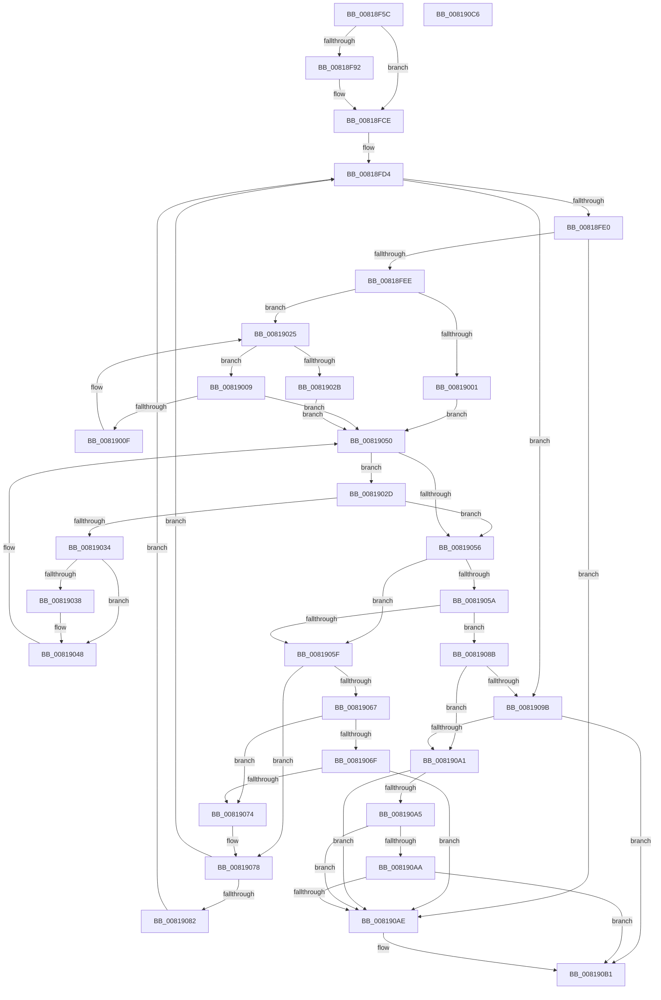

# SdbpCheckUptoStringVersion

- RVA: `0x00818F5C`–`0x008190C7` (길이 `363` bytes)
- VA: `0x0000000140818F5C`
- 실행 섹션: `PAGE`
- PDB 이름 있음: `예`; PDB Function 태그: `아니요`
- unwind 정보 RVA: `0x000D9BFC`
- 디코드: `109`개 명령, `363/363` bytes 표시
- 미해석 바이트: `0` (있으면 어셈블리에 `.byte`로 보존)

> 이 문서는 커널 이미지의 기계어와 PDB 기호를 분석해 생성했습니다. 4번과 5번은 함수 원형과 자료형을 바이너리 사용 방식에서 추정한 C 해석이며 원본 소스 복구 결과는 아닙니다.

## 1. Dependencies

- 직접 호출 지점: **2**; 고유 호출 대상: **2**
- 직접 호출자로 확인된 함수: **2**
- RIP 상대 이미지 참조: **2**

### Outgoing calls
- `0x00818FB5` → [wil_details_FeatureReporting_ReportUsageToService](../../text/53/wil_details_FeatureReporting_ReportUsageToService_function_0053E6E4.md) (function, `0x0053E6E4`)
- `0x00818FC9` → [wil_details_FeatureStateCache_TryEnableDeviceUsageFastPath](../../text/53/wil_details_FeatureStateCache_TryEnableDeviceUsageFastPath_function_0053E774.md) (function, `0x0053E774`)

### Direct callers
- [SdbpCheckApplicationTypeAttributes](../../text/69/SdbpCheckApplicationTypeAttributes_function_0069C93C.md) at `0x0069CC35`
- [SdbpCheckAttribute](SdbpCheckAttribute_function_00818A84.md) at `0x00818D37`

### Static image references
- `0x00818F7E` → RVA `0x00FC4E40` (`.data`; read)
- `0x00818FAE` → RVA `0x000E05A8` (`.rdata`; read)

## 2. Other-region calls and transfers

- 다른 실행 섹션으로 향하는 call: **2**
  - `0x00818FB5` → [wil_details_FeatureReporting_ReportUsageToService](../../text/53/wil_details_FeatureReporting_ReportUsageToService_function_0053E6E4.md) (`PAGE` → `.text`)
  - `0x00818FC9` → [wil_details_FeatureStateCache_TryEnableDeviceUsageFastPath](../../text/53/wil_details_FeatureStateCache_TryEnableDeviceUsageFastPath_function_0053E774.md) (`PAGE` → `.text`)
- 별도 외부 분기/꼬리 이동을 확인하지 못했습니다.

## 3. Assembly (complete function range)

```asm
00818F5C  48 89 5C 24 10                  mov qword ptr [rsp + 0x10], rbx
00818F61  48 89 6C 24 18                  mov qword ptr [rsp + 0x18], rbp
00818F66  56                              push rsi
00818F67  57                              push rdi
00818F68  41 57                           push r15
00818F6A  48 83 EC 20                     sub rsp, 0x20
00818F6E  45 33 FF                        xor r15d, r15d
00818F71  48 8B FA                        mov rdi, rdx
00818F74  48 8B F1                        mov rsi, rcx
00818F77  41 8B EF                        mov ebp, r15d
00818F7A  41 8D 5F 01                     lea ebx, [r15 + 1]
00818F7E  8B 0D BC BE 7A 00               mov ecx, dword ptr [rip + 0x7abebc]
00818F84  4C 89 7C 24 40                  mov qword ptr [rsp + 0x40], r15
00818F89  89 4C 24 40                     mov dword ptr [rsp + 0x40], ecx
00818F8D  F6 C1 10                        test cl, 0x10
00818F90  75 3C                           jne 0x140818fce
00818F92  48 8B 44 24 40                  mov rax, qword ptr [rsp + 0x40]
00818F97  45 8D 47 03                     lea r8d, [r15 + 3]
00818F9B  0B CB                           or ecx, ebx
00818F9D  48 89 44 24 40                  mov qword ptr [rsp + 0x40], rax
00818FA2  89 4C 24 40                     mov dword ptr [rsp + 0x40], ecx
00818FA6  44 8B CB                        mov r9d, ebx
00818FA9  48 8B 54 24 40                  mov rdx, qword ptr [rsp + 0x40]
00818FAE  48 8D 0D F3 75 8C FF            lea rcx, [rip - 0x738a0d]
00818FB5  E8 2A 57 D2 FF                  call 0x14053e6e4
00818FBA  48 8B 4C 24 40                  mov rcx, qword ptr [rsp + 0x40]
00818FBF  4C 8D 05 E2 75 8C FF            lea r8, [rip - 0x738a1e]
00818FC6  8D 53 02                        lea edx, [rbx + 2]
00818FC9  E8 A6 57 D2 FF                  call 0x14053e774
00818FCE  41 BB 30 00 00 00               mov r11d, 0x30
00818FD4  0F B7 16                        movzx edx, word ptr [rsi]
00818FD7  66 85 D2                        test dx, dx
00818FDA  0F 84 BB 00 00 00               je 0x14081909b
00818FE0  44 0F B7 07                     movzx r8d, word ptr [rdi]
00818FE4  66 45 85 C0                     test r8w, r8w
00818FE8  0F 84 C0 00 00 00               je 0x1408190ae
00818FEE  B8 2A 00 00 00                  mov eax, 0x2a
00818FF3  4D 8B D7                        mov r10, r15
00818FF6  4D 8B CF                        mov r9, r15
00818FF9  41 8B EF                        mov ebp, r15d
00818FFC  66 3B C2                        cmp ax, dx
00818FFF  75 24                           jne 0x140819025
00819001  8B EB                           mov ebp, ebx
00819003  48 83 C6 02                     add rsi, 2
00819007  EB 47                           jmp 0x140819050
00819009  66 83 FA 39                     cmp dx, 0x39
0081900D  77 41                           ja 0x140819050
0081900F  0F B7 C2                        movzx eax, dx
00819012  4F 8D 14 92                     lea r10, [r10 + r10*4]
00819016  48 83 C6 02                     add rsi, 2
0081901A  4D 8D 52 E8                     lea r10, [r10 - 0x18]
0081901E  4E 8D 14 50                     lea r10, [rax + r10*2]
00819022  0F B7 16                        movzx edx, word ptr [rsi]
00819025  66 44 3B DA                     cmp r11w, dx
00819029  76 DE                           jbe 0x140819009
0081902B  EB 23                           jmp 0x140819050
0081902D  66 41 83 F8 39                  cmp r8w, 0x39
00819032  77 22                           ja 0x140819056
00819034  85 ED                           test ebp, ebp
00819036  75 10                           jne 0x140819048
00819038  4F 8D 0C 89                     lea r9, [r9 + r9*4]
0081903C  41 0F B7 C0                     movzx eax, r8w
00819040  4D 8D 49 E8                     lea r9, [r9 - 0x18]
00819044  4E 8D 0C 48                     lea r9, [rax + r9*2]
00819048  48 83 C7 02                     add rdi, 2
0081904C  44 0F B7 07                     movzx r8d, word ptr [rdi]
00819050  66 45 3B D8                     cmp r11w, r8w
00819054  76 D7                           jbe 0x14081902d
00819056  85 ED                           test ebp, ebp
00819058  75 05                           jne 0x14081905f
0081905A  4D 3B D1                        cmp r10, r9
0081905D  75 2C                           jne 0x14081908b
0081905F  0F B7 06                        movzx eax, word ptr [rsi]
00819062  66 85 C0                        test ax, ax
00819065  74 11                           je 0x140819078
00819067  0F B7 0F                        movzx ecx, word ptr [rdi]
0081906A  66 85 C9                        test cx, cx
0081906D  74 05                           je 0x140819074
0081906F  66 3B C1                        cmp ax, cx
00819072  75 3A                           jne 0x1408190ae
00819074  48 83 C6 02                     add rsi, 2
00819078  66 44 39 3F                     cmp word ptr [rdi], r15w
0081907C  0F 84 52 FF FF FF               je 0x140818fd4
00819082  48 83 C7 02                     add rdi, 2
00819086  E9 49 FF FF FF                  jmp 0x140818fd4
0081908B  0F B7 16                        movzx edx, word ptr [rsi]
0081908E  41 8B C7                        mov eax, r15d
00819091  0F 97 C0                        seta al
00819094  8B D8                           mov ebx, eax
00819096  66 85 D2                        test dx, dx
00819099  75 06                           jne 0x1408190a1
0081909B  66 44 39 3F                     cmp word ptr [rdi], r15w
0081909F  74 10                           je 0x1408190b1
008190A1  85 DB                           test ebx, ebx
008190A3  74 09                           je 0x1408190ae
008190A5  66 85 D2                        test dx, dx
008190A8  75 04                           jne 0x1408190ae
008190AA  85 ED                           test ebp, ebp
008190AC  75 03                           jne 0x1408190b1
008190AE  41 8B DF                        mov ebx, r15d
008190B1  48 8B 6C 24 50                  mov rbp, qword ptr [rsp + 0x50]
008190B6  8B C3                           mov eax, ebx
008190B8  48 8B 5C 24 48                  mov rbx, qword ptr [rsp + 0x48]
008190BD  48 83 C4 20                     add rsp, 0x20
008190C1  41 5F                           pop r15
008190C3  5F                              pop rdi
008190C4  5E                              pop rsi
008190C5  C3                              ret
008190C6  CC                              int3
```

## 4. C-style interpretation (structured pseudocode)

```c
__int64 __fastcall SdbpCheckUptoStringVersion(__int64 a1, __int64 a2)
{
    __int64 result;
    __int64 v_r15;
    __int64 v_rbx;
    __int64 v_rdi;
    __int64 v_rsi;
    __int64 v_rsp;
    unsigned __int64 v_stack_p10;
    unsigned __int64 v_stack_p18;
    unsigned __int64 v_stack_p8;

    v_stack_p10 = v_rbx;
    v_stack_p18 = v_rbp;
    v_rsp = (v_rsp) - (32);
    v_r15 = 0;
    v_stack_p8 = 0;
    v_stack_p8 = (unsigned int)((unsigned int)(*(unsigned int *)(v_rip + 8044220)));
    if ((((unsigned __int8)((unsigned int)(*(unsigned int *)(v_rip + 8044220)))) & (16)) == 0) {
        result = v_stack_p8;
        a3 = v_r15 + 3;
        a1 = (unsigned int)(((unsigned int)(*(unsigned int *)(v_rip + 8044220))) | ((unsigned int)(v_r15 + 1)));
        v_stack_p8 = result;
        v_stack_p8 = (unsigned int)(a1);
        a4 = (unsigned int)(v_r15 + 1);
        a2 = v_stack_p8;
        a1 = v_rip - 7571981;
        result = wil_details_FeatureReporting_ReportUsageToService(a1, a2, a3, a4);
        a1 = v_stack_p8;
        a3 = v_rip - 7571998;
        a2 = v_r15 + 1 + 2;
        result = wil_details_FeatureStateCache_TryEnableDeviceUsageFastPath(a1, a2, a3, a4);
    }
loc_00818FD4:
    if ((unsigned __int16)(*(unsigned __int16 *)(a1)) == 0) goto loc_0081909B;
    if ((unsigned __int16)(*(unsigned __int16 *)(a2)) == 0) goto loc_008190AE;
    if (42 != ((unsigned __int16)(*(unsigned __int16 *)(a1)))) goto loc_00819025;
    v_rsi = (a1) + (2);
    goto loc_00819050;
loc_00819009:
    if (((unsigned __int16)(*(unsigned __int16 *)(a1))) > 57) goto loc_00819050;
    v_rsi = (v_rsi) + (2);
loc_00819025:
    if (48 <= ((unsigned __int16)(*(unsigned __int16 *)(v_rsi)))) goto loc_00819009;
    goto loc_00819050;
loc_0081902D:
    if (((unsigned __int16)(*(unsigned __int16 *)(a2))) > 57) goto loc_00819056;
    result = (unsigned __int16)(*(unsigned __int16 *)(a1));
    if ((unsigned int)((unsigned int)((unsigned int)(v_r15 + 1))) == 0) {
        a4 = 0 + 0 * 4;
        result = (unsigned __int16)(*(unsigned __int16 *)(a2));
        a4 = a4 - 24;
        a4 = result + a4 * 2;
    }
    v_rdi = (a2) + (2);
loc_00819050:
    if (48 <= ((unsigned __int16)(*(unsigned __int16 *)(v_rdi)))) goto loc_0081902D;
loc_00819056:
    if ((unsigned int)((unsigned int)((unsigned int)(v_r15 + 1))) != 0) goto loc_0081905F;
    if (((unsigned __int16)(*(unsigned __int16 *)(a1)) + 0 + 0 * 4 - 24 * 2) != a4) goto loc_0081908B;
loc_0081905F:
    if ((unsigned __int16)(*(unsigned __int16 *)(v_rsi)) == 0) goto loc_00819078;
    if ((unsigned __int16)(*(unsigned __int16 *)(v_rdi)) == 0) goto loc_00819074;
    if (((unsigned __int16)(*(unsigned __int16 *)(v_rsi))) != ((unsigned __int16)(*(unsigned __int16 *)(v_rdi)))) goto loc_008190AE;
loc_00819074:
    v_rsi = (v_rsi) + (2);
loc_00819078:
    if ((*(unsigned __int16 *)(v_rdi)) == 0) goto loc_00818FD4;
    v_rdi = (v_rdi) + (2);
    goto loc_00818FD4;
loc_0081908B:
    result = (condition_is_above) ? 1 : 0;
    if ((unsigned __int16)(*(unsigned __int16 *)(v_rsi)) != 0) goto loc_008190A1;
loc_0081909B:
    if ((*(unsigned __int16 *)(v_rdi)) == 0) goto loc_008190B1;
loc_008190A1:
    if ((unsigned int)((unsigned int)((unsigned int)(result))) == 0) goto loc_008190AE;
    if ((unsigned __int16)(*(unsigned __int16 *)(v_rsi)) != 0) goto loc_008190AE;
    v_rbx = (unsigned int)((unsigned int)(result));
    if ((unsigned int)((unsigned int)((unsigned int)(v_r15 + 1))) == 0) {
        v_rbx = 0;
    }
    v_rsp = (v_rsp) + (32);
    return (unsigned int)((unsigned int)(v_rbx));
}
```

## 5. (Beta) C Style

```c
int64_t SdbpCheckUptoStringVersion(void *Arg1, void *Arg2)
{
    uint8_t *arg1 = (uint8_t *)Arg1;
    uint8_t *arg2 = (uint8_t *)Arg2;

    int64_t result;
    int64_t local_r15;
    int64_t local_rbx;
    int64_t local_rdi;
    int64_t local_rsi;
    int64_t local_rsp;
    uint64_t v_stack_p10;
    uint64_t v_stack_p18;
    uint64_t v_stack_p8;

    v_stack_p10 = local_rbx;
    v_stack_p18 = local_rbp;
    local_rsp = (local_rsp) - (32);
    local_r15 = 0;
    v_stack_p8 = 0;
    v_stack_p8 = (uint32_t)((uint32_t)(*(uint32_t *)(v_rip + 0x7ABEBC)));
    if ((((uint8_t)((uint32_t)(*(uint32_t *)(v_rip + 0x7ABEBC)))) & (16)) == 0) {
        result = v_stack_p8;
        a3 = local_r15 + 3;
        Arg1 = (uint32_t)(((uint32_t)(*(uint32_t *)(v_rip + 0x7ABEBC))) | ((uint32_t)(local_r15 + 1)));
        v_stack_p8 = result;
        v_stack_p8 = (uint32_t)(Arg1);
        a4 = (uint32_t)(local_r15 + 1);
        Arg2 = v_stack_p8;
        Arg1 = v_rip - 7571981;
        result = wil_details_FeatureReporting_ReportUsageToService(Arg1, Arg2, a3, a4);
        Arg1 = v_stack_p8;
        a3 = v_rip - 7571998;
        Arg2 = local_r15 + 1 + 2;
        result = wil_details_FeatureStateCache_TryEnableDeviceUsageFastPath(Arg1, Arg2, a3, a4);
    }
loc_00818FD4:
    if ((uint16_t)(*(uint16_t *)(arg1)) == 0) goto loc_0081909B;
    if ((uint16_t)(*(uint16_t *)(arg2)) == 0) goto loc_008190AE;
    if (42 != ((uint16_t)(*(uint16_t *)(arg1)))) goto loc_00819025;
    local_rsi = (Arg1) + (2);
    goto loc_00819050;
loc_00819009:
    if (((uint16_t)(*(uint16_t *)(arg1))) > 57) goto loc_00819050;
    local_rsi = (local_rsi) + (2);
loc_00819025:
    if (48 <= ((uint16_t)(*(uint16_t *)(local_rsi)))) goto loc_00819009;
    goto loc_00819050;
loc_0081902D:
    if (((uint16_t)(*(uint16_t *)(arg2))) > 57) goto loc_00819056;
    result = (uint16_t)(*(uint16_t *)(arg1));
    if ((uint32_t)((uint32_t)((uint32_t)(local_r15 + 1))) == 0) {
        a4 = 0 + 0 * 4;
        result = (uint16_t)(*(uint16_t *)(arg2));
        a4 = a4 - 24;
        a4 = result + a4 * 2;
    }
    local_rdi = (Arg2) + (2);
loc_00819050:
    if (48 <= ((uint16_t)(*(uint16_t *)(local_rdi)))) goto loc_0081902D;
loc_00819056:
    if ((uint32_t)((uint32_t)((uint32_t)(local_r15 + 1))) != 0) goto loc_0081905F;
    if (((uint16_t)(*(uint16_t *)(arg1)) + 0 + 0 * 4 - 24 * 2) != a4) goto loc_0081908B;
loc_0081905F:
    if ((uint16_t)(*(uint16_t *)(local_rsi)) == 0) goto loc_00819078;
    if ((uint16_t)(*(uint16_t *)(local_rdi)) == 0) goto loc_00819074;
    if (((uint16_t)(*(uint16_t *)(local_rsi))) != ((uint16_t)(*(uint16_t *)(local_rdi)))) goto loc_008190AE;
loc_00819074:
    local_rsi = (local_rsi) + (2);
loc_00819078:
    if ((*(uint16_t *)(local_rdi)) == 0) goto loc_00818FD4;
    local_rdi = (local_rdi) + (2);
    goto loc_00818FD4;
loc_0081908B:
    result = (condition_is_above) ? 1 : 0;
    if ((uint16_t)(*(uint16_t *)(local_rsi)) != 0) goto loc_008190A1;
loc_0081909B:
    if ((*(uint16_t *)(local_rdi)) == 0) goto loc_008190B1;
loc_008190A1:
    if ((uint32_t)((uint32_t)((uint32_t)(result))) == 0) goto loc_008190AE;
    if ((uint16_t)(*(uint16_t *)(local_rsi)) != 0) goto loc_008190AE;
    local_rbx = (uint32_t)((uint32_t)(result));
    if ((uint32_t)((uint32_t)((uint32_t)(local_r15 + 1))) == 0) {
        local_rbx = 0;
    }
    local_rsp = (local_rsp) + (32);
    return (uint32_t)((uint32_t)(local_rbx));
}
```

### 관측된 메모리 오프셋

구조체 형식이 확인되지 않은 접근은 인자 기준의 오프셋으로만 기록했습니다.

| 기준 인자 | 오프셋 표현 | 폭 (bit) | 접근 |
|---|---:|---:|---|
| `Arg1` | `+ 0x0` | `16` | `R` |
| `Arg2` | `+ 0x0` | `16` | `R` |

## 6. Execution-region graph

[열기: 2D/3D 그래프와 함수 탐색 컨트롤 패널](../../../control-panel.html?section=page&rva=0x00818F5C&view=graph)

- 2D 그래프는 위에서 아래로 흐르고, 3D 그래프는 빈 공간을 드래그해 회전합니다. Shift+드래그는 이동, 휠은 확대·축소, 함수 노드 선택은 대상 보고서 이동입니다.

### Static fallback


