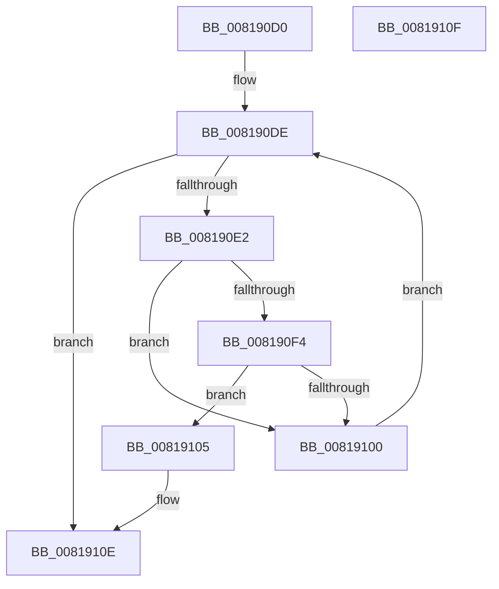

# SdbpCheckUptoVersion

- RVA: `0x008190D0`–`0x00819110` (길이 `64` bytes)
- VA: `0x00000001408190D0`
- 실행 섹션: `PAGE`
- PDB 이름 있음: `예`; PDB Function 태그: `아니요`
- unwind 정보 RVA: `0x000DB714`
- 디코드: `22`개 명령, `64/64` bytes 표시
- 미해석 바이트: `0` (있으면 어셈블리에 `.byte`로 보존)

> 이 문서는 커널 이미지의 기계어와 PDB 기호를 분석해 생성했습니다. 4번과 5번은 함수 원형과 자료형을 바이너리 사용 방식에서 추정한 C 해석이며 원본 소스 복구 결과는 아닙니다.

## 1. Dependencies

- 직접 호출 지점: **0**; 고유 호출 대상: **0**
- 직접 호출자로 확인된 함수: **3**
- RIP 상대 이미지 참조: **0**

### Outgoing calls
- 직접 디코드된 call 명령이 없습니다.

### Direct callers
- [SdbpCheckApplicationTypeAttributes](../../text/69/SdbpCheckApplicationTypeAttributes_function_0069C93C.md) at `0x0069CB45`
- [SdbpCheckAttribute](SdbpCheckAttribute_function_00818A84.md) at `0x00818B06`
- [SdbpMatchOsVersion](../A1/SdbpMatchOsVersion_function_00A18FC0.md) at `0x00A190C8`

### Static image references
- 디코드된 RIP-relative 메모리 참조가 없습니다.

## 2. Other-region calls and transfers

- 다른 실행 섹션으로 향하는 call: **0**
- 별도 외부 분기/꼬리 이동을 확인하지 못했습니다.

## 3. Assembly (complete function range)

```asm
008190D0  B8 01 00 00 00                  mov eax, 1
008190D5  4C 8B D1                        mov r10, rcx
008190D8  4C 8B CA                        mov r9, rdx
008190DB  8D 48 2F                        lea ecx, [rax + 0x2f]
008190DE  85 C9                           test ecx, ecx
008190E0  78 2C                           js 0x14081910e
008190E2  4D 8B C2                        mov r8, r10
008190E5  49 8B D1                        mov rdx, r9
008190E8  49 D3 E8                        shr r8, cl
008190EB  48 D3 EA                        shr rdx, cl
008190EE  66 44 3B C2                     cmp r8w, dx
008190F2  74 0C                           je 0x140819100
008190F4  41 BB FF FF 00 00               mov r11d, 0xffff
008190FA  66 45 3B C3                     cmp r8w, r11w
008190FE  75 05                           jne 0x140819105
00819100  83 E9 10                        sub ecx, 0x10
00819103  EB D9                           jmp 0x1408190de
00819105  33 C0                           xor eax, eax
00819107  66 44 3B C2                     cmp r8w, dx
0081910B  0F 97 C0                        seta al
0081910E  C3                              ret
0081910F  CC                              int3
```

## 4. C-style interpretation (structured pseudocode)

```c
__int64 __fastcall SdbpCheckUptoVersion(__int64 a1, __int64 a2)
{
    __int64 result;

loc_008190DE:
    if (sign_flag) goto loc_0081910E;
    a3 = (a1) >> ((unsigned __int8)(1 + 47));
    a2 = (a2) >> ((unsigned __int8)(1 + 47));
    if (((unsigned __int16)(a3)) == ((unsigned __int16)(a2))) goto loc_00819100;
    if (((unsigned __int16)(a3)) != ((unsigned __int16)((unsigned int)(0xFFFFULL)))) goto loc_00819105;
loc_00819100:
    a1 = (unsigned int)((1 + 47) - (16));
    goto loc_008190DE;
loc_00819105:
    result = 0;
    result = (((unsigned __int16)(a3)) > ((unsigned __int16)(a2))) ? 1 : 0;
loc_0081910E:
    return result;
}
```

## 5. (Beta) C Style

```c
int64_t SdbpCheckUptoVersion(int64_t Arg1, int64_t Arg2)
{
    int64_t result;

loc_008190DE:
    if (sign_flag) goto loc_0081910E;
    a3 = (Arg1) >> ((uint8_t)(1 + 47));
    Arg2 = (Arg2) >> ((uint8_t)(1 + 47));
    if (((uint16_t)(a3)) == ((uint16_t)(Arg2))) goto loc_00819100;
    if (((uint16_t)(a3)) != ((uint16_t)((uint32_t)(0xFFFFULL)))) goto loc_00819105;
loc_00819100:
    Arg1 = (uint32_t)((1 + 47) - (16));
    goto loc_008190DE;
loc_00819105:
    result = 0;
    result = (((uint16_t)(a3)) > ((uint16_t)(Arg2))) ? 1 : 0;
loc_0081910E:
    return result;
}
```

## 6. Execution-region graph

[열기: 2D/3D 그래프와 함수 탐색 컨트롤 패널](../../../control-panel.html?section=page&rva=0x008190D0&view=graph)

- 2D 그래프는 위에서 아래로 흐르고, 3D 그래프는 빈 공간을 드래그해 회전합니다. Shift+드래그는 이동, 휠은 확대·축소, 함수 노드 선택은 대상 보고서 이동입니다.

### Static fallback


