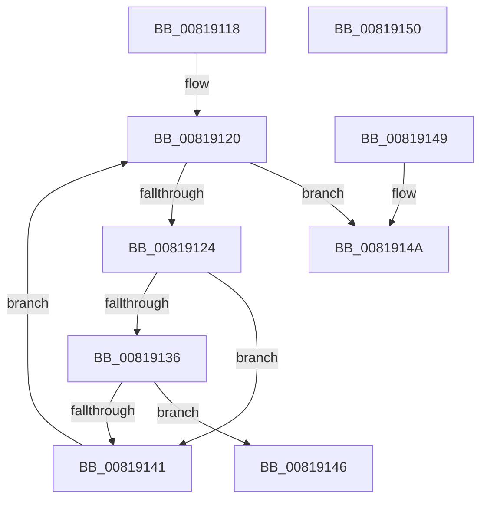

# SdbpCheckVersion

- RVA: `0x00819118`–`0x00819151` (길이 `57` bytes)
- VA: `0x0000000140819118`
- 실행 섹션: `PAGE`
- PDB 이름 있음: `예`; PDB Function 태그: `아니요`
- unwind 정보 RVA: `0x000DB714`
- 디코드: `21`개 명령, `57/57` bytes 표시
- 미해석 바이트: `0` (있으면 어셈블리에 `.byte`로 보존)

> 이 문서는 커널 이미지의 기계어와 PDB 기호를 분석해 생성했습니다. 4번과 5번은 함수 원형과 자료형을 바이너리 사용 방식에서 추정한 C 해석이며 원본 소스 복구 결과는 아닙니다.

## 1. Dependencies

- 직접 호출 지점: **0**; 고유 호출 대상: **0**
- 직접 호출자로 확인된 함수: **3**
- RIP 상대 이미지 참조: **0**

### Outgoing calls
- 직접 디코드된 call 명령이 없습니다.

### Direct callers
- [SdbpCheckApplicationTypeAttributes](../../text/69/SdbpCheckApplicationTypeAttributes_function_0069C93C.md) at `0x0069CB93`
- [SdbpCheckAttribute](SdbpCheckAttribute_function_00818A84.md) at `0x00818B44`
- [SdbpMatchOsVersion](../A1/SdbpMatchOsVersion_function_00A18FC0.md) at `0x00A19054`

### Static image references
- 디코드된 RIP-relative 메모리 참조가 없습니다.

## 2. Other-region calls and transfers

- 다른 실행 섹션으로 향하는 call: **0**
- 별도 외부 분기/꼬리 이동을 확인하지 못했습니다.

## 3. Assembly (complete function range)

```asm
00819118  4C 8B C9                        mov r9, rcx
0081911B  B9 30 00 00 00                  mov ecx, 0x30
00819120  85 C9                           test ecx, ecx
00819122  78 26                           js 0x14081914a
00819124  4D 8B C1                        mov r8, r9
00819127  48 8B C2                        mov rax, rdx
0081912A  49 D3 E8                        shr r8, cl
0081912D  48 D3 E8                        shr rax, cl
00819130  66 44 3B C0                     cmp r8w, ax
00819134  74 0B                           je 0x140819141
00819136  B8 FF FF 00 00                  mov eax, 0xffff
0081913B  66 44 3B C0                     cmp r8w, ax
0081913F  75 05                           jne 0x140819146
00819141  83 E9 10                        sub ecx, 0x10
00819144  EB DA                           jmp 0x140819120
00819146  33 C0                           xor eax, eax
00819148  C3                              ret
00819149  CC                              int3
0081914A  B8 01 00 00 00                  mov eax, 1
0081914F  C3                              ret
00819150  CC                              int3
```

## 4. C-style interpretation (structured pseudocode)

```c
__int64 __fastcall SdbpCheckVersion(__int64 a1, __int64 a2)
{
    __int64 result;

loc_00819120:
    if (sign_flag) goto loc_0081914A;
    a3 = (a1) >> (48);
    result = (a2) >> (48);
    if (((unsigned __int16)(a3)) == ((unsigned __int16)(result))) goto loc_00819141;
    if (((unsigned __int16)(a3)) != ((unsigned __int16)((unsigned int)(0xFFFFULL)))) goto loc_00819146;
loc_00819141:
    a1 = (unsigned int)((48) - (16));
    goto loc_00819120;
loc_00819146:
    result = 0;
    return result;
loc_0081914A:
    return 1;
}
```

## 5. (Beta) C Style

```c
int64_t SdbpCheckVersion(int64_t Arg1, int64_t Arg2)
{
    int64_t result;

loc_00819120:
    if (sign_flag) goto loc_0081914A;
    a3 = (Arg1) >> (48);
    result = (Arg2) >> (48);
    if (((uint16_t)(a3)) == ((uint16_t)(result))) goto loc_00819141;
    if (((uint16_t)(a3)) != ((uint16_t)((uint32_t)(0xFFFFULL)))) goto loc_00819146;
loc_00819141:
    Arg1 = (uint32_t)((48) - (16));
    goto loc_00819120;
loc_00819146:
    result = 0;
    return result;
loc_0081914A:
    return 1;
}
```

## 6. Execution-region graph

[열기: 2D/3D 그래프와 함수 탐색 컨트롤 패널](../../../control-panel.html?section=page&rva=0x00819118&view=graph)

- 2D 그래프는 위에서 아래로 흐르고, 3D 그래프는 빈 공간을 드래그해 회전합니다. Shift+드래그는 이동, 휠은 확대·축소, 함수 노드 선택은 대상 보고서 이동입니다.

### Static fallback


