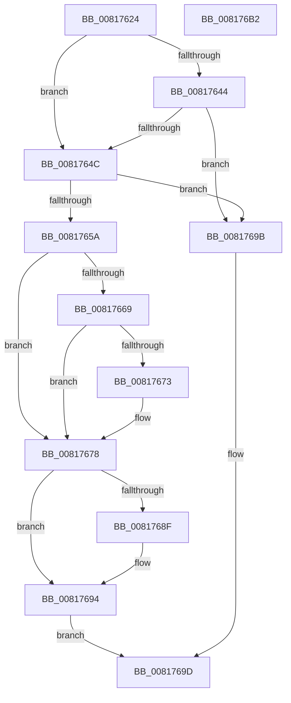

# SdbpCloseLocalDatabaseEx

- RVA: `0x00817624`–`0x008176B3` (길이 `143` bytes)
- VA: `0x0000000140817624`
- 실행 섹션: `PAGE`
- PDB 이름 있음: `예`; PDB Function 태그: `아니요`
- unwind 정보 RVA: `0x0005C954`
- 디코드: `44`개 명령, `143/143` bytes 표시
- 미해석 바이트: `0` (있으면 어셈블리에 `.byte`로 보존)

> 이 문서는 커널 이미지의 기계어와 PDB 기호를 분석해 생성했습니다. 4번과 5번은 함수 원형과 자료형을 바이너리 사용 방식에서 추정한 C 해석이며 원본 소스 복구 결과는 아닙니다.

## 1. Dependencies

- 직접 호출 지점: **1**; 고유 호출 대상: **1**
- 직접 호출자로 확인된 함수: **3**
- RIP 상대 이미지 참조: **0**

### Outgoing calls
- `0x00817673` → [SdbCloseDatabaseRead](../95/SdbCloseDatabaseRead_function_0095A728.md) (function, `0x0095A728`)

### Direct callers
- [SdbpOpenLocalDatabaseEx](SdbpOpenLocalDatabaseEx_function_0081770C.md) at `0x008177A3`
- [SdbpCleanupLocalDatabaseSupport](../95/SdbpCleanupLocalDatabaseSupport_function_0095B6D8.md) at `0x0095B719`
- [sub_00B2786A](../B2/Unknown_function_00B2786A.md) at `0x00B27878`

### Static image references
- 디코드된 RIP-relative 메모리 참조가 없습니다.

## 2. Other-region calls and transfers

- 다른 실행 섹션으로 향하는 call: **0**
- 별도 외부 분기/꼬리 이동을 확인하지 못했습니다.

## 3. Assembly (complete function range)

```asm
00817624  48 89 5C 24 08                  mov qword ptr [rsp + 8], rbx
00817629  48 89 6C 24 10                  mov qword ptr [rsp + 0x10], rbp
0081762E  48 89 74 24 18                  mov qword ptr [rsp + 0x18], rsi
00817633  57                              push rdi
00817634  48 83 EC 20                     sub rsp, 0x20
00817638  41 8B F8                        mov edi, r8d
0081763B  48 8B D9                        mov rbx, rcx
0081763E  41 83 F8 01                     cmp r8d, 1
00817642  74 08                           je 0x14081764c
00817644  8D 47 FD                        lea eax, [rdi - 3]
00817647  83 F8 0C                        cmp eax, 0xc
0081764A  77 4F                           ja 0x14081769b
0081764C  8B CF                           mov ecx, edi
0081764E  BD 01 00 00 00                  mov ebp, 1
00817653  D3 E5                           shl ebp, cl
00817655  85 6B 24                        test dword ptr [rbx + 0x24], ebp
00817658  74 41                           je 0x14081769b
0081765A  48 8B F7                        mov rsi, rdi
0081765D  48 C1 E6 05                     shl rsi, 5
00817661  8B 44 1E 40                     mov eax, dword ptr [rsi + rbx + 0x40]
00817665  A8 02                           test al, 2
00817667  74 0F                           je 0x140817678
00817669  48 8B 4C 1E 38                  mov rcx, qword ptr [rsi + rbx + 0x38]
0081766E  48 85 C9                        test rcx, rcx
00817671  74 05                           je 0x140817678
00817673  E8 B0 30 14 00                  call 0x14095a728
00817678  0F 57 C0                        xorps xmm0, xmm0
0081767B  F7 D5                           not ebp
0081767D  0F 11 44 1E 28                  movups xmmword ptr [rsi + rbx + 0x28], xmm0
00817682  0F 11 44 1E 38                  movups xmmword ptr [rsi + rbx + 0x38], xmm0
00817687  21 6B 24                        and dword ptr [rbx + 0x24], ebp
0081768A  83 FF 01                        cmp edi, 1
0081768D  75 05                           jne 0x140817694
0081768F  48 83 63 18 00                  and qword ptr [rbx + 0x18], 0
00817694  B8 01 00 00 00                  mov eax, 1
00817699  EB 02                           jmp 0x14081769d
0081769B  33 C0                           xor eax, eax
0081769D  48 8B 5C 24 30                  mov rbx, qword ptr [rsp + 0x30]
008176A2  48 8B 6C 24 38                  mov rbp, qword ptr [rsp + 0x38]
008176A7  48 8B 74 24 40                  mov rsi, qword ptr [rsp + 0x40]
008176AC  48 83 C4 20                     add rsp, 0x20
008176B0  5F                              pop rdi
008176B1  C3                              ret
008176B2  CC                              int3
```

## 4. C-style interpretation (structured pseudocode)

```c
__int64 __fastcall SdbpCloseLocalDatabaseEx(__int64 a1, __int64 a2, int a3)
{
    __int64 result;
    __int64 v_rbp;
    __int64 v_rsi;
    __int64 v_rsp;
    unsigned __int64 v_stack_p10;
    unsigned __int64 v_stack_p18;
    unsigned __int64 v_stack_p8;

    v_stack_p8 = v_rbx;
    v_stack_p10 = v_rbp;
    v_stack_p18 = v_rsi;
    v_rsp = (v_rsp) - (32);
    if (a3 == 1) goto loc_0081764C;
    if (((unsigned int)((unsigned int)(a3) - 3)) > 12) goto loc_0081769B;
loc_0081764C:
    v_rbp = (unsigned int)((1) << ((unsigned __int8)((unsigned int)((unsigned int)((unsigned int)(a3))))));
    if (((*(unsigned int *)(a1 + 36)) & ((unsigned int)(v_rbp))) == 0) goto loc_0081769B;
    v_rsi = ((unsigned int)(a3)) << (5);
    if ((((unsigned __int8)((unsigned int)(*(unsigned int *)(v_rsi + a1 * 1 + 64)))) & (2)) == 0) goto loc_00817678;
    result = (unsigned int)(*(unsigned int *)(v_rsi + a1 * 1 + 64));
    if (*(unsigned __int64 *)(v_rsi + a1 * 1 + 56) != 0) {
        result = SdbCloseDatabaseRead(*(unsigned __int64 *)(v_rsi + a1 * 1 + 56), a2, a3, a4);
    }
    v_rbp = (unsigned int)(~(v_rbp));
    *(unsigned __int64 *)(v_rsi + a1 * 1 + 40) = v_xmm0;
    *(unsigned __int64 *)(v_rsi + a1 * 1 + 56) = v_xmm0;
    if (((unsigned int)((unsigned int)(a3))) == 1) {
    }
    goto loc_0081769D;
loc_0081769B:
    result = 0;
loc_0081769D:
    v_rsp = (v_rsp) + (32);
    return result;
}
```

## 5. (Beta) C Style

```c
int64_t SdbpCloseLocalDatabaseEx(void *Arg1, int64_t Arg2, void *Arg3)
{
    uint8_t *arg1 = (uint8_t *)Arg1;
    uint8_t *arg3 = (uint8_t *)Arg3;

    int64_t result;
    int64_t local_rbp;
    int64_t local_rsi;
    int64_t local_rsp;
    uint64_t v_stack_p10;
    uint64_t v_stack_p18;
    uint64_t v_stack_p8;

    v_stack_p8 = local_rbx;
    v_stack_p10 = local_rbp;
    v_stack_p18 = local_rsi;
    local_rsp = (local_rsp) - (32);
    if (Arg3 == 1) goto loc_0081764C;
    if (((uint32_t)((uint32_t)(Arg3) - 3)) > 12) goto loc_0081769B;
loc_0081764C:
    local_rbp = (uint32_t)((1) << ((uint8_t)((uint32_t)((uint32_t)((uint32_t)(Arg3))))));
    if (((*(uint32_t *)(arg1 + 0x24)) & ((uint32_t)(local_rbp))) == 0) goto loc_0081769B;
    local_rsi = ((uint32_t)(Arg3)) << (5);
    if ((((uint8_t)((uint32_t)(*(uint32_t *)(local_rsi + arg1 * 1 + 0x40)))) & (2)) == 0) goto loc_00817678;
    result = (uint32_t)(*(uint32_t *)(local_rsi + arg1 * 1 + 0x40));
    if (*(uint64_t *)(local_rsi + arg1 * 1 + 0x38) != 0) {
        result = SdbCloseDatabaseRead(*(uint64_t *)(local_rsi + arg1 * 1 + 0x38), Arg2, Arg3, a4);
    }
    local_rbp = (uint32_t)(~(local_rbp));
    *(uint64_t *)(local_rsi + arg1 * 1 + 0x28) = v_xmm0;
    *(uint64_t *)(local_rsi + arg1 * 1 + 0x38) = v_xmm0;
    if (((uint32_t)((uint32_t)(Arg3))) == 1) {
    }
    goto loc_0081769D;
loc_0081769B:
    result = 0;
loc_0081769D:
    local_rsp = (local_rsp) + (32);
    return result;
}
```

### 관측된 메모리 오프셋

구조체 형식이 확인되지 않은 접근은 인자 기준의 오프셋으로만 기록했습니다.

| 기준 인자 | 오프셋 표현 | 폭 (bit) | 접근 |
|---|---:|---:|---|
| `Arg1` | `+ 0x18` | `64` | `R/W` |
| `Arg1` | `+ 0x24` | `32` | `R` |
| `Arg1` | `+ 0x24` | `32` | `R/W` |
| `Arg3` | `- 0x3` | `32` | `R` |

## 6. Execution-region graph

[열기: 2D/3D 그래프와 함수 탐색 컨트롤 패널](../../../control-panel.html?section=page&rva=0x00817624&view=graph)

- 2D 그래프는 위에서 아래로 흐르고, 3D 그래프는 빈 공간을 드래그해 회전합니다. Shift+드래그는 이동, 휠은 확대·축소, 함수 노드 선택은 대상 보고서 이동입니다.

### Static fallback


