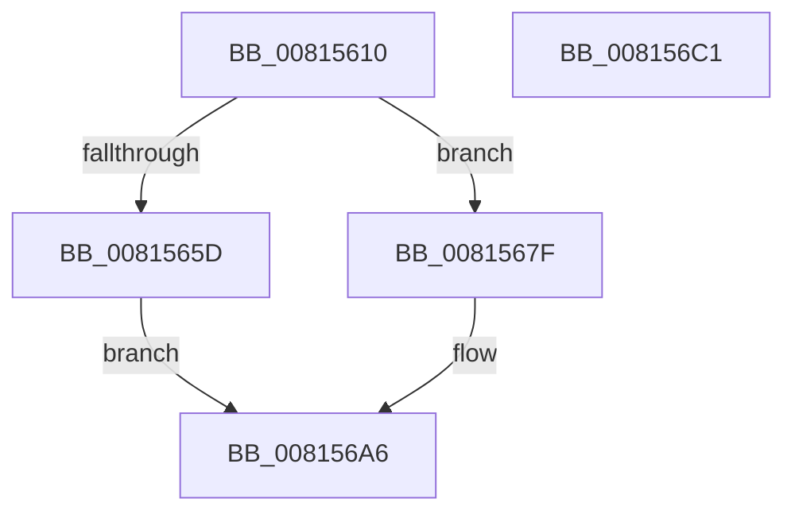

# SdbpFindFirstTagWithoutIndex

- RVA: `0x00815610`–`0x008156C2` (길이 `178` bytes)
- VA: `0x0000000140815610`
- 실행 섹션: `PAGE`
- PDB 이름 있음: `예`; PDB Function 태그: `아니요`
- unwind 정보 RVA: `0x0005D7BC`
- 디코드: `47`개 명령, `178/178` bytes 표시
- 미해석 바이트: `0` (있으면 어셈블리에 `.byte`로 보존)

> 이 문서는 커널 이미지의 기계어와 PDB 기호를 분석해 생성했습니다. 4번과 5번은 함수 원형과 자료형을 바이너리 사용 방식에서 추정한 C 해석이며 원본 소스 복구 결과는 아닙니다.

## 1. Dependencies

- 직접 호출 지점: **3**; 고유 호출 대상: **3**
- 직접 호출자로 확인된 함수: **1**
- RIP 상대 이미지 참조: **2**

### Outgoing calls
- `0x00815654` → [SdbFindFirstTag](../95/SdbFindFirstTag_function_0095E34C.md) (function, `0x0095E34C`)
- `0x00815676` → [AslLogCallPrintf](../95/AslLogCallPrintf_function_0095E4EC.md) (function, `0x0095E4EC`)
- `0x0081569E` → [SdbpFindFirstNamedTagHelper](../AD/SdbpFindFirstNamedTagHelper_function_00AD4D2C.md) (function, `0x00AD4D2C`)

### Direct callers
- [SdbGetDatabaseMatchEx](../95/SdbGetDatabaseMatchEx_function_0095BD7C.md) at `0x0095BF24`

### Static image references
- `0x0081565D` → RVA `0x0003CC70` (`.rdata`; read)
- `0x0081566A` → RVA `0x0003CBE8` (`.rdata`; read)

## 2. Other-region calls and transfers

- 다른 실행 섹션으로 향하는 call: **0**
- 별도 외부 분기/꼬리 이동을 확인하지 못했습니다.

## 3. Assembly (complete function range)

```asm
00815610  48 8B C4                        mov rax, rsp
00815613  48 89 58 08                     mov qword ptr [rax + 8], rbx
00815617  48 89 68 10                     mov qword ptr [rax + 0x10], rbp
0081561B  48 89 70 18                     mov qword ptr [rax + 0x18], rsi
0081561F  48 89 78 20                     mov qword ptr [rax + 0x20], rdi
00815623  41 56                           push r14
00815625  48 83 EC 30                     sub rsp, 0x30
00815629  48 8B 5C 24 60                  mov rbx, qword ptr [rsp + 0x60]
0081562E  0F 57 C0                        xorps xmm0, xmm0
00815631  41 0F B7 F0                     movzx esi, r8w
00815635  44 0F B7 F2                     movzx r14d, dx
00815639  33 C0                           xor eax, eax
0081563B  33 D2                           xor edx, edx
0081563D  41 B8 01 70 00 00               mov r8d, 0x7001
00815643  49 8B F9                        mov rdi, r9
00815646  0F 11 03                        movups xmmword ptr [rbx], xmm0
00815649  48 8B E9                        mov rbp, rcx
0081564C  0F 11 43 10                     movups xmmword ptr [rbx + 0x10], xmm0
00815650  48 89 43 20                     mov qword ptr [rbx + 0x20], rax
00815654  E8 F3 8C 14 00                  call 0x14095e34c
00815659  85 C0                           test eax, eax
0081565B  74 22                           je 0x14081567f
0081565D  4C 8D 0D 0C 76 82 FF            lea r9, [rip - 0x7d89f4]
00815664  41 B8 FC 14 00 00               mov r8d, 0x14fc
0081566A  48 8D 15 77 75 82 FF            lea rdx, [rip - 0x7d8a89]
00815671  B9 01 00 00 00                  mov ecx, 1
00815676  E8 71 8E 14 00                  call 0x14095e4ec
0081567B  33 C0                           xor eax, eax
0081567D  EB 27                           jmp 0x1408156a6
0081567F  83 64 24 28 00                  and dword ptr [rsp + 0x28], 0
00815684  44 0F B7 CE                     movzx r9d, si
00815688  45 0F B7 C6                     movzx r8d, r14w
0081568C  48 89 7C 24 20                  mov qword ptr [rsp + 0x20], rdi
00815691  33 D2                           xor edx, edx
00815693  48 89 7B 20                     mov qword ptr [rbx + 0x20], rdi
00815697  48 8B CD                        mov rcx, rbp
0081569A  66 89 73 0C                     mov word ptr [rbx + 0xc], si
0081569E  E8 89 F6 2B 00                  call 0x140ad4d2c
008156A3  89 43 04                        mov dword ptr [rbx + 4], eax
008156A6  48 8B 5C 24 40                  mov rbx, qword ptr [rsp + 0x40]
008156AB  48 8B 6C 24 48                  mov rbp, qword ptr [rsp + 0x48]
008156B0  48 8B 74 24 50                  mov rsi, qword ptr [rsp + 0x50]
008156B5  48 8B 7C 24 58                  mov rdi, qword ptr [rsp + 0x58]
008156BA  48 83 C4 30                     add rsp, 0x30
008156BE  41 5E                           pop r14
008156C0  C3                              ret
008156C1  CC                              int3
```

## 4. C-style interpretation (structured pseudocode)

```c
__int64 __fastcall SdbpFindFirstTagWithoutIndex(__int64 a1, int a2, unsigned __int16 a3, __int64 a4, __int64 a5)
{
    __int64 result;
    __int64 v_rsp;
    unsigned int v_stack_m10;
    unsigned __int64 v_stack_m18;
    unsigned __int64 v_stack_p10;
    unsigned __int64 v_stack_p18;
    unsigned __int64 v_stack_p20;
    unsigned __int64 v_stack_p8;

    *(unsigned __int64 *)(v_rsp + 8) = v_rbx;
    *(unsigned __int64 *)(v_rsp + 16) = v_rbp;
    *(unsigned __int64 *)(v_rsp + 24) = v_rsi;
    *(unsigned __int64 *)(v_rsp + 32) = v_rdi;
    v_rsp = (v_rsp) - (48);
    result = 0;
    a2 = 0;
    *(unsigned __int64 *)(a5) = v_xmm0;
    *(unsigned __int64 *)(a5 + 16) = v_xmm0;
    *(unsigned __int64 *)(a5 + 32) = 0;
    result = SdbFindFirstTag(a1, a2, (unsigned int)(0x7001ULL), a4);
    if ((unsigned int)(result) == 0) goto loc_0081567F;
    result = AslLogCallPrintf(1, v_rip - 8227465, (unsigned int)(0x14FCULL), v_rip - 8227316);
    result = 0;
    goto loc_008156A6;
loc_0081567F:
    v_stack_m18 = a4;
    a2 = 0;
    *(unsigned __int64 *)(a5 + 32) = a4;
    *(unsigned __int16 *)(a5 + 12) = a3;
    result = SdbpFindFirstNamedTagHelper(a1, a2, (unsigned __int16)((unsigned __int16)(a2)), a3);
    *(unsigned int *)(a5 + 4) = (unsigned int)(result);
loc_008156A6:
    v_rsp = (v_rsp) + (48);
    return result;
}
```

## 5. (Beta) C Style

```c
int64_t SdbpFindFirstTagWithoutIndex(int64_t Arg1, int32_t Arg2, uint16_t Arg3, int64_t Arg4, void *Arg5)
{
    uint8_t *arg5 = (uint8_t *)Arg5;

    int64_t result;
    int64_t local_rsp;
    uint32_t v_stack_m10;
    uint64_t v_stack_m18;
    uint64_t v_stack_p10;
    uint64_t v_stack_p18;
    uint64_t v_stack_p20;
    uint64_t v_stack_p8;

    *(uint64_t *)(local_rsp + 0x8) = local_rbx;
    *(uint64_t *)(local_rsp + 0x10) = local_rbp;
    *(uint64_t *)(local_rsp + 0x18) = local_rsi;
    *(uint64_t *)(local_rsp + 0x20) = local_rdi;
    local_rsp = (local_rsp) - (48);
    result = 0;
    Arg2 = 0;
    *(uint64_t *)(arg5) = v_xmm0;
    *(uint64_t *)(arg5 + 0x10) = v_xmm0;
    *(uint64_t *)(arg5 + 0x20) = 0;
    result = SdbFindFirstTag(Arg1, Arg2, (uint32_t)(0x7001ULL), Arg4);
    if ((uint32_t)(result) == 0) goto loc_0081567F;
    result = AslLogCallPrintf(1, v_rip - 8227465, (uint32_t)(0x14FCULL), v_rip - 8227316);
    result = 0;
    goto loc_008156A6;
loc_0081567F:
    v_stack_m18 = Arg4;
    Arg2 = 0;
    *(uint64_t *)(arg5 + 0x20) = Arg4;
    *(uint16_t *)(arg5 + 0xC) = Arg3;
    result = SdbpFindFirstNamedTagHelper(Arg1, Arg2, (uint16_t)((uint16_t)(Arg2)), Arg3);
    *(uint32_t *)(arg5 + 0x4) = (uint32_t)(result);
loc_008156A6:
    local_rsp = (local_rsp) + (48);
    return result;
}
```

### 관측된 메모리 오프셋

구조체 형식이 확인되지 않은 접근은 인자 기준의 오프셋으로만 기록했습니다.

| 기준 인자 | 오프셋 표현 | 폭 (bit) | 접근 |
|---|---:|---:|---|
| `Arg5` | `+ 0x0` | `128` | `R` |
| `Arg5` | `+ 0x4` | `32` | `W` |
| `Arg5` | `+ 0xC` | `16` | `W` |
| `Arg5` | `+ 0x10` | `128` | `R` |
| `Arg5` | `+ 0x20` | `64` | `W` |

## 6. Execution-region graph

[열기: 2D/3D 그래프와 함수 탐색 컨트롤 패널](../../../control-panel.html?section=page&rva=0x00815610&view=graph)

- 2D 그래프는 위에서 아래로 흐르고, 3D 그래프는 빈 공간을 드래그해 회전합니다. Shift+드래그는 이동, 휠은 확대·축소, 함수 노드 선택은 대상 보고서 이동입니다.

### Static fallback


