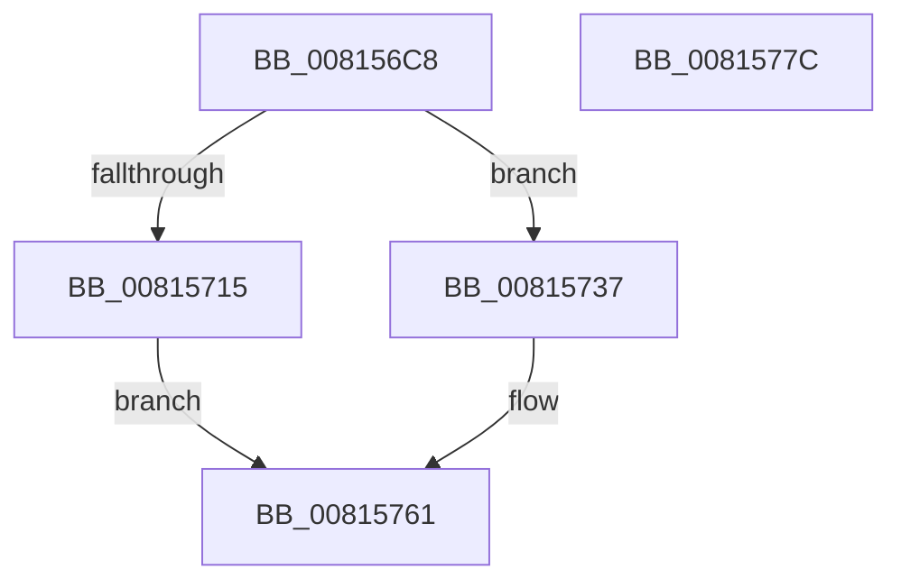

# SdbpFindFirstWildcardTagWithoutIndex

- RVA: `0x008156C8`–`0x0081577D` (길이 `181` bytes)
- VA: `0x00000001408156C8`
- 실행 섹션: `PAGE`
- PDB 이름 있음: `예`; PDB Function 태그: `아니요`
- unwind 정보 RVA: `0x0005D7BC`
- 디코드: `47`개 명령, `181/181` bytes 표시
- 미해석 바이트: `0` (있으면 어셈블리에 `.byte`로 보존)

> 이 문서는 커널 이미지의 기계어와 PDB 기호를 분석해 생성했습니다. 4번과 5번은 함수 원형과 자료형을 바이너리 사용 방식에서 추정한 C 해석이며 원본 소스 복구 결과는 아닙니다.

## 1. Dependencies

- 직접 호출 지점: **3**; 고유 호출 대상: **3**
- 직접 호출자로 확인된 함수: **1**
- RIP 상대 이미지 참조: **2**

### Outgoing calls
- `0x0081570C` → [SdbFindFirstTag](../95/SdbFindFirstTag_function_0095E34C.md) (function, `0x0095E34C`)
- `0x0081572E` → [AslLogCallPrintf](../95/AslLogCallPrintf_function_0095E4EC.md) (function, `0x0095E4EC`)
- `0x00815759` → [SdbpFindFirstNamedTagHelper](../AD/SdbpFindFirstNamedTagHelper_function_00AD4D2C.md) (function, `0x00AD4D2C`)

### Direct callers
- [sub_00B27968](../B2/Unknown_function_00B27968.md) at `0x00B279ED`

### Static image references
- `0x00815715` → RVA `0x0003CC70` (`.rdata`; read)
- `0x00815722` → RVA `0x0003CBA0` (`.rdata`; read)

## 2. Other-region calls and transfers

- 다른 실행 섹션으로 향하는 call: **0**
- 별도 외부 분기/꼬리 이동을 확인하지 못했습니다.

## 3. Assembly (complete function range)

```asm
008156C8  48 8B C4                        mov rax, rsp
008156CB  48 89 58 08                     mov qword ptr [rax + 8], rbx
008156CF  48 89 68 10                     mov qword ptr [rax + 0x10], rbp
008156D3  48 89 70 18                     mov qword ptr [rax + 0x18], rsi
008156D7  48 89 78 20                     mov qword ptr [rax + 0x20], rdi
008156DB  41 56                           push r14
008156DD  48 83 EC 30                     sub rsp, 0x30
008156E1  48 8B 5C 24 60                  mov rbx, qword ptr [rsp + 0x60]
008156E6  0F 57 C0                        xorps xmm0, xmm0
008156E9  41 0F B7 F0                     movzx esi, r8w
008156ED  44 0F B7 F2                     movzx r14d, dx
008156F1  33 C0                           xor eax, eax
008156F3  33 D2                           xor edx, edx
008156F5  41 B8 01 70 00 00               mov r8d, 0x7001
008156FB  49 8B F9                        mov rdi, r9
008156FE  0F 11 03                        movups xmmword ptr [rbx], xmm0
00815701  48 8B E9                        mov rbp, rcx
00815704  0F 11 43 10                     movups xmmword ptr [rbx + 0x10], xmm0
00815708  48 89 43 20                     mov qword ptr [rbx + 0x20], rax
0081570C  E8 3B 8C 14 00                  call 0x14095e34c
00815711  85 C0                           test eax, eax
00815713  74 22                           je 0x140815737
00815715  4C 8D 0D 54 75 82 FF            lea r9, [rip - 0x7d8aac]
0081571C  41 B8 2C 15 00 00               mov r8d, 0x152c
00815722  48 8D 15 77 74 82 FF            lea rdx, [rip - 0x7d8b89]
00815729  B9 01 00 00 00                  mov ecx, 1
0081572E  E8 B9 8D 14 00                  call 0x14095e4ec
00815733  33 C0                           xor eax, eax
00815735  EB 2A                           jmp 0x140815761
00815737  C7 44 24 28 01 00 00 00         mov dword ptr [rsp + 0x28], 1
0081573F  44 0F B7 CE                     movzx r9d, si
00815743  45 0F B7 C6                     movzx r8d, r14w
00815747  48 89 7C 24 20                  mov qword ptr [rsp + 0x20], rdi
0081574C  33 D2                           xor edx, edx
0081574E  48 89 7B 20                     mov qword ptr [rbx + 0x20], rdi
00815752  48 8B CD                        mov rcx, rbp
00815755  66 89 73 0C                     mov word ptr [rbx + 0xc], si
00815759  E8 CE F5 2B 00                  call 0x140ad4d2c
0081575E  89 43 04                        mov dword ptr [rbx + 4], eax
00815761  48 8B 5C 24 40                  mov rbx, qword ptr [rsp + 0x40]
00815766  48 8B 6C 24 48                  mov rbp, qword ptr [rsp + 0x48]
0081576B  48 8B 74 24 50                  mov rsi, qword ptr [rsp + 0x50]
00815770  48 8B 7C 24 58                  mov rdi, qword ptr [rsp + 0x58]
00815775  48 83 C4 30                     add rsp, 0x30
00815779  41 5E                           pop r14
0081577B  C3                              ret
0081577C  CC                              int3
```

## 4. C-style interpretation (structured pseudocode)

```c
__int64 __fastcall SdbpFindFirstWildcardTagWithoutIndex(__int64 a1, int a2, unsigned __int16 a3, __int64 a4, __int64 a5)
{
    __int64 result;
    __int64 v_rsp;
    unsigned int v_stack_m10;
    unsigned __int64 v_stack_m18;
    unsigned __int64 v_stack_p10;
    unsigned __int64 v_stack_p18;
    unsigned __int64 v_stack_p20;
    unsigned __int64 v_stack_p8;

    *(unsigned __int64 *)(v_rsp + 8) = v_rbx;
    *(unsigned __int64 *)(v_rsp + 16) = v_rbp;
    *(unsigned __int64 *)(v_rsp + 24) = v_rsi;
    *(unsigned __int64 *)(v_rsp + 32) = v_rdi;
    v_rsp = (v_rsp) - (48);
    result = 0;
    a2 = 0;
    *(unsigned __int64 *)(a5) = v_xmm0;
    *(unsigned __int64 *)(a5 + 16) = v_xmm0;
    *(unsigned __int64 *)(a5 + 32) = 0;
    result = SdbFindFirstTag(a1, a2, (unsigned int)(0x7001ULL), a4);
    if ((unsigned int)(result) == 0) goto loc_00815737;
    result = AslLogCallPrintf(1, v_rip - 8227721, (unsigned int)(0x152CULL), v_rip - 8227500);
    result = 0;
    goto loc_00815761;
loc_00815737:
    v_stack_m10 = 1;
    v_stack_m18 = a4;
    a2 = 0;
    *(unsigned __int64 *)(a5 + 32) = a4;
    *(unsigned __int16 *)(a5 + 12) = a3;
    result = SdbpFindFirstNamedTagHelper(a1, a2, (unsigned __int16)((unsigned __int16)(a2)), a3);
    *(unsigned int *)(a5 + 4) = (unsigned int)(result);
loc_00815761:
    v_rsp = (v_rsp) + (48);
    return result;
}
```

## 5. (Beta) C Style

```c
int64_t SdbpFindFirstWildcardTagWithoutIndex(int64_t Arg1, int32_t Arg2, uint16_t Arg3, int64_t Arg4, void *Arg5)
{
    uint8_t *arg5 = (uint8_t *)Arg5;

    int64_t result;
    int64_t local_rsp;
    uint32_t v_stack_m10;
    uint64_t v_stack_m18;
    uint64_t v_stack_p10;
    uint64_t v_stack_p18;
    uint64_t v_stack_p20;
    uint64_t v_stack_p8;

    *(uint64_t *)(local_rsp + 0x8) = local_rbx;
    *(uint64_t *)(local_rsp + 0x10) = local_rbp;
    *(uint64_t *)(local_rsp + 0x18) = local_rsi;
    *(uint64_t *)(local_rsp + 0x20) = local_rdi;
    local_rsp = (local_rsp) - (48);
    result = 0;
    Arg2 = 0;
    *(uint64_t *)(arg5) = v_xmm0;
    *(uint64_t *)(arg5 + 0x10) = v_xmm0;
    *(uint64_t *)(arg5 + 0x20) = 0;
    result = SdbFindFirstTag(Arg1, Arg2, (uint32_t)(0x7001ULL), Arg4);
    if ((uint32_t)(result) == 0) goto loc_00815737;
    result = AslLogCallPrintf(1, v_rip - 8227721, (uint32_t)(0x152CULL), v_rip - 8227500);
    result = 0;
    goto loc_00815761;
loc_00815737:
    v_stack_m10 = 1;
    v_stack_m18 = Arg4;
    Arg2 = 0;
    *(uint64_t *)(arg5 + 0x20) = Arg4;
    *(uint16_t *)(arg5 + 0xC) = Arg3;
    result = SdbpFindFirstNamedTagHelper(Arg1, Arg2, (uint16_t)((uint16_t)(Arg2)), Arg3);
    *(uint32_t *)(arg5 + 0x4) = (uint32_t)(result);
loc_00815761:
    local_rsp = (local_rsp) + (48);
    return result;
}
```

### 관측된 메모리 오프셋

구조체 형식이 확인되지 않은 접근은 인자 기준의 오프셋으로만 기록했습니다.

| 기준 인자 | 오프셋 표현 | 폭 (bit) | 접근 |
|---|---:|---:|---|
| `Arg5` | `+ 0x0` | `128` | `R` |
| `Arg5` | `+ 0x4` | `32` | `W` |
| `Arg5` | `+ 0xC` | `16` | `W` |
| `Arg5` | `+ 0x10` | `128` | `R` |
| `Arg5` | `+ 0x20` | `64` | `W` |

## 6. Execution-region graph

[열기: 2D/3D 그래프와 함수 탐색 컨트롤 패널](../../../control-panel.html?section=page&rva=0x008156C8&view=graph)

- 2D 그래프는 위에서 아래로 흐르고, 3D 그래프는 빈 공간을 드래그해 회전합니다. Shift+드래그는 이동, 휠은 확대·축소, 함수 노드 선택은 대상 보고서 이동입니다.

### Static fallback


