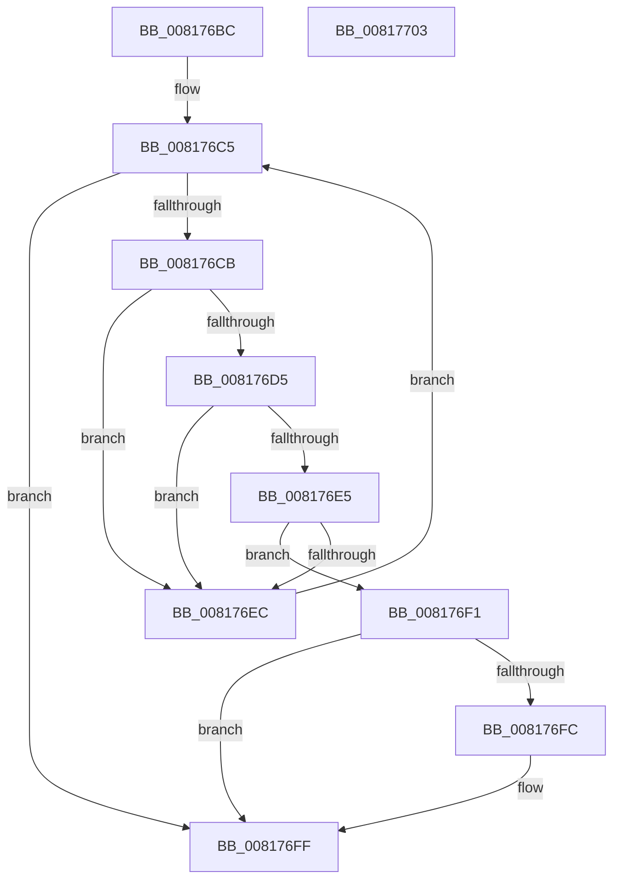

# SdbpFindLocalDatabaseByPDB

- RVA: `0x008176BC`–`0x00817704` (길이 `72` bytes)
- VA: `0x00000001408176BC`
- 실행 섹션: `PAGE`
- PDB 이름 있음: `예`; PDB Function 태그: `아니요`
- unwind 정보 RVA: `0x000DB714`
- 디코드: `24`개 명령, `72/72` bytes 표시
- 미해석 바이트: `0` (있으면 어셈블리에 `.byte`로 보존)

> 이 문서는 커널 이미지의 기계어와 PDB 기호를 분석해 생성했습니다. 4번과 5번은 함수 원형과 자료형을 바이너리 사용 방식에서 추정한 C 해석이며 원본 소스 복구 결과는 아닙니다.

## 1. Dependencies

- 직접 호출 지점: **0**; 고유 호출 대상: **0**
- 직접 호출자로 확인된 함수: **1**
- RIP 상대 이미지 참조: **0**

### Outgoing calls
- 직접 디코드된 call 명령이 없습니다.

### Direct callers
- [SdbTagIDToTagRef](SdbTagIDToTagRef_function_0081710C.md) at `0x0081712C`

### Static image references
- 디코드된 RIP-relative 메모리 참조가 없습니다.

## 2. Other-region calls and transfers

- 다른 실행 섹션으로 향하는 call: **0**
- 별도 외부 분기/꼬리 이동을 확인하지 못했습니다.

## 3. Assembly (complete function range)

```asm
008176BC  45 33 D2                        xor r10d, r10d
008176BF  4C 8B D9                        mov r11, rcx
008176C2  45 33 C0                        xor r8d, r8d
008176C5  41 83 F8 10                     cmp r8d, 0x10
008176C9  73 34                           jae 0x1408176ff
008176CB  41 8B 43 24                     mov eax, dword ptr [r11 + 0x24]
008176CF  44 0F A3 C0                     bt eax, r8d
008176D3  73 17                           jae 0x1408176ec
008176D5  41 8B C8                        mov ecx, r8d
008176D8  48 C1 E1 05                     shl rcx, 5
008176DC  42 8B 44 19 40                  mov eax, dword ptr [rcx + r11 + 0x40]
008176E1  A8 02                           test al, 2
008176E3  74 07                           je 0x1408176ec
008176E5  4A 3B 54 19 38                  cmp rdx, qword ptr [rcx + r11 + 0x38]
008176EA  74 05                           je 0x1408176f1
008176EC  41 FF C0                        inc r8d
008176EF  EB D4                           jmp 0x1408176c5
008176F1  41 BA 01 00 00 00               mov r10d, 1
008176F7  4D 85 C9                        test r9, r9
008176FA  74 03                           je 0x1408176ff
008176FC  45 89 01                        mov dword ptr [r9], r8d
008176FF  41 8B C2                        mov eax, r10d
00817702  C3                              ret
00817703  CC                              int3
```

## 4. C-style interpretation (structured pseudocode)

```c
__int64 __fastcall SdbpFindLocalDatabaseByPDB(__int64 a1, __int64 a2, int a3, __int64 a4)
{
    __int64 v_r10;

    v_r10 = 0;
    a3 = 0;
loc_008176C5:
    if (0 >= 16) goto loc_008176FF;
    if (0 >= 16) goto loc_008176EC;
    a1 = (0) << (5);
    if ((((unsigned __int8)((unsigned int)(*(unsigned int *)(a1 + a1 * 1 + 64)))) & (2)) == 0) goto loc_008176EC;
    if (a2 == (*(unsigned __int64 *)(a1 + a1 * 1 + 56))) goto loc_008176F1;
loc_008176EC:
    a3 = (unsigned int)((a3) + 1);
    goto loc_008176C5;
loc_008176F1:
    if (a4 != 0) {
        *(unsigned int *)(a4) = a3;
    }
    return 1;
}
```

## 5. (Beta) C Style

```c
int64_t SdbpFindLocalDatabaseByPDB(void *Arg1, int64_t Arg2, int32_t Arg3, int64_t Arg4)
{
    uint8_t *arg1 = (uint8_t *)Arg1;

    int64_t local_r10;

    local_r10 = 0;
    Arg3 = 0;
loc_008176C5:
    if (0 >= 16) goto loc_008176FF;
    if (0 >= 16) goto loc_008176EC;
    Arg1 = (0) << (5);
    if ((((uint8_t)((uint32_t)(*(uint32_t *)(arg1 + arg1 * 1 + 0x40)))) & (2)) == 0) goto loc_008176EC;
    if (Arg2 == (*(uint64_t *)(arg1 + arg1 * 1 + 0x38))) goto loc_008176F1;
loc_008176EC:
    Arg3 = (uint32_t)((Arg3) + 1);
    goto loc_008176C5;
loc_008176F1:
    if (Arg4 != 0) {
        *(uint32_t *)(Arg4) = Arg3;
    }
    return 1;
}
```

### 관측된 메모리 오프셋

구조체 형식이 확인되지 않은 접근은 인자 기준의 오프셋으로만 기록했습니다.

| 기준 인자 | 오프셋 표현 | 폭 (bit) | 접근 |
|---|---:|---:|---|
| `Arg1` | `+ 0x24` | `32` | `R` |

## 6. Execution-region graph

[열기: 2D/3D 그래프와 함수 탐색 컨트롤 패널](../../../control-panel.html?section=page&rva=0x008176BC&view=graph)

- 2D 그래프는 위에서 아래로 흐르고, 3D 그래프는 빈 공간을 드래그해 회전합니다. Shift+드래그는 이동, 휠은 확대·축소, 함수 노드 선택은 대상 보고서 이동입니다.

### Static fallback


