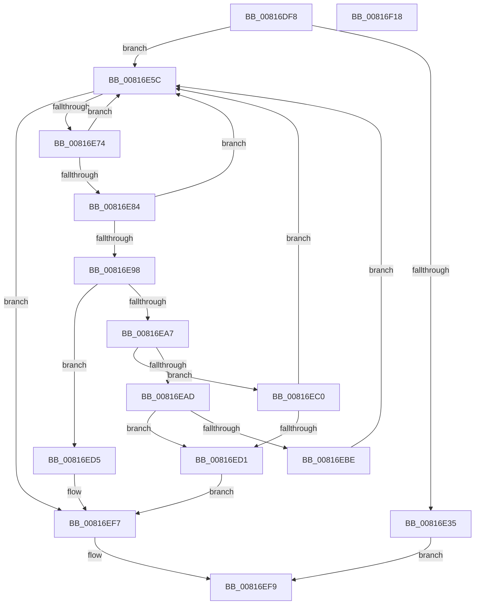

# SdbpFindNextNamedTagHelper

- RVA: `0x00816DF8`–`0x00816F19` (길이 `289` bytes)
- VA: `0x0000000140816DF8`
- 실행 섹션: `PAGE`
- PDB 이름 있음: `예`; PDB Function 태그: `아니요`
- unwind 정보 RVA: `0x000847EC`
- 디코드: `83`개 명령, `289/289` bytes 표시
- 미해석 바이트: `0` (있으면 어셈블리에 `.byte`로 보존)

> 이 문서는 커널 이미지의 기계어와 PDB 기호를 분석해 생성했습니다. 4번과 5번은 함수 원형과 자료형을 바이너리 사용 방식에서 추정한 C 해석이며 원본 소스 복구 결과는 아닙니다.

## 1. Dependencies

- 직접 호출 지점: **9**; 고유 호출 대상: **7**
- 직접 호출자로 확인된 함수: **3**
- RIP 상대 이미지 참조: **3**

### Outgoing calls
- `0x00816E27` → [SdbGetTagFromTagID](../95/SdbGetTagFromTagID_function_0095E3C0.md) (function, `0x0095E3C0`)
- `0x00816E50` → [AslLogCallPrintf](../95/AslLogCallPrintf_function_0095E4EC.md) (function, `0x0095E4EC`)
- `0x00816E65` → [SdbGetNextChild](../95/SdbGetNextChild_function_0095E520.md) (function, `0x0095E520`)
- `0x00816E79` → [SdbGetTagFromTagID](../95/SdbGetTagFromTagID_function_0095E3C0.md) (function, `0x0095E3C0`)
- `0x00816E8D` → [SdbFindFirstTag](../95/SdbFindFirstTag_function_0095E34C.md) (function, `0x0095E34C`)
- `0x00816E9D` → [SdbGetStringTagPtr](../95/SdbGetStringTagPtr_function_0095DDA8.md) (function, `0x0095DDA8`)
- `0x00816EB5` → [AslStringPatternMatchExW](../95/AslStringPatternMatchExW_function_0095E850.md) (function, `0x0095E850`)
- `0x00816EC8` → [wcsicmp](../../text/50/wcsicmp_function_00500080.md) (function, `0x00500080`)
- `0x00816EF2` → [AslLogCallPrintf](../95/AslLogCallPrintf_function_0095E4EC.md) (function, `0x0095E4EC`)

### Direct callers
- [SdbpFindNextTagWithoutIndex](SdbpFindNextTagWithoutIndex_function_00815784.md) at `0x008157E3`
- [SdbpFindNextWildcardTagWithoutIndex](SdbpFindNextWildcardTagWithoutIndex_function_00815800.md) at `0x00815862`
- [SdbpSearchDB](../AB/SdbpSearchDB_function_00AB3294.md) at `0x00AB3471`
- [SdbpSearchDB](../AB/SdbpSearchDB_function_00AB3294.md) at `0x00AB355F`
- [SdbpSearchDB](../AB/SdbpSearchDB_function_00AB3294.md) at `0x00AB3661`
- [SdbpSearchDB](../AB/SdbpSearchDB_function_00AB3294.md) at `0x00AB3754`

### Static image references
- `0x00816E35` → RVA `0x00012680` (`.rdata`; read)
- `0x00816E46` → RVA `0x0003D1F0` (`.rdata`; read)
- `0x00816ED5` → RVA `0x0003D1C8` (`.rdata`; read)

## 2. Other-region calls and transfers

- 다른 실행 섹션으로 향하는 call: **1**
  - `0x00816EC8` → [wcsicmp](../../text/50/wcsicmp_function_00500080.md) (`PAGE` → `.text`)
- 별도 외부 분기/꼬리 이동을 확인하지 못했습니다.

## 3. Assembly (complete function range)

```asm
00816DF8  48 8B C4                        mov rax, rsp
00816DFB  48 89 58 08                     mov qword ptr [rax + 8], rbx
00816DFF  48 89 68 10                     mov qword ptr [rax + 0x10], rbp
00816E03  48 89 70 18                     mov qword ptr [rax + 0x18], rsi
00816E07  48 89 78 20                     mov qword ptr [rax + 0x20], rdi
00816E0B  41 54                           push r12
00816E0D  41 56                           push r14
00816E0F  41 57                           push r15
00816E11  48 83 EC 30                     sub rsp, 0x30
00816E15  44 8B F2                        mov r14d, edx
00816E18  45 0F B7 E1                     movzx r12d, r9w
00816E1C  41 8B D0                        mov edx, r8d
00816E1F  41 8B F8                        mov edi, r8d
00816E22  48 8B E9                        mov rbp, rcx
00816E25  33 DB                           xor ebx, ebx
00816E27  E8 94 75 14 00                  call 0x14095e3c0
00816E2C  44 0F B7 F8                     movzx r15d, ax
00816E30  66 85 C0                        test ax, ax
00816E33  75 27                           jne 0x140816e5c
00816E35  4C 8D 0D 44 B8 7F FF            lea r9, [rip - 0x8047bc]
00816E3C  89 7C 24 20                     mov dword ptr [rsp + 0x20], edi
00816E40  41 B8 2C 02 00 00               mov r8d, 0x22c
00816E46  48 8D 15 A3 63 82 FF            lea rdx, [rip - 0x7d9c5d]
00816E4D  8D 4B 01                        lea ecx, [rbx + 1]
00816E50  E8 97 76 14 00                  call 0x14095e4ec
00816E55  33 C0                           xor eax, eax
00816E57  E9 9D 00 00 00                  jmp 0x140816ef9
00816E5C  44 8B C7                        mov r8d, edi
00816E5F  41 8B D6                        mov edx, r14d
00816E62  48 8B CD                        mov rcx, rbp
00816E65  E8 B6 76 14 00                  call 0x14095e520
00816E6A  8B F8                           mov edi, eax
00816E6C  85 C0                           test eax, eax
00816E6E  0F 84 83 00 00 00               je 0x140816ef7
00816E74  8B D0                           mov edx, eax
00816E76  48 8B CD                        mov rcx, rbp
00816E79  E8 42 75 14 00                  call 0x14095e3c0
00816E7E  66 41 3B C7                     cmp ax, r15w
00816E82  75 D8                           jne 0x140816e5c
00816E84  45 0F B7 C4                     movzx r8d, r12w
00816E88  8B D7                           mov edx, edi
00816E8A  48 8B CD                        mov rcx, rbp
00816E8D  E8 BA 74 14 00                  call 0x14095e34c
00816E92  8B F0                           mov esi, eax
00816E94  85 C0                           test eax, eax
00816E96  74 C4                           je 0x140816e5c
00816E98  8B D0                           mov edx, eax
00816E9A  48 8B CD                        mov rcx, rbp
00816E9D  E8 06 6F 14 00                  call 0x14095dda8
00816EA2  48 85 C0                        test rax, rax
00816EA5  74 2E                           je 0x140816ed5
00816EA7  39 5C 24 78                     cmp dword ptr [rsp + 0x78], ebx
00816EAB  74 13                           je 0x140816ec0
00816EAD  48 8B 54 24 70                  mov rdx, qword ptr [rsp + 0x70]
00816EB2  48 8B C8                        mov rcx, rax
00816EB5  E8 96 79 14 00                  call 0x14095e850
00816EBA  85 C0                           test eax, eax
00816EBC  75 13                           jne 0x140816ed1
00816EBE  EB 9C                           jmp 0x140816e5c
00816EC0  48 8B 4C 24 70                  mov rcx, qword ptr [rsp + 0x70]
00816EC5  48 8B D0                        mov rdx, rax
00816EC8  E8 B3 91 CE FF                  call 0x140500080
00816ECD  85 C0                           test eax, eax
00816ECF  75 8B                           jne 0x140816e5c
00816ED1  8B DF                           mov ebx, edi
00816ED3  EB 22                           jmp 0x140816ef7
00816ED5  4C 8D 0D EC 62 82 FF            lea r9, [rip - 0x7d9d14]
00816EDC  89 74 24 20                     mov dword ptr [rsp + 0x20], esi
00816EE0  41 B8 3D 02 00 00               mov r8d, 0x23d
00816EE6  48 8D 15 03 63 82 FF            lea rdx, [rip - 0x7d9cfd]
00816EED  B9 01 00 00 00                  mov ecx, 1
00816EF2  E8 F5 75 14 00                  call 0x14095e4ec
00816EF7  8B C3                           mov eax, ebx
00816EF9  48 8B 5C 24 50                  mov rbx, qword ptr [rsp + 0x50]
00816EFE  48 8B 6C 24 58                  mov rbp, qword ptr [rsp + 0x58]
00816F03  48 8B 74 24 60                  mov rsi, qword ptr [rsp + 0x60]
00816F08  48 8B 7C 24 68                  mov rdi, qword ptr [rsp + 0x68]
00816F0D  48 83 C4 30                     add rsp, 0x30
00816F11  41 5F                           pop r15
00816F13  41 5E                           pop r14
00816F15  41 5C                           pop r12
00816F17  C3                              ret
00816F18  CC                              int3
```

## 4. C-style interpretation (structured pseudocode)

```c
__int64 __fastcall SdbpFindNextNamedTagHelper(__int64 a1, int a2, int a3, unsigned __int16 a4, __int64 a5, unsigned int a6)
{
    __int64 result;
    __int64 v_rbx;
    __int64 v_rsp;
    unsigned int v_stack_m28;
    unsigned __int64 v_stack_p10;
    unsigned __int64 v_stack_p18;
    unsigned __int64 v_stack_p20;
    unsigned __int64 v_stack_p8;

    *(unsigned __int64 *)(v_rsp + 8) = v_rbx;
    *(unsigned __int64 *)(v_rsp + 16) = v_rbp;
    *(unsigned __int64 *)(v_rsp + 24) = v_rsi;
    *(unsigned __int64 *)(v_rsp + 32) = v_rdi;
    v_rsp = (v_rsp) - (48);
    v_rbx = 0;
    result = SdbGetTagFromTagID(a1, (unsigned int)(a3), a3, a4);
    if ((unsigned __int16)(result) != 0) goto loc_00816E5C;
    v_stack_m28 = (unsigned int)((unsigned int)(a3));
    result = AslLogCallPrintf(v_rbx + 1, v_rip - 8232029, 556, v_rip - 8406972);
    result = 0;
    goto loc_00816EF9;
loc_00816E5C:
    result = SdbGetNextChild(a1, (unsigned int)((unsigned int)((unsigned int)(a2))), (unsigned int)((unsigned int)((unsigned int)(a3))), v_rip - 8406972);
    if ((unsigned int)(result) == 0) goto loc_00816EF7;
    result = SdbGetTagFromTagID(a1, (unsigned int)((unsigned int)(result)), (unsigned int)((unsigned int)((unsigned int)(a3))), v_rip - 8406972);
    if (((unsigned __int16)(result)) != ((unsigned __int16)((unsigned __int16)(result)))) goto loc_00816E5C;
    result = SdbFindFirstTag(a1, (unsigned int)((unsigned int)((unsigned int)((unsigned int)(result)))), a4, v_rip - 8406972);
    if ((unsigned int)(result) == 0) goto loc_00816E5C;
    result = SdbGetStringTagPtr(a1, (unsigned int)((unsigned int)(result)), a4, v_rip - 8406972);
    if (result == 0) goto loc_00816ED5;
    if (a6 == 0) goto loc_00816EC0;
    result = AslStringPatternMatchExW(result, a5, a4, v_rip - 8406972);
    if ((unsigned int)(result) != 0) goto loc_00816ED1;
    goto loc_00816E5C;
loc_00816EC0:
    result = wcsicmp(a5, result, a4, v_rip - 8406972);
    if ((unsigned int)(result) != 0) goto loc_00816E5C;
loc_00816ED1:
    goto loc_00816EF7;
loc_00816ED5:
    v_stack_m28 = (unsigned int)((unsigned int)((unsigned int)(result)));
    result = AslLogCallPrintf(1, v_rip - 8232189, 573, v_rip - 8232212);
loc_00816EF7:
loc_00816EF9:
    v_rsp = (v_rsp) + (48);
    return (unsigned int)((unsigned int)((unsigned int)((unsigned int)((unsigned int)((unsigned int)(result))))));
}
```

## 5. (Beta) C Style

```c
int64_t SdbpFindNextNamedTagHelper(int64_t Arg1, int32_t Arg2, int32_t Arg3, uint16_t Arg4, int64_t Arg5, uint32_t Arg6)
{
    int64_t result;
    int64_t local_rbx;
    int64_t local_rsp;
    uint32_t v_stack_m28;
    uint64_t v_stack_p10;
    uint64_t v_stack_p18;
    uint64_t v_stack_p20;
    uint64_t v_stack_p8;

    *(uint64_t *)(local_rsp + 0x8) = local_rbx;
    *(uint64_t *)(local_rsp + 0x10) = local_rbp;
    *(uint64_t *)(local_rsp + 0x18) = local_rsi;
    *(uint64_t *)(local_rsp + 0x20) = local_rdi;
    local_rsp = (local_rsp) - (48);
    local_rbx = 0;
    result = SdbGetTagFromTagID(Arg1, (uint32_t)(Arg3), Arg3, Arg4);
    if ((uint16_t)(result) != 0) goto loc_00816E5C;
    v_stack_m28 = (uint32_t)((uint32_t)(Arg3));
    result = AslLogCallPrintf(local_rbx + 1, v_rip - 8232029, 556, v_rip - 8406972);
    result = 0;
    goto loc_00816EF9;
loc_00816E5C:
    result = SdbGetNextChild(Arg1, (uint32_t)((uint32_t)((uint32_t)(Arg2))), (uint32_t)((uint32_t)((uint32_t)(Arg3))), v_rip - 8406972);
    if ((uint32_t)(result) == 0) goto loc_00816EF7;
    result = SdbGetTagFromTagID(Arg1, (uint32_t)((uint32_t)(result)), (uint32_t)((uint32_t)((uint32_t)(Arg3))), v_rip - 8406972);
    if (((uint16_t)(result)) != ((uint16_t)((uint16_t)(result)))) goto loc_00816E5C;
    result = SdbFindFirstTag(Arg1, (uint32_t)((uint32_t)((uint32_t)((uint32_t)(result)))), Arg4, v_rip - 8406972);
    if ((uint32_t)(result) == 0) goto loc_00816E5C;
    result = SdbGetStringTagPtr(Arg1, (uint32_t)((uint32_t)(result)), Arg4, v_rip - 8406972);
    if (result == 0) goto loc_00816ED5;
    if (Arg6 == 0) goto loc_00816EC0;
    result = AslStringPatternMatchExW(result, Arg5, Arg4, v_rip - 8406972);
    if ((uint32_t)(result) != 0) goto loc_00816ED1;
    goto loc_00816E5C;
loc_00816EC0:
    result = wcsicmp(Arg5, result, Arg4, v_rip - 8406972);
    if ((uint32_t)(result) != 0) goto loc_00816E5C;
loc_00816ED1:
    goto loc_00816EF7;
loc_00816ED5:
    v_stack_m28 = (uint32_t)((uint32_t)((uint32_t)(result)));
    result = AslLogCallPrintf(1, v_rip - 8232189, 573, v_rip - 8232212);
loc_00816EF7:
loc_00816EF9:
    local_rsp = (local_rsp) + (48);
    return (uint32_t)((uint32_t)((uint32_t)((uint32_t)((uint32_t)((uint32_t)(result))))));
}
```

## 6. Execution-region graph

[열기: 2D/3D 그래프와 함수 탐색 컨트롤 패널](../../../control-panel.html?section=page&rva=0x00816DF8&view=graph)

- 2D 그래프는 위에서 아래로 흐르고, 3D 그래프는 빈 공간을 드래그해 회전합니다. Shift+드래그는 이동, 휠은 확대·축소, 함수 노드 선택은 대상 보고서 이동입니다.

### Static fallback


