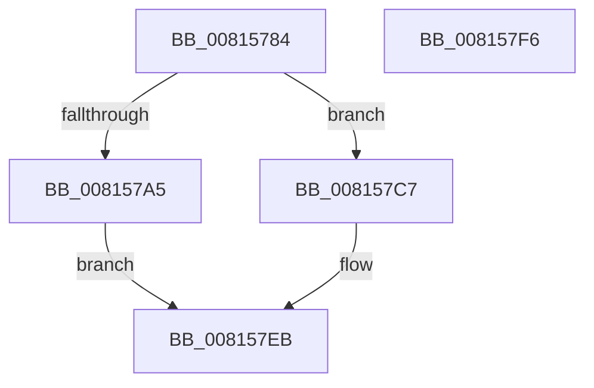

# SdbpFindNextTagWithoutIndex

- RVA: `0x00815784`–`0x008157F7` (길이 `115` bytes)
- VA: `0x0000000140815784`
- 실행 섹션: `PAGE`
- PDB 이름 있음: `예`; PDB Function 태그: `아니요`
- unwind 정보 RVA: `0x0006E5F8`
- 디코드: `31`개 명령, `115/115` bytes 표시
- 미해석 바이트: `0` (있으면 어셈블리에 `.byte`로 보존)

> 이 문서는 커널 이미지의 기계어와 PDB 기호를 분석해 생성했습니다. 4번과 5번은 함수 원형과 자료형을 바이너리 사용 방식에서 추정한 C 해석이며 원본 소스 복구 결과는 아닙니다.

## 1. Dependencies

- 직접 호출 지점: **3**; 고유 호출 대상: **3**
- 직접 호출자로 확인된 함수: **1**
- RIP 상대 이미지 참조: **2**

### Outgoing calls
- `0x0081579C` → [SdbFindFirstTag](../95/SdbFindFirstTag_function_0095E34C.md) (function, `0x0095E34C`)
- `0x008157BE` → [AslLogCallPrintf](../95/AslLogCallPrintf_function_0095E4EC.md) (function, `0x0095E4EC`)
- `0x008157E3` → [SdbpFindNextNamedTagHelper](SdbpFindNextNamedTagHelper_function_00816DF8.md) (function, `0x00816DF8`)

### Direct callers
- [sub_00B27968](../B2/Unknown_function_00B27968.md) at `0x00B279A8`

### Static image references
- `0x008157A5` → RVA `0x0003CC70` (`.rdata`; read)
- `0x008157B2` → RVA `0x0003CBC8` (`.rdata`; read)

## 2. Other-region calls and transfers

- 다른 실행 섹션으로 향하는 call: **0**
- 별도 외부 분기/꼬리 이동을 확인하지 못했습니다.

## 3. Assembly (complete function range)

```asm
00815784  48 89 5C 24 08                  mov qword ptr [rsp + 8], rbx
00815789  57                              push rdi
0081578A  48 83 EC 30                     sub rsp, 0x30
0081578E  48 8B DA                        mov rbx, rdx
00815791  41 B8 01 70 00 00               mov r8d, 0x7001
00815797  33 D2                           xor edx, edx
00815799  48 8B F9                        mov rdi, rcx
0081579C  E8 AB 8B 14 00                  call 0x14095e34c
008157A1  85 C0                           test eax, eax
008157A3  74 22                           je 0x1408157c7
008157A5  4C 8D 0D C4 74 82 FF            lea r9, [rip - 0x7d8b3c]
008157AC  41 B8 13 15 00 00               mov r8d, 0x1513
008157B2  48 8D 15 0F 74 82 FF            lea rdx, [rip - 0x7d8bf1]
008157B9  B9 01 00 00 00                  mov ecx, 1
008157BE  E8 29 8D 14 00                  call 0x14095e4ec
008157C3  33 C0                           xor eax, eax
008157C5  EB 24                           jmp 0x1408157eb
008157C7  48 8B 43 20                     mov rax, qword ptr [rbx + 0x20]
008157CB  33 D2                           xor edx, edx
008157CD  83 64 24 28 00                  and dword ptr [rsp + 0x28], 0
008157D2  48 8B CF                        mov rcx, rdi
008157D5  44 0F B7 4B 0C                  movzx r9d, word ptr [rbx + 0xc]
008157DA  44 8B 43 04                     mov r8d, dword ptr [rbx + 4]
008157DE  48 89 44 24 20                  mov qword ptr [rsp + 0x20], rax
008157E3  E8 10 16 00 00                  call 0x140816df8
008157E8  89 43 04                        mov dword ptr [rbx + 4], eax
008157EB  48 8B 5C 24 40                  mov rbx, qword ptr [rsp + 0x40]
008157F0  48 83 C4 30                     add rsp, 0x30
008157F4  5F                              pop rdi
008157F5  C3                              ret
008157F6  CC                              int3
```

## 4. C-style interpretation (structured pseudocode)

```c
__int64 __fastcall SdbpFindNextTagWithoutIndex(__int64 a1, __int64 a2)
{
    __int64 result;
    __int64 v_rsp;
    unsigned int v_stack_m10;
    unsigned __int64 v_stack_m18;
    unsigned __int64 v_stack_p8;

    v_stack_p8 = v_rbx;
    v_rsp = (v_rsp) - (48);
    a2 = 0;
    result = SdbFindFirstTag(a1, a2, (unsigned int)(0x7001ULL), a4);
    if ((unsigned int)(result) == 0) goto loc_008157C7;
    result = AslLogCallPrintf(1, v_rip - 8227825, (unsigned int)(0x1513ULL), v_rip - 8227644);
    result = 0;
    goto loc_008157EB;
loc_008157C7:
    a2 = 0;
    v_stack_m18 = *(unsigned __int64 *)(a2 + 32);
    result = SdbpFindNextNamedTagHelper(a1, a2, (unsigned int)(*(unsigned int *)(a2 + 4)), *(unsigned __int16 *)(a2 + 12));
    *(unsigned int *)(a2 + 4) = (unsigned int)(result);
loc_008157EB:
    v_rsp = (v_rsp) + (48);
    return result;
}
```

## 5. (Beta) C Style

```c
int64_t SdbpFindNextTagWithoutIndex(int64_t Arg1, void *Arg2)
{
    uint8_t *arg2 = (uint8_t *)Arg2;

    int64_t result;
    int64_t local_rsp;
    uint32_t v_stack_m10;
    uint64_t v_stack_m18;
    uint64_t v_stack_p8;

    v_stack_p8 = local_rbx;
    local_rsp = (local_rsp) - (48);
    Arg2 = 0;
    result = SdbFindFirstTag(Arg1, Arg2, (uint32_t)(0x7001ULL), a4);
    if ((uint32_t)(result) == 0) goto loc_008157C7;
    result = AslLogCallPrintf(1, v_rip - 8227825, (uint32_t)(0x1513ULL), v_rip - 8227644);
    result = 0;
    goto loc_008157EB;
loc_008157C7:
    Arg2 = 0;
    v_stack_m18 = *(uint64_t *)(arg2 + 0x20);
    result = SdbpFindNextNamedTagHelper(Arg1, Arg2, (uint32_t)(*(uint32_t *)(arg2 + 0x4)), *(uint16_t *)(arg2 + 0xC));
    *(uint32_t *)(arg2 + 0x4) = (uint32_t)(result);
loc_008157EB:
    local_rsp = (local_rsp) + (48);
    return result;
}
```

### 관측된 메모리 오프셋

구조체 형식이 확인되지 않은 접근은 인자 기준의 오프셋으로만 기록했습니다.

| 기준 인자 | 오프셋 표현 | 폭 (bit) | 접근 |
|---|---:|---:|---|
| `Arg2` | `+ 0x4` | `32` | `R` |
| `Arg2` | `+ 0x4` | `32` | `W` |
| `Arg2` | `+ 0xC` | `16` | `R` |
| `Arg2` | `+ 0x20` | `64` | `R` |

## 6. Execution-region graph

[열기: 2D/3D 그래프와 함수 탐색 컨트롤 패널](../../../control-panel.html?section=page&rva=0x00815784&view=graph)

- 2D 그래프는 위에서 아래로 흐르고, 3D 그래프는 빈 공간을 드래그해 회전합니다. Shift+드래그는 이동, 휠은 확대·축소, 함수 노드 선택은 대상 보고서 이동입니다.

### Static fallback


