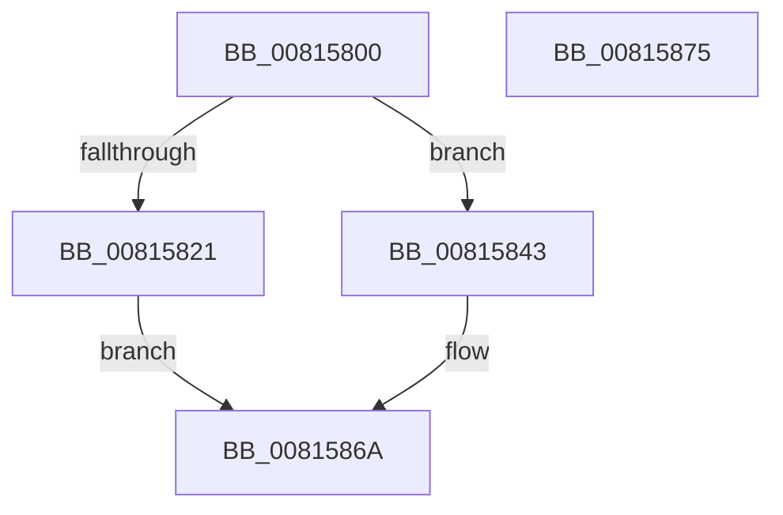

# SdbpFindNextWildcardTagWithoutIndex

- RVA: `0x00815800`–`0x00815876` (길이 `118` bytes)
- VA: `0x0000000140815800`
- 실행 섹션: `PAGE`
- PDB 이름 있음: `예`; PDB Function 태그: `아니요`
- unwind 정보 RVA: `0x0006E5F8`
- 디코드: `31`개 명령, `118/118` bytes 표시
- 미해석 바이트: `0` (있으면 어셈블리에 `.byte`로 보존)

> 이 문서는 커널 이미지의 기계어와 PDB 기호를 분석해 생성했습니다. 4번과 5번은 함수 원형과 자료형을 바이너리 사용 방식에서 추정한 C 해석이며 원본 소스 복구 결과는 아닙니다.

## 1. Dependencies

- 직접 호출 지점: **3**; 고유 호출 대상: **3**
- 직접 호출자로 확인된 함수: **1**
- RIP 상대 이미지 참조: **2**

### Outgoing calls
- `0x00815818` → [SdbFindFirstTag](../95/SdbFindFirstTag_function_0095E34C.md) (function, `0x0095E34C`)
- `0x0081583A` → [AslLogCallPrintf](../95/AslLogCallPrintf_function_0095E4EC.md) (function, `0x0095E4EC`)
- `0x00815862` → [SdbpFindNextNamedTagHelper](SdbpFindNextNamedTagHelper_function_00816DF8.md) (function, `0x00816DF8`)

### Direct callers
- [sub_00B27968](../B2/Unknown_function_00B27968.md) at `0x00B27A36`

### Static image references
- `0x00815821` → RVA `0x0003CC70` (`.rdata`; read)
- `0x0081582E` → RVA `0x0003CB78` (`.rdata`; read)

## 2. Other-region calls and transfers

- 다른 실행 섹션으로 향하는 call: **0**
- 별도 외부 분기/꼬리 이동을 확인하지 못했습니다.

## 3. Assembly (complete function range)

```asm
00815800  48 89 5C 24 08                  mov qword ptr [rsp + 8], rbx
00815805  57                              push rdi
00815806  48 83 EC 30                     sub rsp, 0x30
0081580A  48 8B DA                        mov rbx, rdx
0081580D  41 B8 01 70 00 00               mov r8d, 0x7001
00815813  33 D2                           xor edx, edx
00815815  48 8B F9                        mov rdi, rcx
00815818  E8 2F 8B 14 00                  call 0x14095e34c
0081581D  85 C0                           test eax, eax
0081581F  74 22                           je 0x140815843
00815821  4C 8D 0D 48 74 82 FF            lea r9, [rip - 0x7d8bb8]
00815828  41 B8 43 15 00 00               mov r8d, 0x1543
0081582E  48 8D 15 43 73 82 FF            lea rdx, [rip - 0x7d8cbd]
00815835  B9 01 00 00 00                  mov ecx, 1
0081583A  E8 AD 8C 14 00                  call 0x14095e4ec
0081583F  33 C0                           xor eax, eax
00815841  EB 27                           jmp 0x14081586a
00815843  48 8B 43 20                     mov rax, qword ptr [rbx + 0x20]
00815847  33 D2                           xor edx, edx
00815849  44 0F B7 4B 0C                  movzx r9d, word ptr [rbx + 0xc]
0081584E  48 8B CF                        mov rcx, rdi
00815851  44 8B 43 04                     mov r8d, dword ptr [rbx + 4]
00815855  C7 44 24 28 01 00 00 00         mov dword ptr [rsp + 0x28], 1
0081585D  48 89 44 24 20                  mov qword ptr [rsp + 0x20], rax
00815862  E8 91 15 00 00                  call 0x140816df8
00815867  89 43 04                        mov dword ptr [rbx + 4], eax
0081586A  48 8B 5C 24 40                  mov rbx, qword ptr [rsp + 0x40]
0081586F  48 83 C4 30                     add rsp, 0x30
00815873  5F                              pop rdi
00815874  C3                              ret
00815875  CC                              int3
```

## 4. C-style interpretation (structured pseudocode)

```c
__int64 __fastcall SdbpFindNextWildcardTagWithoutIndex(__int64 a1, __int64 a2)
{
    __int64 result;
    __int64 v_rsp;
    unsigned int v_stack_m10;
    unsigned __int64 v_stack_m18;
    unsigned __int64 v_stack_p8;

    v_stack_p8 = v_rbx;
    v_rsp = (v_rsp) - (48);
    a2 = 0;
    result = SdbFindFirstTag(a1, a2, (unsigned int)(0x7001ULL), a4);
    if ((unsigned int)(result) == 0) goto loc_00815843;
    result = AslLogCallPrintf(1, v_rip - 8228029, (unsigned int)(0x1543ULL), v_rip - 8227768);
    result = 0;
    goto loc_0081586A;
loc_00815843:
    a2 = 0;
    v_stack_m10 = 1;
    v_stack_m18 = *(unsigned __int64 *)(a2 + 32);
    result = SdbpFindNextNamedTagHelper(a1, a2, (unsigned int)(*(unsigned int *)(a2 + 4)), *(unsigned __int16 *)(a2 + 12));
    *(unsigned int *)(a2 + 4) = (unsigned int)(result);
loc_0081586A:
    v_rsp = (v_rsp) + (48);
    return result;
}
```

## 5. (Beta) C Style

```c
int64_t SdbpFindNextWildcardTagWithoutIndex(int64_t Arg1, void *Arg2)
{
    uint8_t *arg2 = (uint8_t *)Arg2;

    int64_t result;
    int64_t local_rsp;
    uint32_t v_stack_m10;
    uint64_t v_stack_m18;
    uint64_t v_stack_p8;

    v_stack_p8 = local_rbx;
    local_rsp = (local_rsp) - (48);
    Arg2 = 0;
    result = SdbFindFirstTag(Arg1, Arg2, (uint32_t)(0x7001ULL), a4);
    if ((uint32_t)(result) == 0) goto loc_00815843;
    result = AslLogCallPrintf(1, v_rip - 8228029, (uint32_t)(0x1543ULL), v_rip - 8227768);
    result = 0;
    goto loc_0081586A;
loc_00815843:
    Arg2 = 0;
    v_stack_m10 = 1;
    v_stack_m18 = *(uint64_t *)(arg2 + 0x20);
    result = SdbpFindNextNamedTagHelper(Arg1, Arg2, (uint32_t)(*(uint32_t *)(arg2 + 0x4)), *(uint16_t *)(arg2 + 0xC));
    *(uint32_t *)(arg2 + 0x4) = (uint32_t)(result);
loc_0081586A:
    local_rsp = (local_rsp) + (48);
    return result;
}
```

### 관측된 메모리 오프셋

구조체 형식이 확인되지 않은 접근은 인자 기준의 오프셋으로만 기록했습니다.

| 기준 인자 | 오프셋 표현 | 폭 (bit) | 접근 |
|---|---:|---:|---|
| `Arg2` | `+ 0x4` | `32` | `R` |
| `Arg2` | `+ 0x4` | `32` | `W` |
| `Arg2` | `+ 0xC` | `16` | `R` |
| `Arg2` | `+ 0x20` | `64` | `R` |

## 6. Execution-region graph

[열기: 2D/3D 그래프와 함수 탐색 컨트롤 패널](../../../control-panel.html?section=page&rva=0x00815800&view=graph)

- 2D 그래프는 위에서 아래로 흐르고, 3D 그래프는 빈 공간을 드래그해 회전합니다. Shift+드래그는 이동, 휠은 확대·축소, 함수 노드 선택은 대상 보고서 이동입니다.

### Static fallback


