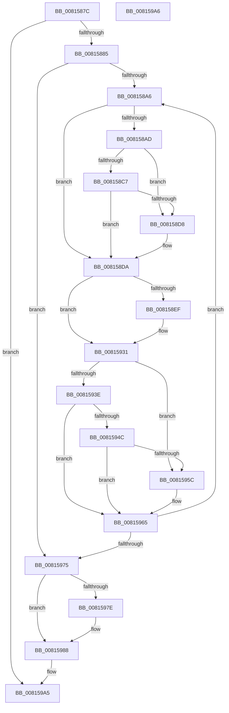

# SdbpFreeAppAttributes

- RVA: `0x0081587C`–`0x008159A7` (길이 `299` bytes)
- VA: `0x000000014081587C`
- 실행 섹션: `PAGE`
- PDB 이름 있음: `예`; PDB Function 태그: `아니요`
- unwind 정보 RVA: `0x000D9934`
- 디코드: `77`개 명령, `299/299` bytes 표시
- 미해석 바이트: `0` (있으면 어셈블리에 `.byte`로 보존)

> 이 문서는 커널 이미지의 기계어와 PDB 기호를 분석해 생성했습니다. 4번과 5번은 함수 원형과 자료형을 바이너리 사용 방식에서 추정한 C 해석이며 원본 소스 복구 결과는 아닙니다.

## 1. Dependencies

- 직접 호출 지점: **5**; 고유 호출 대상: **5**
- 직접 호출자로 확인된 함수: **1**
- RIP 상대 이미지 참조: **2**

### Outgoing calls
- `0x008158BE` → [ULongLongMult](../../text/44/ULongLongMult_function_00448380.md) (function, `0x00448380`)
- `0x00815916` → [wil_details_FeatureReporting_ReportUsageToService](../../text/53/wil_details_FeatureReporting_ReportUsageToService_function_0053E6E4.md) (function, `0x0053E6E4`)
- `0x0081592C` → [wil_details_FeatureStateCache_TryEnableDeviceUsageFastPath](../../text/53/wil_details_FeatureStateCache_TryEnableDeviceUsageFastPath_function_0053E774.md) (function, `0x0053E774`)
- `0x00815960` → [AslFree](../95/AslFree_function_0095B674.md) (function, `0x0095B674`)
- `0x00815983` → [ExFreePoolWithTag](../../poolcode/B8/ExFreePoolWithTag_function_00B82870.md) (function, `0x00B82870`)

### Direct callers
- [SdbpReleaseSearchDBContext](../95/SdbpReleaseSearchDBContext_function_00958118.md) at `0x0095820A`
- [SdbpReleaseSearchDBContext](../95/SdbpReleaseSearchDBContext_function_00958118.md) at `0x0095821D`

### Static image references
- `0x008158E0` → RVA `0x00FC4E40` (`.data`; read)
- `0x00815906` → RVA `0x000E05A8` (`.rdata`; read)

## 2. Other-region calls and transfers

- 다른 실행 섹션으로 향하는 call: **4**
  - `0x008158BE` → [ULongLongMult](../../text/44/ULongLongMult_function_00448380.md) (`PAGE` → `.text`)
  - `0x00815916` → [wil_details_FeatureReporting_ReportUsageToService](../../text/53/wil_details_FeatureReporting_ReportUsageToService_function_0053E6E4.md) (`PAGE` → `.text`)
  - `0x0081592C` → [wil_details_FeatureStateCache_TryEnableDeviceUsageFastPath](../../text/53/wil_details_FeatureStateCache_TryEnableDeviceUsageFastPath_function_0053E774.md) (`PAGE` → `.text`)
  - `0x00815983` → [ExFreePoolWithTag](../../poolcode/B8/ExFreePoolWithTag_function_00B82870.md) (`PAGE` → `POOLCODE`)
- 별도 외부 분기/꼬리 이동을 확인하지 못했습니다.

## 3. Assembly (complete function range)

```asm
0081587C  48 85 C9                        test rcx, rcx
0081587F  0F 84 20 01 00 00               je 0x1408159a5
00815885  48 89 5C 24 10                  mov qword ptr [rsp + 0x10], rbx
0081588A  48 89 74 24 18                  mov qword ptr [rsp + 0x18], rsi
0081588F  57                              push rdi
00815890  48 83 EC 20                     sub rsp, 0x20
00815894  48 8B 41 10                     mov rax, qword ptr [rcx + 0x10]
00815898  33 F6                           xor esi, esi
0081589A  48 8B D9                        mov rbx, rcx
0081589D  48 85 C0                        test rax, rax
008158A0  0F 84 CF 00 00 00               je 0x140815975
008158A6  33 FF                           xor edi, edi
008158A8  48 3B F0                        cmp rsi, rax
008158AB  73 2D                           jae 0x1408158da
008158AD  48 8B 4B 08                     mov rcx, qword ptr [rbx + 8]
008158B1  4C 8D 44 24 30                  lea r8, [rsp + 0x30]
008158B6  48 21 7C 24 30                  and qword ptr [rsp + 0x30], rdi
008158BB  48 8B D6                        mov rdx, rsi
008158BE  E8 BD 2A C3 FF                  call 0x140448380
008158C3  85 C0                           test eax, eax
008158C5  78 11                           js 0x1408158d8
008158C7  48 8B 4B 28                     mov rcx, qword ptr [rbx + 0x28]
008158CB  48 8B 7C 24 30                  mov rdi, qword ptr [rsp + 0x30]
008158D0  48 03 F9                        add rdi, rcx
008158D3  48 3B F9                        cmp rdi, rcx
008158D6  73 02                           jae 0x1408158da
008158D8  33 FF                           xor edi, edi
008158DA  48 83 64 24 30 00               and qword ptr [rsp + 0x30], 0
008158E0  8B 0D 5A F5 7A 00               mov ecx, dword ptr [rip + 0x7af55a]
008158E6  89 4C 24 30                     mov dword ptr [rsp + 0x30], ecx
008158EA  F6 C1 10                        test cl, 0x10
008158ED  75 42                           jne 0x140815931
008158EF  48 8B 44 24 30                  mov rax, qword ptr [rsp + 0x30]
008158F4  83 C9 01                        or ecx, 1
008158F7  48 89 44 24 30                  mov qword ptr [rsp + 0x30], rax
008158FC  41 B9 01 00 00 00               mov r9d, 1
00815902  89 4C 24 30                     mov dword ptr [rsp + 0x30], ecx
00815906  48 8D 0D 9B AC 8C FF            lea rcx, [rip - 0x735365]
0081590D  48 8B 54 24 30                  mov rdx, qword ptr [rsp + 0x30]
00815912  45 8D 41 02                     lea r8d, [r9 + 2]
00815916  E8 C9 8D D2 FF                  call 0x14053e6e4
0081591B  48 8B 4C 24 30                  mov rcx, qword ptr [rsp + 0x30]
00815920  4C 8D 05 81 AC 8C FF            lea r8, [rip - 0x73537f]
00815927  BA 03 00 00 00                  mov edx, 3
0081592C  E8 43 8E D2 FF                  call 0x14053e774
00815931  0F B7 07                        movzx eax, word ptr [rdi]
00815934  B9 01 60 00 00                  mov ecx, 0x6001
00815939  66 3B C1                        cmp ax, cx
0081593C  74 1E                           je 0x14081595c
0081593E  B9 11 60 00 00                  mov ecx, 0x6011
00815943  66 2B C1                        sub ax, cx
00815946  66 83 F8 37                     cmp ax, 0x37
0081594A  77 19                           ja 0x140815965
0081594C  48 B9 01 00 00 07 00 00 82 00   movabs rcx, 0x82000007000001
00815956  48 0F A3 C1                     bt rcx, rax
0081595A  73 09                           jae 0x140815965
0081595C  48 8B 57 08                     mov rdx, qword ptr [rdi + 8]
00815960  E8 0F 5D 14 00                  call 0x14095b674
00815965  48 8B 43 10                     mov rax, qword ptr [rbx + 0x10]
00815969  48 FF C6                        inc rsi
0081596C  48 3B F0                        cmp rsi, rax
0081596F  0F 82 31 FF FF FF               jb 0x1408158a6
00815975  48 8B 4B 28                     mov rcx, qword ptr [rbx + 0x28]
00815979  48 85 C9                        test rcx, rcx
0081597C  74 0A                           je 0x140815988
0081597E  BA 52 54 61 72                  mov edx, 0x72615452
00815983  E8 E8 CE 36 00                  call 0x140b82870
00815988  48 8B 74 24 40                  mov rsi, qword ptr [rsp + 0x40]
0081598D  0F 57 C0                        xorps xmm0, xmm0
00815990  0F 11 03                        movups xmmword ptr [rbx], xmm0
00815993  0F 11 43 10                     movups xmmword ptr [rbx + 0x10], xmm0
00815997  0F 11 43 20                     movups xmmword ptr [rbx + 0x20], xmm0
0081599B  48 8B 5C 24 38                  mov rbx, qword ptr [rsp + 0x38]
008159A0  48 83 C4 20                     add rsp, 0x20
008159A4  5F                              pop rdi
008159A5  C3                              ret
008159A6  CC                              int3
```

## 4. C-style interpretation (structured pseudocode)

```c
__int64 __fastcall SdbpFreeAppAttributes(__int64 a1)
{
    __int64 result;
    __int64 v_rdi;
    __int64 v_rsi;
    __int64 v_rsp;
    unsigned __int64 v_stack_p10;
    unsigned __int64 v_stack_p18;
    unsigned __int64 v_stack_p8;

    if (a1 == 0) goto loc_008159A5;
    v_stack_p10 = v_rbx;
    v_stack_p18 = v_rsi;
    v_rsp = (v_rsp) - (32);
    v_rsi = 0;
    if (*(unsigned __int64 *)(a1 + 16) == 0) goto loc_00815975;
loc_008158A6:
    v_rdi = 0;
    if (0 >= (*(unsigned __int64 *)(a1 + 16))) goto loc_008158DA;
    result = ULongLongMult(*(unsigned __int64 *)(a1 + 8), 0, v_stack_p8, a4);
    if (sign_flag) goto loc_008158D8;
    v_rdi = (v_stack_p8) + (*(unsigned __int64 *)(a1 + 40));
    if (v_rdi < (*(unsigned __int64 *)(a1 + 40))) {
        v_rdi = 0;
    }
    v_stack_p8 = (unsigned int)((unsigned int)(*(unsigned int *)(v_rip + 8058202)));
    if ((((unsigned __int8)((unsigned int)(*(unsigned int *)(v_rip + 8058202)))) & (16)) == 0) {
        result = v_stack_p8;
        a1 = (unsigned int)(((unsigned int)(*(unsigned int *)(v_rip + 8058202))) | (1));
        v_stack_p8 = result;
        a4 = 1;
        v_stack_p8 = (unsigned int)(a1);
        a1 = v_rip - 7557989;
        a2 = v_stack_p8;
        a3 = a4 + 2;
        result = wil_details_FeatureReporting_ReportUsageToService(a1, a2, a3, a4);
        a1 = v_stack_p8;
        a3 = v_rip - 7558015;
        a2 = 3;
        result = wil_details_FeatureStateCache_TryEnableDeviceUsageFastPath(a1, a2, a3, a4);
    }
    if (((unsigned __int16)(*(unsigned __int16 *)(v_rdi))) == ((unsigned __int16)((unsigned int)(0x6001ULL)))) goto loc_0081595C;
    result = (unsigned __int16)((*(unsigned __int16 *)(v_rdi)) - ((unsigned __int16)((unsigned int)(0x6011ULL))));
    if (((unsigned __int16)(result)) > 55) goto loc_00815965;
    if (((unsigned __int16)(result)) < 55) {
        a2 = *(unsigned __int64 *)(v_rdi + 8);
        result = AslFree((unsigned int)(0x6011ULL), a2, a3, a4);
    }
    v_rsi = (v_rsi) + 1;
    if (v_rsi < (*(unsigned __int64 *)(a1 + 16))) goto loc_008158A6;
loc_00815975:
    result = *(unsigned __int64 *)(a1 + 16);
    if (*(unsigned __int64 *)(a1 + 40) != 0) {
        a2 = 0x72615452ULL;
        result = ExFreePoolWithTag(*(unsigned __int64 *)(a1 + 40), a2, a3, a4);
    }
    *(unsigned __int64 *)(a1) = v_xmm0;
    *(unsigned __int64 *)(a1 + 16) = v_xmm0;
    *(unsigned __int64 *)(a1 + 32) = v_xmm0;
    v_rsp = (v_rsp) + (32);
loc_008159A5:
    return result;
}
```

## 5. (Beta) C Style

```c
int64_t SdbpFreeAppAttributes(int64_t Arg1)
{
    int64_t result;
    int64_t local_rdi;
    int64_t local_rsi;
    int64_t local_rsp;
    uint64_t v_stack_p10;
    uint64_t v_stack_p18;
    uint64_t v_stack_p8;

    if (Arg1 == 0) goto loc_008159A5;
    v_stack_p10 = local_rbx;
    v_stack_p18 = local_rsi;
    local_rsp = (local_rsp) - (32);
    local_rsi = 0;
    if (*(uint64_t *)(Arg1 + 0x10) == 0) goto loc_00815975;
loc_008158A6:
    local_rdi = 0;
    if (0 >= (*(uint64_t *)(Arg1 + 0x10))) goto loc_008158DA;
    result = ULongLongMult(*(uint64_t *)(Arg1 + 0x8), 0, v_stack_p8, a4);
    if (sign_flag) goto loc_008158D8;
    local_rdi = (v_stack_p8) + (*(uint64_t *)(Arg1 + 0x28));
    if (local_rdi < (*(uint64_t *)(Arg1 + 0x28))) {
        local_rdi = 0;
    }
    v_stack_p8 = (uint32_t)((uint32_t)(*(uint32_t *)(v_rip + 0x7AF55A)));
    if ((((uint8_t)((uint32_t)(*(uint32_t *)(v_rip + 0x7AF55A)))) & (16)) == 0) {
        result = v_stack_p8;
        Arg1 = (uint32_t)(((uint32_t)(*(uint32_t *)(v_rip + 0x7AF55A))) | (1));
        v_stack_p8 = result;
        a4 = 1;
        v_stack_p8 = (uint32_t)(Arg1);
        Arg1 = v_rip - 7557989;
        a2 = v_stack_p8;
        a3 = a4 + 2;
        result = wil_details_FeatureReporting_ReportUsageToService(Arg1, a2, a3, a4);
        Arg1 = v_stack_p8;
        a3 = v_rip - 7558015;
        a2 = 3;
        result = wil_details_FeatureStateCache_TryEnableDeviceUsageFastPath(Arg1, a2, a3, a4);
    }
    if (((uint16_t)(*(uint16_t *)(local_rdi))) == ((uint16_t)((uint32_t)(0x6001ULL)))) goto loc_0081595C;
    result = (uint16_t)((*(uint16_t *)(local_rdi)) - ((uint16_t)((uint32_t)(0x6011ULL))));
    if (((uint16_t)(result)) > 55) goto loc_00815965;
    if (((uint16_t)(result)) < 55) {
        a2 = *(uint64_t *)(local_rdi + 0x8);
        result = AslFree((uint32_t)(0x6011ULL), a2, a3, a4);
    }
    local_rsi = (local_rsi) + 1;
    if (local_rsi < (*(uint64_t *)(Arg1 + 0x10))) goto loc_008158A6;
loc_00815975:
    result = *(uint64_t *)(Arg1 + 0x10);
    if (*(uint64_t *)(Arg1 + 0x28) != 0) {
        a2 = 0x72615452ULL;
        result = ExFreePoolWithTag(*(uint64_t *)(Arg1 + 0x28), a2, a3, a4);
    }
    *(uint64_t *)(Arg1) = v_xmm0;
    *(uint64_t *)(Arg1 + 0x10) = v_xmm0;
    *(uint64_t *)(Arg1 + 0x20) = v_xmm0;
    local_rsp = (local_rsp) + (32);
loc_008159A5:
    return result;
}
```

## 6. Execution-region graph

[열기: 2D/3D 그래프와 함수 탐색 컨트롤 패널](../../../control-panel.html?section=page&rva=0x0081587C&view=graph)

- 2D 그래프는 위에서 아래로 흐르고, 3D 그래프는 빈 공간을 드래그해 회전합니다. Shift+드래그는 이동, 휠은 확대·축소, 함수 노드 선택은 대상 보고서 이동입니다.

### Static fallback


