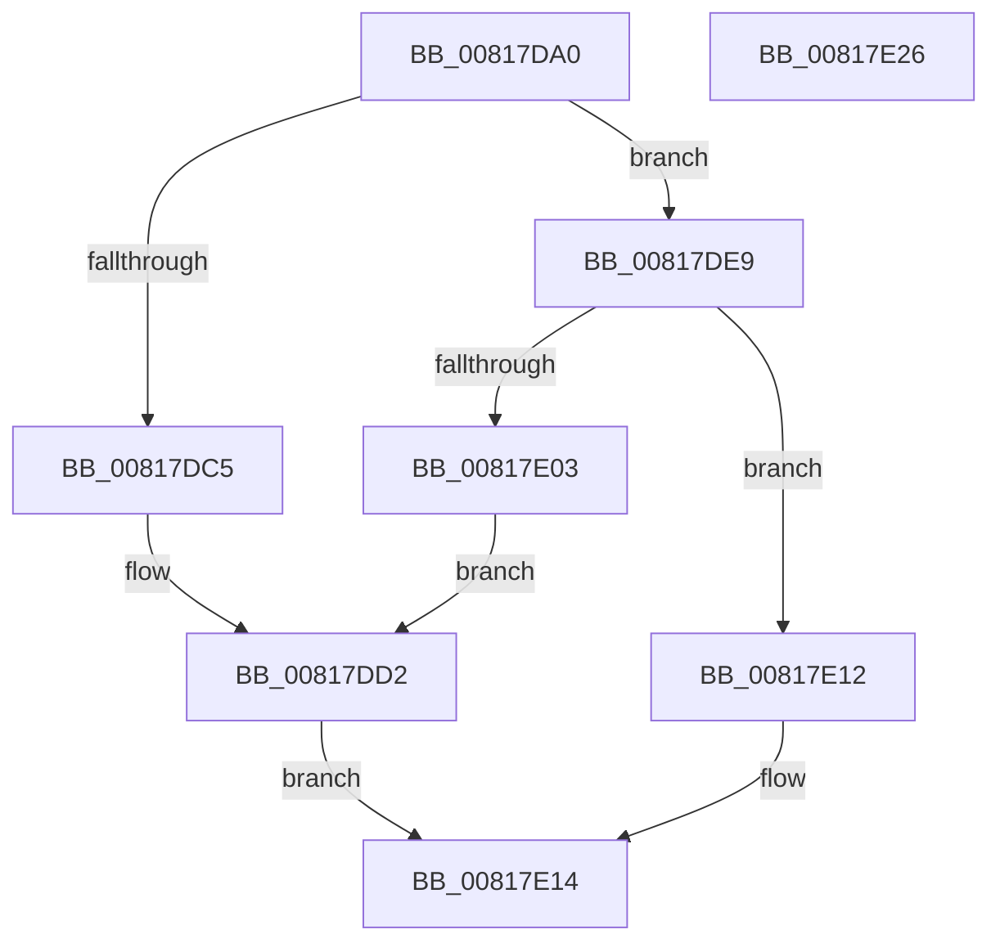

# SdbpGetCustomSdbFileName

- RVA: `0x00817DA0`–`0x00817E27` (길이 `135` bytes)
- VA: `0x0000000140817DA0`
- 실행 섹션: `PAGE`
- PDB 이름 있음: `예`; PDB Function 태그: `아니요`
- unwind 정보 RVA: `0x000794E0`
- 디코드: `37`개 명령, `135/135` bytes 표시
- 미해석 바이트: `0` (있으면 어셈블리에 `.byte`로 보존)

> 이 문서는 커널 이미지의 기계어와 PDB 기호를 분석해 생성했습니다. 4번과 5번은 함수 원형과 자료형을 바이너리 사용 방식에서 추정한 C 해석이며 원본 소스 복구 결과는 아닙니다.

## 1. Dependencies

- 직접 호출 지점: **3**; 고유 호출 대상: **3**
- 직접 호출자로 확인된 함수: **1**
- RIP 상대 이미지 참조: **4**

### Outgoing calls
- `0x00817DBA` → [AslGuidToString](../AB/AslGuidToString_function_00ABD4AC.md) (function, `0x00ABD4AC`)
- `0x00817DE2` → [AslLogCallPrintf](../95/AslLogCallPrintf_function_0095E4EC.md) (function, `0x0095E4EC`)
- `0x00817DF8` → [RtlStringCchCatW](../../text/4C/RtlStringCchCatW_function_004C7500.md) (function, `0x004C7500`)

### Direct callers
- [SdbGetPathCustomSdb](SdbGetPathCustomSdb_function_0081795C.md) at `0x0081799F`

### Static image references
- `0x00817DC5` → RVA `0x0003DC60` (`.rdata`; read)
- `0x00817DD2` → RVA `0x0003DC80` (`.rdata`; read)
- `0x00817DE9` → RVA `0x0003DCA0` (`.rdata`; read)
- `0x00817E03` → RVA `0x0003DCB0` (`.rdata`; read)

## 2. Other-region calls and transfers

- 다른 실행 섹션으로 향하는 call: **1**
  - `0x00817DF8` → [RtlStringCchCatW](../../text/4C/RtlStringCchCatW_function_004C7500.md) (`PAGE` → `.text`)
- 별도 외부 분기/꼬리 이동을 확인하지 못했습니다.

## 3. Assembly (complete function range)

```asm
00817DA0  48 89 5C 24 08                  mov qword ptr [rsp + 8], rbx
00817DA5  48 89 74 24 10                  mov qword ptr [rsp + 0x10], rsi
00817DAA  57                              push rdi
00817DAB  48 83 EC 30                     sub rsp, 0x30
00817DAF  33 F6                           xor esi, esi
00817DB1  48 8B F9                        mov rdi, rcx
00817DB4  66 89 31                        mov word ptr [rcx], si
00817DB7  8D 56 2B                        lea edx, [rsi + 0x2b]
00817DBA  E8 ED 56 2A 00                  call 0x140abd4ac
00817DBF  8B D8                           mov ebx, eax
00817DC1  85 C0                           test eax, eax
00817DC3  79 24                           jns 0x140817de9
00817DC5  4C 8D 0D 94 5E 82 FF            lea r9, [rip - 0x7da16c]
00817DCC  41 B8 45 03 00 00               mov r8d, 0x345
00817DD2  48 8D 15 A7 5E 82 FF            lea rdx, [rip - 0x7da159]
00817DD9  89 44 24 20                     mov dword ptr [rsp + 0x20], eax
00817DDD  B9 01 00 00 00                  mov ecx, 1
00817DE2  E8 05 67 14 00                  call 0x14095e4ec
00817DE7  EB 2B                           jmp 0x140817e14
00817DE9  4C 8D 05 B0 5E 82 FF            lea r8, [rip - 0x7da150]
00817DF0  BA 2B 00 00 00                  mov edx, 0x2b
00817DF5  48 8B CF                        mov rcx, rdi
00817DF8  E8 03 F7 CA FF                  call 0x1404c7500
00817DFD  8B D8                           mov ebx, eax
00817DFF  85 C0                           test eax, eax
00817E01  79 0F                           jns 0x140817e12
00817E03  4C 8D 0D A6 5E 82 FF            lea r9, [rip - 0x7da15a]
00817E0A  41 B8 4B 03 00 00               mov r8d, 0x34b
00817E10  EB C0                           jmp 0x140817dd2
00817E12  8B DE                           mov ebx, esi
00817E14  48 8B 74 24 48                  mov rsi, qword ptr [rsp + 0x48]
00817E19  8B C3                           mov eax, ebx
00817E1B  48 8B 5C 24 40                  mov rbx, qword ptr [rsp + 0x40]
00817E20  48 83 C4 30                     add rsp, 0x30
00817E24  5F                              pop rdi
00817E25  C3                              ret
00817E26  CC                              int3
```

## 4. C-style interpretation (structured pseudocode)

```c
__int64 __fastcall SdbpGetCustomSdbFileName(__int64 a1)
{
    __int64 result;
    __int64 v_rsi;
    __int64 v_rsp;
    unsigned int v_stack_m18;
    unsigned __int64 v_stack_p10;
    unsigned __int64 v_stack_p8;

    v_stack_p8 = v_rbx;
    v_stack_p10 = v_rsi;
    v_rsp = (v_rsp) - (48);
    v_rsi = 0;
    *(unsigned __int16 *)(a1) = 0;
    result = AslGuidToString(a1, v_rsi + 43, a3, a4);
    if (!sign_flag) goto loc_00817DE9;
loc_00817DD2:
    v_stack_m18 = (unsigned int)(result);
    result = AslLogCallPrintf(1, v_rip - 8233305, 837, v_rip - 8233324);
    goto loc_00817E14;
loc_00817DE9:
    result = RtlStringCchCatW(a1, 43, v_rip - 8233296, v_rip - 8233324);
    if (!sign_flag) goto loc_00817E12;
    goto loc_00817DD2;
loc_00817E12:
loc_00817E14:
    v_rsp = (v_rsp) + (48);
    return 0;
}
```

## 5. (Beta) C Style

```c
int64_t SdbpGetCustomSdbFileName(void *Arg1)
{
    uint8_t *arg1 = (uint8_t *)Arg1;

    int64_t result;
    int64_t local_rsi;
    int64_t local_rsp;
    uint32_t v_stack_m18;
    uint64_t v_stack_p10;
    uint64_t v_stack_p8;

    v_stack_p8 = local_rbx;
    v_stack_p10 = local_rsi;
    local_rsp = (local_rsp) - (48);
    local_rsi = 0;
    *(uint16_t *)(arg1) = 0;
    result = AslGuidToString(Arg1, local_rsi + 43, a3, a4);
    if (!sign_flag) goto loc_00817DE9;
loc_00817DD2:
    v_stack_m18 = (uint32_t)(result);
    result = AslLogCallPrintf(1, v_rip - 8233305, 837, v_rip - 8233324);
    goto loc_00817E14;
loc_00817DE9:
    result = RtlStringCchCatW(Arg1, 43, v_rip - 8233296, v_rip - 8233324);
    if (!sign_flag) goto loc_00817E12;
    goto loc_00817DD2;
loc_00817E12:
loc_00817E14:
    local_rsp = (local_rsp) + (48);
    return 0;
}
```

### 관측된 메모리 오프셋

구조체 형식이 확인되지 않은 접근은 인자 기준의 오프셋으로만 기록했습니다.

| 기준 인자 | 오프셋 표현 | 폭 (bit) | 접근 |
|---|---:|---:|---|
| `Arg1` | `+ 0x0` | `16` | `W` |

## 6. Execution-region graph

[열기: 2D/3D 그래프와 함수 탐색 컨트롤 패널](../../../control-panel.html?section=page&rva=0x00817DA0&view=graph)

- 2D 그래프는 위에서 아래로 흐르고, 3D 그래프는 빈 공간을 드래그해 회전합니다. Shift+드래그는 이동, 휠은 확대·축소, 함수 노드 선택은 대상 보고서 이동입니다.

### Static fallback


