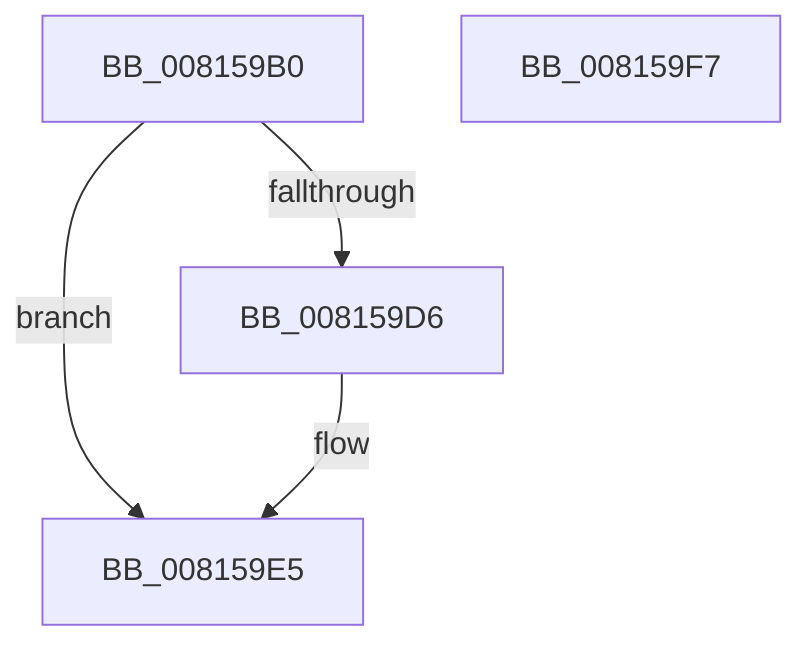

# SdbpGetDeviceDWORD

- RVA: `0x008159B0`–`0x008159F8` (길이 `72` bytes)
- VA: `0x00000001408159B0`
- 실행 섹션: `PAGE`
- PDB 이름 있음: `예`; PDB Function 태그: `아니요`
- unwind 정보 RVA: `0x00060BC4`
- 디코드: `23`개 명령, `72/72` bytes 표시
- 미해석 바이트: `0` (있으면 어셈블리에 `.byte`로 보존)

> 이 문서는 커널 이미지의 기계어와 PDB 기호를 분석해 생성했습니다. 4번과 5번은 함수 원형과 자료형을 바이너리 사용 방식에서 추정한 C 해석이며 원본 소스 복구 결과는 아닙니다.

## 1. Dependencies

- 직접 호출 지점: **2**; 고유 호출 대상: **2**
- 직접 호출자로 확인된 함수: **1**
- RIP 상대 이미지 참조: **0**

### Outgoing calls
- `0x008159CD` → [SdbFindFirstTag](../95/SdbFindFirstTag_function_0095E34C.md) (function, `0x0095E34C`)
- `0x008159DE` → [SdbReadDWORDTag](../95/SdbReadDWORDTag_function_0095D408.md) (function, `0x0095D408`)

### Direct callers
- [SdbpMatchDeviceDWORD](SdbpMatchDeviceDWORD_function_00816638.md) at `0x0081665C`
- [SdbpMatchDeviceDWORD](SdbpMatchDeviceDWORD_function_00816638.md) at `0x00816678`
- [SdbpMatchDeviceDWORD](SdbpMatchDeviceDWORD_function_00816638.md) at `0x00816691`

### Static image references
- 디코드된 RIP-relative 메모리 참조가 없습니다.

## 2. Other-region calls and transfers

- 다른 실행 섹션으로 향하는 call: **0**
- 별도 외부 분기/꼬리 이동을 확인하지 못했습니다.

## 3. Assembly (complete function range)

```asm
008159B0  48 89 5C 24 08                  mov qword ptr [rsp + 8], rbx
008159B5  48 89 74 24 10                  mov qword ptr [rsp + 0x10], rsi
008159BA  57                              push rdi
008159BB  48 83 EC 20                     sub rsp, 0x20
008159BF  41 0F B7 F8                     movzx edi, r8w
008159C3  48 8B F1                        mov rsi, rcx
008159C6  44 0F B7 C7                     movzx r8d, di
008159CA  83 CB FF                        or ebx, 0xffffffff
008159CD  E8 7A 89 14 00                  call 0x14095e34c
008159D2  85 C0                           test eax, eax
008159D4  74 0F                           je 0x1408159e5
008159D6  44 8B C7                        mov r8d, edi
008159D9  8B D0                           mov edx, eax
008159DB  48 8B CE                        mov rcx, rsi
008159DE  E8 25 7A 14 00                  call 0x14095d408
008159E3  8B D8                           mov ebx, eax
008159E5  48 8B 74 24 38                  mov rsi, qword ptr [rsp + 0x38]
008159EA  8B C3                           mov eax, ebx
008159EC  48 8B 5C 24 30                  mov rbx, qword ptr [rsp + 0x30]
008159F1  48 83 C4 20                     add rsp, 0x20
008159F5  5F                              pop rdi
008159F6  C3                              ret
008159F7  CC                              int3
```

## 4. C-style interpretation (structured pseudocode)

```c
__int64 __fastcall SdbpGetDeviceDWORD(__int64 a1, __int64 a2, unsigned __int16 a3)
{
    __int64 result;
    __int64 v_rbx;
    __int64 v_rsp;
    unsigned __int64 v_stack_p10;
    unsigned __int64 v_stack_p8;

    v_stack_p8 = v_rbx;
    v_stack_p10 = v_rsi;
    v_rsp = (v_rsp) - (32);
    v_rbx = (unsigned int)((v_rbx) | (0xFFFFFFFFULL));
    result = SdbFindFirstTag(a1, a2, a3, a4);
    if ((unsigned int)(result) != 0) {
        a3 = a3;
        a2 = (unsigned int)(result);
        a1 = a1;
        result = SdbReadDWORDTag(a1, a2, a3, a4);
        v_rbx = (unsigned int)(result);
    }
    v_rsp = (v_rsp) + (32);
    return (unsigned int)((unsigned int)(v_rbx));
}
```

## 5. (Beta) C Style

```c
int64_t SdbpGetDeviceDWORD(int64_t Arg1, int64_t Arg2, uint16_t Arg3)
{
    int64_t result;
    int64_t local_rbx;
    int64_t local_rsp;
    uint64_t v_stack_p10;
    uint64_t v_stack_p8;

    v_stack_p8 = local_rbx;
    v_stack_p10 = local_rsi;
    local_rsp = (local_rsp) - (32);
    local_rbx = (uint32_t)((local_rbx) | (0xFFFFFFFFULL));
    result = SdbFindFirstTag(Arg1, Arg2, Arg3, a4);
    if ((uint32_t)(result) != 0) {
        Arg3 = Arg3;
        Arg2 = (uint32_t)(result);
        Arg1 = Arg1;
        result = SdbReadDWORDTag(Arg1, Arg2, Arg3, a4);
        local_rbx = (uint32_t)(result);
    }
    local_rsp = (local_rsp) + (32);
    return (uint32_t)((uint32_t)(local_rbx));
}
```

## 6. Execution-region graph

[열기: 2D/3D 그래프와 함수 탐색 컨트롤 패널](../../../control-panel.html?section=page&rva=0x008159B0&view=graph)

- 2D 그래프는 위에서 아래로 흐르고, 3D 그래프는 빈 공간을 드래그해 회전합니다. Shift+드래그는 이동, 휠은 확대·축소, 함수 노드 선택은 대상 보고서 이동입니다.

### Static fallback


