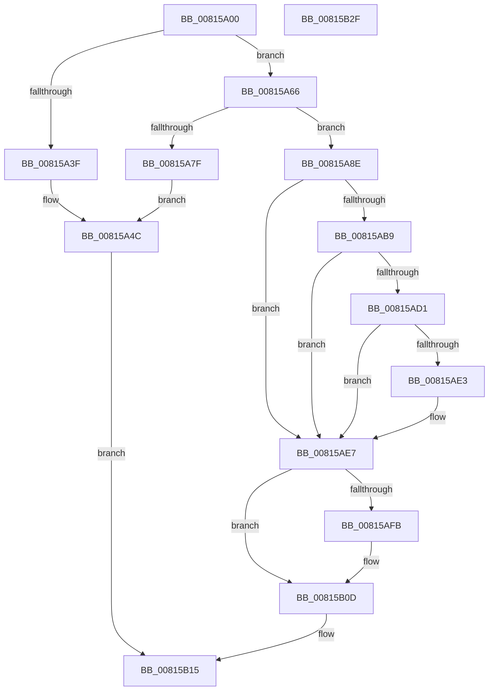

# SdbpGetExeEntryFlags

- RVA: `0x00815A00`–`0x00815B30` (길이 `304` bytes)
- VA: `0x0000000140815A00`
- 실행 섹션: `PAGE`
- PDB 이름 있음: `예`; PDB Function 태그: `아니요`
- unwind 정보 RVA: `0x000D9A68`
- 디코드: `89`개 명령, `304/304` bytes 표시
- 미해석 바이트: `0` (있으면 어셈블리에 `.byte`로 보존)

> 이 문서는 커널 이미지의 기계어와 PDB 기호를 분석해 생성했습니다. 4번과 5번은 함수 원형과 자료형을 바이너리 사용 방식에서 추정한 C 해석이며 원본 소스 복구 결과는 아닙니다.

## 1. Dependencies

- 직접 호출 지점: **10**; 고유 호출 대상: **6**
- 직접 호출자로 확인된 함수: **1**
- RIP 상대 이미지 참조: **4**

### Outgoing calls
- `0x00815A36` → [SdbFindFirstTag](../95/SdbFindFirstTag_function_0095E34C.md) (function, `0x0095E34C`)
- `0x00815A5C` → [AslLogCallPrintf](../95/AslLogCallPrintf_function_0095E4EC.md) (function, `0x0095E4EC`)
- `0x00815A76` → [SdbReadBinaryTag](../A7/SdbReadBinaryTag_function_00A7EC28.md) (function, `0x00A7EC28`)
- `0x00815A98` → [SdbGetEntryFlags](../AB/SdbGetEntryFlags_function_00ABD3E0.md) (function, `0x00ABD3E0`)
- `0x00815AB0` → [SdbFindFirstTag](../95/SdbFindFirstTag_function_0095E34C.md) (function, `0x0095E34C`)
- `0x00815AC8` → [SdbFindFirstTag](../95/SdbFindFirstTag_function_0095E34C.md) (function, `0x0095E34C`)
- `0x00815AD9` → [SdbReadDWORDTag](../95/SdbReadDWORDTag_function_0095D408.md) (function, `0x0095D408`)
- `0x00815AF2` → [SdbFindFirstTag](../95/SdbFindFirstTag_function_0095E34C.md) (function, `0x0095E34C`)
- `0x00815B03` → [SdbReadDWORDTag](../95/SdbReadDWORDTag_function_0095D408.md) (function, `0x0095D408`)
- `0x00815B1F` → [_security_check_cookie](../../text/6A/_security_check_cookie_function_006AC640.md) (function, `0x006AC640`)

### Direct callers
- [SdbpCheckForMatch](../AB/SdbpCheckForMatch_function_00AB37BC.md) at `0x00AB3859`

### Static image references
- `0x00815A0B` → RVA `0x00E0A740` (`.data`; read)
- `0x00815A3F` → RVA `0x0003C110` (`.rdata`; read)
- `0x00815A4C` → RVA `0x0003C0F8` (`.rdata`; read)
- `0x00815A7F` → RVA `0x0003C0D0` (`.rdata`; read)

## 2. Other-region calls and transfers

- 다른 실행 섹션으로 향하는 call: **1**
  - `0x00815B1F` → [_security_check_cookie](../../text/6A/_security_check_cookie_function_006AC640.md) (`PAGE` → `.text`)
- 별도 외부 분기/꼬리 이동을 확인하지 못했습니다.

## 3. Assembly (complete function range)

```asm
00815A00  40 53                           push rbx
00815A02  55                              push rbp
00815A03  56                              push rsi
00815A04  57                              push rdi
00815A05  41 56                           push r14
00815A07  48 83 EC 50                     sub rsp, 0x50
00815A0B  48 8B 05 2E 4D 5F 00            mov rax, qword ptr [rip + 0x5f4d2e]
00815A12  48 33 C4                        xor rax, rsp
00815A15  48 89 44 24 48                  mov qword ptr [rsp + 0x48], rax
00815A1A  4D 8B F0                        mov r14, r8
00815A1D  0F 57 C0                        xorps xmm0, xmm0
00815A20  33 FF                           xor edi, edi
00815A22  41 B8 04 90 00 00               mov r8d, 0x9004
00815A28  0F 11 44 24 38                  movups xmmword ptr [rsp + 0x38], xmm0
00815A2D  89 7C 24 30                     mov dword ptr [rsp + 0x30], edi
00815A31  8B EA                           mov ebp, edx
00815A33  48 8B F1                        mov rsi, rcx
00815A36  E8 11 89 14 00                  call 0x14095e34c
00815A3B  85 C0                           test eax, eax
00815A3D  75 27                           jne 0x140815a66
00815A3F  4C 8D 0D CA 66 82 FF            lea r9, [rip - 0x7d9936]
00815A46  41 B8 CF 02 00 00               mov r8d, 0x2cf
00815A4C  48 8D 15 A5 66 82 FF            lea rdx, [rip - 0x7d995b]
00815A53  89 6C 24 20                     mov dword ptr [rsp + 0x20], ebp
00815A57  B9 01 00 00 00                  mov ecx, 1
00815A5C  E8 8B 8A 14 00                  call 0x14095e4ec
00815A61  E9 AF 00 00 00                  jmp 0x140815b15
00815A66  41 B9 10 00 00 00               mov r9d, 0x10
00815A6C  4C 8D 44 24 38                  lea r8, [rsp + 0x38]
00815A71  8B D0                           mov edx, eax
00815A73  48 8B CE                        mov rcx, rsi
00815A76  E8 AD 91 26 00                  call 0x140a7ec28
00815A7B  85 C0                           test eax, eax
00815A7D  75 0F                           jne 0x140815a8e
00815A7F  4C 8D 0D 4A 66 82 FF            lea r9, [rip - 0x7d99b6]
00815A86  41 B8 D4 02 00 00               mov r8d, 0x2d4
00815A8C  EB BE                           jmp 0x140815a4c
00815A8E  48 8D 54 24 30                  lea rdx, [rsp + 0x30]
00815A93  48 8D 4C 24 38                  lea rcx, [rsp + 0x38]
00815A98  E8 43 79 2A 00                  call 0x140abd3e0
00815A9D  F7 D8                           neg eax
00815A9F  41 B8 0D 70 00 00               mov r8d, 0x700d
00815AA5  8B D5                           mov edx, ebp
00815AA7  48 8B CE                        mov rcx, rsi
00815AAA  1B DB                           sbb ebx, ebx
00815AAC  23 5C 24 30                     and ebx, dword ptr [rsp + 0x30]
00815AB0  E8 97 88 14 00                  call 0x14095e34c
00815AB5  85 C0                           test eax, eax
00815AB7  74 2E                           je 0x140815ae7
00815AB9  41 B8 10 40 00 00               mov r8d, 0x4010
00815ABF  8B D0                           mov edx, eax
00815AC1  48 8B CE                        mov rcx, rsi
00815AC4  0F BA EB 0C                     bts ebx, 0xc
00815AC8  E8 7F 88 14 00                  call 0x14095e34c
00815ACD  85 C0                           test eax, eax
00815ACF  74 16                           je 0x140815ae7
00815AD1  45 33 C0                        xor r8d, r8d
00815AD4  8B D0                           mov edx, eax
00815AD6  48 8B CE                        mov rcx, rsi
00815AD9  E8 2A 79 14 00                  call 0x14095d408
00815ADE  83 F8 02                        cmp eax, 2
00815AE1  75 04                           jne 0x140815ae7
00815AE3  0F BA EB 0D                     bts ebx, 0xd
00815AE7  41 B8 32 40 00 00               mov r8d, 0x4032
00815AED  8B D5                           mov edx, ebp
00815AEF  48 8B CE                        mov rcx, rsi
00815AF2  E8 55 88 14 00                  call 0x14095e34c
00815AF7  85 C0                           test eax, eax
00815AF9  74 12                           je 0x140815b0d
00815AFB  45 33 C0                        xor r8d, r8d
00815AFE  8B D0                           mov edx, eax
00815B00  48 8B CE                        mov rcx, rsi
00815B03  E8 00 79 14 00                  call 0x14095d408
00815B08  C1 E0 10                        shl eax, 0x10
00815B0B  0B D8                           or ebx, eax
00815B0D  41 89 1E                        mov dword ptr [r14], ebx
00815B10  BF 01 00 00 00                  mov edi, 1
00815B15  8B C7                           mov eax, edi
00815B17  48 8B 4C 24 48                  mov rcx, qword ptr [rsp + 0x48]
00815B1C  48 33 CC                        xor rcx, rsp
00815B1F  E8 1C 6B E9 FF                  call 0x1406ac640
00815B24  48 83 C4 50                     add rsp, 0x50
00815B28  41 5E                           pop r14
00815B2A  5F                              pop rdi
00815B2B  5E                              pop rsi
00815B2C  5D                              pop rbp
00815B2D  5B                              pop rbx
00815B2E  C3                              ret
00815B2F  CC                              int3
```

## 4. C-style interpretation (structured pseudocode)

```c
__int64 __fastcall SdbpGetExeEntryFlags(__int64 a1, int a2, __int64 a3)
{
    __int64 result;
    __int64 v_rbx;
    __int64 v_rdi;
    __int64 v_rsp;
    unsigned __int64 v_stack_m30;
    unsigned __int64 v_stack_m40;
    unsigned int v_stack_m48;
    unsigned int v_stack_m58;

    v_rsp = (v_rsp) - (80);
    result = (*(unsigned __int64 *)(v_rip + 6245678)) ^ (v_rsp);
    v_stack_m30 = result;
    v_rdi = 0;
    v_stack_m40 = v_xmm0;
    v_stack_m48 = 0;
    result = SdbFindFirstTag(a1, a2, (unsigned int)(0x9004ULL), a4);
    if ((unsigned int)(result) != 0) goto loc_00815A66;
loc_00815A4C:
    v_stack_m58 = (unsigned int)((unsigned int)(a2));
    result = AslLogCallPrintf(1, v_rip - 8231259, 719, v_rip - 8231222);
    goto loc_00815B15;
loc_00815A66:
    result = SdbReadBinaryTag(a1, (unsigned int)((unsigned int)(result)), v_stack_m40, 16);
    if ((unsigned int)(result) != 0) goto loc_00815A8E;
    goto loc_00815A4C;
loc_00815A8E:
    result = SdbGetEntryFlags(v_stack_m40, v_stack_m48, 724, v_rip - 8231350);
    result = (unsigned int)(-(result));
    v_rbx = (unsigned int)((v_rbx) & (v_stack_m48));
    result = SdbFindFirstTag(a1, (unsigned int)((unsigned int)((unsigned int)(a2))), (unsigned int)(0x700DULL), v_rip - 8231350);
    if ((unsigned int)(result) == 0) goto loc_00815AE7;
    result = SdbFindFirstTag(a1, (unsigned int)((unsigned int)(result)), (unsigned int)(0x4010ULL), v_rip - 8231350);
    if ((unsigned int)(result) == 0) goto loc_00815AE7;
    a3 = 0;
    result = SdbReadDWORDTag(a1, (unsigned int)((unsigned int)(result)), a3, v_rip - 8231350);
    if (((unsigned int)(result)) == 2) {
    }
    result = SdbFindFirstTag(a1, (unsigned int)((unsigned int)((unsigned int)(a2))), (unsigned int)(0x4032ULL), v_rip - 8231350);
    if ((unsigned int)(result) != 0) {
        a3 = 0;
        a2 = (unsigned int)(result);
        a1 = a1;
        result = SdbReadDWORDTag(a1, a2, a3, v_rip - 8231350);
        result = (unsigned int)((result) << (16));
        v_rbx = (unsigned int)((v_rbx) | ((unsigned int)(result)));
    }
    *(unsigned int *)(a3) = (unsigned int)(v_rbx);
loc_00815B15:
    a1 = (v_stack_m30) ^ (v_rsp);
    result = _security_check_cookie(a1, a2, a3, v_rip - 8231350);
    v_rsp = (v_rsp) + (80);
    return result;
}
```

## 5. (Beta) C Style

```c
int64_t SdbpGetExeEntryFlags(int64_t Arg1, int32_t Arg2, void *Arg3)
{
    uint8_t *arg3 = (uint8_t *)Arg3;

    int64_t result;
    int64_t local_rbx;
    int64_t local_rdi;
    int64_t local_rsp;
    uint64_t v_stack_m30;
    uint64_t v_stack_m40;
    uint32_t v_stack_m48;
    uint32_t v_stack_m58;

    local_rsp = (local_rsp) - (80);
    result = (*(uint64_t *)(v_rip + 0x5F4D2E)) ^ (local_rsp);
    v_stack_m30 = result;
    local_rdi = 0;
    v_stack_m40 = v_xmm0;
    v_stack_m48 = 0;
    result = SdbFindFirstTag(Arg1, Arg2, (uint32_t)(0x9004ULL), a4);
    if ((uint32_t)(result) != 0) goto loc_00815A66;
loc_00815A4C:
    v_stack_m58 = (uint32_t)((uint32_t)(Arg2));
    result = AslLogCallPrintf(1, v_rip - 8231259, 719, v_rip - 8231222);
    goto loc_00815B15;
loc_00815A66:
    result = SdbReadBinaryTag(Arg1, (uint32_t)((uint32_t)(result)), v_stack_m40, 16);
    if ((uint32_t)(result) != 0) goto loc_00815A8E;
    goto loc_00815A4C;
loc_00815A8E:
    result = SdbGetEntryFlags(v_stack_m40, v_stack_m48, 724, v_rip - 8231350);
    result = (uint32_t)(-(result));
    local_rbx = (uint32_t)((local_rbx) & (v_stack_m48));
    result = SdbFindFirstTag(Arg1, (uint32_t)((uint32_t)((uint32_t)(Arg2))), (uint32_t)(0x700DULL), v_rip - 8231350);
    if ((uint32_t)(result) == 0) goto loc_00815AE7;
    result = SdbFindFirstTag(Arg1, (uint32_t)((uint32_t)(result)), (uint32_t)(0x4010ULL), v_rip - 8231350);
    if ((uint32_t)(result) == 0) goto loc_00815AE7;
    Arg3 = 0;
    result = SdbReadDWORDTag(Arg1, (uint32_t)((uint32_t)(result)), Arg3, v_rip - 8231350);
    if (((uint32_t)(result)) == 2) {
    }
    result = SdbFindFirstTag(Arg1, (uint32_t)((uint32_t)((uint32_t)(Arg2))), (uint32_t)(0x4032ULL), v_rip - 8231350);
    if ((uint32_t)(result) != 0) {
        Arg3 = 0;
        Arg2 = (uint32_t)(result);
        Arg1 = Arg1;
        result = SdbReadDWORDTag(Arg1, Arg2, Arg3, v_rip - 8231350);
        result = (uint32_t)((result) << (16));
        local_rbx = (uint32_t)((local_rbx) | ((uint32_t)(result)));
    }
    *(uint32_t *)(arg3) = (uint32_t)(local_rbx);
loc_00815B15:
    Arg1 = (v_stack_m30) ^ (local_rsp);
    result = _security_check_cookie(Arg1, Arg2, Arg3, v_rip - 8231350);
    local_rsp = (local_rsp) + (80);
    return result;
}
```

### 관측된 메모리 오프셋

구조체 형식이 확인되지 않은 접근은 인자 기준의 오프셋으로만 기록했습니다.

| 기준 인자 | 오프셋 표현 | 폭 (bit) | 접근 |
|---|---:|---:|---|
| `Arg3` | `+ 0x0` | `32` | `W` |

## 6. Execution-region graph

[열기: 2D/3D 그래프와 함수 탐색 컨트롤 패널](../../../control-panel.html?section=page&rva=0x00815A00&view=graph)

- 2D 그래프는 위에서 아래로 흐르고, 3D 그래프는 빈 공간을 드래그해 회전합니다. Shift+드래그는 이동, 휠은 확대·축소, 함수 노드 선택은 대상 보고서 이동입니다.

### Static fallback


