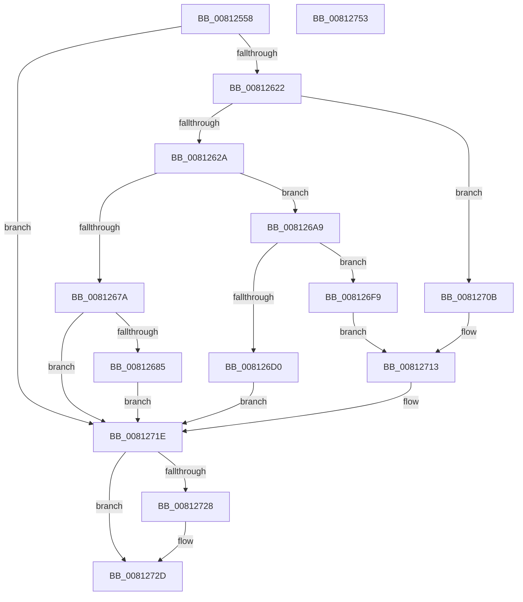

# SdbpGetFileTimestamp

- RVA: `0x00812558`–`0x00812754` (길이 `508` bytes)
- VA: `0x0000000140812558`
- 실행 섹션: `PAGE`
- PDB 이름 있음: `예`; PDB Function 태그: `아니요`
- unwind 정보 RVA: `0x000D98EC`
- 디코드: `120`개 명령, `508/508` bytes 표시
- 미해석 바이트: `0` (있으면 어셈블리에 `.byte`로 보존)

> 이 문서는 커널 이미지의 기계어와 PDB 기호를 분석해 생성했습니다. 4번과 5번은 함수 원형과 자료형을 바이너리 사용 방식에서 추정한 C 해석이며 원본 소스 복구 결과는 아닙니다.

## 1. Dependencies

- 직접 호출 지점: **9**; 고유 호출 대상: **8**
- 직접 호출자로 확인된 함수: **2**
- RIP 상대 이미지 참조: **4**

### Outgoing calls
- `0x008125C2` → [memset](../../text/6C/memset_function_006C6C40.md) (function, `0x006C6C40`)
- `0x008125CE` → [RtlInitUnicodeString](../../text/42/RtlInitUnicodeString_function_0042A780.md) (function, `0x0042A780`)
- `0x00812610` → [ZwQueryInformationByName](../../text/6A/ZwQueryInformationByName_function_006AFB50.md) (function, `0x006AFB50`)
- `0x0081266F` → [ZwCreateFile](../../text/6A/ZwCreateFile_function_006ADB70.md) (function, `0x006ADB70`)
- `0x008126A2` → [AslLogCallPrintf](../95/AslLogCallPrintf_function_0095E4EC.md) (function, `0x0095E4EC`)
- `0x008126C5` → [NtQueryInformationFile](../8A/NtQueryInformationFile_function_008AD630.md) (function, `0x008AD630`)
- `0x008126F2` → [AslLogCallPrintf](../95/AslLogCallPrintf_function_0095E4EC.md) (function, `0x0095E4EC`)
- `0x00812728` → [ZwClose](../../text/6A/ZwClose_function_006AD2B0.md) (function, `0x006AD2B0`)
- `0x00812736` → [_security_check_cookie](../../text/6A/_security_check_cookie_function_006AC640.md) (function, `0x006AC640`)

### Direct callers
- [SdbpGetMergeRedirectPathInternal](SdbpGetMergeRedirectPathInternal_function_00812B00.md) at `0x00812F90`
- [SdbpGetMergeRedirectPathInternal](SdbpGetMergeRedirectPathInternal_function_00812B00.md) at `0x00812FC2`
- [SdbpGetMergeRedirectPathInternal](SdbpGetMergeRedirectPathInternal_function_00812B00.md) at `0x00813020`
- [SdbpOpenLocalDatabaseEx](SdbpOpenLocalDatabaseEx_function_0081770C.md) at `0x0081785A`

### Static image references
- `0x00812572` → RVA `0x00E0A740` (`.data`; read)
- `0x00812685` → RVA `0x0003B818` (`.rdata`; read)
- `0x00812696` → RVA `0x0003B800` (`.rdata`; read)
- `0x008126D4` → RVA `0x0003B7D8` (`.rdata`; read)

## 2. Other-region calls and transfers

- 다른 실행 섹션으로 향하는 call: **6**
  - `0x008125C2` → [memset](../../text/6C/memset_function_006C6C40.md) (`PAGE` → `.text`)
  - `0x008125CE` → [RtlInitUnicodeString](../../text/42/RtlInitUnicodeString_function_0042A780.md) (`PAGE` → `.text`)
  - `0x00812610` → [ZwQueryInformationByName](../../text/6A/ZwQueryInformationByName_function_006AFB50.md) (`PAGE` → `.text`)
  - `0x0081266F` → [ZwCreateFile](../../text/6A/ZwCreateFile_function_006ADB70.md) (`PAGE` → `.text`)
  - `0x00812728` → [ZwClose](../../text/6A/ZwClose_function_006AD2B0.md) (`PAGE` → `.text`)
  - `0x00812736` → [_security_check_cookie](../../text/6A/_security_check_cookie_function_006AC640.md) (`PAGE` → `.text`)
- 별도 외부 분기/꼬리 이동을 확인하지 못했습니다.

## 3. Assembly (complete function range)

```asm
00812558  48 89 5C 24 18                  mov qword ptr [rsp + 0x18], rbx
0081255D  48 89 74 24 20                  mov qword ptr [rsp + 0x20], rsi
00812562  55                              push rbp
00812563  57                              push rdi
00812564  41 56                           push r14
00812566  48 8D 6C 24 C0                  lea rbp, [rsp - 0x40]
0081256B  48 81 EC 40 01 00 00            sub rsp, 0x140
00812572  48 8B 05 C7 81 5F 00            mov rax, qword ptr [rip + 0x5f81c7]
00812579  48 33 C4                        xor rax, rsp
0081257C  48 89 45 30                     mov qword ptr [rbp + 0x30], rax
00812580  33 C0                           xor eax, eax
00812582  0F 57 C0                        xorps xmm0, xmm0
00812585  21 45 94                        and dword ptr [rbp - 0x6c], eax
00812588  0F 57 C9                        xorps xmm1, xmm1
0081258B  48 21 44 24 60                  and qword ptr [rsp + 0x60], rax
00812590  41 8B F0                        mov esi, r8d
00812593  48 8B FA                        mov rdi, rdx
00812596  89 44 24 7C                     mov dword ptr [rsp + 0x7c], eax
0081259A  21 44 24 7C                     and dword ptr [rsp + 0x7c], eax
0081259E  8D 58 48                        lea ebx, [rax + 0x48]
008125A1  4C 8B F1                        mov r14, rcx
008125A4  48 89 45 D8                     mov qword ptr [rbp - 0x28], rax
008125A8  44 8B C3                        mov r8d, ebx
008125AB  48 8D 4D E0                     lea rcx, [rbp - 0x20]
008125AF  33 D2                           xor edx, edx
008125B1  0F 11 45 A8                     movups xmmword ptr [rbp - 0x58], xmm0
008125B5  0F 11 44 24 68                  movups xmmword ptr [rsp + 0x68], xmm0
008125BA  0F 11 4D B8                     movups xmmword ptr [rbp - 0x48], xmm1
008125BE  0F 11 4D C8                     movups xmmword ptr [rbp - 0x38], xmm1
008125C2  E8 79 46 EB FF                  call 0x1406c6c40
008125C7  48 8B D7                        mov rdx, rdi
008125CA  48 8D 4D A8                     lea rcx, [rbp - 0x58]
008125CE  E8 AD 81 C1 FF                  call 0x14042a780
008125D3  48 83 65 80 00                  and qword ptr [rbp - 0x80], 0
008125D8  48 8D 45 A8                     lea rax, [rbp - 0x58]
008125DC  0F 57 C0                        xorps xmm0, xmm0
008125DF  48 89 45 88                     mov qword ptr [rbp - 0x78], rax
008125E3  44 8B CB                        mov r9d, ebx
008125E6  C7 44 24 78 30 00 00 00         mov dword ptr [rsp + 0x78], 0x30
008125EE  4C 8D 45 E0                     lea r8, [rbp - 0x20]
008125F2  C7 45 90 40 02 00 00            mov dword ptr [rbp - 0x70], 0x240
008125F9  48 8D 54 24 68                  lea rdx, [rsp + 0x68]
008125FE  C7 44 24 20 44 00 00 00         mov dword ptr [rsp + 0x20], 0x44
00812606  48 8D 4C 24 78                  lea rcx, [rsp + 0x78]
0081260B  F3 0F 7F 45 98                  movdqu xmmword ptr [rbp - 0x68], xmm0
00812610  E8 3B D5 E9 FF                  call 0x1406afb50
00812615  8B D8                           mov ebx, eax
00812617  3D 34 00 00 C0                  cmp eax, 0xc0000034
0081261C  0F 84 FC 00 00 00               je 0x14081271e
00812622  85 C0                           test eax, eax
00812624  0F 89 E1 00 00 00               jns 0x14081270b
0081262A  83 64 24 50 00                  and dword ptr [rsp + 0x50], 0
0081262F  4C 8D 4C 24 68                  lea r9, [rsp + 0x68]
00812634  48 83 64 24 48 00               and qword ptr [rsp + 0x48], 0
0081263A  4C 8D 44 24 78                  lea r8, [rsp + 0x78]
0081263F  C7 44 24 40 60 00 00 00         mov dword ptr [rsp + 0x40], 0x60
00812647  48 8D 4C 24 60                  lea rcx, [rsp + 0x60]
0081264C  C7 44 24 38 01 00 00 00         mov dword ptr [rsp + 0x38], 1
00812654  BA 80 00 10 80                  mov edx, 0x80100080
00812659  C7 44 24 30 01 00 00 00         mov dword ptr [rsp + 0x30], 1
00812661  C7 44 24 28 80 00 00 00         mov dword ptr [rsp + 0x28], 0x80
00812669  48 83 64 24 20 00               and qword ptr [rsp + 0x20], 0
0081266F  E8 FC B4 E9 FF                  call 0x1406adb70
00812674  8B D8                           mov ebx, eax
00812676  85 C0                           test eax, eax
00812678  79 2F                           jns 0x1408126a9
0081267A  3D 34 00 00 C0                  cmp eax, 0xc0000034
0081267F  0F 84 99 00 00 00               je 0x14081271e
00812685  4C 8D 0D 8C 91 82 FF            lea r9, [rip - 0x7d6e74]
0081268C  89 44 24 20                     mov dword ptr [rsp + 0x20], eax
00812690  41 B8 05 06 00 00               mov r8d, 0x605
00812696  48 8D 15 63 91 82 FF            lea rdx, [rip - 0x7d6e9d]
0081269D  B9 01 00 00 00                  mov ecx, 1
008126A2  E8 45 BE 14 00                  call 0x14095e4ec
008126A7  EB 75                           jmp 0x14081271e
008126A9  48 8B 4C 24 60                  mov rcx, qword ptr [rsp + 0x60]
008126AE  4C 8D 45 B8                     lea r8, [rbp - 0x48]
008126B2  41 B9 28 00 00 00               mov r9d, 0x28
008126B8  C7 44 24 20 04 00 00 00         mov dword ptr [rsp + 0x20], 4
008126C0  48 8D 54 24 68                  lea rdx, [rsp + 0x68]
008126C5  E8 66 AF 09 00                  call 0x1408ad630
008126CA  8B D8                           mov ebx, eax
008126CC  85 C0                           test eax, eax
008126CE  79 29                           jns 0x1408126f9
008126D0  89 44 24 28                     mov dword ptr [rsp + 0x28], eax
008126D4  4C 8D 0D FD 90 82 FF            lea r9, [rip - 0x7d6f03]
008126DB  41 B8 10 06 00 00               mov r8d, 0x610
008126E1  48 89 7C 24 20                  mov qword ptr [rsp + 0x20], rdi
008126E6  48 8D 15 13 91 82 FF            lea rdx, [rip - 0x7d6eed]
008126ED  B9 01 00 00 00                  mov ecx, 1
008126F2  E8 F5 BD 14 00                  call 0x14095e4ec
008126F7  EB 25                           jmp 0x14081271e
008126F9  48 8B 4D C8                     mov rcx, qword ptr [rbp - 0x38]
008126FD  48 8B 45 D0                     mov rax, qword ptr [rbp - 0x30]
00812701  48 89 4D F8                     mov qword ptr [rbp - 8], rcx
00812705  48 89 45 00                     mov qword ptr [rbp], rax
00812709  EB 08                           jmp 0x140812713
0081270B  48 8B 45 00                     mov rax, qword ptr [rbp]
0081270F  48 8B 4D F8                     mov rcx, qword ptr [rbp - 8]
00812713  85 F6                           test esi, esi
00812715  48 0F 45 C1                     cmovne rax, rcx
00812719  33 DB                           xor ebx, ebx
0081271B  49 89 06                        mov qword ptr [r14], rax
0081271E  48 8B 4C 24 60                  mov rcx, qword ptr [rsp + 0x60]
00812723  48 85 C9                        test rcx, rcx
00812726  74 05                           je 0x14081272d
00812728  E8 83 AB E9 FF                  call 0x1406ad2b0
0081272D  8B C3                           mov eax, ebx
0081272F  48 8B 4D 30                     mov rcx, qword ptr [rbp + 0x30]
00812733  48 33 CC                        xor rcx, rsp
00812736  E8 05 9F E9 FF                  call 0x1406ac640
0081273B  4C 8D 9C 24 40 01 00 00         lea r11, [rsp + 0x140]
00812743  49 8B 5B 30                     mov rbx, qword ptr [r11 + 0x30]
00812747  49 8B 73 38                     mov rsi, qword ptr [r11 + 0x38]
0081274B  49 8B E3                        mov rsp, r11
0081274E  41 5E                           pop r14
00812750  5F                              pop rdi
00812751  5D                              pop rbp
00812752  C3                              ret
00812753  CC                              int3
```

## 4. C-style interpretation (structured pseudocode)

```c
__int64 __fastcall SdbpGetFileTimestamp(__int64 a1, __int64 a2, int a3)
{
    __int64 result;
    __int64 v_rbx;
    __int64 v_rsp;
    unsigned int v_stack_m108;
    unsigned __int64 v_stack_m110;
    unsigned int v_stack_m118;
    unsigned int v_stack_m120;
    unsigned int v_stack_m128;
    unsigned int v_stack_m130;
    unsigned int v_stack_m138;
    unsigned __int64 v_stack_m18;
    unsigned __int64 v_stack_m28;
    unsigned __int64 v_stack_m58;
    unsigned __int64 v_stack_m60;
    unsigned __int64 v_stack_m78;
    unsigned __int64 v_stack_m80;
    unsigned __int64 v_stack_m88;
    unsigned __int64 v_stack_m90;
    unsigned __int64 v_stack_mA0;
    unsigned __int64 v_stack_mB0;
    unsigned __int64 v_stack_mC0;
    unsigned int v_stack_mC4;
    unsigned int v_stack_mC8;
    unsigned __int64 v_stack_mD0;
    unsigned __int64 v_stack_mD8;
    unsigned int v_stack_mDC;
    unsigned int v_stack_mE0;
    unsigned __int64 v_stack_mF0;
    unsigned __int64 v_stack_mF8;
    unsigned __int64 v_stack_p18;
    unsigned __int64 v_stack_p20;

    v_stack_p18 = v_rbx;
    v_stack_p20 = v_rsi;
    v_rsp = (v_rsp) - (320);
    result = (*(unsigned __int64 *)(v_rip + 6259143)) ^ (v_rsp);
    v_stack_m28 = result;
    result = 0;
    v_stack_mDC = 0;
    v_stack_m80 = 0;
    a2 = 0;
    v_stack_mB0 = v_xmm0;
    v_stack_mF0 = v_xmm0;
    v_stack_mA0 = v_xmm1;
    v_stack_m90 = v_xmm1;
    result = memset(v_stack_m78, a2, (unsigned int)((unsigned int)(result + 72)), a4);
    result = RtlInitUnicodeString(v_stack_mB0, 0, (unsigned int)((unsigned int)(result + 72)), a4);
    v_stack_mD0 = v_stack_mB0;
    v_stack_mE0 = 48;
    v_stack_mC8 = 576;
    v_stack_m138 = 68;
    v_stack_mC0 = v_xmm0;
    result = ZwQueryInformationByName(v_stack_mE0, v_stack_mF0, v_stack_m78, (unsigned int)((unsigned int)(result + 72)));
    if (((unsigned int)(result)) == 0xC0000034ULL) goto loc_0081271E;
    if (!sign_flag) goto loc_0081270B;
    v_stack_m118 = 96;
    v_stack_m120 = 1;
    v_stack_m128 = 1;
    v_stack_m130 = 128;
    result = ZwCreateFile(v_stack_mF8, (unsigned int)(0x80100080ULL), v_stack_mE0, v_stack_mF0);
    if (!sign_flag) goto loc_008126A9;
    if (((unsigned int)(result)) == 0xC0000034ULL) goto loc_0081271E;
    v_stack_m138 = (unsigned int)(result);
    result = AslLogCallPrintf(1, v_rip - 8220317, (unsigned int)(0x605ULL), v_rip - 8220276);
    goto loc_0081271E;
loc_008126A9:
    v_stack_m138 = 4;
    result = NtQueryInformationFile(v_stack_mF8, v_stack_mF0, v_stack_mA0, 40);
    if (!sign_flag) goto loc_008126F9;
    v_stack_m130 = (unsigned int)(result);
    v_stack_m138 = 0;
    result = AslLogCallPrintf(1, v_rip - 8220397, (unsigned int)(0x610ULL), v_rip - 8220419);
    goto loc_0081271E;
loc_008126F9:
    v_stack_m60 = v_stack_m90;
    v_stack_m58 = v_stack_m88;
    goto loc_00812713;
loc_0081270B:
loc_00812713:
    result = v_stack_m58;
    if ((unsigned int)((unsigned int)(a3)) != 0) { result = v_stack_m60; }
    v_rbx = 0;
    *(unsigned __int64 *)(a1) = result;
loc_0081271E:
    if (v_stack_mF8 != 0) {
        result = ZwClose(v_stack_mF8, v_rip - 8220397, (unsigned int)(0x610ULL), v_rip - 8220419);
    }
    a1 = (v_stack_m28) ^ (v_rsp);
    result = _security_check_cookie(a1, v_rip - 8220397, (unsigned int)(0x610ULL), v_rip - 8220419);
    return result;
}
```

## 5. (Beta) C Style

```c
int64_t SdbpGetFileTimestamp(void *Arg1, int64_t Arg2, int32_t Arg3)
{
    uint8_t *arg1 = (uint8_t *)Arg1;

    int64_t result;
    int64_t local_rbx;
    int64_t local_rsp;
    uint32_t v_stack_m108;
    uint64_t v_stack_m110;
    uint32_t v_stack_m118;
    uint32_t v_stack_m120;
    uint32_t v_stack_m128;
    uint32_t v_stack_m130;
    uint32_t v_stack_m138;
    uint64_t v_stack_m18;
    uint64_t v_stack_m28;
    uint64_t v_stack_m58;
    uint64_t v_stack_m60;
    uint64_t v_stack_m78;
    uint64_t v_stack_m80;
    uint64_t v_stack_m88;
    uint64_t v_stack_m90;
    uint64_t v_stack_mA0;
    uint64_t v_stack_mB0;
    uint64_t v_stack_mC0;
    uint32_t v_stack_mC4;
    uint32_t v_stack_mC8;
    uint64_t v_stack_mD0;
    uint64_t v_stack_mD8;
    uint32_t v_stack_mDC;
    uint32_t v_stack_mE0;
    uint64_t v_stack_mF0;
    uint64_t v_stack_mF8;
    uint64_t v_stack_p18;
    uint64_t v_stack_p20;

    v_stack_p18 = local_rbx;
    v_stack_p20 = local_rsi;
    local_rsp = (local_rsp) - (320);
    result = (*(uint64_t *)(v_rip + 0x5F81C7)) ^ (local_rsp);
    v_stack_m28 = result;
    result = 0;
    v_stack_mDC = 0;
    v_stack_m80 = 0;
    Arg2 = 0;
    v_stack_mB0 = v_xmm0;
    v_stack_mF0 = v_xmm0;
    v_stack_mA0 = v_xmm1;
    v_stack_m90 = v_xmm1;
    result = memset(v_stack_m78, Arg2, (uint32_t)((uint32_t)(result + 72)), a4);
    result = RtlInitUnicodeString(v_stack_mB0, 0, (uint32_t)((uint32_t)(result + 72)), a4);
    v_stack_mD0 = v_stack_mB0;
    v_stack_mE0 = 48;
    v_stack_mC8 = 576;
    v_stack_m138 = 68;
    v_stack_mC0 = v_xmm0;
    result = ZwQueryInformationByName(v_stack_mE0, v_stack_mF0, v_stack_m78, (uint32_t)((uint32_t)(result + 72)));
    if (((uint32_t)(result)) == 0xC0000034ULL) goto loc_0081271E;
    if (!sign_flag) goto loc_0081270B;
    v_stack_m118 = 96;
    v_stack_m120 = 1;
    v_stack_m128 = 1;
    v_stack_m130 = 128;
    result = ZwCreateFile(v_stack_mF8, (uint32_t)(0x80100080ULL), v_stack_mE0, v_stack_mF0);
    if (!sign_flag) goto loc_008126A9;
    if (((uint32_t)(result)) == 0xC0000034ULL) goto loc_0081271E;
    v_stack_m138 = (uint32_t)(result);
    result = AslLogCallPrintf(1, v_rip - 8220317, (uint32_t)(0x605ULL), v_rip - 8220276);
    goto loc_0081271E;
loc_008126A9:
    v_stack_m138 = 4;
    result = NtQueryInformationFile(v_stack_mF8, v_stack_mF0, v_stack_mA0, 40);
    if (!sign_flag) goto loc_008126F9;
    v_stack_m130 = (uint32_t)(result);
    v_stack_m138 = 0;
    result = AslLogCallPrintf(1, v_rip - 8220397, (uint32_t)(0x610ULL), v_rip - 8220419);
    goto loc_0081271E;
loc_008126F9:
    v_stack_m60 = v_stack_m90;
    v_stack_m58 = v_stack_m88;
    goto loc_00812713;
loc_0081270B:
loc_00812713:
    result = v_stack_m58;
    if ((uint32_t)((uint32_t)(Arg3)) != 0) { result = v_stack_m60; }
    local_rbx = 0;
    *(uint64_t *)(arg1) = result;
loc_0081271E:
    if (v_stack_mF8 != 0) {
        result = ZwClose(v_stack_mF8, v_rip - 8220397, (uint32_t)(0x610ULL), v_rip - 8220419);
    }
    Arg1 = (v_stack_m28) ^ (local_rsp);
    result = _security_check_cookie(Arg1, v_rip - 8220397, (uint32_t)(0x610ULL), v_rip - 8220419);
    return result;
}
```

### 관측된 메모리 오프셋

구조체 형식이 확인되지 않은 접근은 인자 기준의 오프셋으로만 기록했습니다.

| 기준 인자 | 오프셋 표현 | 폭 (bit) | 접근 |
|---|---:|---:|---|
| `Arg1` | `+ 0x0` | `64` | `W` |

## 6. Execution-region graph

[열기: 2D/3D 그래프와 함수 탐색 컨트롤 패널](../../../control-panel.html?section=page&rva=0x00812558&view=graph)

- 2D 그래프는 위에서 아래로 흐르고, 3D 그래프는 빈 공간을 드래그해 회전합니다. Shift+드래그는 이동, 휠은 확대·축소, 함수 노드 선택은 대상 보고서 이동입니다.

### Static fallback


