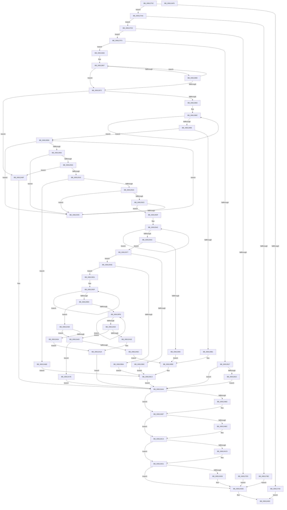

# SdbpGetManifestedMergeStubAlloc

- RVA: `0x0081275C`–`0x00812AF9` (길이 `925` bytes)
- VA: `0x000000014081275C`
- 실행 섹션: `PAGE`
- PDB 이름 있음: `예`; PDB Function 태그: `아니요`
- unwind 정보 RVA: `0x000C5BB4`
- 디코드: `247`개 명령, `925/925` bytes 표시
- 미해석 바이트: `0` (있으면 어셈블리에 `.byte`로 보존)

> 이 문서는 커널 이미지의 기계어와 PDB 기호를 분석해 생성했습니다. 4번과 5번은 함수 원형과 자료형을 바이너리 사용 방식에서 추정한 C 해석이며 원본 소스 복구 결과는 아닙니다.

## 1. Dependencies

- 직접 호출 지점: **20**; 고유 호출 대상: **12**
- 직접 호출자로 확인된 함수: **1**
- RIP 상대 이미지 참조: **14**

### Outgoing calls
- `0x008127B1` → [SdbpGetMergeSdbsDisabled](SdbpGetMergeSdbsDisabled_function_008130A8.md) (function, `0x008130A8`)
- `0x008127D9` → [AslLogCallPrintf](../95/AslLogCallPrintf_function_0095E4EC.md) (function, `0x0095E4EC`)
- `0x0081280C` → [AslRegistryGetKey](AslRegistryGetKey_function_00819F64.md) (function, `0x00819F64`)
- `0x0081283C` → [AslLogCallPrintf](../95/AslLogCallPrintf_function_0095E4EC.md) (function, `0x0095E4EC`)
- `0x0081285D` → [wcsicmp](../../text/50/wcsicmp_function_00500080.md) (function, `0x00500080`)
- `0x008128A2` → [AslAlloc](../95/AslAlloc_function_0095BD34.md) (function, `0x0095BD34`)
- `0x008128CC` → [AslLogCallPrintf](../95/AslLogCallPrintf_function_0095E4EC.md) (function, `0x0095E4EC`)
- `0x008128F5` → [ZwEnumerateValueKey](../../text/6A/ZwEnumerateValueKey_function_006AD330.md) (function, `0x006AD330`)
- `0x0081292A` → [wcsicmp](../../text/50/wcsicmp_function_00500080.md) (function, `0x00500080`)
- `0x00812958` → [AslAlloc](../95/AslAlloc_function_0095BD34.md) (function, `0x0095BD34`)
- `0x00812991` → [ZwEnumerateValueKey](../../text/6A/ZwEnumerateValueKey_function_006AD330.md) (function, `0x006AD330`)
- `0x008129D1` → [RtlGetNtSystemRoot](../A1/RtlGetNtSystemRoot_function_00A1DCD0.md) (function, `0x00A1DCD0`)
- `0x008129F0` → [wcsnicmp](../../text/50/wcsnicmp_function_005001C0.md) (function, `0x005001C0`)
- `0x00812A0F` → [AslPathToSystemPath](AslPathToSystemPath_function_0081B370.md) (function, `0x0081B370`)
- `0x00812A33` → [AslLogCallPrintf](../95/AslLogCallPrintf_function_0095E4EC.md) (function, `0x0095E4EC`)
- `0x00812A46` → [AslStringDuplicate](../95/AslStringDuplicate_function_00958604.md) (function, `0x00958604`)
- `0x00812AB2` → [ZwClose](../../text/6A/ZwClose_function_006AD2B0.md) (function, `0x006AD2B0`)
- `0x00812ABF` → [AslFree](../95/AslFree_function_0095B674.md) (function, `0x0095B674`)
- `0x00812ACC` → [AslFree](../95/AslFree_function_0095B674.md) (function, `0x0095B674`)
- `0x00812AD9` → [AslFree](../95/AslFree_function_0095B674.md) (function, `0x0095B674`)

### Direct callers
- [SdbpGetMergeRedirectPathInternal](SdbpGetMergeRedirectPathInternal_function_00812B00.md) at `0x00812FE6`

### Static image references
- `0x008127BC` → RVA `0x0003B1A0` (`.rdata`; read)
- `0x008127CD` → RVA `0x0003B180` (`.rdata`; read)
- `0x008127F8` → RVA `0x0003B0C0` (`.rdata`; read)
- `0x00812822` → RVA `0x0003B980` (`.rdata`; read)
- `0x00812849` → RVA `0x00009788` (`.rdata`; read)
- `0x00812850` → RVA `0x000098A8` (`.rdata`; read)
- `0x008128B1` → RVA `0x0003B958` (`.rdata`; read)
- `0x00812965` → RVA `0x0003B918` (`.rdata`; read)
- `0x0081299C` → RVA `0x0003B8F8` (`.rdata`; read)
- `0x008129BF` → RVA `0x0003B8D0` (`.rdata`; read)
- `0x00812A1D` → RVA `0x0003B8A0` (`.rdata`; read)
- `0x00812A54` → RVA `0x0003B880` (`.rdata`; read)
- `0x00812A6C` → RVA `0x0003B860` (`.rdata`; read)
- `0x00812A8D` → RVA `0x0003B938` (`.rdata`; read)

## 2. Other-region calls and transfers

- 다른 실행 섹션으로 향하는 call: **6**
  - `0x0081285D` → [wcsicmp](../../text/50/wcsicmp_function_00500080.md) (`PAGE` → `.text`)
  - `0x008128F5` → [ZwEnumerateValueKey](../../text/6A/ZwEnumerateValueKey_function_006AD330.md) (`PAGE` → `.text`)
  - `0x0081292A` → [wcsicmp](../../text/50/wcsicmp_function_00500080.md) (`PAGE` → `.text`)
  - `0x00812991` → [ZwEnumerateValueKey](../../text/6A/ZwEnumerateValueKey_function_006AD330.md) (`PAGE` → `.text`)
  - `0x008129F0` → [wcsnicmp](../../text/50/wcsnicmp_function_005001C0.md) (`PAGE` → `.text`)
  - `0x00812AB2` → [ZwClose](../../text/6A/ZwClose_function_006AD2B0.md) (`PAGE` → `.text`)
- 별도 외부 분기/꼬리 이동을 확인하지 못했습니다.

## 3. Assembly (complete function range)

```asm
0081275C  48 89 5C 24 10                  mov qword ptr [rsp + 0x10], rbx
00812761  48 89 4C 24 08                  mov qword ptr [rsp + 8], rcx
00812766  55                              push rbp
00812767  56                              push rsi
00812768  57                              push rdi
00812769  41 54                           push r12
0081276B  41 55                           push r13
0081276D  41 56                           push r14
0081276F  41 57                           push r15
00812771  48 8B EC                        mov rbp, rsp
00812774  48 83 EC 50                     sub rsp, 0x50
00812778  45 33 F6                        xor r14d, r14d
0081277B  4C 8B E2                        mov r12, rdx
0081277E  44 89 75 50                     mov dword ptr [rbp + 0x50], r14d
00812782  41 8B F6                        mov esi, r14d
00812785  44 89 75 58                     mov dword ptr [rbp + 0x58], r14d
00812789  45 8B EE                        mov r13d, r14d
0081278C  4C 89 75 E0                     mov qword ptr [rbp - 0x20], r14
00812790  45 8B FE                        mov r15d, r14d
00812793  4C 89 75 E8                     mov qword ptr [rbp - 0x18], r14
00812797  4C 89 75 F0                     mov qword ptr [rbp - 0x10], r14
0081279B  48 85 C9                        test rcx, rcx
0081279E  75 0A                           jne 0x1408127aa
008127A0  B8 EF 00 00 C0                  mov eax, 0xc00000ef
008127A5  E9 36 03 00 00                  jmp 0x140812ae0
008127AA  4C 89 31                        mov qword ptr [rcx], r14
008127AD  48 8D 4D 50                     lea rcx, [rbp + 0x50]
008127B1  E8 F2 08 00 00                  call 0x1408130a8
008127B6  8B D8                           mov ebx, eax
008127B8  85 C0                           test eax, eax
008127BA  79 27                           jns 0x1408127e3
008127BC  4C 8D 0D DD 89 82 FF            lea r9, [rip - 0x7d7623]
008127C3  89 44 24 20                     mov dword ptr [rsp + 0x20], eax
008127C7  41 B8 83 04 00 00               mov r8d, 0x483
008127CD  48 8D 15 AC 89 82 FF            lea rdx, [rip - 0x7d7654]
008127D4  B9 01 00 00 00                  mov ecx, 1
008127D9  E8 0E BD 14 00                  call 0x14095e4ec
008127DE  E9 FB 02 00 00                  jmp 0x140812ade
008127E3  44 39 75 50                     cmp dword ptr [rbp + 0x50], r14d
008127E7  74 0A                           je 0x1408127f3
008127E9  BB 34 00 00 C0                  mov ebx, 0xc0000034
008127EE  E9 EB 02 00 00                  jmp 0x140812ade
008127F3  BF 01 00 00 00                  mov edi, 1
008127F8  48 8D 15 C1 88 82 FF            lea rdx, [rip - 0x7d773f]
008127FF  44 8B CF                        mov r9d, edi
00812802  48 8D 4D F0                     lea rcx, [rbp - 0x10]
00812806  41 B8 00 01 00 80               mov r8d, 0x80000100
0081280C  E8 53 77 00 00                  call 0x140819f64
00812811  8B D8                           mov ebx, eax
00812813  85 C0                           test eax, eax
00812815  79 2F                           jns 0x140812846
00812817  3D 34 00 00 C0                  cmp eax, 0xc0000034
0081281C  0F 84 82 02 00 00               je 0x140812aa4
00812822  4C 8D 0D 57 91 82 FF            lea r9, [rip - 0x7d6ea9]
00812829  89 44 24 20                     mov dword ptr [rsp + 0x20], eax
0081282D  41 B8 93 04 00 00               mov r8d, 0x493
00812833  48 8D 15 46 89 82 FF            lea rdx, [rip - 0x7d76ba]
0081283A  8B CF                           mov ecx, edi
0081283C  E8 AB BC 14 00                  call 0x14095e4ec
00812841  E9 5E 02 00 00                  jmp 0x140812aa4
00812846  44 8B F7                        mov r14d, edi
00812849  48 8D 1D 38 6F 7F FF            lea rbx, [rip - 0x8090c8]
00812850  4C 8D 3D 51 70 7F FF            lea r15, [rip - 0x808faf]
00812857  48 8B 13                        mov rdx, qword ptr [rbx]
0081285A  49 8B CC                        mov rcx, r12
0081285D  E8 1E D8 CE FF                  call 0x140500080
00812862  85 C0                           test eax, eax
00812864  74 0C                           je 0x140812872
00812866  44 03 F7                        add r14d, edi
00812869  48 83 C3 20                     add rbx, 0x20
0081286D  49 3B DF                        cmp rbx, r15
00812870  7C E5                           jl 0x140812857
00812872  48 8B 75 E0                     mov rsi, qword ptr [rbp - 0x20]
00812876  4D 8B FD                        mov r15, r13
00812879  41 83 FE 0A                     cmp r14d, 0xa
0081287D  0F 8D 1C 02 00 00               jge 0x140812a9f
00812883  49 83 CE FF                     or r14, 0xffffffffffffffff
00812887  49 8B C6                        mov rax, r14
0081288A  33 C9                           xor ecx, ecx
0081288C  48 FF C0                        inc rax
0081288F  66 41 39 0C 44                  cmp word ptr [r12 + rax*2], cx
00812894  75 F6                           jne 0x14081288c
00812896  8D 1C 45 12 00 00 00            lea ebx, [rax*2 + 0x12]
0081289D  8B D3                           mov edx, ebx
0081289F  89 5D E0                        mov dword ptr [rbp - 0x20], ebx
008128A2  E8 8D 94 14 00                  call 0x14095bd34
008128A7  4C 8B E8                        mov r13, rax
008128AA  33 C0                           xor eax, eax
008128AC  4D 85 ED                        test r13, r13
008128AF  75 25                           jne 0x1408128d6
008128B1  4C 8D 0D A0 90 82 FF            lea r9, [rip - 0x7d6f60]
008128B8  41 B8 A7 04 00 00               mov r8d, 0x4a7
008128BE  BB 17 00 00 C0                  mov ebx, 0xc0000017
008128C3  48 8D 15 B6 88 82 FF            lea rdx, [rip - 0x7d774a]
008128CA  8B CF                           mov ecx, edi
008128CC  E8 1B BC 14 00                  call 0x14095e4ec
008128D1  E9 CE 01 00 00                  jmp 0x140812aa4
008128D6  48 8D 4D 58                     lea rcx, [rbp + 0x58]
008128DA  89 45 50                        mov dword ptr [rbp + 0x50], eax
008128DD  48 89 4C 24 28                  mov qword ptr [rsp + 0x28], rcx
008128E2  4D 8B CD                        mov r9, r13
008128E5  48 8B 4D F0                     mov rcx, qword ptr [rbp - 0x10]
008128E9  41 B8 02 00 00 00               mov r8d, 2
008128EF  8B D0                           mov edx, eax
008128F1  89 5C 24 20                     mov dword ptr [rsp + 0x20], ebx
008128F5  E8 36 AA E9 FF                  call 0x1406ad330
008128FA  8B D8                           mov ebx, eax
008128FC  3D 05 00 00 80                  cmp eax, 0x80000005
00812901  74 32                           je 0x140812935
00812903  3D 23 00 00 C0                  cmp eax, 0xc0000023
00812908  74 2B                           je 0x140812935
0081290A  3D 1A 00 00 80                  cmp eax, 0x8000001a
0081290F  0F 84 8A 01 00 00               je 0x140812a9f
00812915  85 C0                           test eax, eax
00812917  0F 88 70 01 00 00               js 0x140812a8d
0081291D  41 39 7D 04                     cmp dword ptr [r13 + 4], edi
00812921  75 12                           jne 0x140812935
00812923  49 8D 55 0C                     lea rdx, [r13 + 0xc]
00812927  49 8B CC                        mov rcx, r12
0081292A  E8 51 D7 CE FF                  call 0x140500080
0081292F  33 C9                           xor ecx, ecx
00812931  85 C0                           test eax, eax
00812933  74 0A                           je 0x14081293f
00812935  8B 45 50                        mov eax, dword ptr [rbp + 0x50]
00812938  8B 5D E0                        mov ebx, dword ptr [rbp - 0x20]
0081293B  03 C7                           add eax, edi
0081293D  EB 97                           jmp 0x1408128d6
0081293F  49 8B C6                        mov rax, r14
00812942  48 FF C0                        inc rax
00812945  66 41 39 0C 44                  cmp word ptr [r12 + rax*2], cx
0081294A  75 F6                           jne 0x140812942
0081294C  8D 1C 45 1A 02 00 00            lea ebx, [rax*2 + 0x21a]
00812953  8B D3                           mov edx, ebx
00812955  44 8B E3                        mov r12d, ebx
00812958  E8 D7 93 14 00                  call 0x14095bd34
0081295D  4C 8B F8                        mov r15, rax
00812960  48 85 C0                        test rax, rax
00812963  75 12                           jne 0x140812977
00812965  4C 8D 0D AC 8F 82 FF            lea r9, [rip - 0x7d7054]
0081296C  41 B8 CB 04 00 00               mov r8d, 0x4cb
00812972  E9 47 FF FF FF                  jmp 0x1408128be
00812977  8B 55 50                        mov edx, dword ptr [rbp + 0x50]
0081297A  48 8D 45 58                     lea rax, [rbp + 0x58]
0081297E  48 8B 4D F0                     mov rcx, qword ptr [rbp - 0x10]
00812982  4D 8B CF                        mov r9, r15
00812985  48 89 44 24 28                  mov qword ptr [rsp + 0x28], rax
0081298A  45 33 C0                        xor r8d, r8d
0081298D  89 5C 24 20                     mov dword ptr [rsp + 0x20], ebx
00812991  E8 9A A9 E9 FF                  call 0x1406ad330
00812996  8B D8                           mov ebx, eax
00812998  85 C0                           test eax, eax
0081299A  79 12                           jns 0x1408129ae
0081299C  4C 8D 0D 55 8F 82 FF            lea r9, [rip - 0x7d70ab]
008129A3  41 B8 D6 04 00 00               mov r8d, 0x4d6
008129A9  E9 15 FF FF FF                  jmp 0x1408128c3
008129AE  8B 45 58                        mov eax, dword ptr [rbp + 0x58]
008129B1  48 83 C0 02                     add rax, 2
008129B5  49 3B C4                        cmp rax, r12
008129B8  76 17                           jbe 0x1408129d1
008129BA  BB 23 00 00 C0                  mov ebx, 0xc0000023
008129BF  4C 8D 0D 0A 8F 82 FF            lea r9, [rip - 0x7d70f6]
008129C6  41 B8 DB 04 00 00               mov r8d, 0x4db
008129CC  E9 F2 FE FF FF                  jmp 0x1408128c3
008129D1  E8 FA B2 20 00                  call 0x140a1dcd0
008129D6  48 8B D8                        mov rbx, rax
008129D9  4D 8B C6                        mov r8, r14
008129DC  45 33 E4                        xor r12d, r12d
008129DF  49 FF C0                        inc r8
008129E2  66 46 39 24 40                  cmp word ptr [rax + r8*2], r12w
008129E7  75 F6                           jne 0x1408129df
008129E9  49 8D 57 0C                     lea rdx, [r15 + 0xc]
008129ED  48 8B CB                        mov rcx, rbx
008129F0  E8 CB D7 CE FF                  call 0x1405001c0
008129F5  85 C0                           test eax, eax
008129F7  75 45                           jne 0x140812a3e
008129F9  49 FF C6                        inc r14
008129FC  66 46 39 24 73                  cmp word ptr [rbx + r14*2], r12w
00812A01  75 F6                           jne 0x1408129f9
00812A03  49 83 C6 06                     add r14, 6
00812A07  48 8D 4D E8                     lea rcx, [rbp - 0x18]
00812A0B  4B 8D 14 77                     lea rdx, [r15 + r14*2]
00812A0F  E8 5C 89 00 00                  call 0x14081b370
00812A14  45 33 F6                        xor r14d, r14d
00812A17  8B D8                           mov ebx, eax
00812A19  85 C0                           test eax, eax
00812A1B  79 46                           jns 0x140812a63
00812A1D  4C 8D 0D 7C 8E 82 FF            lea r9, [rip - 0x7d7184]
00812A24  41 B8 EF 04 00 00               mov r8d, 0x4ef
00812A2A  48 8D 15 4F 87 82 FF            lea rdx, [rip - 0x7d78b1]
00812A31  8B CF                           mov ecx, edi
00812A33  E8 B4 BA 14 00                  call 0x14095e4ec
00812A38  48 8B 75 E8                     mov rsi, qword ptr [rbp - 0x18]
00812A3C  EB 66                           jmp 0x140812aa4
00812A3E  49 8D 57 0C                     lea rdx, [r15 + 0xc]
00812A42  48 8D 4D E8                     lea rcx, [rbp - 0x18]
00812A46  E8 B9 5B 14 00                  call 0x140958604
00812A4B  45 33 F6                        xor r14d, r14d
00812A4E  8B D8                           mov ebx, eax
00812A50  85 C0                           test eax, eax
00812A52  79 0F                           jns 0x140812a63
00812A54  4C 8D 0D 25 8E 82 FF            lea r9, [rip - 0x7d71db]
00812A5B  41 B8 F6 04 00 00               mov r8d, 0x4f6
00812A61  EB C7                           jmp 0x140812a2a
00812A63  48 8B 75 E8                     mov rsi, qword ptr [rbp - 0x18]
00812A67  48 85 F6                        test rsi, rsi
00812A6A  75 12                           jne 0x140812a7e
00812A6C  4C 8D 0D ED 8D 82 FF            lea r9, [rip - 0x7d7213]
00812A73  41 B8 FD 04 00 00               mov r8d, 0x4fd
00812A79  E9 40 FE FF FF                  jmp 0x1408128be
00812A7E  48 8B 45 40                     mov rax, qword ptr [rbp + 0x40]
00812A82  41 8B DE                        mov ebx, r14d
00812A85  48 89 30                        mov qword ptr [rax], rsi
00812A88  49 8B F6                        mov rsi, r14
00812A8B  EB 17                           jmp 0x140812aa4
00812A8D  4C 8D 0D A4 8E 82 FF            lea r9, [rip - 0x7d715c]
00812A94  41 B8 BA 04 00 00               mov r8d, 0x4ba
00812A9A  E9 24 FE FF FF                  jmp 0x1408128c3
00812A9F  BB 34 00 00 C0                  mov ebx, 0xc0000034
00812AA4  48 8B 4D F0                     mov rcx, qword ptr [rbp - 0x10]
00812AA8  48 8D 41 FF                     lea rax, [rcx - 1]
00812AAC  48 83 F8 FD                     cmp rax, -3
00812AB0  77 05                           ja 0x140812ab7
00812AB2  E8 F9 A7 E9 FF                  call 0x1406ad2b0
00812AB7  48 85 F6                        test rsi, rsi
00812ABA  74 08                           je 0x140812ac4
00812ABC  48 8B D6                        mov rdx, rsi
00812ABF  E8 B0 8B 14 00                  call 0x14095b674
00812AC4  4D 85 ED                        test r13, r13
00812AC7  74 08                           je 0x140812ad1
00812AC9  49 8B D5                        mov rdx, r13
00812ACC  E8 A3 8B 14 00                  call 0x14095b674
00812AD1  4D 85 FF                        test r15, r15
00812AD4  74 08                           je 0x140812ade
00812AD6  49 8B D7                        mov rdx, r15
00812AD9  E8 96 8B 14 00                  call 0x14095b674
00812ADE  8B C3                           mov eax, ebx
00812AE0  48 8B 9C 24 98 00 00 00         mov rbx, qword ptr [rsp + 0x98]
00812AE8  48 83 C4 50                     add rsp, 0x50
00812AEC  41 5F                           pop r15
00812AEE  41 5E                           pop r14
00812AF0  41 5D                           pop r13
00812AF2  41 5C                           pop r12
00812AF4  5F                              pop rdi
00812AF5  5E                              pop rsi
00812AF6  5D                              pop rbp
00812AF7  C3                              ret
00812AF8  CC                              int3
```

## 4. C-style interpretation (structured pseudocode)

```c
__int64 __fastcall SdbpGetManifestedMergeStubAlloc(__int64 a1, __int64 a2)
{
    __int64 result;
    __int64 v_r12;
    __int64 v_r14;
    __int64 v_rbx;
    __int64 v_rsp;
    unsigned __int64 v_stack_m48;
    unsigned __int64 v_stack_m50;
    unsigned __int64 v_stack_m58;
    unsigned __int64 v_stack_m60;
    unsigned int v_stack_m68;
    unsigned __int64 v_stack_p10;
    unsigned int v_stack_p18;
    unsigned int v_stack_p20;
    unsigned __int64 v_stack_p8;

    v_stack_p10 = v_rbx;
    v_stack_p8 = a1;
    v_rsp = (v_rsp) - (80);
    v_r14 = 0;
    v_stack_p18 = 0;
    v_stack_p20 = 0;
    v_stack_m58 = 0;
    v_stack_m50 = 0;
    v_stack_m48 = 0;
    if (a1 != 0) goto loc_008127AA;
    goto loc_00812AE0;
loc_008127AA:
    *(unsigned __int64 *)(a1) = 0;
    result = SdbpGetMergeSdbsDisabled(v_stack_p18, a2, a3, a4);
    if (!sign_flag) goto loc_008127E3;
    v_stack_m68 = (unsigned int)(result);
    result = AslLogCallPrintf(1, v_rip - 8222292, (unsigned int)(0x483ULL), v_rip - 8222243);
    goto loc_00812ADE;
loc_008127E3:
    if (v_stack_p18 == 0) goto loc_008127F3;
    goto loc_00812ADE;
loc_008127F3:
    result = AslRegistryGetKey(v_stack_m48, v_rip - 8222527, (unsigned int)(0x80000100ULL), 1);
    if (!sign_flag) goto loc_00812846;
    if (((unsigned int)(result)) == 0xC0000034ULL) goto loc_00812AA4;
    v_stack_m68 = (unsigned int)(result);
    result = AslLogCallPrintf(1, v_rip - 8222394, (unsigned int)(0x493ULL), v_rip - 8220329);
    goto loc_00812AA4;
loc_00812846:
loc_00812857:
    result = wcsicmp(a2, *(unsigned __int64 *)(v_rip - 8425672), (unsigned int)(0x493ULL), v_rip - 8220329);
    if ((unsigned int)(result) == 0) goto loc_00812872;
    v_r14 = (unsigned int)((1) + (1));
    v_rbx = (v_rip - 8425672) + (32);
    if (v_rbx < (v_rip - 8425391)) goto loc_00812857;
loc_00812872:
    if (((unsigned int)(v_r14)) >= 10) goto loc_00812A9F;
    v_r14 = (v_r14) | (-1);
    a1 = 0;
loc_0081288C:
    result = (v_r14) + 1;
    if ((*(unsigned __int16 *)(a2 + result * 2)) != 0) goto loc_0081288C;
    v_stack_m58 = (unsigned int)(result * 2 + 18);
    result = AslAlloc(a1, (unsigned int)((unsigned int)(result * 2 + 18)), (unsigned int)(0x493ULL), v_rip - 8220329);
    result = 0;
    if (0 != 0) goto loc_008128D6;
loc_008128BE:
loc_008128C3:
    result = AslLogCallPrintf(1, v_rip - 8222538, (unsigned int)(0x4A7ULL), v_rip - 8220512);
    goto loc_00812AA4;
loc_008128D6:
    v_stack_p18 = (unsigned int)(result);
    v_stack_m60 = v_stack_p20;
    v_stack_m68 = (unsigned int)((unsigned int)(0xC0000017ULL));
    result = ZwEnumerateValueKey(v_stack_m48, (unsigned int)((unsigned int)(result)), 2, result);
    if (((unsigned int)(result)) == 0x80000005ULL) goto loc_00812935;
    if (((unsigned int)(result)) == 0xC0000023ULL) goto loc_00812935;
    if (((unsigned int)(result)) == 0x8000001AULL) goto loc_00812A9F;
    if (sign_flag) goto loc_00812A8D;
    if ((*(unsigned int *)(result + 4)) != 1) goto loc_00812935;
    result = wcsicmp(a2, result + 12, 2, result);
    a1 = 0;
    if ((unsigned int)(result) == 0) goto loc_0081293F;
loc_00812935:
    result = (unsigned int)(((unsigned int)(v_stack_p18)) + (1));
    goto loc_008128D6;
loc_0081293F:
loc_00812942:
    result = (v_r14) + 1;
    if ((*(unsigned __int16 *)(a2 + result * 2)) != 0) goto loc_00812942;
    result = AslAlloc(a1, (unsigned int)((unsigned int)(result * 2 + 538)), 2, result);
    if (result != 0) goto loc_00812977;
    goto loc_008128BE;
loc_00812977:
    v_stack_m60 = v_stack_p20;
    a3 = 0;
    v_stack_m68 = (unsigned int)(result * 2 + 538);
    result = ZwEnumerateValueKey(v_stack_m48, (unsigned int)(v_stack_p18), a3, result);
    if (!sign_flag) goto loc_008129AE;
    goto loc_008128C3;
loc_008129AE:
    result = ((unsigned int)(v_stack_p20)) + (2);
    if (result <= ((unsigned int)((unsigned int)(result * 2 + 538)))) goto loc_008129D1;
    goto loc_008128C3;
loc_008129D1:
    result = RtlGetNtSystemRoot(v_stack_m48, (unsigned int)(v_stack_p18), (unsigned int)(0x4DBULL), v_rip - 8220918);
    v_r12 = 0;
loc_008129DF:
    a3 = (v_r14) + 1;
    if ((*(unsigned __int16 *)(result + a3 * 2)) != 0) goto loc_008129DF;
    result = wcsnicmp(result, result + 12, a3, v_rip - 8220918);
    if ((unsigned int)(result) != 0) goto loc_00812A3E;
loc_008129F9:
    v_r14 = (v_r14) + 1;
    if ((*(unsigned __int16 *)(result + v_r14 * 2)) != 0) goto loc_008129F9;
    v_r14 = (v_r14) + (6);
    result = AslPathToSystemPath(v_stack_m50, result + v_r14 * 2, a3, v_rip - 8220918);
    v_r14 = 0;
    if (!sign_flag) goto loc_00812A63;
loc_00812A2A:
    result = AslLogCallPrintf(1, v_rip - 8222897, (unsigned int)(0x4EFULL), v_rip - 8221060);
    goto loc_00812AA4;
loc_00812A3E:
    result = AslStringDuplicate(v_stack_m50, result + 12, (unsigned int)(0x4EFULL), v_rip - 8221060);
    v_r14 = 0;
    if (!sign_flag) goto loc_00812A63;
    goto loc_00812A2A;
loc_00812A63:
    if (v_stack_m50 != 0) goto loc_00812A7E;
    goto loc_008128BE;
loc_00812A7E:
    *(unsigned __int64 *)(v_stack_p8) = v_stack_m50;
    goto loc_00812AA4;
loc_00812A8D:
    goto loc_008128C3;
loc_00812A9F:
loc_00812AA4:
    result = v_stack_m48 - 1;
    if ((v_stack_m48 - 1) <= -3) {
        result = ZwClose(v_stack_m48, result + 12, (unsigned int)(0x4BAULL), v_rip - 8221020);
    }
    if (0 != 0) {
        a2 = 0;
        result = AslFree(v_stack_m48, a2, (unsigned int)(0x4BAULL), v_rip - 8221020);
    }
    if (result != 0) {
        a2 = result;
        result = AslFree(v_stack_m48, a2, (unsigned int)(0x4BAULL), v_rip - 8221020);
    }
    if (result != 0) {
        a2 = result;
        result = AslFree(v_stack_m48, a2, (unsigned int)(0x4BAULL), v_rip - 8221020);
    }
loc_00812AE0:
    v_rsp = (v_rsp) + (80);
    return (unsigned int)((unsigned int)((unsigned int)(0xC0000034ULL)));
}
```

## 5. (Beta) C Style

```c
int64_t SdbpGetManifestedMergeStubAlloc(int64_t Arg1, void *Arg2)
{
    uint8_t *arg2 = (uint8_t *)Arg2;

    int64_t result;
    int64_t local_r12;
    int64_t local_r14;
    int64_t local_rbx;
    int64_t local_rsp;
    uint64_t v_stack_m48;
    uint64_t v_stack_m50;
    uint64_t v_stack_m58;
    uint64_t v_stack_m60;
    uint32_t v_stack_m68;
    uint64_t v_stack_p10;
    uint32_t v_stack_p18;
    uint32_t v_stack_p20;
    uint64_t v_stack_p8;

    v_stack_p10 = local_rbx;
    v_stack_p8 = Arg1;
    local_rsp = (local_rsp) - (80);
    local_r14 = 0;
    v_stack_p18 = 0;
    v_stack_p20 = 0;
    v_stack_m58 = 0;
    v_stack_m50 = 0;
    v_stack_m48 = 0;
    if (Arg1 != 0) goto loc_008127AA;
    goto loc_00812AE0;
loc_008127AA:
    *(uint64_t *)(Arg1) = 0;
    result = SdbpGetMergeSdbsDisabled(v_stack_p18, Arg2, a3, a4);
    if (!sign_flag) goto loc_008127E3;
    v_stack_m68 = (uint32_t)(result);
    result = AslLogCallPrintf(1, v_rip - 8222292, (uint32_t)(0x483ULL), v_rip - 8222243);
    goto loc_00812ADE;
loc_008127E3:
    if (v_stack_p18 == 0) goto loc_008127F3;
    goto loc_00812ADE;
loc_008127F3:
    result = AslRegistryGetKey(v_stack_m48, v_rip - 8222527, (uint32_t)(0x80000100ULL), 1);
    if (!sign_flag) goto loc_00812846;
    if (((uint32_t)(result)) == 0xC0000034ULL) goto loc_00812AA4;
    v_stack_m68 = (uint32_t)(result);
    result = AslLogCallPrintf(1, v_rip - 8222394, (uint32_t)(0x493ULL), v_rip - 8220329);
    goto loc_00812AA4;
loc_00812846:
loc_00812857:
    result = wcsicmp(Arg2, *(uint64_t *)(v_rip - 0x8090C8), (uint32_t)(0x493ULL), v_rip - 8220329);
    if ((uint32_t)(result) == 0) goto loc_00812872;
    local_r14 = (uint32_t)((1) + (1));
    local_rbx = (v_rip - 8425672) + (32);
    if (local_rbx < (v_rip - 8425391)) goto loc_00812857;
loc_00812872:
    if (((uint32_t)(local_r14)) >= 10) goto loc_00812A9F;
    local_r14 = (local_r14) | (-1);
    Arg1 = 0;
loc_0081288C:
    result = (local_r14) + 1;
    if ((*(uint16_t *)(arg2 + result * 2)) != 0) goto loc_0081288C;
    v_stack_m58 = (uint32_t)(result * 2 + 18);
    result = AslAlloc(Arg1, (uint32_t)((uint32_t)(result * 2 + 18)), (uint32_t)(0x493ULL), v_rip - 8220329);
    result = 0;
    if (0 != 0) goto loc_008128D6;
loc_008128BE:
loc_008128C3:
    result = AslLogCallPrintf(1, v_rip - 8222538, (uint32_t)(0x4A7ULL), v_rip - 8220512);
    goto loc_00812AA4;
loc_008128D6:
    v_stack_p18 = (uint32_t)(result);
    v_stack_m60 = v_stack_p20;
    v_stack_m68 = (uint32_t)((uint32_t)(0xC0000017ULL));
    result = ZwEnumerateValueKey(v_stack_m48, (uint32_t)((uint32_t)(result)), 2, result);
    if (((uint32_t)(result)) == 0x80000005ULL) goto loc_00812935;
    if (((uint32_t)(result)) == 0xC0000023ULL) goto loc_00812935;
    if (((uint32_t)(result)) == 0x8000001AULL) goto loc_00812A9F;
    if (sign_flag) goto loc_00812A8D;
    if ((*(uint32_t *)(result + 0x4)) != 1) goto loc_00812935;
    result = wcsicmp(Arg2, result + 12, 2, result);
    Arg1 = 0;
    if ((uint32_t)(result) == 0) goto loc_0081293F;
loc_00812935:
    result = (uint32_t)(((uint32_t)(v_stack_p18)) + (1));
    goto loc_008128D6;
loc_0081293F:
loc_00812942:
    result = (local_r14) + 1;
    if ((*(uint16_t *)(arg2 + result * 2)) != 0) goto loc_00812942;
    result = AslAlloc(Arg1, (uint32_t)((uint32_t)(result * 2 + 538)), 2, result);
    if (result != 0) goto loc_00812977;
    goto loc_008128BE;
loc_00812977:
    v_stack_m60 = v_stack_p20;
    a3 = 0;
    v_stack_m68 = (uint32_t)(result * 2 + 538);
    result = ZwEnumerateValueKey(v_stack_m48, (uint32_t)(v_stack_p18), a3, result);
    if (!sign_flag) goto loc_008129AE;
    goto loc_008128C3;
loc_008129AE:
    result = ((uint32_t)(v_stack_p20)) + (2);
    if (result <= ((uint32_t)((uint32_t)(result * 2 + 538)))) goto loc_008129D1;
    goto loc_008128C3;
loc_008129D1:
    result = RtlGetNtSystemRoot(v_stack_m48, (uint32_t)(v_stack_p18), (uint32_t)(0x4DBULL), v_rip - 8220918);
    local_r12 = 0;
loc_008129DF:
    a3 = (local_r14) + 1;
    if ((*(uint16_t *)(result + a3 * 2)) != 0) goto loc_008129DF;
    result = wcsnicmp(result, result + 12, a3, v_rip - 8220918);
    if ((uint32_t)(result) != 0) goto loc_00812A3E;
loc_008129F9:
    local_r14 = (local_r14) + 1;
    if ((*(uint16_t *)(result + local_r14 * 2)) != 0) goto loc_008129F9;
    local_r14 = (local_r14) + (6);
    result = AslPathToSystemPath(v_stack_m50, result + local_r14 * 2, a3, v_rip - 8220918);
    local_r14 = 0;
    if (!sign_flag) goto loc_00812A63;
loc_00812A2A:
    result = AslLogCallPrintf(1, v_rip - 8222897, (uint32_t)(0x4EFULL), v_rip - 8221060);
    goto loc_00812AA4;
loc_00812A3E:
    result = AslStringDuplicate(v_stack_m50, result + 12, (uint32_t)(0x4EFULL), v_rip - 8221060);
    local_r14 = 0;
    if (!sign_flag) goto loc_00812A63;
    goto loc_00812A2A;
loc_00812A63:
    if (v_stack_m50 != 0) goto loc_00812A7E;
    goto loc_008128BE;
loc_00812A7E:
    *(uint64_t *)(v_stack_p8) = v_stack_m50;
    goto loc_00812AA4;
loc_00812A8D:
    goto loc_008128C3;
loc_00812A9F:
loc_00812AA4:
    result = v_stack_m48 - 1;
    if ((v_stack_m48 - 1) <= -3) {
        result = ZwClose(v_stack_m48, result + 12, (uint32_t)(0x4BAULL), v_rip - 8221020);
    }
    if (0 != 0) {
        Arg2 = 0;
        result = AslFree(v_stack_m48, Arg2, (uint32_t)(0x4BAULL), v_rip - 8221020);
    }
    if (result != 0) {
        Arg2 = result;
        result = AslFree(v_stack_m48, Arg2, (uint32_t)(0x4BAULL), v_rip - 8221020);
    }
    if (result != 0) {
        Arg2 = result;
        result = AslFree(v_stack_m48, Arg2, (uint32_t)(0x4BAULL), v_rip - 8221020);
    }
loc_00812AE0:
    local_rsp = (local_rsp) + (80);
    return (uint32_t)((uint32_t)((uint32_t)(0xC0000034ULL)));
}
```

### 관측된 메모리 오프셋

구조체 형식이 확인되지 않은 접근은 인자 기준의 오프셋으로만 기록했습니다.

| 기준 인자 | 오프셋 표현 | 폭 (bit) | 접근 |
|---|---:|---:|---|
| `Arg2` | `+ 0x0 + rax*2` | `16` | `R` |

## 6. Execution-region graph

[열기: 2D/3D 그래프와 함수 탐색 컨트롤 패널](../../../control-panel.html?section=page&rva=0x0081275C&view=graph)

- 2D 그래프는 위에서 아래로 흐르고, 3D 그래프는 빈 공간을 드래그해 회전합니다. Shift+드래그는 이동, 휠은 확대·축소, 함수 노드 선택은 대상 보고서 이동입니다.

### Static fallback


