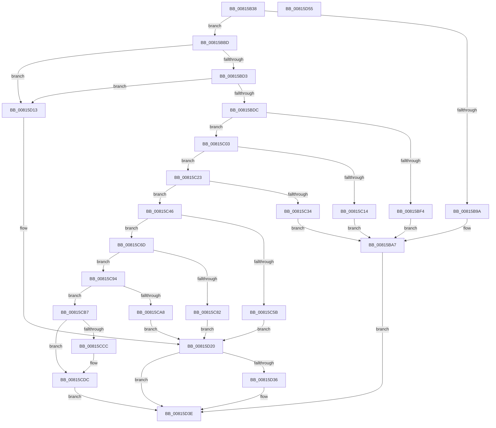

# SdbpGetMatchingTextAttributes

- RVA: `0x00815B38`–`0x00815D56` (길이 `542` bytes)
- VA: `0x0000000140815B38`
- 실행 섹션: `PAGE`
- PDB 이름 있음: `예`; PDB Function 태그: `아니요`
- unwind 정보 RVA: `0x000AF26C`
- 디코드: `142`개 명령, `542/542` bytes 표시
- 미해석 바이트: `0` (있으면 어셈블리에 `.byte`로 보존)

> 이 문서는 커널 이미지의 기계어와 PDB 기호를 분석해 생성했습니다. 4번과 5번은 함수 원형과 자료형을 바이너리 사용 방식에서 추정한 C 해석이며 원본 소스 복구 결과는 아닙니다.

## 1. Dependencies

- 직접 호출 지점: **13**; 고유 호출 대상: **8**
- 직접 호출자로 확인된 함수: **1**
- RIP 상대 이미지 참조: **9**

### Outgoing calls
- `0x00815B91` → [SdbFindFirstTag](../95/SdbFindFirstTag_function_0095E34C.md) (function, `0x0095E34C`)
- `0x00815BB3` → [AslLogCallPrintf](../95/AslLogCallPrintf_function_0095E4EC.md) (function, `0x0095E4EC`)
- `0x00815BC2` → [SdbGetStringTagPtr](../95/SdbGetStringTagPtr_function_0095DDA8.md) (function, `0x0095DDA8`)
- `0x00815BE8` → [SdbFindFirstTag](../95/SdbFindFirstTag_function_0095E34C.md) (function, `0x0095E34C`)
- `0x00815C09` → [SdbGetTagDataSize](../95/SdbGetTagDataSize_function_0095E230.md) (function, `0x0095E230`)
- `0x00815C27` → [AslAlloc](../95/AslAlloc_function_0095BD34.md) (function, `0x0095BD34`)
- `0x00815C52` → [SdbReadBinaryTag](../A7/SdbReadBinaryTag_function_00A7EC28.md) (function, `0x00A7EC28`)
- `0x00815C79` → [SdbFindFirstTag](../95/SdbFindFirstTag_function_0095E34C.md) (function, `0x0095E34C`)
- `0x00815C9C` → [SdbReadDWORDTag](../95/SdbReadDWORDTag_function_0095D408.md) (function, `0x0095D408`)
- `0x00815CC3` → [SdbFindFirstTag](../95/SdbFindFirstTag_function_0095E34C.md) (function, `0x0095E34C`)
- `0x00815CD4` → [SdbReadDWORDTag](../95/SdbReadDWORDTag_function_0095D408.md) (function, `0x0095D408`)
- `0x00815D2C` → [AslLogCallPrintf](../95/AslLogCallPrintf_function_0095E4EC.md) (function, `0x0095E4EC`)
- `0x00815D39` → [AslFree](../95/AslFree_function_0095B674.md) (function, `0x0095B674`)

### Direct callers
- [SdbpCheckMatchingText](SdbpCheckMatchingText_function_00814950.md) at `0x008149B5`

### Static image references
- `0x00815B9A` → RVA `0x0003C318` (`.rdata`; read)
- `0x00815BA7` → RVA `0x0003C2F8` (`.rdata`; read)
- `0x00815BF4` → RVA `0x0003C2B0` (`.rdata`; read)
- `0x00815C14` → RVA `0x0003CA78` (`.rdata`; read)
- `0x00815C34` → RVA `0x0003CA50` (`.rdata`; read)
- `0x00815C61` → RVA `0x0003CA28` (`.rdata`; read)
- `0x00815C88` → RVA `0x0003CA08` (`.rdata`; read)
- `0x00815CAE` → RVA `0x0003C9E8` (`.rdata`; read)
- `0x00815D19` → RVA `0x0003C2D0` (`.rdata`; read)

## 2. Other-region calls and transfers

- 다른 실행 섹션으로 향하는 call: **0**
- 별도 외부 분기/꼬리 이동을 확인하지 못했습니다.

## 3. Assembly (complete function range)

```asm
00815B38  48 89 5C 24 08                  mov qword ptr [rsp + 8], rbx
00815B3D  4C 89 4C 24 20                  mov qword ptr [rsp + 0x20], r9
00815B42  4C 89 44 24 18                  mov qword ptr [rsp + 0x18], r8
00815B47  55                              push rbp
00815B48  56                              push rsi
00815B49  57                              push rdi
00815B4A  41 54                           push r12
00815B4C  41 55                           push r13
00815B4E  41 56                           push r14
00815B50  41 57                           push r15
00815B52  48 83 EC 20                     sub rsp, 0x20
00815B56  48 8B 84 24 80 00 00 00         mov rax, qword ptr [rsp + 0x80]
00815B5E  33 DB                           xor ebx, ebx
00815B60  49 89 18                        mov qword ptr [r8], rbx
00815B63  41 BD 00 20 00 00               mov r13d, 0x2000
00815B69  41 B8 01 60 00 00               mov r8d, 0x6001
00815B6F  49 89 19                        mov qword ptr [r9], rbx
00815B72  44 8B E2                        mov r12d, edx
00815B75  48 8B F9                        mov rdi, rcx
00815B78  89 18                           mov dword ptr [rax], ebx
00815B7A  8B F3                           mov esi, ebx
00815B7C  48 8B 84 24 88 00 00 00         mov rax, qword ptr [rsp + 0x88]
00815B84  89 18                           mov dword ptr [rax], ebx
00815B86  48 8B 84 24 90 00 00 00         mov rax, qword ptr [rsp + 0x90]
00815B8E  44 89 28                        mov dword ptr [rax], r13d
00815B91  E8 B6 87 14 00                  call 0x14095e34c
00815B96  85 C0                           test eax, eax
00815B98  75 23                           jne 0x140815bbd
00815B9A  4C 8D 0D 77 67 82 FF            lea r9, [rip - 0x7d9889]
00815BA1  41 B8 07 07 00 00               mov r8d, 0x707
00815BA7  48 8D 15 4A 67 82 FF            lea rdx, [rip - 0x7d98b6]
00815BAE  B9 01 00 00 00                  mov ecx, 1
00815BB3  E8 34 89 14 00                  call 0x14095e4ec
00815BB8  E9 81 01 00 00                  jmp 0x140815d3e
00815BBD  8B D0                           mov edx, eax
00815BBF  48 8B CF                        mov rcx, rdi
00815BC2  E8 E1 81 14 00                  call 0x14095dda8
00815BC7  4C 8B F8                        mov r15, rax
00815BCA  48 85 C0                        test rax, rax
00815BCD  0F 84 40 01 00 00               je 0x140815d13
00815BD3  66 39 18                        cmp word ptr [rax], bx
00815BD6  0F 84 37 01 00 00               je 0x140815d13
00815BDC  41 B8 13 90 00 00               mov r8d, 0x9013
00815BE2  41 8B D4                        mov edx, r12d
00815BE5  48 8B CF                        mov rcx, rdi
00815BE8  E8 5F 87 14 00                  call 0x14095e34c
00815BED  44 8B F0                        mov r14d, eax
00815BF0  85 C0                           test eax, eax
00815BF2  75 0F                           jne 0x140815c03
00815BF4  4C 8D 0D B5 66 82 FF            lea r9, [rip - 0x7d994b]
00815BFB  41 B8 16 07 00 00               mov r8d, 0x716
00815C01  EB A4                           jmp 0x140815ba7
00815C03  41 8B D6                        mov edx, r14d
00815C06  48 8B CF                        mov rcx, rdi
00815C09  E8 22 86 14 00                  call 0x14095e230
00815C0E  8B E8                           mov ebp, eax
00815C10  85 C0                           test eax, eax
00815C12  75 0F                           jne 0x140815c23
00815C14  4C 8D 0D 5D 6E 82 FF            lea r9, [rip - 0x7d91a3]
00815C1B  41 B8 1C 07 00 00               mov r8d, 0x71c
00815C21  EB 84                           jmp 0x140815ba7
00815C23  48 8D 55 02                     lea rdx, [rbp + 2]
00815C27  E8 08 61 14 00                  call 0x14095bd34
00815C2C  48 8B F0                        mov rsi, rax
00815C2F  48 85 C0                        test rax, rax
00815C32  75 12                           jne 0x140815c46
00815C34  4C 8D 0D 15 6E 82 FF            lea r9, [rip - 0x7d91eb]
00815C3B  41 B8 22 07 00 00               mov r8d, 0x722
00815C41  E9 61 FF FF FF                  jmp 0x140815ba7
00815C46  44 8B CD                        mov r9d, ebp
00815C49  4C 8B C6                        mov r8, rsi
00815C4C  41 8B D6                        mov edx, r14d
00815C4F  48 8B CF                        mov rcx, rdi
00815C52  E8 D1 8F 26 00                  call 0x140a7ec28
00815C57  85 C0                           test eax, eax
00815C59  75 12                           jne 0x140815c6d
00815C5B  41 B8 27 07 00 00               mov r8d, 0x727
00815C61  4C 8D 0D C0 6D 82 FF            lea r9, [rip - 0x7d9240]
00815C68  E9 B3 00 00 00                  jmp 0x140815d20
00815C6D  41 B8 53 40 00 00               mov r8d, 0x4053
00815C73  41 8B D4                        mov edx, r12d
00815C76  48 8B CF                        mov rcx, rdi
00815C79  E8 CE 86 14 00                  call 0x14095e34c
00815C7E  85 C0                           test eax, eax
00815C80  75 12                           jne 0x140815c94
00815C82  41 B8 30 07 00 00               mov r8d, 0x730
00815C88  4C 8D 0D 79 6D 82 FF            lea r9, [rip - 0x7d9287]
00815C8F  E9 8C 00 00 00                  jmp 0x140815d20
00815C94  45 33 C0                        xor r8d, r8d
00815C97  8B D0                           mov edx, eax
00815C99  48 8B CF                        mov rcx, rdi
00815C9C  E8 67 77 14 00                  call 0x14095d408
00815CA1  44 8B F0                        mov r14d, eax
00815CA4  85 C0                           test eax, eax
00815CA6  75 0F                           jne 0x140815cb7
00815CA8  41 B8 36 07 00 00               mov r8d, 0x736
00815CAE  4C 8D 0D 33 6D 82 FF            lea r9, [rip - 0x7d92cd]
00815CB5  EB 69                           jmp 0x140815d20
00815CB7  41 B8 01 40 00 00               mov r8d, 0x4001
00815CBD  41 8B D4                        mov edx, r12d
00815CC0  48 8B CF                        mov rcx, rdi
00815CC3  E8 84 86 14 00                  call 0x14095e34c
00815CC8  85 C0                           test eax, eax
00815CCA  74 10                           je 0x140815cdc
00815CCC  45 8B C5                        mov r8d, r13d
00815CCF  8B D0                           mov edx, eax
00815CD1  48 8B CF                        mov rcx, rdi
00815CD4  E8 2F 77 14 00                  call 0x14095d408
00815CD9  44 8B E8                        mov r13d, eax
00815CDC  48 8B 44 24 70                  mov rax, qword ptr [rsp + 0x70]
00815CE1  BB 01 00 00 00                  mov ebx, 1
00815CE6  4C 89 38                        mov qword ptr [rax], r15
00815CE9  48 8B 44 24 78                  mov rax, qword ptr [rsp + 0x78]
00815CEE  48 89 30                        mov qword ptr [rax], rsi
00815CF1  48 8B 84 24 80 00 00 00         mov rax, qword ptr [rsp + 0x80]
00815CF9  89 28                           mov dword ptr [rax], ebp
00815CFB  48 8B 84 24 88 00 00 00         mov rax, qword ptr [rsp + 0x88]
00815D03  44 89 30                        mov dword ptr [rax], r14d
00815D06  48 8B 84 24 90 00 00 00         mov rax, qword ptr [rsp + 0x90]
00815D0E  44 89 28                        mov dword ptr [rax], r13d
00815D11  EB 2B                           jmp 0x140815d3e
00815D13  41 B8 0D 07 00 00               mov r8d, 0x70d
00815D19  4C 8D 0D B0 65 82 FF            lea r9, [rip - 0x7d9a50]
00815D20  48 8D 15 D1 65 82 FF            lea rdx, [rip - 0x7d9a2f]
00815D27  B9 01 00 00 00                  mov ecx, 1
00815D2C  E8 BB 87 14 00                  call 0x14095e4ec
00815D31  48 85 F6                        test rsi, rsi
00815D34  74 08                           je 0x140815d3e
00815D36  48 8B D6                        mov rdx, rsi
00815D39  E8 36 59 14 00                  call 0x14095b674
00815D3E  8B C3                           mov eax, ebx
00815D40  48 8B 5C 24 60                  mov rbx, qword ptr [rsp + 0x60]
00815D45  48 83 C4 20                     add rsp, 0x20
00815D49  41 5F                           pop r15
00815D4B  41 5E                           pop r14
00815D4D  41 5D                           pop r13
00815D4F  41 5C                           pop r12
00815D51  5F                              pop rdi
00815D52  5E                              pop rsi
00815D53  5D                              pop rbp
00815D54  C3                              ret
00815D55  CC                              int3
```

## 4. C-style interpretation (structured pseudocode)

```c
__int64 __fastcall SdbpGetMatchingTextAttributes(__int64 a1, int a2, __int64 a3, __int64 a4, __int64 a5, __int64 a6, __int64 a7)
{
    __int64 result;
    __int64 v_r13;
    __int64 v_rbx;
    __int64 v_rsp;
    unsigned __int64 v_stack_p18;
    unsigned __int64 v_stack_p20;
    unsigned __int64 v_stack_p8;

    v_stack_p8 = v_rbx;
    v_stack_p20 = a4;
    v_stack_p18 = a3;
    v_rsp = (v_rsp) - (32);
    v_rbx = 0;
    *(unsigned __int64 *)(a3) = 0;
    *(unsigned __int64 *)(a4) = 0;
    *(unsigned int *)(a5) = 0;
    *(unsigned int *)(a6) = 0;
    *(unsigned int *)(a7) = (unsigned int)((unsigned int)(0x2000ULL));
    result = SdbFindFirstTag(a1, a2, (unsigned int)(0x6001ULL), a4);
    if ((unsigned int)(result) != 0) goto loc_00815BBD;
loc_00815BA7:
    result = AslLogCallPrintf(1, v_rip - 8231094, (unsigned int)(0x707ULL), v_rip - 8231049);
    goto loc_00815D3E;
loc_00815BBD:
    result = SdbGetStringTagPtr(a1, (unsigned int)((unsigned int)(result)), (unsigned int)(0x707ULL), v_rip - 8231049);
    if (result == 0) goto loc_00815D13;
    if ((*(unsigned __int16 *)(result)) == 0) goto loc_00815D13;
    result = SdbFindFirstTag(a1, (unsigned int)((unsigned int)((unsigned int)(a2))), (unsigned int)(0x9013ULL), v_rip - 8231049);
    if ((unsigned int)(result) != 0) goto loc_00815C03;
    goto loc_00815BA7;
loc_00815C03:
    result = SdbGetTagDataSize(a1, (unsigned int)((unsigned int)((unsigned int)((unsigned int)(result)))), (unsigned int)(0x716ULL), v_rip - 8231243);
    if ((unsigned int)(result) != 0) goto loc_00815C23;
    goto loc_00815BA7;
loc_00815C23:
    result = AslAlloc(a1, (unsigned int)((unsigned int)(result)) + 2, (unsigned int)(0x71CULL), v_rip - 8229283);
    if (result != 0) goto loc_00815C46;
    goto loc_00815BA7;
loc_00815C46:
    result = SdbReadBinaryTag(a1, (unsigned int)((unsigned int)((unsigned int)((unsigned int)(result)))), result, (unsigned int)((unsigned int)((unsigned int)((unsigned int)(result)))));
    if ((unsigned int)(result) != 0) goto loc_00815C6D;
    goto loc_00815D20;
loc_00815C6D:
    result = SdbFindFirstTag(a1, (unsigned int)((unsigned int)((unsigned int)(a2))), (unsigned int)(0x4053ULL), v_rip - 8229440);
    if ((unsigned int)(result) != 0) goto loc_00815C94;
    goto loc_00815D20;
loc_00815C94:
    a3 = 0;
    result = SdbReadDWORDTag(a1, (unsigned int)((unsigned int)(result)), a3, v_rip - 8229511);
    if ((unsigned int)(result) != 0) goto loc_00815CB7;
    goto loc_00815D20;
loc_00815CB7:
    result = SdbFindFirstTag(a1, (unsigned int)((unsigned int)((unsigned int)(a2))), (unsigned int)(0x4001ULL), v_rip - 8229581);
    v_r13 = (unsigned int)(0x2000ULL);
    if ((unsigned int)(result) != 0) {
        a3 = (unsigned int)((unsigned int)(0x2000ULL));
        a2 = (unsigned int)(result);
        a1 = a1;
        result = SdbReadDWORDTag(a1, a2, a3, v_rip - 8229581);
        v_r13 = (unsigned int)(result);
    }
    *(unsigned __int64 *)(v_stack_p18) = result;
    *(unsigned __int64 *)(v_stack_p20) = result;
    *(unsigned int *)(a5) = (unsigned int)((unsigned int)((unsigned int)(result)));
    *(unsigned int *)(a6) = (unsigned int)((unsigned int)((unsigned int)(result)));
    *(unsigned int *)(a7) = (unsigned int)(v_r13);
    goto loc_00815D3E;
loc_00815D13:
loc_00815D20:
    result = AslLogCallPrintf(1, v_rip - 8231471, (unsigned int)(0x70DULL), v_rip - 8231504);
    if (result != 0) {
        a2 = result;
        result = AslFree(1, a2, (unsigned int)(0x70DULL), v_rip - 8231504);
    }
    v_rsp = (v_rsp) + (32);
    return 1;
}
```

## 5. (Beta) C Style

```c
int64_t SdbpGetMatchingTextAttributes(int64_t Arg1, int32_t Arg2, void *Arg3, void *Arg4, void *Arg5, void *Arg6, void *Arg7)
{
    uint8_t *arg3 = (uint8_t *)Arg3;
    uint8_t *arg4 = (uint8_t *)Arg4;
    uint8_t *arg5 = (uint8_t *)Arg5;
    uint8_t *arg6 = (uint8_t *)Arg6;
    uint8_t *arg7 = (uint8_t *)Arg7;

    int64_t result;
    int64_t local_r13;
    int64_t local_rbx;
    int64_t local_rsp;
    uint64_t v_stack_p18;
    uint64_t v_stack_p20;
    uint64_t v_stack_p8;

    v_stack_p8 = local_rbx;
    v_stack_p20 = Arg4;
    v_stack_p18 = Arg3;
    local_rsp = (local_rsp) - (32);
    local_rbx = 0;
    *(uint64_t *)(arg3) = 0;
    *(uint64_t *)(arg4) = 0;
    *(uint32_t *)(arg5) = 0;
    *(uint32_t *)(arg6) = 0;
    *(uint32_t *)(arg7) = (uint32_t)((uint32_t)(0x2000ULL));
    result = SdbFindFirstTag(Arg1, Arg2, (uint32_t)(0x6001ULL), Arg4);
    if ((uint32_t)(result) != 0) goto loc_00815BBD;
loc_00815BA7:
    result = AslLogCallPrintf(1, v_rip - 8231094, (uint32_t)(0x707ULL), v_rip - 8231049);
    goto loc_00815D3E;
loc_00815BBD:
    result = SdbGetStringTagPtr(Arg1, (uint32_t)((uint32_t)(result)), (uint32_t)(0x707ULL), v_rip - 8231049);
    if (result == 0) goto loc_00815D13;
    if ((*(uint16_t *)(result)) == 0) goto loc_00815D13;
    result = SdbFindFirstTag(Arg1, (uint32_t)((uint32_t)((uint32_t)(Arg2))), (uint32_t)(0x9013ULL), v_rip - 8231049);
    if ((uint32_t)(result) != 0) goto loc_00815C03;
    goto loc_00815BA7;
loc_00815C03:
    result = SdbGetTagDataSize(Arg1, (uint32_t)((uint32_t)((uint32_t)((uint32_t)(result)))), (uint32_t)(0x716ULL), v_rip - 8231243);
    if ((uint32_t)(result) != 0) goto loc_00815C23;
    goto loc_00815BA7;
loc_00815C23:
    result = AslAlloc(Arg1, (uint32_t)((uint32_t)(result)) + 2, (uint32_t)(0x71CULL), v_rip - 8229283);
    if (result != 0) goto loc_00815C46;
    goto loc_00815BA7;
loc_00815C46:
    result = SdbReadBinaryTag(Arg1, (uint32_t)((uint32_t)((uint32_t)((uint32_t)(result)))), result, (uint32_t)((uint32_t)((uint32_t)((uint32_t)(result)))));
    if ((uint32_t)(result) != 0) goto loc_00815C6D;
    goto loc_00815D20;
loc_00815C6D:
    result = SdbFindFirstTag(Arg1, (uint32_t)((uint32_t)((uint32_t)(Arg2))), (uint32_t)(0x4053ULL), v_rip - 8229440);
    if ((uint32_t)(result) != 0) goto loc_00815C94;
    goto loc_00815D20;
loc_00815C94:
    Arg3 = 0;
    result = SdbReadDWORDTag(Arg1, (uint32_t)((uint32_t)(result)), Arg3, v_rip - 8229511);
    if ((uint32_t)(result) != 0) goto loc_00815CB7;
    goto loc_00815D20;
loc_00815CB7:
    result = SdbFindFirstTag(Arg1, (uint32_t)((uint32_t)((uint32_t)(Arg2))), (uint32_t)(0x4001ULL), v_rip - 8229581);
    local_r13 = (uint32_t)(0x2000ULL);
    if ((uint32_t)(result) != 0) {
        Arg3 = (uint32_t)((uint32_t)(0x2000ULL));
        Arg2 = (uint32_t)(result);
        Arg1 = Arg1;
        result = SdbReadDWORDTag(Arg1, Arg2, Arg3, v_rip - 8229581);
        local_r13 = (uint32_t)(result);
    }
    *(uint64_t *)(v_stack_p18) = result;
    *(uint64_t *)(v_stack_p20) = result;
    *(uint32_t *)(arg5) = (uint32_t)((uint32_t)((uint32_t)(result)));
    *(uint32_t *)(arg6) = (uint32_t)((uint32_t)((uint32_t)(result)));
    *(uint32_t *)(arg7) = (uint32_t)(local_r13);
    goto loc_00815D3E;
loc_00815D13:
loc_00815D20:
    result = AslLogCallPrintf(1, v_rip - 8231471, (uint32_t)(0x70DULL), v_rip - 8231504);
    if (result != 0) {
        Arg2 = result;
        result = AslFree(1, Arg2, (uint32_t)(0x70DULL), v_rip - 8231504);
    }
    local_rsp = (local_rsp) + (32);
    return 1;
}
```

### 관측된 메모리 오프셋

구조체 형식이 확인되지 않은 접근은 인자 기준의 오프셋으로만 기록했습니다.

| 기준 인자 | 오프셋 표현 | 폭 (bit) | 접근 |
|---|---:|---:|---|
| `Arg3` | `+ 0x0` | `64` | `W` |
| `Arg4` | `+ 0x0` | `64` | `W` |
| `Arg5` | `+ 0x0` | `32` | `W` |
| `Arg6` | `+ 0x0` | `32` | `W` |
| `Arg7` | `+ 0x0` | `32` | `W` |

## 6. Execution-region graph

[열기: 2D/3D 그래프와 함수 탐색 컨트롤 패널](../../../control-panel.html?section=page&rva=0x00815B38&view=graph)

- 2D 그래프는 위에서 아래로 흐르고, 3D 그래프는 빈 공간을 드래그해 회전합니다. Shift+드래그는 이동, 휠은 확대·축소, 함수 노드 선택은 대상 보고서 이동입니다.

### Static fallback


