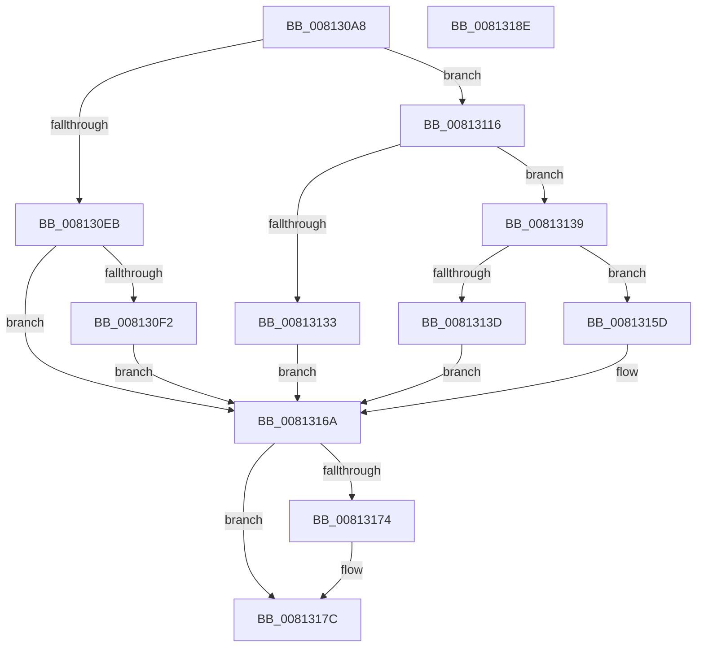

# SdbpGetMergeSdbsDisabled

- RVA: `0x008130A8`–`0x0081318F` (길이 `231` bytes)
- VA: `0x00000001408130A8`
- 실행 섹션: `PAGE`
- PDB 이름 있음: `예`; PDB Function 태그: `아니요`
- unwind 정보 RVA: `0x000C3DF4`
- 디코드: `61`개 명령, `231/231` bytes 표시
- 미해석 바이트: `0` (있으면 어셈블리에 `.byte`로 보존)

> 이 문서는 커널 이미지의 기계어와 PDB 기호를 분석해 생성했습니다. 4번과 5번은 함수 원형과 자료형을 바이너리 사용 방식에서 추정한 C 해석이며 원본 소스 복구 결과는 아닙니다.

## 1. Dependencies

- 직접 호출 지점: **5**; 고유 호출 대상: **4**
- 직접 호출자로 확인된 함수: **1**
- RIP 상대 이미지 참조: **5**

### Outgoing calls
- `0x008130DB` → [AslRegistryGetKey](AslRegistryGetKey_function_00819F64.md) (function, `0x00819F64`)
- `0x0081310F` → [AslLogCallPrintf](../95/AslLogCallPrintf_function_0095E4EC.md) (function, `0x0095E4EC`)
- `0x00813125` → [AslRegistryGetUInt32](AslRegistryGetUInt32_function_0081A228.md) (function, `0x0081A228`)
- `0x00813156` → [AslLogCallPrintf](../95/AslLogCallPrintf_function_0095E4EC.md) (function, `0x0095E4EC`)
- `0x00813177` → [ZwClose](../../text/6A/ZwClose_function_006AD2B0.md) (function, `0x006AD2B0`)

### Direct callers
- [SdbpGetManifestedMergeStubAlloc](SdbpGetManifestedMergeStubAlloc_function_0081275C.md) at `0x008127B1`

### Static image references
- `0x008130BC` → RVA `0x0003B270` (`.rdata`; read)
- `0x008130F2` → RVA `0x0003B238` (`.rdata`; read)
- `0x00813103` → RVA `0x0003B218` (`.rdata`; read)
- `0x00813116` → RVA `0x0003B1E8` (`.rdata`; read)
- `0x0081313D` → RVA `0x0003B1C8` (`.rdata`; read)

## 2. Other-region calls and transfers

- 다른 실행 섹션으로 향하는 call: **1**
  - `0x00813177` → [ZwClose](../../text/6A/ZwClose_function_006AD2B0.md) (`PAGE` → `.text`)
- 별도 외부 분기/꼬리 이동을 확인하지 못했습니다.

## 3. Assembly (complete function range)

```asm
008130A8  48 8B C4                        mov rax, rsp
008130AB  48 89 58 08                     mov qword ptr [rax + 8], rbx
008130AF  48 89 70 20                     mov qword ptr [rax + 0x20], rsi
008130B3  57                              push rdi
008130B4  48 83 EC 30                     sub rsp, 0x30
008130B8  83 60 10 00                     and dword ptr [rax + 0x10], 0
008130BC  48 8D 15 AD 81 82 FF            lea rdx, [rip - 0x7d7e53]
008130C3  48 83 60 18 00                  and qword ptr [rax + 0x18], 0
008130C8  48 8B F1                        mov rsi, rcx
008130CB  48 8D 48 18                     lea rcx, [rax + 0x18]
008130CF  41 B9 01 00 00 00               mov r9d, 1
008130D5  41 B8 00 01 00 80               mov r8d, 0x80000100
008130DB  E8 84 6E 00 00                  call 0x140819f64
008130E0  48 8B 7C 24 50                  mov rdi, qword ptr [rsp + 0x50]
008130E5  8B D8                           mov ebx, eax
008130E7  85 C0                           test eax, eax
008130E9  79 2B                           jns 0x140813116
008130EB  3D 34 00 00 C0                  cmp eax, 0xc0000034
008130F0  74 78                           je 0x14081316a
008130F2  4C 8D 0D 3F 81 82 FF            lea r9, [rip - 0x7d7ec1]
008130F9  89 44 24 20                     mov dword ptr [rsp + 0x20], eax
008130FD  41 B8 3D 04 00 00               mov r8d, 0x43d
00813103  48 8D 15 0E 81 82 FF            lea rdx, [rip - 0x7d7ef2]
0081310A  B9 01 00 00 00                  mov ecx, 1
0081310F  E8 D8 B3 14 00                  call 0x14095e4ec
00813114  EB 54                           jmp 0x14081316a
00813116  4C 8D 05 CB 80 82 FF            lea r8, [rip - 0x7d7f35]
0081311D  48 8B D7                        mov rdx, rdi
00813120  48 8D 4C 24 48                  lea rcx, [rsp + 0x48]
00813125  E8 FE 70 00 00                  call 0x14081a228
0081312A  8B D8                           mov ebx, eax
0081312C  3D 34 00 00 C0                  cmp eax, 0xc0000034
00813131  75 06                           jne 0x140813139
00813133  33 DB                           xor ebx, ebx
00813135  21 1E                           and dword ptr [rsi], ebx
00813137  EB 31                           jmp 0x14081316a
00813139  85 C0                           test eax, eax
0081313B  79 20                           jns 0x14081315d
0081313D  4C 8D 0D 84 80 82 FF            lea r9, [rip - 0x7d7f7c]
00813144  41 B8 49 04 00 00               mov r8d, 0x449
0081314A  48 8D 15 C7 80 82 FF            lea rdx, [rip - 0x7d7f39]
00813151  B9 01 00 00 00                  mov ecx, 1
00813156  E8 91 B3 14 00                  call 0x14095e4ec
0081315B  EB 0D                           jmp 0x14081316a
0081315D  33 C0                           xor eax, eax
0081315F  39 44 24 48                     cmp dword ptr [rsp + 0x48], eax
00813163  0F 95 C0                        setne al
00813166  33 DB                           xor ebx, ebx
00813168  89 06                           mov dword ptr [rsi], eax
0081316A  48 8D 47 FF                     lea rax, [rdi - 1]
0081316E  48 83 F8 FD                     cmp rax, -3
00813172  77 08                           ja 0x14081317c
00813174  48 8B CF                        mov rcx, rdi
00813177  E8 34 A1 E9 FF                  call 0x1406ad2b0
0081317C  48 8B 74 24 58                  mov rsi, qword ptr [rsp + 0x58]
00813181  8B C3                           mov eax, ebx
00813183  48 8B 5C 24 40                  mov rbx, qword ptr [rsp + 0x40]
00813188  48 83 C4 30                     add rsp, 0x30
0081318C  5F                              pop rdi
0081318D  C3                              ret
0081318E  CC                              int3
```

## 4. C-style interpretation (structured pseudocode)

```c
__int64 __fastcall SdbpGetMergeSdbsDisabled(__int64 a1)
{
    __int64 result;
    __int64 v_rbx;
    __int64 v_rsp;
    unsigned int v_stack_m18;
    unsigned __int64 v_stack_p10;
    unsigned __int64 v_stack_p18;
    unsigned __int64 v_stack_p20;
    unsigned __int64 v_stack_p8;

    *(unsigned __int64 *)(v_rsp + 8) = v_rbx;
    *(unsigned __int64 *)(v_rsp + 32) = v_rsi;
    v_rsp = (v_rsp) - (48);
    result = AslRegistryGetKey(v_rsp + 24, v_rip - 8224339, (unsigned int)(0x80000100ULL), 1);
    if (!sign_flag) goto loc_00813116;
    if (((unsigned int)(result)) == 0xC0000034ULL) goto loc_0081316A;
    v_stack_m18 = (unsigned int)(result);
    result = AslLogCallPrintf(1, v_rip - 8224498, (unsigned int)(0x43DULL), v_rip - 8224449);
    goto loc_0081316A;
loc_00813116:
    result = AslRegistryGetUInt32(v_stack_p10, v_stack_p18, v_rip - 8224565, v_rip - 8224449);
    if (((unsigned int)(result)) != 0xC0000034ULL) goto loc_00813139;
    v_rbx = 0;
    goto loc_0081316A;
loc_00813139:
    if (!sign_flag) goto loc_0081315D;
    result = AslLogCallPrintf(1, v_rip - 8224569, (unsigned int)(0x449ULL), v_rip - 8224636);
    goto loc_0081316A;
loc_0081315D:
    result = 0;
    result = (v_stack_p10 != 0) ? 1 : 0;
    v_rbx = 0;
    *(unsigned int *)(a1) = (unsigned int)(result);
loc_0081316A:
    result = v_stack_p18 - 1;
    if ((v_stack_p18 - 1) <= -3) {
        a1 = v_stack_p18;
        result = ZwClose(a1, v_rip - 8224569, (unsigned int)(0x449ULL), v_rip - 8224636);
    }
    v_rsp = (v_rsp) + (48);
    return 0;
}
```

## 5. (Beta) C Style

```c
int64_t SdbpGetMergeSdbsDisabled(void *Arg1)
{
    uint8_t *arg1 = (uint8_t *)Arg1;

    int64_t result;
    int64_t local_rbx;
    int64_t local_rsp;
    uint32_t v_stack_m18;
    uint64_t v_stack_p10;
    uint64_t v_stack_p18;
    uint64_t v_stack_p20;
    uint64_t v_stack_p8;

    *(uint64_t *)(local_rsp + 0x8) = local_rbx;
    *(uint64_t *)(local_rsp + 0x20) = local_rsi;
    local_rsp = (local_rsp) - (48);
    result = AslRegistryGetKey(local_rsp + 24, v_rip - 8224339, (uint32_t)(0x80000100ULL), 1);
    if (!sign_flag) goto loc_00813116;
    if (((uint32_t)(result)) == 0xC0000034ULL) goto loc_0081316A;
    v_stack_m18 = (uint32_t)(result);
    result = AslLogCallPrintf(1, v_rip - 8224498, (uint32_t)(0x43DULL), v_rip - 8224449);
    goto loc_0081316A;
loc_00813116:
    result = AslRegistryGetUInt32(v_stack_p10, v_stack_p18, v_rip - 8224565, v_rip - 8224449);
    if (((uint32_t)(result)) != 0xC0000034ULL) goto loc_00813139;
    local_rbx = 0;
    goto loc_0081316A;
loc_00813139:
    if (!sign_flag) goto loc_0081315D;
    result = AslLogCallPrintf(1, v_rip - 8224569, (uint32_t)(0x449ULL), v_rip - 8224636);
    goto loc_0081316A;
loc_0081315D:
    result = 0;
    result = (v_stack_p10 != 0) ? 1 : 0;
    local_rbx = 0;
    *(uint32_t *)(arg1) = (uint32_t)(result);
loc_0081316A:
    result = v_stack_p18 - 1;
    if ((v_stack_p18 - 1) <= -3) {
        Arg1 = v_stack_p18;
        result = ZwClose(Arg1, v_rip - 8224569, (uint32_t)(0x449ULL), v_rip - 8224636);
    }
    local_rsp = (local_rsp) + (48);
    return 0;
}
```

### 관측된 메모리 오프셋

구조체 형식이 확인되지 않은 접근은 인자 기준의 오프셋으로만 기록했습니다.

| 기준 인자 | 오프셋 표현 | 폭 (bit) | 접근 |
|---|---:|---:|---|
| `Arg1` | `+ 0x0` | `32` | `R/W` |
| `Arg1` | `+ 0x0` | `32` | `W` |

## 6. Execution-region graph

[열기: 2D/3D 그래프와 함수 탐색 컨트롤 패널](../../../control-panel.html?section=page&rva=0x008130A8&view=graph)

- 2D 그래프는 위에서 아래로 흐르고, 3D 그래프는 빈 공간을 드래그해 회전합니다. Shift+드래그는 이동, 휠은 확대·축소, 함수 노드 선택은 대상 보고서 이동입니다.

### Static fallback


