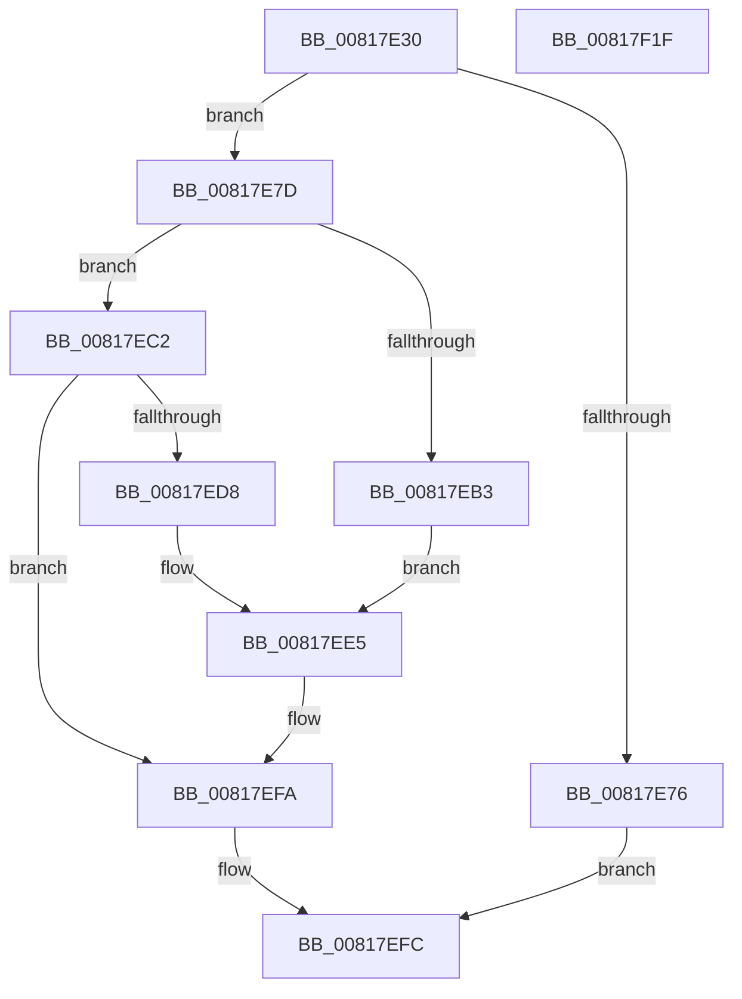

# SdbpGetPathAppPatch

- RVA: `0x00817E30`–`0x00817F20` (길이 `240` bytes)
- VA: `0x0000000140817E30`
- 실행 섹션: `PAGE`
- PDB 이름 있음: `예`; PDB Function 태그: `아니요`
- unwind 정보 RVA: `0x000D9B38`
- 디코드: `60`개 명령, `240/240` bytes 표시
- 미해석 바이트: `0` (있으면 어셈블리에 `.byte`로 보존)

> 이 문서는 커널 이미지의 기계어와 PDB 기호를 분석해 생성했습니다. 4번과 5번은 함수 원형과 자료형을 바이너리 사용 방식에서 추정한 C 해석이며 원본 소스 복구 결과는 아닙니다.

## 1. Dependencies

- 직접 호출 지점: **4**; 고유 호출 대상: **4**
- 직접 호출자로 확인된 함수: **4**
- RIP 상대 이미지 참조: **7**

### Outgoing calls
- `0x00817EA8` → [AslPathCombine](AslPathCombine_function_0081B100.md) (function, `0x0081B100`)
- `0x00817ECD` → [AslPathToSystemPathBuf](AslPathToSystemPathBuf_function_0081B430.md) (function, `0x0081B430`)
- `0x00817EF5` → [AslLogCallPrintf](../95/AslLogCallPrintf_function_0095E4EC.md) (function, `0x0095E4EC`)
- `0x00817F07` → [_security_check_cookie](../../text/6A/_security_check_cookie_function_006AC640.md) (function, `0x006AC640`)

### Direct callers
- [SdbpGetPathAppPatchPreRS3](../../text/69/SdbpGetPathAppPatchPreRS3_function_0069CCF0.md) at `0x0069CE41`
- [SdbpGetPathCustomSdbPreRS3](../../text/69/SdbpGetPathCustomSdbPreRS3_function_0069CE80.md) at `0x0069CFBE`
- [SdbpGetPathCustomSdb](SdbpGetPathCustomSdb_function_00818080.md) at `0x0081813F`
- [SdbpGetPathMergeSource](SdbpGetPathMergeSource_function_00818180.md) at `0x0081824F`

### Static image references
- `0x00817E3F` → RVA `0x00E0A740` (`.data`; read)
- `0x00817E51` → RVA `0x0003DD08` (`.rdata`; read)
- `0x00817E64` → RVA `0x0003DCF8` (`.rdata`; read)
- `0x00817E7F` → RVA `0x00013F90` (`.rdata`; read)
- `0x00817EB3` → RVA `0x0003DD10` (`.rdata`; read)
- `0x00817ED8` → RVA `0x0003DD48` (`.rdata`; read)
- `0x00817EE5` → RVA `0x0003DD30` (`.rdata`; read)

## 2. Other-region calls and transfers

- 다른 실행 섹션으로 향하는 call: **1**
  - `0x00817F07` → [_security_check_cookie](../../text/6A/_security_check_cookie_function_006AC640.md) (`PAGE` → `.text`)
- 별도 외부 분기/꼬리 이동을 확인하지 못했습니다.

## 3. Assembly (complete function range)

```asm
00817E30  48 89 5C 24 20                  mov qword ptr [rsp + 0x20], rbx
00817E35  55                              push rbp
00817E36  56                              push rsi
00817E37  57                              push rdi
00817E38  48 81 EC 70 02 00 00            sub rsp, 0x270
00817E3F  48 8B 05 FA 28 5F 00            mov rax, qword ptr [rip + 0x5f28fa]
00817E46  48 33 C4                        xor rax, rsp
00817E49  48 89 84 24 60 02 00 00         mov qword ptr [rsp + 0x260], rax
00817E51  8B 05 B1 5E 82 FF               mov eax, dword ptr [rip - 0x7da14f]
00817E57  4D 8B D0                        mov r10, r8
00817E5A  89 44 24 40                     mov dword ptr [rsp + 0x40], eax
00817E5E  48 8B F2                        mov rsi, rdx
00817E61  48 8B F9                        mov rdi, rcx
00817E64  0F 10 05 8D 5E 82 FF            movups xmm0, xmmword ptr [rip - 0x7da173]
00817E6B  0F 11 44 24 30                  movups xmmword ptr [rsp + 0x30], xmm0
00817E70  48 83 FA 0A                     cmp rdx, 0xa
00817E74  73 07                           jae 0x140817e7d
00817E76  B8 23 00 00 C0                  mov eax, 0xc0000023
00817E7B  EB 7F                           jmp 0x140817efc
00817E7D  33 ED                           xor ebp, ebp
00817E7F  48 8D 05 0A C1 7F FF            lea rax, [rip - 0x803ef6]
00817E86  4D 85 D2                        test r10, r10
00817E89  66 89 29                        mov word ptr [rcx], bp
00817E8C  41 B9 04 01 00 00               mov r9d, 0x104
00817E92  66 89 6C 24 50                  mov word ptr [rsp + 0x50], bp
00817E97  4C 0F 44 D0                     cmove r10, rax
00817E9B  4C 8D 44 24 50                  lea r8, [rsp + 0x50]
00817EA0  49 8B D2                        mov rdx, r10
00817EA3  48 8D 4C 24 30                  lea rcx, [rsp + 0x30]
00817EA8  E8 53 32 00 00                  call 0x14081b100
00817EAD  8B D8                           mov ebx, eax
00817EAF  85 C0                           test eax, eax
00817EB1  79 0F                           jns 0x140817ec2
00817EB3  4C 8D 0D 56 5E 82 FF            lea r9, [rip - 0x7da1aa]
00817EBA  41 B8 C5 03 00 00               mov r8d, 0x3c5
00817EC0  EB 23                           jmp 0x140817ee5
00817EC2  4C 8D 44 24 50                  lea r8, [rsp + 0x50]
00817EC7  48 8B D6                        mov rdx, rsi
00817ECA  48 8B CF                        mov rcx, rdi
00817ECD  E8 5E 35 00 00                  call 0x14081b430
00817ED2  8B D8                           mov ebx, eax
00817ED4  85 C0                           test eax, eax
00817ED6  79 22                           jns 0x140817efa
00817ED8  4C 8D 0D 69 5E 82 FF            lea r9, [rip - 0x7da197]
00817EDF  41 B8 CB 03 00 00               mov r8d, 0x3cb
00817EE5  48 8D 15 44 5E 82 FF            lea rdx, [rip - 0x7da1bc]
00817EEC  89 44 24 20                     mov dword ptr [rsp + 0x20], eax
00817EF0  B9 01 00 00 00                  mov ecx, 1
00817EF5  E8 F2 65 14 00                  call 0x14095e4ec
00817EFA  8B C3                           mov eax, ebx
00817EFC  48 8B 8C 24 60 02 00 00         mov rcx, qword ptr [rsp + 0x260]
00817F04  48 33 CC                        xor rcx, rsp
00817F07  E8 34 47 E9 FF                  call 0x1406ac640
00817F0C  48 8B 9C 24 A8 02 00 00         mov rbx, qword ptr [rsp + 0x2a8]
00817F14  48 81 C4 70 02 00 00            add rsp, 0x270
00817F1B  5F                              pop rdi
00817F1C  5E                              pop rsi
00817F1D  5D                              pop rbp
00817F1E  C3                              ret
00817F1F  CC                              int3
```

## 4. C-style interpretation (structured pseudocode)

```c
__int64 __fastcall SdbpGetPathAppPatch(__int64 a1, __int64 a2, __int64 a3)
{
    __int64 result;
    __int64 v_rbp;
    __int64 v_rsp;
    unsigned __int16 v_stack_m238;
    unsigned int v_stack_m248;
    unsigned __int64 v_stack_m258;
    unsigned int v_stack_m268;
    unsigned __int64 v_stack_m28;
    unsigned __int64 v_stack_p20;

    v_stack_p20 = v_rbx;
    v_rsp = (v_rsp) - (624);
    result = (*(unsigned __int64 *)(v_rip + 6236410)) ^ (v_rsp);
    v_stack_m28 = result;
    v_stack_m248 = (unsigned int)((unsigned int)(*(unsigned int *)(v_rip - 8233295)));
    v_stack_m258 = v_xmm0;
    if (a2 >= 10) goto loc_00817E7D;
    goto loc_00817EFC;
loc_00817E7D:
    v_rbp = 0;
    *(unsigned __int16 *)(a1) = 0;
    v_stack_m238 = 0;
    if (a3 == 0) { a3 = v_rip - 8404726; }
    result = AslPathCombine(v_stack_m258, a3, v_stack_m238, 260);
    if (!sign_flag) goto loc_00817EC2;
    goto loc_00817EE5;
loc_00817EC2:
    result = AslPathToSystemPathBuf(a1, a2, v_stack_m238, v_rip - 8233386);
    if (!sign_flag) goto loc_00817EFA;
loc_00817EE5:
    v_stack_m268 = (unsigned int)(result);
    result = AslLogCallPrintf(1, v_rip - 8233404, 971, v_rip - 8233367);
loc_00817EFA:
loc_00817EFC:
    a1 = (v_stack_m28) ^ (v_rsp);
    result = _security_check_cookie(a1, v_rip - 8233404, 971, v_rip - 8233367);
    v_rsp = (v_rsp) + (624);
    return result;
}
```

## 5. (Beta) C Style

```c
int64_t SdbpGetPathAppPatch(void *Arg1, int64_t Arg2, int64_t Arg3)
{
    uint8_t *arg1 = (uint8_t *)Arg1;

    int64_t result;
    int64_t local_rbp;
    int64_t local_rsp;
    uint16_t v_stack_m238;
    uint32_t v_stack_m248;
    uint64_t v_stack_m258;
    uint32_t v_stack_m268;
    uint64_t v_stack_m28;
    uint64_t v_stack_p20;

    v_stack_p20 = local_rbx;
    local_rsp = (local_rsp) - (624);
    result = (*(uint64_t *)(v_rip + 0x5F28FA)) ^ (local_rsp);
    v_stack_m28 = result;
    v_stack_m248 = (uint32_t)((uint32_t)(*(uint32_t *)(v_rip - 0x7DA14F)));
    v_stack_m258 = v_xmm0;
    if (Arg2 >= 10) goto loc_00817E7D;
    goto loc_00817EFC;
loc_00817E7D:
    local_rbp = 0;
    *(uint16_t *)(arg1) = 0;
    v_stack_m238 = 0;
    if (Arg3 == 0) { Arg3 = v_rip - 8404726; }
    result = AslPathCombine(v_stack_m258, Arg3, v_stack_m238, 260);
    if (!sign_flag) goto loc_00817EC2;
    goto loc_00817EE5;
loc_00817EC2:
    result = AslPathToSystemPathBuf(Arg1, Arg2, v_stack_m238, v_rip - 8233386);
    if (!sign_flag) goto loc_00817EFA;
loc_00817EE5:
    v_stack_m268 = (uint32_t)(result);
    result = AslLogCallPrintf(1, v_rip - 8233404, 971, v_rip - 8233367);
loc_00817EFA:
loc_00817EFC:
    Arg1 = (v_stack_m28) ^ (local_rsp);
    result = _security_check_cookie(Arg1, v_rip - 8233404, 971, v_rip - 8233367);
    local_rsp = (local_rsp) + (624);
    return result;
}
```

### 관측된 메모리 오프셋

구조체 형식이 확인되지 않은 접근은 인자 기준의 오프셋으로만 기록했습니다.

| 기준 인자 | 오프셋 표현 | 폭 (bit) | 접근 |
|---|---:|---:|---|
| `Arg1` | `+ 0x0` | `16` | `W` |

## 6. Execution-region graph

[열기: 2D/3D 그래프와 함수 탐색 컨트롤 패널](../../../control-panel.html?section=page&rva=0x00817E30&view=graph)

- 2D 그래프는 위에서 아래로 흐르고, 3D 그래프는 빈 공간을 드래그해 회전합니다. Shift+드래그는 이동, 휠은 확대·축소, 함수 노드 선택은 대상 보고서 이동입니다.

### Static fallback


