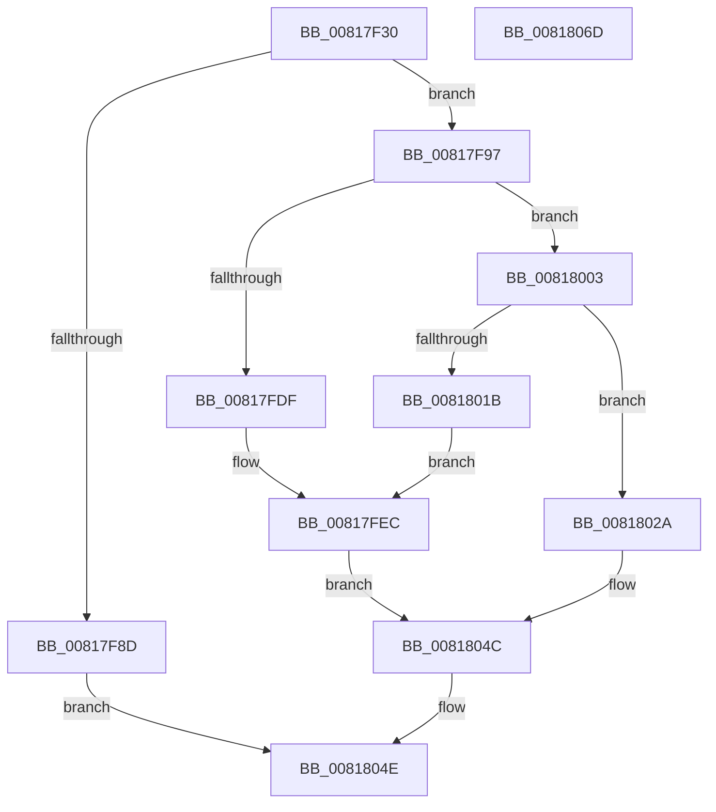

# SdbpGetPathAppraiser

- RVA: `0x00817F30`–`0x0081806E` (길이 `318` bytes)
- VA: `0x0000000140817F30`
- 실행 섹션: `PAGE`
- PDB 이름 있음: `예`; PDB Function 태그: `아니요`
- unwind 정보 RVA: `0x000D9B58`
- 디코드: `80`개 명령, `318/318` bytes 표시
- 미해석 바이트: `0` (있으면 어셈블리에 `.byte`로 보존)

> 이 문서는 커널 이미지의 기계어와 PDB 기호를 분석해 생성했습니다. 4번과 5번은 함수 원형과 자료형을 바이너리 사용 방식에서 추정한 C 해석이며 원본 소스 복구 결과는 아닙니다.

## 1. Dependencies

- 직접 호출 지점: **5**; 고유 호출 대상: **5**
- 직접 호출자로 확인된 함수: **0**
- RIP 상대 이미지 참조: **8**

### Outgoing calls
- `0x00817FD4` → [AslPathCombine](AslPathCombine_function_0081B100.md) (function, `0x0081B100`)
- `0x00817FFC` → [AslLogCallPrintf](../95/AslLogCallPrintf_function_0095E4EC.md) (function, `0x0095E4EC`)
- `0x00818010` → [SdbpGetProcessHostGuestArchitectures](SdbpGetProcessHostGuestArchitectures_function_00818350.md) (function, `0x00818350`)
- `0x00818045` → [AslEnvGetSysNativeDirPathForGuestBuf](AslEnvGetSysNativeDirPathForGuestBuf_function_0081D184.md) (function, `0x0081D184`)
- `0x00818058` → [_security_check_cookie](../../text/6A/_security_check_cookie_function_006AC640.md) (function, `0x006AC640`)

### Direct callers
- 이 함수 시작 RVA로 연결되는 직접 call은 확인되지 않았습니다. 간접 호출은 완전히 역산할 수 없습니다.

### Static image references
- `0x00817F48` → RVA `0x00E0A740` (`.data`; read)
- `0x00817F59` → RVA `0x0003DA68` (`.rdata`; read)
- `0x00817F69` → RVA `0x0003DA6C` (`.rdata`; read)
- `0x00817F7B` → RVA `0x0003DA58` (`.rdata`; read)
- `0x00817FBA` → RVA `0x00013F90` (`.rdata`; read)
- `0x00817FDF` → RVA `0x0003DD10` (`.rdata`; read)
- `0x00817FEC` → RVA `0x0003DA70` (`.rdata`; read)
- `0x0081801B` → RVA `0x0003DD88` (`.rdata`; read)

## 2. Other-region calls and transfers

- 다른 실행 섹션으로 향하는 call: **1**
  - `0x00818058` → [_security_check_cookie](../../text/6A/_security_check_cookie_function_006AC640.md) (`PAGE` → `.text`)
- 별도 외부 분기/꼬리 이동을 확인하지 못했습니다.

## 3. Assembly (complete function range)

```asm
00817F30  40 55                           push rbp
00817F32  53                              push rbx
00817F33  56                              push rsi
00817F34  57                              push rdi
00817F35  41 56                           push r14
00817F37  41 57                           push r15
00817F39  48 8D AC 24 88 FE FF FF         lea rbp, [rsp - 0x178]
00817F41  48 81 EC 78 02 00 00            sub rsp, 0x278
00817F48  48 8B 05 F1 27 5F 00            mov rax, qword ptr [rip + 0x5f27f1]
00817F4F  48 33 C4                        xor rax, rsp
00817F52  48 89 85 60 01 00 00            mov qword ptr [rbp + 0x160], rax
00817F59  8B 05 09 5B 82 FF               mov eax, dword ptr [rip - 0x7da4f7]
00817F5F  4D 8B F1                        mov r14, r9
00817F62  89 44 24 48                     mov dword ptr [rsp + 0x48], eax
00817F66  4D 8B D0                        mov r10, r8
00817F69  0F B7 05 FC 5A 82 FF            movzx eax, word ptr [rip - 0x7da504]
00817F70  48 8B F2                        mov rsi, rdx
00817F73  66 89 44 24 4C                  mov word ptr [rsp + 0x4c], ax
00817F78  48 8B F9                        mov rdi, rcx
00817F7B  0F 10 05 D6 5A 82 FF            movups xmm0, xmmword ptr [rip - 0x7da52a]
00817F82  0F 11 44 24 38                  movups xmmword ptr [rsp + 0x38], xmm0
00817F87  48 83 FA 0B                     cmp rdx, 0xb
00817F8B  73 0A                           jae 0x140817f97
00817F8D  B8 23 00 00 C0                  mov eax, 0xc0000023
00817F92  E9 B7 00 00 00                  jmp 0x14081804e
00817F97  45 33 FF                        xor r15d, r15d
00817F9A  4C 8D 44 24 50                  lea r8, [rsp + 0x50]
00817F9F  B8 FF FF 00 00                  mov eax, 0xffff
00817FA4  66 44 89 39                     mov word ptr [rcx], r15w
00817FA8  66 89 44 24 34                  mov word ptr [rsp + 0x34], ax
00817FAD  48 8D 4C 24 38                  lea rcx, [rsp + 0x38]
00817FB2  66 89 44 24 30                  mov word ptr [rsp + 0x30], ax
00817FB7  4D 85 D2                        test r10, r10
00817FBA  48 8D 05 CF BF 7F FF            lea rax, [rip - 0x804031]
00817FC1  66 44 89 7C 24 50               mov word ptr [rsp + 0x50], r15w
00817FC7  4C 0F 44 D0                     cmove r10, rax
00817FCB  41 B9 04 01 00 00               mov r9d, 0x104
00817FD1  49 8B D2                        mov rdx, r10
00817FD4  E8 27 31 00 00                  call 0x14081b100
00817FD9  8B D8                           mov ebx, eax
00817FDB  85 C0                           test eax, eax
00817FDD  79 24                           jns 0x140818003
00817FDF  4C 8D 0D 2A 5D 82 FF            lea r9, [rip - 0x7da2d6]
00817FE6  41 B8 23 05 00 00               mov r8d, 0x523
00817FEC  48 8D 15 7D 5A 82 FF            lea rdx, [rip - 0x7da583]
00817FF3  89 44 24 20                     mov dword ptr [rsp + 0x20], eax
00817FF7  B9 01 00 00 00                  mov ecx, 1
00817FFC  E8 EB 64 14 00                  call 0x14095e4ec
00818001  EB 49                           jmp 0x14081804c
00818003  4D 8B C6                        mov r8, r14
00818006  48 8D 54 24 30                  lea rdx, [rsp + 0x30]
0081800B  48 8D 4C 24 34                  lea rcx, [rsp + 0x34]
00818010  E8 3B 03 00 00                  call 0x140818350
00818015  8B D8                           mov ebx, eax
00818017  85 C0                           test eax, eax
00818019  79 0F                           jns 0x14081802a
0081801B  4C 8D 0D 66 5D 82 FF            lea r9, [rip - 0x7da29a]
00818022  41 B8 29 05 00 00               mov r8d, 0x529
00818028  EB C2                           jmp 0x140817fec
0081802A  44 0F B7 4C 24 34               movzx r9d, word ptr [rsp + 0x34]
00818030  48 8D 44 24 30                  lea rax, [rsp + 0x30]
00818035  4C 8D 44 24 50                  lea r8, [rsp + 0x50]
0081803A  48 89 44 24 20                  mov qword ptr [rsp + 0x20], rax
0081803F  48 8B D6                        mov rdx, rsi
00818042  48 8B CF                        mov rcx, rdi
00818045  E8 3A 51 00 00                  call 0x14081d184
0081804A  8B D8                           mov ebx, eax
0081804C  8B C3                           mov eax, ebx
0081804E  48 8B 8D 60 01 00 00            mov rcx, qword ptr [rbp + 0x160]
00818055  48 33 CC                        xor rcx, rsp
00818058  E8 E3 45 E9 FF                  call 0x1406ac640
0081805D  48 81 C4 78 02 00 00            add rsp, 0x278
00818064  41 5F                           pop r15
00818066  41 5E                           pop r14
00818068  5F                              pop rdi
00818069  5E                              pop rsi
0081806A  5B                              pop rbx
0081806B  5D                              pop rbp
0081806C  C3                              ret
0081806D  CC                              int3
```

## 4. C-style interpretation (structured pseudocode)

```c
__int64 __fastcall SdbpGetPathAppraiser(__int64 a1, __int64 a2, __int64 a3, __int64 a4)
{
    __int64 result;
    __int64 v_r15;
    __int64 v_rsp;
    unsigned __int64 v_stack_m1A8;
    unsigned __int64 v_stack_m258;
    unsigned __int16 v_stack_m25C;
    unsigned int v_stack_m260;
    unsigned __int64 v_stack_m270;
    unsigned __int16 v_stack_m274;
    unsigned __int16 v_stack_m278;
    unsigned int v_stack_m288;
    unsigned __int64 v_stack_m48;

    v_rsp = (v_rsp) - (632);
    result = (*(unsigned __int64 *)(v_rip + 6236145)) ^ (v_rsp);
    v_stack_m48 = result;
    v_stack_m260 = (unsigned int)((unsigned int)(*(unsigned int *)(v_rip - 8234231)));
    v_stack_m25C = (unsigned __int16)(*(unsigned __int16 *)(v_rip - 8234244));
    v_stack_m270 = v_xmm0;
    if (a2 >= 11) goto loc_00817F97;
    goto loc_0081804E;
loc_00817F97:
    v_r15 = 0;
    *(unsigned __int16 *)(a1) = 0;
    v_stack_m274 = (unsigned __int16)((unsigned int)(0xFFFFULL));
    v_stack_m278 = (unsigned __int16)((unsigned int)(0xFFFFULL));
    v_stack_m258 = 0;
    if (a3 == 0) { a3 = v_rip - 8405041; }
    result = AslPathCombine(v_stack_m270, a3, v_stack_m258, 260);
    if (!sign_flag) goto loc_00818003;
loc_00817FEC:
    v_stack_m288 = (unsigned int)(result);
    result = AslLogCallPrintf(1, v_rip - 8234371, (unsigned int)(0x523ULL), v_rip - 8233686);
    goto loc_0081804C;
loc_00818003:
    result = SdbpGetProcessHostGuestArchitectures(v_stack_m274, v_stack_m278, a4, v_rip - 8233686);
    if (!sign_flag) goto loc_0081802A;
    goto loc_00817FEC;
loc_0081802A:
    v_stack_m288 = v_stack_m278;
    result = AslEnvGetSysNativeDirPathForGuestBuf(a1, a2, v_stack_m258, v_stack_m274);
loc_0081804C:
loc_0081804E:
    a1 = (v_stack_m48) ^ (v_rsp);
    result = _security_check_cookie(a1, a2, v_stack_m258, v_stack_m274);
    v_rsp = (v_rsp) + (632);
    return result;
}
```

## 5. (Beta) C Style

```c
int64_t SdbpGetPathAppraiser(void *Arg1, int64_t Arg2, int64_t Arg3, int64_t Arg4)
{
    uint8_t *arg1 = (uint8_t *)Arg1;

    int64_t result;
    int64_t local_r15;
    int64_t local_rsp;
    uint64_t v_stack_m1A8;
    uint64_t v_stack_m258;
    uint16_t v_stack_m25C;
    uint32_t v_stack_m260;
    uint64_t v_stack_m270;
    uint16_t v_stack_m274;
    uint16_t v_stack_m278;
    uint32_t v_stack_m288;
    uint64_t v_stack_m48;

    local_rsp = (local_rsp) - (632);
    result = (*(uint64_t *)(v_rip + 0x5F27F1)) ^ (local_rsp);
    v_stack_m48 = result;
    v_stack_m260 = (uint32_t)((uint32_t)(*(uint32_t *)(v_rip - 0x7DA4F7)));
    v_stack_m25C = (uint16_t)(*(uint16_t *)(v_rip - 0x7DA504));
    v_stack_m270 = v_xmm0;
    if (Arg2 >= 11) goto loc_00817F97;
    goto loc_0081804E;
loc_00817F97:
    local_r15 = 0;
    *(uint16_t *)(arg1) = 0;
    v_stack_m274 = (uint16_t)((uint32_t)(0xFFFFULL));
    v_stack_m278 = (uint16_t)((uint32_t)(0xFFFFULL));
    v_stack_m258 = 0;
    if (Arg3 == 0) { Arg3 = v_rip - 8405041; }
    result = AslPathCombine(v_stack_m270, Arg3, v_stack_m258, 260);
    if (!sign_flag) goto loc_00818003;
loc_00817FEC:
    v_stack_m288 = (uint32_t)(result);
    result = AslLogCallPrintf(1, v_rip - 8234371, (uint32_t)(0x523ULL), v_rip - 8233686);
    goto loc_0081804C;
loc_00818003:
    result = SdbpGetProcessHostGuestArchitectures(v_stack_m274, v_stack_m278, Arg4, v_rip - 8233686);
    if (!sign_flag) goto loc_0081802A;
    goto loc_00817FEC;
loc_0081802A:
    v_stack_m288 = v_stack_m278;
    result = AslEnvGetSysNativeDirPathForGuestBuf(Arg1, Arg2, v_stack_m258, v_stack_m274);
loc_0081804C:
loc_0081804E:
    Arg1 = (v_stack_m48) ^ (local_rsp);
    result = _security_check_cookie(Arg1, Arg2, v_stack_m258, v_stack_m274);
    local_rsp = (local_rsp) + (632);
    return result;
}
```

### 관측된 메모리 오프셋

구조체 형식이 확인되지 않은 접근은 인자 기준의 오프셋으로만 기록했습니다.

| 기준 인자 | 오프셋 표현 | 폭 (bit) | 접근 |
|---|---:|---:|---|
| `Arg1` | `+ 0x0` | `16` | `W` |

## 6. Execution-region graph

[열기: 2D/3D 그래프와 함수 탐색 컨트롤 패널](../../../control-panel.html?section=page&rva=0x00817F30&view=graph)

- 2D 그래프는 위에서 아래로 흐르고, 3D 그래프는 빈 공간을 드래그해 회전합니다. Shift+드래그는 이동, 휠은 확대·축소, 함수 노드 선택은 대상 보고서 이동입니다.

### Static fallback


