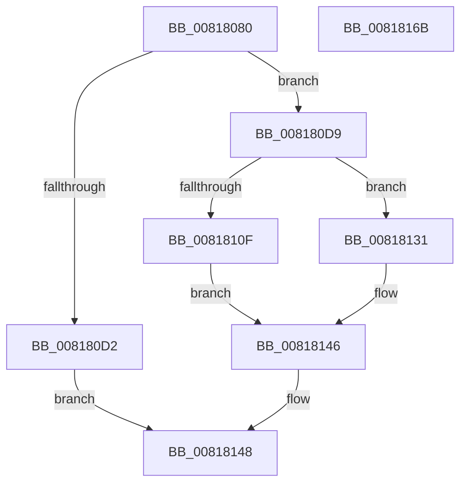

# SdbpGetPathCustomSdb

- RVA: `0x00818080`–`0x0081816C` (길이 `236` bytes)
- VA: `0x0000000140818080`
- 실행 섹션: `PAGE`
- PDB 이름 있음: `예`; PDB Function 태그: `아니요`
- unwind 정보 RVA: `0x000D9B38`
- 디코드: `59`개 명령, `236/236` bytes 표시
- 미해석 바이트: `0` (있으면 어셈블리에 `.byte`로 보존)

> 이 문서는 커널 이미지의 기계어와 PDB 기호를 분석해 생성했습니다. 4번과 5번은 함수 원형과 자료형을 바이너리 사용 방식에서 추정한 C 해석이며 원본 소스 복구 결과는 아닙니다.

## 1. Dependencies

- 직접 호출 지점: **4**; 고유 호출 대상: **4**
- 직접 호출자로 확인된 함수: **0**
- RIP 상대 이미지 참조: **7**

### Outgoing calls
- `0x00818104` → [AslPathCombine](AslPathCombine_function_0081B100.md) (function, `0x0081B100`)
- `0x0081812A` → [AslLogCallPrintf](../95/AslLogCallPrintf_function_0095E4EC.md) (function, `0x0095E4EC`)
- `0x0081813F` → [SdbpGetPathAppPatch](SdbpGetPathAppPatch_function_00817E30.md) (function, `0x00817E30`)
- `0x00818153` → [_security_check_cookie](../../text/6A/_security_check_cookie_function_006AC640.md) (function, `0x006AC640`)

### Direct callers
- 이 함수 시작 RVA로 연결되는 직접 call은 확인되지 않았습니다. 간접 호출은 완전히 역산할 수 없습니다.

### Static image references
- `0x0081808F` → RVA `0x00E0A740` (`.data`; read)
- `0x008180A1` → RVA `0x0003D9E8` (`.rdata`; read)
- `0x008180B1` → RVA `0x0003D9EC` (`.rdata`; read)
- `0x008180C0` → RVA `0x0003D9D8` (`.rdata`; read)
- `0x008180DB` → RVA `0x00013F90` (`.rdata`; read)
- `0x0081810F` → RVA `0x0003DD10` (`.rdata`; read)
- `0x00818120` → RVA `0x0003D9F0` (`.rdata`; read)

## 2. Other-region calls and transfers

- 다른 실행 섹션으로 향하는 call: **1**
  - `0x00818153` → [_security_check_cookie](../../text/6A/_security_check_cookie_function_006AC640.md) (`PAGE` → `.text`)
- 별도 외부 분기/꼬리 이동을 확인하지 못했습니다.

## 3. Assembly (complete function range)

```asm
00818080  48 89 5C 24 20                  mov qword ptr [rsp + 0x20], rbx
00818085  55                              push rbp
00818086  56                              push rsi
00818087  57                              push rdi
00818088  48 81 EC 70 02 00 00            sub rsp, 0x270
0081808F  48 8B 05 AA 26 5F 00            mov rax, qword ptr [rip + 0x5f26aa]
00818096  48 33 C4                        xor rax, rsp
00818099  48 89 84 24 60 02 00 00         mov qword ptr [rsp + 0x260], rax
008180A1  8B 05 41 59 82 FF               mov eax, dword ptr [rip - 0x7da6bf]
008180A7  4D 8B D0                        mov r10, r8
008180AA  89 44 24 40                     mov dword ptr [rsp + 0x40], eax
008180AE  48 8B F2                        mov rsi, rdx
008180B1  0F B7 05 34 59 82 FF            movzx eax, word ptr [rip - 0x7da6cc]
008180B8  48 8B F9                        mov rdi, rcx
008180BB  66 89 44 24 44                  mov word ptr [rsp + 0x44], ax
008180C0  0F 10 05 11 59 82 FF            movups xmm0, xmmword ptr [rip - 0x7da6ef]
008180C7  0F 11 44 24 30                  movups xmmword ptr [rsp + 0x30], xmm0
008180CC  48 83 FA 0B                     cmp rdx, 0xb
008180D0  73 07                           jae 0x1408180d9
008180D2  B8 23 00 00 C0                  mov eax, 0xc0000023
008180D7  EB 6F                           jmp 0x140818148
008180D9  33 ED                           xor ebp, ebp
008180DB  48 8D 05 AE BE 7F FF            lea rax, [rip - 0x804152]
008180E2  4D 85 D2                        test r10, r10
008180E5  66 89 29                        mov word ptr [rcx], bp
008180E8  41 B9 04 01 00 00               mov r9d, 0x104
008180EE  66 89 6C 24 50                  mov word ptr [rsp + 0x50], bp
008180F3  4C 0F 44 D0                     cmove r10, rax
008180F7  4C 8D 44 24 50                  lea r8, [rsp + 0x50]
008180FC  49 8B D2                        mov rdx, r10
008180FF  48 8D 4C 24 30                  lea rcx, [rsp + 0x30]
00818104  E8 F7 2F 00 00                  call 0x14081b100
00818109  8B D8                           mov ebx, eax
0081810B  85 C0                           test eax, eax
0081810D  79 22                           jns 0x140818131
0081810F  4C 8D 0D FA 5B 82 FF            lea r9, [rip - 0x7da406]
00818116  89 44 24 20                     mov dword ptr [rsp + 0x20], eax
0081811A  41 B8 B2 04 00 00               mov r8d, 0x4b2
00818120  48 8D 15 C9 58 82 FF            lea rdx, [rip - 0x7da737]
00818127  8D 4D 01                        lea ecx, [rbp + 1]
0081812A  E8 BD 63 14 00                  call 0x14095e4ec
0081812F  EB 15                           jmp 0x140818146
00818131  45 33 C9                        xor r9d, r9d
00818134  4C 8D 44 24 50                  lea r8, [rsp + 0x50]
00818139  48 8B D6                        mov rdx, rsi
0081813C  48 8B CF                        mov rcx, rdi
0081813F  E8 EC FC FF FF                  call 0x140817e30
00818144  8B D8                           mov ebx, eax
00818146  8B C3                           mov eax, ebx
00818148  48 8B 8C 24 60 02 00 00         mov rcx, qword ptr [rsp + 0x260]
00818150  48 33 CC                        xor rcx, rsp
00818153  E8 E8 44 E9 FF                  call 0x1406ac640
00818158  48 8B 9C 24 A8 02 00 00         mov rbx, qword ptr [rsp + 0x2a8]
00818160  48 81 C4 70 02 00 00            add rsp, 0x270
00818167  5F                              pop rdi
00818168  5E                              pop rsi
00818169  5D                              pop rbp
0081816A  C3                              ret
0081816B  CC                              int3
```

## 4. C-style interpretation (structured pseudocode)

```c
__int64 __fastcall SdbpGetPathCustomSdb(__int64 a1, __int64 a2, __int64 a3)
{
    __int64 result;
    __int64 v_rbp;
    __int64 v_rsp;
    unsigned __int16 v_stack_m238;
    unsigned __int16 v_stack_m244;
    unsigned int v_stack_m248;
    unsigned __int64 v_stack_m258;
    unsigned int v_stack_m268;
    unsigned __int64 v_stack_m28;
    unsigned __int64 v_stack_p20;

    v_stack_p20 = v_rbx;
    v_rsp = (v_rsp) - (624);
    result = (*(unsigned __int64 *)(v_rip + 6235818)) ^ (v_rsp);
    v_stack_m28 = result;
    v_stack_m248 = (unsigned int)((unsigned int)(*(unsigned int *)(v_rip - 8234687)));
    v_stack_m244 = (unsigned __int16)(*(unsigned __int16 *)(v_rip - 8234700));
    v_stack_m258 = v_xmm0;
    if (a2 >= 11) goto loc_008180D9;
    goto loc_00818148;
loc_008180D9:
    v_rbp = 0;
    *(unsigned __int16 *)(a1) = 0;
    v_stack_m238 = 0;
    if (a3 == 0) { a3 = v_rip - 8405330; }
    result = AslPathCombine(v_stack_m258, a3, v_stack_m238, 260);
    if (!sign_flag) goto loc_00818131;
    v_stack_m268 = (unsigned int)(result);
    result = AslLogCallPrintf(v_rbp + 1, v_rip - 8234807, (unsigned int)(0x4B2ULL), v_rip - 8233990);
    goto loc_00818146;
loc_00818131:
    a4 = 0;
    result = SdbpGetPathAppPatch(a1, a2, v_stack_m238, a4);
loc_00818146:
loc_00818148:
    a1 = (v_stack_m28) ^ (v_rsp);
    result = _security_check_cookie(a1, a2, v_stack_m238, a4);
    v_rsp = (v_rsp) + (624);
    return result;
}
```

## 5. (Beta) C Style

```c
int64_t SdbpGetPathCustomSdb(void *Arg1, int64_t Arg2, int64_t Arg3)
{
    uint8_t *arg1 = (uint8_t *)Arg1;

    int64_t result;
    int64_t local_rbp;
    int64_t local_rsp;
    uint16_t v_stack_m238;
    uint16_t v_stack_m244;
    uint32_t v_stack_m248;
    uint64_t v_stack_m258;
    uint32_t v_stack_m268;
    uint64_t v_stack_m28;
    uint64_t v_stack_p20;

    v_stack_p20 = local_rbx;
    local_rsp = (local_rsp) - (624);
    result = (*(uint64_t *)(v_rip + 0x5F26AA)) ^ (local_rsp);
    v_stack_m28 = result;
    v_stack_m248 = (uint32_t)((uint32_t)(*(uint32_t *)(v_rip - 0x7DA6BF)));
    v_stack_m244 = (uint16_t)(*(uint16_t *)(v_rip - 0x7DA6CC));
    v_stack_m258 = v_xmm0;
    if (Arg2 >= 11) goto loc_008180D9;
    goto loc_00818148;
loc_008180D9:
    local_rbp = 0;
    *(uint16_t *)(arg1) = 0;
    v_stack_m238 = 0;
    if (Arg3 == 0) { Arg3 = v_rip - 8405330; }
    result = AslPathCombine(v_stack_m258, Arg3, v_stack_m238, 260);
    if (!sign_flag) goto loc_00818131;
    v_stack_m268 = (uint32_t)(result);
    result = AslLogCallPrintf(local_rbp + 1, v_rip - 8234807, (uint32_t)(0x4B2ULL), v_rip - 8233990);
    goto loc_00818146;
loc_00818131:
    a4 = 0;
    result = SdbpGetPathAppPatch(Arg1, Arg2, v_stack_m238, a4);
loc_00818146:
loc_00818148:
    Arg1 = (v_stack_m28) ^ (local_rsp);
    result = _security_check_cookie(Arg1, Arg2, v_stack_m238, a4);
    local_rsp = (local_rsp) + (624);
    return result;
}
```

### 관측된 메모리 오프셋

구조체 형식이 확인되지 않은 접근은 인자 기준의 오프셋으로만 기록했습니다.

| 기준 인자 | 오프셋 표현 | 폭 (bit) | 접근 |
|---|---:|---:|---|
| `Arg1` | `+ 0x0` | `16` | `W` |

## 6. Execution-region graph

[열기: 2D/3D 그래프와 함수 탐색 컨트롤 패널](../../../control-panel.html?section=page&rva=0x00818080&view=graph)

- 2D 그래프는 위에서 아래로 흐르고, 3D 그래프는 빈 공간을 드래그해 회전합니다. Shift+드래그는 이동, 휠은 확대·축소, 함수 노드 선택은 대상 보고서 이동입니다.

### Static fallback


