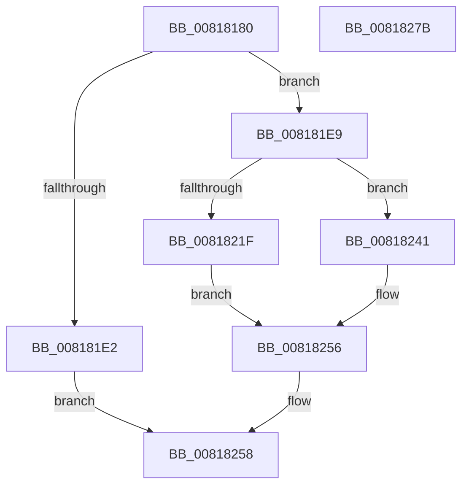

# SdbpGetPathMergeSource

- RVA: `0x00818180`–`0x0081827C` (길이 `252` bytes)
- VA: `0x0000000140818180`
- 실행 섹션: `PAGE`
- PDB 이름 있음: `예`; PDB Function 태그: `아니요`
- unwind 정보 RVA: `0x000D9B78`
- 디코드: `61`개 명령, `252/252` bytes 표시
- 미해석 바이트: `0` (있으면 어셈블리에 `.byte`로 보존)

> 이 문서는 커널 이미지의 기계어와 PDB 기호를 분석해 생성했습니다. 4번과 5번은 함수 원형과 자료형을 바이너리 사용 방식에서 추정한 C 해석이며 원본 소스 복구 결과는 아닙니다.

## 1. Dependencies

- 직접 호출 지점: **4**; 고유 호출 대상: **4**
- 직접 호출자로 확인된 함수: **0**
- RIP 상대 이미지 참조: **8**

### Outgoing calls
- `0x00818214` → [AslPathCombine](AslPathCombine_function_0081B100.md) (function, `0x0081B100`)
- `0x0081823A` → [AslLogCallPrintf](../95/AslLogCallPrintf_function_0095E4EC.md) (function, `0x0095E4EC`)
- `0x0081824F` → [SdbpGetPathAppPatch](SdbpGetPathAppPatch_function_00817E30.md) (function, `0x00817E30`)
- `0x00818263` → [_security_check_cookie](../../text/6A/_security_check_cookie_function_006AC640.md) (function, `0x006AC640`)

### Direct callers
- 이 함수 시작 RVA로 연결되는 직접 call은 확인되지 않았습니다. 간접 호출은 완전히 역산할 수 없습니다.

### Static image references
- `0x0081818F` → RVA `0x00E0A740` (`.data`; read)
- `0x008181A1` → RVA `0x0003D9B8` (`.rdata`; read)
- `0x008181B6` → RVA `0x0003D990` (`.rdata`; read)
- `0x008181BD` → RVA `0x0003D9A0` (`.rdata`; read)
- `0x008181C9` → RVA `0x0003D9B0` (`.rdata`; read)
- `0x008181EB` → RVA `0x00013F90` (`.rdata`; read)
- `0x0081821F` → RVA `0x0003DD10` (`.rdata`; read)
- `0x00818230` → RVA `0x0003D9C0` (`.rdata`; read)

## 2. Other-region calls and transfers

- 다른 실행 섹션으로 향하는 call: **1**
  - `0x00818263` → [_security_check_cookie](../../text/6A/_security_check_cookie_function_006AC640.md) (`PAGE` → `.text`)
- 별도 외부 분기/꼬리 이동을 확인하지 못했습니다.

## 3. Assembly (complete function range)

```asm
00818180  48 89 5C 24 20                  mov qword ptr [rsp + 0x20], rbx
00818185  55                              push rbp
00818186  56                              push rsi
00818187  57                              push rdi
00818188  48 81 EC 80 02 00 00            sub rsp, 0x280
0081818F  48 8B 05 AA 25 5F 00            mov rax, qword ptr [rip + 0x5f25aa]
00818196  48 33 C4                        xor rax, rsp
00818199  48 89 84 24 70 02 00 00         mov qword ptr [rsp + 0x270], rax
008181A1  0F B7 05 10 58 82 FF            movzx eax, word ptr [rip - 0x7da7f0]
008181A8  4D 8B D0                        mov r10, r8
008181AB  66 89 44 24 58                  mov word ptr [rsp + 0x58], ax
008181B0  48 8B F2                        mov rsi, rdx
008181B3  48 8B F9                        mov rdi, rcx
008181B6  0F 10 05 D3 57 82 FF            movups xmm0, xmmword ptr [rip - 0x7da82d]
008181BD  0F 10 0D DC 57 82 FF            movups xmm1, xmmword ptr [rip - 0x7da824]
008181C4  0F 11 44 24 30                  movups xmmword ptr [rsp + 0x30], xmm0
008181C9  F2 0F 10 05 DF 57 82 FF         movsd xmm0, qword ptr [rip - 0x7da821]
008181D1  F2 0F 11 44 24 50               movsd qword ptr [rsp + 0x50], xmm0
008181D7  0F 11 4C 24 40                  movups xmmword ptr [rsp + 0x40], xmm1
008181DC  48 83 FA 15                     cmp rdx, 0x15
008181E0  73 07                           jae 0x1408181e9
008181E2  B8 23 00 00 C0                  mov eax, 0xc0000023
008181E7  EB 6F                           jmp 0x140818258
008181E9  33 ED                           xor ebp, ebp
008181EB  48 8D 05 9E BD 7F FF            lea rax, [rip - 0x804262]
008181F2  4D 85 D2                        test r10, r10
008181F5  66 89 29                        mov word ptr [rcx], bp
008181F8  41 B9 04 01 00 00               mov r9d, 0x104
008181FE  66 89 6C 24 60                  mov word ptr [rsp + 0x60], bp
00818203  4C 0F 44 D0                     cmove r10, rax
00818207  4C 8D 44 24 60                  lea r8, [rsp + 0x60]
0081820C  49 8B D2                        mov rdx, r10
0081820F  48 8D 4C 24 30                  lea rcx, [rsp + 0x30]
00818214  E8 E7 2E 00 00                  call 0x14081b100
00818219  8B D8                           mov ebx, eax
0081821B  85 C0                           test eax, eax
0081821D  79 22                           jns 0x140818241
0081821F  4C 8D 0D EA 5A 82 FF            lea r9, [rip - 0x7da516]
00818226  89 44 24 20                     mov dword ptr [rsp + 0x20], eax
0081822A  41 B8 7C 04 00 00               mov r8d, 0x47c
00818230  48 8D 15 89 57 82 FF            lea rdx, [rip - 0x7da877]
00818237  8D 4D 01                        lea ecx, [rbp + 1]
0081823A  E8 AD 62 14 00                  call 0x14095e4ec
0081823F  EB 15                           jmp 0x140818256
00818241  45 33 C9                        xor r9d, r9d
00818244  4C 8D 44 24 60                  lea r8, [rsp + 0x60]
00818249  48 8B D6                        mov rdx, rsi
0081824C  48 8B CF                        mov rcx, rdi
0081824F  E8 DC FB FF FF                  call 0x140817e30
00818254  8B D8                           mov ebx, eax
00818256  8B C3                           mov eax, ebx
00818258  48 8B 8C 24 70 02 00 00         mov rcx, qword ptr [rsp + 0x270]
00818260  48 33 CC                        xor rcx, rsp
00818263  E8 D8 43 E9 FF                  call 0x1406ac640
00818268  48 8B 9C 24 B8 02 00 00         mov rbx, qword ptr [rsp + 0x2b8]
00818270  48 81 C4 80 02 00 00            add rsp, 0x280
00818277  5F                              pop rdi
00818278  5E                              pop rsi
00818279  5D                              pop rbp
0081827A  C3                              ret
0081827B  CC                              int3
```

## 4. C-style interpretation (structured pseudocode)

```c
__int64 __fastcall SdbpGetPathMergeSource(__int64 a1, __int64 a2, __int64 a3)
{
    __int64 result;
    __int64 v_rbp;
    __int64 v_rsp;
    unsigned __int16 v_stack_m238;
    unsigned __int16 v_stack_m240;
    unsigned __int64 v_stack_m248;
    unsigned __int64 v_stack_m258;
    unsigned __int64 v_stack_m268;
    unsigned int v_stack_m278;
    unsigned __int64 v_stack_m28;
    unsigned __int64 v_stack_p20;

    v_stack_p20 = v_rbx;
    v_rsp = (v_rsp) - (640);
    result = (*(unsigned __int64 *)(v_rip + 6235562)) ^ (v_rsp);
    v_stack_m28 = result;
    v_stack_m240 = (unsigned __int16)(*(unsigned __int16 *)(v_rip - 8234992));
    v_stack_m268 = v_xmm0;
    v_stack_m248 = v_xmm0;
    v_stack_m258 = v_xmm1;
    if (a2 >= 21) goto loc_008181E9;
    goto loc_00818258;
loc_008181E9:
    v_rbp = 0;
    *(unsigned __int16 *)(a1) = 0;
    v_stack_m238 = 0;
    if (a3 == 0) { a3 = v_rip - 8405602; }
    result = AslPathCombine(v_stack_m268, a3, v_stack_m238, 260);
    if (!sign_flag) goto loc_00818241;
    v_stack_m278 = (unsigned int)(result);
    result = AslLogCallPrintf(v_rbp + 1, v_rip - 8235127, (unsigned int)(0x47CULL), v_rip - 8234262);
    goto loc_00818256;
loc_00818241:
    a4 = 0;
    result = SdbpGetPathAppPatch(a1, a2, v_stack_m238, a4);
loc_00818256:
loc_00818258:
    a1 = (v_stack_m28) ^ (v_rsp);
    result = _security_check_cookie(a1, a2, v_stack_m238, a4);
    v_rsp = (v_rsp) + (640);
    return result;
}
```

## 5. (Beta) C Style

```c
int64_t SdbpGetPathMergeSource(void *Arg1, int64_t Arg2, int64_t Arg3)
{
    uint8_t *arg1 = (uint8_t *)Arg1;

    int64_t result;
    int64_t local_rbp;
    int64_t local_rsp;
    uint16_t v_stack_m238;
    uint16_t v_stack_m240;
    uint64_t v_stack_m248;
    uint64_t v_stack_m258;
    uint64_t v_stack_m268;
    uint32_t v_stack_m278;
    uint64_t v_stack_m28;
    uint64_t v_stack_p20;

    v_stack_p20 = local_rbx;
    local_rsp = (local_rsp) - (640);
    result = (*(uint64_t *)(v_rip + 0x5F25AA)) ^ (local_rsp);
    v_stack_m28 = result;
    v_stack_m240 = (uint16_t)(*(uint16_t *)(v_rip - 0x7DA7F0));
    v_stack_m268 = v_xmm0;
    v_stack_m248 = v_xmm0;
    v_stack_m258 = v_xmm1;
    if (Arg2 >= 21) goto loc_008181E9;
    goto loc_00818258;
loc_008181E9:
    local_rbp = 0;
    *(uint16_t *)(arg1) = 0;
    v_stack_m238 = 0;
    if (Arg3 == 0) { Arg3 = v_rip - 8405602; }
    result = AslPathCombine(v_stack_m268, Arg3, v_stack_m238, 260);
    if (!sign_flag) goto loc_00818241;
    v_stack_m278 = (uint32_t)(result);
    result = AslLogCallPrintf(local_rbp + 1, v_rip - 8235127, (uint32_t)(0x47CULL), v_rip - 8234262);
    goto loc_00818256;
loc_00818241:
    a4 = 0;
    result = SdbpGetPathAppPatch(Arg1, Arg2, v_stack_m238, a4);
loc_00818256:
loc_00818258:
    Arg1 = (v_stack_m28) ^ (local_rsp);
    result = _security_check_cookie(Arg1, Arg2, v_stack_m238, a4);
    local_rsp = (local_rsp) + (640);
    return result;
}
```

### 관측된 메모리 오프셋

구조체 형식이 확인되지 않은 접근은 인자 기준의 오프셋으로만 기록했습니다.

| 기준 인자 | 오프셋 표현 | 폭 (bit) | 접근 |
|---|---:|---:|---|
| `Arg1` | `+ 0x0` | `16` | `W` |

## 6. Execution-region graph

[열기: 2D/3D 그래프와 함수 탐색 컨트롤 패널](../../../control-panel.html?section=page&rva=0x00818180&view=graph)

- 2D 그래프는 위에서 아래로 흐르고, 3D 그래프는 빈 공간을 드래그해 회전합니다. Shift+드래그는 이동, 휠은 확대·축소, 함수 노드 선택은 대상 보고서 이동입니다.

### Static fallback


