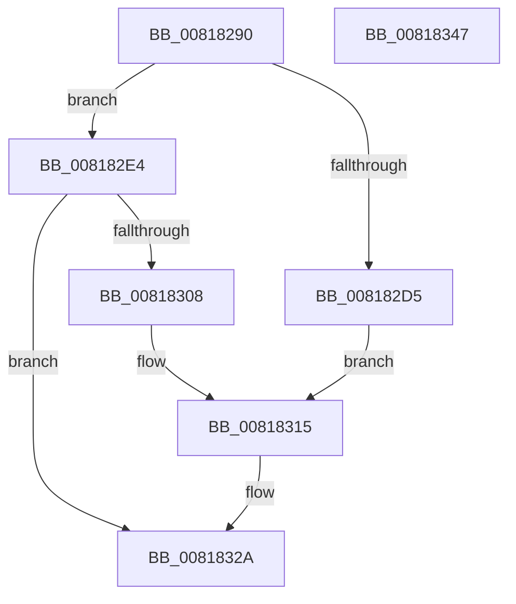

# SdbpGetPathSystem

- RVA: `0x00818290`–`0x00818348` (길이 `184` bytes)
- VA: `0x0000000140818290`
- 실행 섹션: `PAGE`
- PDB 이름 있음: `예`; PDB Function 태그: `아니요`
- unwind 정보 RVA: `0x00060130`
- 디코드: `48`개 명령, `184/184` bytes 표시
- 미해석 바이트: `0` (있으면 어셈블리에 `.byte`로 보존)

> 이 문서는 커널 이미지의 기계어와 PDB 기호를 분석해 생성했습니다. 4번과 5번은 함수 원형과 자료형을 바이너리 사용 방식에서 추정한 C 해석이며 원본 소스 복구 결과는 아닙니다.

## 1. Dependencies

- 직접 호출 지점: **3**; 고유 호출 대상: **3**
- 직접 호출자로 확인된 함수: **0**
- RIP 상대 이미지 참조: **3**

### Outgoing calls
- `0x008182CA` → [SdbpGetProcessHostGuestArchitectures](SdbpGetProcessHostGuestArchitectures_function_00818350.md) (function, `0x00818350`)
- `0x008182FD` → [AslEnvGetSystem32DirPathBuf](AslEnvGetSystem32DirPathBuf_function_0081D2BC.md) (function, `0x0081D2BC`)
- `0x00818325` → [AslLogCallPrintf](../95/AslLogCallPrintf_function_0095E4EC.md) (function, `0x0095E4EC`)

### Direct callers
- 이 함수 시작 RVA로 연결되는 직접 call은 확인되지 않았습니다. 간접 호출은 완전히 역산할 수 없습니다.

### Static image references
- `0x008182D5` → RVA `0x0003DD88` (`.rdata`; read)
- `0x00818308` → RVA `0x0003D968` (`.rdata`; read)
- `0x00818315` → RVA `0x0003D950` (`.rdata`; read)

## 2. Other-region calls and transfers

- 다른 실행 섹션으로 향하는 call: **0**
- 별도 외부 분기/꼬리 이동을 확인하지 못했습니다.

## 3. Assembly (complete function range)

```asm
00818290  48 8B C4                        mov rax, rsp
00818293  48 89 58 08                     mov qword ptr [rax + 8], rbx
00818297  48 89 68 10                     mov qword ptr [rax + 0x10], rbp
0081829B  48 89 70 18                     mov qword ptr [rax + 0x18], rsi
0081829F  48 89 78 20                     mov qword ptr [rax + 0x20], rdi
008182A3  41 56                           push r14
008182A5  48 83 EC 40                     sub rsp, 0x40
008182A9  49 8B F8                        mov rdi, r8
008182AC  48 8B F2                        mov rsi, rdx
008182AF  48 8B E9                        mov rbp, rcx
008182B2  48 8D 50 E8                     lea rdx, [rax - 0x18]
008182B6  45 33 F6                        xor r14d, r14d
008182B9  48 8D 48 EC                     lea rcx, [rax - 0x14]
008182BD  4D 8B C1                        mov r8, r9
008182C0  66 44 89 70 EC                  mov word ptr [rax - 0x14], r14w
008182C5  66 44 89 70 E8                  mov word ptr [rax - 0x18], r14w
008182CA  E8 81 00 00 00                  call 0x140818350
008182CF  8B D8                           mov ebx, eax
008182D1  85 C0                           test eax, eax
008182D3  79 0F                           jns 0x1408182e4
008182D5  4C 8D 0D AC 5A 82 FF            lea r9, [rip - 0x7da554]
008182DC  41 B8 2A 04 00 00               mov r8d, 0x42a
008182E2  EB 31                           jmp 0x140818315
008182E4  44 0F B7 4C 24 34               movzx r9d, word ptr [rsp + 0x34]
008182EA  48 8D 44 24 30                  lea rax, [rsp + 0x30]
008182EF  4C 8B C7                        mov r8, rdi
008182F2  48 89 44 24 20                  mov qword ptr [rsp + 0x20], rax
008182F7  48 8B D6                        mov rdx, rsi
008182FA  48 8B CD                        mov rcx, rbp
008182FD  E8 BA 4F 00 00                  call 0x14081d2bc
00818302  8B D8                           mov ebx, eax
00818304  85 C0                           test eax, eax
00818306  79 22                           jns 0x14081832a
00818308  4C 8D 0D 59 56 82 FF            lea r9, [rip - 0x7da9a7]
0081830F  41 B8 30 04 00 00               mov r8d, 0x430
00818315  48 8D 15 34 56 82 FF            lea rdx, [rip - 0x7da9cc]
0081831C  89 44 24 20                     mov dword ptr [rsp + 0x20], eax
00818320  B9 01 00 00 00                  mov ecx, 1
00818325  E8 C2 61 14 00                  call 0x14095e4ec
0081832A  48 8B 6C 24 58                  mov rbp, qword ptr [rsp + 0x58]
0081832F  8B C3                           mov eax, ebx
00818331  48 8B 5C 24 50                  mov rbx, qword ptr [rsp + 0x50]
00818336  48 8B 74 24 60                  mov rsi, qword ptr [rsp + 0x60]
0081833B  48 8B 7C 24 68                  mov rdi, qword ptr [rsp + 0x68]
00818340  48 83 C4 40                     add rsp, 0x40
00818344  41 5E                           pop r14
00818346  C3                              ret
00818347  CC                              int3
```

## 4. C-style interpretation (structured pseudocode)

```c
__int64 __fastcall SdbpGetPathSystem(__int64 a1, __int64 a2, __int64 a3, __int64 a4)
{
    __int64 result;
    __int64 v_r14;
    __int64 v_rsp;
    unsigned __int16 v_stack_m14;
    unsigned __int64 v_stack_m18;
    unsigned __int64 v_stack_m28;
    unsigned __int64 v_stack_p10;
    unsigned __int64 v_stack_p18;
    unsigned __int64 v_stack_p20;
    unsigned __int64 v_stack_p8;

    *(unsigned __int64 *)(v_rsp + 8) = v_rbx;
    *(unsigned __int64 *)(v_rsp + 16) = v_rbp;
    *(unsigned __int64 *)(v_rsp + 24) = v_rsi;
    *(unsigned __int64 *)(v_rsp + 32) = v_rdi;
    v_rsp = (v_rsp) - (64);
    v_r14 = 0;
    *(unsigned __int16 *)(v_rsp - 20) = 0;
    *(unsigned __int16 *)(v_rsp - 24) = 0;
    result = SdbpGetProcessHostGuestArchitectures(v_rsp - 20, v_rsp - 24, a4, a4);
    if (!sign_flag) goto loc_008182E4;
    goto loc_00818315;
loc_008182E4:
    v_stack_m28 = v_stack_m18;
    result = AslEnvGetSystem32DirPathBuf(a1, a2, a3, v_stack_m14);
    if (!sign_flag) goto loc_0081832A;
loc_00818315:
    v_stack_m28 = (unsigned int)(result);
    result = AslLogCallPrintf(1, v_rip - 8235468, (unsigned int)(0x430ULL), v_rip - 8235431);
loc_0081832A:
    v_rsp = (v_rsp) + (64);
    return (unsigned int)((unsigned int)((unsigned int)((unsigned int)(result))));
}
```

## 5. (Beta) C Style

```c
int64_t SdbpGetPathSystem(int64_t Arg1, int64_t Arg2, int64_t Arg3, int64_t Arg4)
{
    int64_t result;
    int64_t local_r14;
    int64_t local_rsp;
    uint16_t v_stack_m14;
    uint64_t v_stack_m18;
    uint64_t v_stack_m28;
    uint64_t v_stack_p10;
    uint64_t v_stack_p18;
    uint64_t v_stack_p20;
    uint64_t v_stack_p8;

    *(uint64_t *)(local_rsp + 0x8) = local_rbx;
    *(uint64_t *)(local_rsp + 0x10) = local_rbp;
    *(uint64_t *)(local_rsp + 0x18) = local_rsi;
    *(uint64_t *)(local_rsp + 0x20) = local_rdi;
    local_rsp = (local_rsp) - (64);
    local_r14 = 0;
    *(uint16_t *)(local_rsp - 0x14) = 0;
    *(uint16_t *)(local_rsp - 0x18) = 0;
    result = SdbpGetProcessHostGuestArchitectures(local_rsp - 20, local_rsp - 24, Arg4, Arg4);
    if (!sign_flag) goto loc_008182E4;
    goto loc_00818315;
loc_008182E4:
    v_stack_m28 = v_stack_m18;
    result = AslEnvGetSystem32DirPathBuf(Arg1, Arg2, Arg3, v_stack_m14);
    if (!sign_flag) goto loc_0081832A;
loc_00818315:
    v_stack_m28 = (uint32_t)(result);
    result = AslLogCallPrintf(1, v_rip - 8235468, (uint32_t)(0x430ULL), v_rip - 8235431);
loc_0081832A:
    local_rsp = (local_rsp) + (64);
    return (uint32_t)((uint32_t)((uint32_t)((uint32_t)(result))));
}
```

## 6. Execution-region graph

[열기: 2D/3D 그래프와 함수 탐색 컨트롤 패널](../../../control-panel.html?section=page&rva=0x00818290&view=graph)

- 2D 그래프는 위에서 아래로 흐르고, 3D 그래프는 빈 공간을 드래그해 회전합니다. Shift+드래그는 이동, 휠은 확대·축소, 함수 노드 선택은 대상 보고서 이동입니다.

### Static fallback


