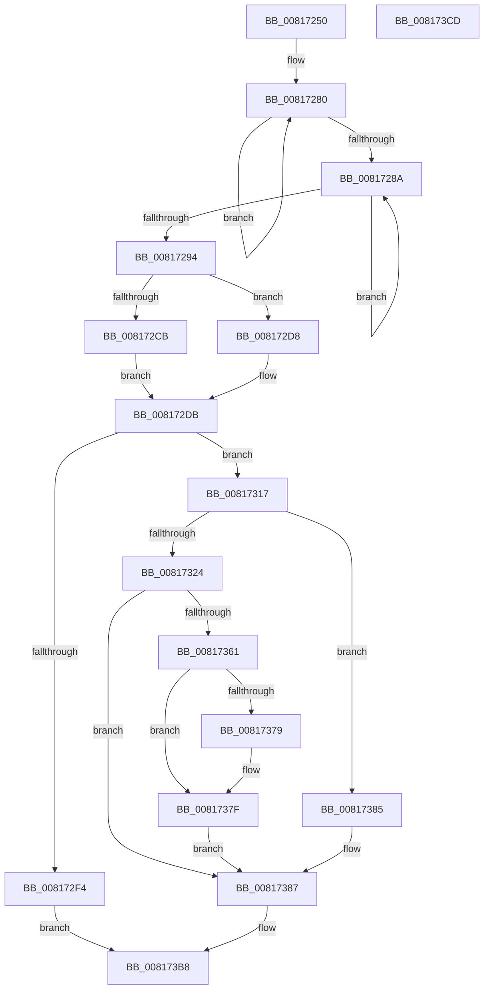

# SdbpGetProcessHistory

- RVA: `0x00817250`–`0x008173CE` (길이 `382` bytes)
- VA: `0x0000000140817250`
- 실행 섹션: `PAGE`
- PDB 이름 있음: `예`; PDB Function 태그: `아니요`
- unwind 정보 RVA: `0x000D9AB4`
- 디코드: `108`개 명령, `382/382` bytes 표시
- 미해석 바이트: `0` (있으면 어셈블리에 `.byte`로 보존)

> 이 문서는 커널 이미지의 기계어와 PDB 기호를 분석해 생성했습니다. 4번과 5번은 함수 원형과 자료형을 바이너리 사용 방식에서 추정한 C 해석이며 원본 소스 복구 결과는 아닙니다.

## 1. Dependencies

- 직접 호출 지점: **6**; 고유 호출 대상: **4**
- 직접 호출자로 확인된 함수: **1**
- RIP 상대 이미지 참조: **3**

### Outgoing calls
- `0x008172B7` → [AslEnvVarQuery](AslEnvVarQuery_function_0081D410.md) (function, `0x0081D410`)
- `0x008172E2` → [AslAlloc](../95/AslAlloc_function_0095BD34.md) (function, `0x0095BD34`)
- `0x0081730B` → [AslLogCallPrintf](../95/AslLogCallPrintf_function_0095E4EC.md) (function, `0x0095E4EC`)
- `0x00817356` → [AslEnvVarQuery](AslEnvVarQuery_function_0081D410.md) (function, `0x0081D410`)
- `0x00817395` → [memcpy](../../text/6C/memcpy_function_006C6840.md) (function, `0x006C6840`)
- `0x008173AC` → [memcpy](../../text/6C/memcpy_function_006C6840.md) (function, `0x006C6840`)

### Direct callers
- [SdbpInitializeSearchDBContext](SdbpInitializeSearchDBContext_function_00816210.md) at `0x00816267`

### Static image references
- `0x008172AC` → RVA `0x0003D3B8` (`.rdata`; read)
- `0x008172F4` → RVA `0x0003D3E0` (`.rdata`; read)
- `0x00817301` → RVA `0x0003D410` (`.rdata`; read)

## 2. Other-region calls and transfers

- 다른 실행 섹션으로 향하는 call: **2**
  - `0x00817395` → [memcpy](../../text/6C/memcpy_function_006C6840.md) (`PAGE` → `.text`)
  - `0x008173AC` → [memcpy](../../text/6C/memcpy_function_006C6840.md) (`PAGE` → `.text`)
- 별도 외부 분기/꼬리 이동을 확인하지 못했습니다.

## 3. Assembly (complete function range)

```asm
00817250  4C 8B DC                        mov r11, rsp
00817253  49 89 5B 10                     mov qword ptr [r11 + 0x10], rbx
00817257  49 89 4B 08                     mov qword ptr [r11 + 8], rcx
0081725B  55                              push rbp
0081725C  56                              push rsi
0081725D  57                              push rdi
0081725E  41 54                           push r12
00817260  41 55                           push r13
00817262  41 56                           push r14
00817264  41 57                           push r15
00817266  48 83 EC 30                     sub rsp, 0x30
0081726A  4C 8B E2                        mov r12, rdx
0081726D  4D 8B F8                        mov r15, r8
00817270  33 D2                           xor edx, edx
00817272  48 8B C1                        mov rax, rcx
00817275  48 83 CE FF                     or rsi, 0xffffffffffffffff
00817279  49 89 53 20                     mov qword ptr [r11 + 0x20], rdx
0081727D  48 8B DE                        mov rbx, rsi
00817280  48 FF C3                        inc rbx
00817283  66 41 39 14 5C                  cmp word ptr [r12 + rbx*2], dx
00817288  75 F6                           jne 0x140817280
0081728A  48 FF C6                        inc rsi
0081728D  66 41 39 14 70                  cmp word ptr [r8 + rsi*2], dx
00817292  75 F6                           jne 0x14081728a
00817294  45 33 C9                        xor r9d, r9d
00817297  48 8D 8C 24 88 00 00 00         lea rcx, [rsp + 0x88]
0081729F  48 89 4C 24 28                  mov qword ptr [rsp + 0x28], rcx
008172A4  48 8B C8                        mov rcx, rax
008172A7  48 89 54 24 20                  mov qword ptr [rsp + 0x20], rdx
008172AC  48 8D 15 05 61 82 FF            lea rdx, [rip - 0x7d9efb]
008172B3  45 8D 41 11                     lea r8d, [r9 + 0x11]
008172B7  E8 54 61 00 00                  call 0x14081d410
008172BC  44 8B E8                        mov r13d, eax
008172BF  8D 04 1E                        lea eax, [rsi + rbx]
008172C2  41 81 FD 23 00 00 C0            cmp r13d, 0xc0000023
008172C9  75 0D                           jne 0x1408172d8
008172CB  8D 50 02                        lea edx, [rax + 2]
008172CE  48 03 94 24 88 00 00 00         add rdx, qword ptr [rsp + 0x88]
008172D6  EB 03                           jmp 0x1408172db
008172D8  8D 50 01                        lea edx, [rax + 1]
008172DB  48 8D 2C 12                     lea rbp, [rdx + rdx]
008172DF  48 8B D5                        mov rdx, rbp
008172E2  E8 4D 4A 14 00                  call 0x14095bd34
008172E7  48 8B F8                        mov rdi, rax
008172EA  4C 8B F0                        mov r14, rax
008172ED  33 C0                           xor eax, eax
008172EF  48 85 FF                        test rdi, rdi
008172F2  75 23                           jne 0x140817317
008172F4  4C 8D 0D E5 60 82 FF            lea r9, [rip - 0x7d9f1b]
008172FB  41 B8 4F 09 00 00               mov r8d, 0x94f
00817301  48 8D 15 08 61 82 FF            lea rdx, [rip - 0x7d9ef8]
00817308  8D 4F 01                        lea ecx, [rdi + 1]
0081730B  E8 DC 71 14 00                  call 0x14095e4ec
00817310  33 C0                           xor eax, eax
00817312  E9 A1 00 00 00                  jmp 0x1408173b8
00817317  66 41 89 06                     mov word ptr [r14], ax
0081731B  41 81 FD 23 00 00 C0            cmp r13d, 0xc0000023
00817322  75 61                           jne 0x140817385
00817324  48 8B 4C 24 70                  mov rcx, qword ptr [rsp + 0x70]
00817329  48 8D 84 24 88 00 00 00         lea rax, [rsp + 0x88]
00817331  48 89 AC 24 88 00 00 00         mov qword ptr [rsp + 0x88], rbp
00817339  48 8D 15 78 60 82 FF            lea rdx, [rip - 0x7d9f88]
00817340  48 89 44 24 28                  mov qword ptr [rsp + 0x28], rax
00817345  4D 8B CE                        mov r9, r14
00817348  48 D1 ED                        shr rbp, 1
0081734B  41 B8 11 00 00 00               mov r8d, 0x11
00817351  48 89 6C 24 20                  mov qword ptr [rsp + 0x20], rbp
00817356  E8 B5 60 00 00                  call 0x14081d410
0081735B  33 ED                           xor ebp, ebp
0081735D  85 C0                           test eax, eax
0081735F  78 26                           js 0x140817387
00817361  48 8B 84 24 88 00 00 00         mov rax, qword ptr [rsp + 0x88]
00817369  49 8D 0C 46                     lea rcx, [r14 + rax*2]
0081736D  48 8D 79 FE                     lea rdi, [rcx - 2]
00817371  8D 45 3B                        lea eax, [rbp + 0x3b]
00817374  66 39 07                        cmp word ptr [rdi], ax
00817377  74 06                           je 0x14081737f
00817379  48 8B F9                        mov rdi, rcx
0081737C  66 89 01                        mov word ptr [rcx], ax
0081737F  48 83 C7 02                     add rdi, 2
00817383  EB 02                           jmp 0x140817387
00817385  33 ED                           xor ebp, ebp
00817387  8B DB                           mov ebx, ebx
00817389  49 8B D4                        mov rdx, r12
0081738C  48 03 DB                        add rbx, rbx
0081738F  48 8B CF                        mov rcx, rdi
00817392  4C 8B C3                        mov r8, rbx
00817395  E8 A6 F4 EA FF                  call 0x1406c6840
0081739A  48 03 FB                        add rdi, rbx
0081739D  8B C6                           mov eax, esi
0081739F  49 8B D7                        mov rdx, r15
008173A2  48 8B CF                        mov rcx, rdi
008173A5  48 8D 1C 00                     lea rbx, [rax + rax]
008173A9  4C 8B C3                        mov r8, rbx
008173AC  E8 8F F4 EA FF                  call 0x1406c6840
008173B1  49 8B C6                        mov rax, r14
008173B4  66 89 2C 3B                     mov word ptr [rbx + rdi], bp
008173B8  48 8B 5C 24 78                  mov rbx, qword ptr [rsp + 0x78]
008173BD  48 83 C4 30                     add rsp, 0x30
008173C1  41 5F                           pop r15
008173C3  41 5E                           pop r14
008173C5  41 5D                           pop r13
008173C7  41 5C                           pop r12
008173C9  5F                              pop rdi
008173CA  5E                              pop rsi
008173CB  5D                              pop rbp
008173CC  C3                              ret
008173CD  CC                              int3
```

## 4. C-style interpretation (structured pseudocode)

```c
__int64 __fastcall SdbpGetProcessHistory(__int64 a1, __int64 a2, __int64 a3, int a4)
{
    __int64 result;
    __int64 v_rbp;
    __int64 v_rbx;
    __int64 v_rdi;
    __int64 v_rsi;
    __int64 v_rsp;
    unsigned __int64 v_stack_m40;
    unsigned __int64 v_stack_m48;
    unsigned __int64 v_stack_p10;
    unsigned __int64 v_stack_p20;
    unsigned __int64 v_stack_p8;

    *(unsigned __int64 *)(v_rsp + 16) = v_rbx;
    *(unsigned __int64 *)(v_rsp + 8) = a1;
    v_rsp = (v_rsp) - (48);
    a2 = 0;
    v_rsi = (v_rsi) | (-1);
    *(unsigned __int64 *)(v_rsp + 32) = 0;
loc_00817280:
    v_rbx = (v_rsi) + 1;
    if ((*(unsigned __int16 *)(a2 + v_rbx * 2)) != 0) goto loc_00817280;
loc_0081728A:
    v_rsi = (v_rsi) + 1;
    if ((*(unsigned __int16 *)(a3 + v_rsi * 2)) != 0) goto loc_0081728A;
    a4 = 0;
    v_stack_m40 = v_stack_p20;
    v_stack_m48 = 0;
    result = AslEnvVarQuery(a1, v_rip - 8232699, a4 + 17, a4);
    if (((unsigned int)((unsigned int)((unsigned int)(result)))) != 0xC0000023ULL) goto loc_008172D8;
    a2 = (v_rsi + v_rbx * 1 + 2) + (v_stack_p20);
    goto loc_008172DB;
loc_008172D8:
loc_008172DB:
    result = AslAlloc(a1, v_rsi + v_rbx * 1 + 1 + v_rsi + v_rbx * 1 + 1 * 1, a4 + 17, a4);
    result = 0;
    if (0 != 0) goto loc_00817317;
    result = AslLogCallPrintf(result + 1, v_rip - 8232696, (unsigned int)(0x94FULL), v_rip - 8232731);
    result = 0;
    goto loc_008173B8;
loc_00817317:
    *(unsigned __int16 *)(result) = 0;
    if (((unsigned int)((unsigned int)((unsigned int)(result)))) != 0xC0000023ULL) goto loc_00817385;
    v_stack_p20 = v_rsi + v_rbx * 1 + 1 + v_rsi + v_rbx * 1 + 1 * 1;
    v_stack_m40 = v_stack_p20;
    v_rbp = (v_rsi + v_rbx * 1 + 1 + v_rsi + v_rbx * 1 + 1 * 1) >> (1);
    v_stack_m48 = v_rbp;
    result = AslEnvVarQuery(v_stack_p8, v_rip - 8232840, 17, 0);
    v_rbp = 0;
    if (sign_flag) goto loc_00817387;
    v_rdi = result + v_stack_p20 * 2 - 2;
    if ((*(unsigned __int16 *)(result + v_stack_p20 * 2 - 2)) != ((unsigned __int16)(v_rbp + 59))) {
        v_rdi = result + v_stack_p20 * 2;
        *(unsigned __int16 *)(result + v_stack_p20 * 2) = (unsigned __int16)(v_rbp + 59);
    }
    v_rdi = (v_rdi) + (2);
    goto loc_00817387;
loc_00817385:
    v_rbp = 0;
loc_00817387:
    v_rbx = ((unsigned int)((unsigned int)(v_rbx))) + ((unsigned int)((unsigned int)(v_rbx)));
    result = memcpy(v_rdi, a2, v_rbx, 0);
    v_rdi = (v_rdi) + (v_rbx);
    result = memcpy(v_rdi, a3, (unsigned int)((unsigned int)(v_rsi)) + (unsigned int)((unsigned int)(v_rsi)) * 1, 0);
    *(unsigned __int16 *)((unsigned int)((unsigned int)(v_rsi)) + (unsigned int)((unsigned int)(v_rsi)) * 1 + v_rdi * 1) = 0;
loc_008173B8:
    v_rsp = (v_rsp) + (48);
    return result;
}
```

## 5. (Beta) C Style

```c
int64_t SdbpGetProcessHistory(int64_t Arg1, void *Arg2, void *Arg3, int32_t Arg4)
{
    uint8_t *arg2 = (uint8_t *)Arg2;
    uint8_t *arg3 = (uint8_t *)Arg3;

    int64_t result;
    int64_t local_rbp;
    int64_t local_rbx;
    int64_t local_rdi;
    int64_t local_rsi;
    int64_t local_rsp;
    uint64_t v_stack_m40;
    uint64_t v_stack_m48;
    uint64_t v_stack_p10;
    uint64_t v_stack_p20;
    uint64_t v_stack_p8;

    *(uint64_t *)(local_rsp + 0x10) = local_rbx;
    *(uint64_t *)(local_rsp + 0x8) = Arg1;
    local_rsp = (local_rsp) - (48);
    Arg2 = 0;
    local_rsi = (local_rsi) | (-1);
    *(uint64_t *)(local_rsp + 0x20) = 0;
loc_00817280:
    local_rbx = (local_rsi) + 1;
    if ((*(uint16_t *)(arg2 + local_rbx * 2)) != 0) goto loc_00817280;
loc_0081728A:
    local_rsi = (local_rsi) + 1;
    if ((*(uint16_t *)(arg3 + local_rsi * 2)) != 0) goto loc_0081728A;
    Arg4 = 0;
    v_stack_m40 = v_stack_p20;
    v_stack_m48 = 0;
    result = AslEnvVarQuery(Arg1, v_rip - 8232699, Arg4 + 17, Arg4);
    if (((uint32_t)((uint32_t)((uint32_t)(result)))) != 0xC0000023ULL) goto loc_008172D8;
    Arg2 = (local_rsi + local_rbx * 1 + 2) + (v_stack_p20);
    goto loc_008172DB;
loc_008172D8:
loc_008172DB:
    result = AslAlloc(Arg1, local_rsi + local_rbx * 1 + 1 + local_rsi + local_rbx * 1 + 1 * 1, Arg4 + 17, Arg4);
    result = 0;
    if (0 != 0) goto loc_00817317;
    result = AslLogCallPrintf(result + 1, v_rip - 8232696, (uint32_t)(0x94FULL), v_rip - 8232731);
    result = 0;
    goto loc_008173B8;
loc_00817317:
    *(uint16_t *)(result) = 0;
    if (((uint32_t)((uint32_t)((uint32_t)(result)))) != 0xC0000023ULL) goto loc_00817385;
    v_stack_p20 = local_rsi + local_rbx * 1 + 1 + local_rsi + local_rbx * 1 + 1 * 1;
    v_stack_m40 = v_stack_p20;
    local_rbp = (local_rsi + local_rbx * 1 + 1 + local_rsi + local_rbx * 1 + 1 * 1) >> (1);
    v_stack_m48 = local_rbp;
    result = AslEnvVarQuery(v_stack_p8, v_rip - 8232840, 17, 0);
    local_rbp = 0;
    if (sign_flag) goto loc_00817387;
    local_rdi = result + v_stack_p20 * 2 - 2;
    if ((*(uint16_t *)(result + v_stack_p20 * 2 - 0x2)) != ((uint16_t)(local_rbp + 59))) {
        local_rdi = result + v_stack_p20 * 2;
        *(uint16_t *)(result + v_stack_p20 * 2) = (uint16_t)(local_rbp + 59);
    }
    local_rdi = (local_rdi) + (2);
    goto loc_00817387;
loc_00817385:
    local_rbp = 0;
loc_00817387:
    local_rbx = ((uint32_t)((uint32_t)(local_rbx))) + ((uint32_t)((uint32_t)(local_rbx)));
    result = memcpy(local_rdi, Arg2, local_rbx, 0);
    local_rdi = (local_rdi) + (local_rbx);
    result = memcpy(local_rdi, Arg3, (uint32_t)((uint32_t)(local_rsi)) + (uint32_t)((uint32_t)(local_rsi)) * 1, 0);
    *(uint16_t *)((uint32_t)((uint32_t)(local_rsi)) + (uint32_t)((uint32_t)(local_rsi)) * 1 + local_rdi * 1) = 0;
loc_008173B8:
    local_rsp = (local_rsp) + (48);
    return result;
}
```

### 관측된 메모리 오프셋

구조체 형식이 확인되지 않은 접근은 인자 기준의 오프셋으로만 기록했습니다.

| 기준 인자 | 오프셋 표현 | 폭 (bit) | 접근 |
|---|---:|---:|---|
| `Arg2` | `+ 0x0 + rbx*2` | `16` | `R` |
| `Arg3` | `+ 0x0 + rsi*2` | `16` | `R` |

## 6. Execution-region graph

[열기: 2D/3D 그래프와 함수 탐색 컨트롤 패널](../../../control-panel.html?section=page&rva=0x00817250&view=graph)

- 2D 그래프는 위에서 아래로 흐르고, 3D 그래프는 빈 공간을 드래그해 회전합니다. Shift+드래그는 이동, 휠은 확대·축소, 함수 노드 선택은 대상 보고서 이동입니다.

### Static fallback


