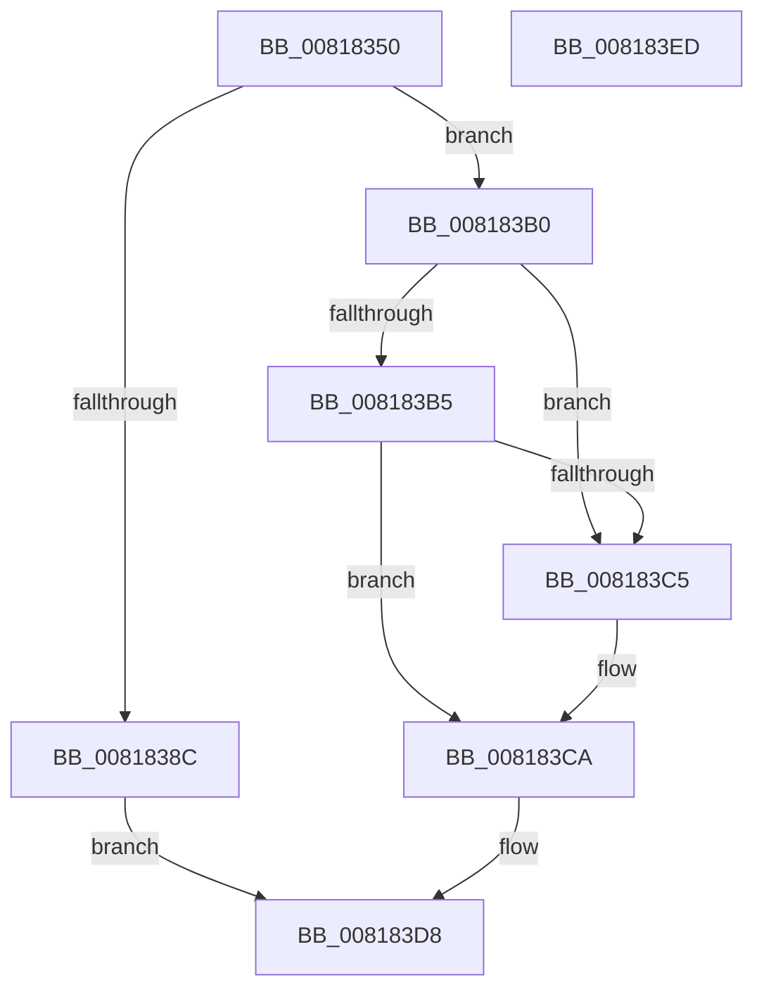

# SdbpGetProcessHostGuestArchitectures

- RVA: `0x00818350`–`0x008183EE` (길이 `158` bytes)
- VA: `0x0000000140818350`
- 실행 섹션: `PAGE`
- PDB 이름 있음: `예`; PDB Function 태그: `아니요`
- unwind 정보 RVA: `0x000AB20C`
- 디코드: `47`개 명령, `158/158` bytes 표시
- 미해석 바이트: `0` (있으면 어셈블리에 `.byte`로 보존)

> 이 문서는 커널 이미지의 기계어와 PDB 기호를 분석해 생성했습니다. 4번과 5번은 함수 원형과 자료형을 바이너리 사용 방식에서 추정한 C 해석이며 원본 소스 복구 결과는 아닙니다.

## 1. Dependencies

- 직접 호출 지점: **3**; 고유 호출 대상: **3**
- 직접 호출자로 확인된 함수: **4**
- RIP 상대 이미지 참조: **2**

### Outgoing calls
- `0x00818381` → [AslEnvGetProcessWowInfo](AslEnvGetProcessWowInfo_function_0081D0A8.md) (function, `0x0081D0A8`)
- `0x008183A9` → [AslLogCallPrintf](../95/AslLogCallPrintf_function_0095E4EC.md) (function, `0x0095E4EC`)
- `0x008183B8` → [AslImageFileToArchitecture](AslImageFileToArchitecture_function_0081D5D0.md) (function, `0x0081D5D0`)

### Direct callers
- [SdbpGetPathAppPatchPreRS3](../../text/69/SdbpGetPathAppPatchPreRS3_function_0069CCF0.md) at `0x0069CD7E`
- [SdbpGetPathCustomSdbPreRS3](../../text/69/SdbpGetPathCustomSdbPreRS3_function_0069CE80.md) at `0x0069CF33`
- [SdbpGetPathAppraiser](SdbpGetPathAppraiser_function_00817F30.md) at `0x00818010`
- [SdbpGetPathSystem](SdbpGetPathSystem_function_00818290.md) at `0x008182CA`

### Static image references
- `0x0081838C` → RVA `0x0003C070` (`.rdata`; read)
- `0x0081839D` → RVA `0x0003DCD0` (`.rdata`; read)

## 2. Other-region calls and transfers

- 다른 실행 섹션으로 향하는 call: **0**
- 별도 외부 분기/꼬리 이동을 확인하지 못했습니다.

## 3. Assembly (complete function range)

```asm
00818350  48 8B C4                        mov rax, rsp
00818353  48 89 58 08                     mov qword ptr [rax + 8], rbx
00818357  48 89 68 10                     mov qword ptr [rax + 0x10], rbp
0081835B  56                              push rsi
0081835C  57                              push rdi
0081835D  41 56                           push r14
0081835F  48 83 EC 40                     sub rsp, 0x40
00818363  48 8B F2                        mov rsi, rdx
00818366  4C 8B F1                        mov r14, rcx
00818369  BD FF FF 00 00                  mov ebp, 0xffff
0081836E  48 8D 50 20                     lea rdx, [rax + 0x20]
00818372  48 8D 48 D8                     lea rcx, [rax - 0x28]
00818376  66 89 68 20                     mov word ptr [rax + 0x20], bp
0081837A  66 89 68 D8                     mov word ptr [rax - 0x28], bp
0081837E  49 8B F8                        mov rdi, r8
00818381  E8 22 4D 00 00                  call 0x14081d0a8
00818386  8B D8                           mov ebx, eax
00818388  85 C0                           test eax, eax
0081838A  79 24                           jns 0x1408183b0
0081838C  4C 8D 0D DD 3C 82 FF            lea r9, [rip - 0x7dc323]
00818393  89 44 24 20                     mov dword ptr [rsp + 0x20], eax
00818397  41 B8 83 03 00 00               mov r8d, 0x383
0081839D  48 8D 15 2C 59 82 FF            lea rdx, [rip - 0x7da6d4]
008183A4  B9 01 00 00 00                  mov ecx, 1
008183A9  E8 3E 61 14 00                  call 0x14095e4ec
008183AE  EB 28                           jmp 0x1408183d8
008183B0  48 85 FF                        test rdi, rdi
008183B3  74 10                           je 0x1408183c5
008183B5  0F B7 0F                        movzx ecx, word ptr [rdi]
008183B8  E8 13 52 00 00                  call 0x14081d5d0
008183BD  0F B7 C8                        movzx ecx, ax
008183C0  66 3B C5                        cmp ax, bp
008183C3  75 05                           jne 0x1408183ca
008183C5  0F B7 4C 24 78                  movzx ecx, word ptr [rsp + 0x78]
008183CA  0F B7 44 24 30                  movzx eax, word ptr [rsp + 0x30]
008183CF  33 DB                           xor ebx, ebx
008183D1  66 41 89 06                     mov word ptr [r14], ax
008183D5  66 89 0E                        mov word ptr [rsi], cx
008183D8  48 8B 6C 24 68                  mov rbp, qword ptr [rsp + 0x68]
008183DD  8B C3                           mov eax, ebx
008183DF  48 8B 5C 24 60                  mov rbx, qword ptr [rsp + 0x60]
008183E4  48 83 C4 40                     add rsp, 0x40
008183E8  41 5E                           pop r14
008183EA  5F                              pop rdi
008183EB  5E                              pop rsi
008183EC  C3                              ret
008183ED  CC                              int3
```

## 4. C-style interpretation (structured pseudocode)

```c
__int64 __fastcall SdbpGetProcessHostGuestArchitectures(__int64 a1, __int64 a2, __int64 a3)
{
    __int64 result;
    __int64 v_rbx;
    __int64 v_rsp;
    unsigned __int16 v_stack_m28;
    unsigned int v_stack_m38;
    unsigned __int64 v_stack_p10;
    unsigned __int16 v_stack_p20;
    unsigned __int64 v_stack_p8;

    *(unsigned __int64 *)(v_rsp + 8) = v_rbx;
    *(unsigned __int64 *)(v_rsp + 16) = v_rbp;
    v_rsp = (v_rsp) - (64);
    *(unsigned __int16 *)(v_rsp + 32) = (unsigned __int16)((unsigned int)(0xFFFFULL));
    *(unsigned __int16 *)(v_rsp - 40) = (unsigned __int16)((unsigned int)(0xFFFFULL));
    result = AslEnvGetProcessWowInfo(v_rsp - 40, v_rsp + 32, a3, a4);
    if (!sign_flag) goto loc_008183B0;
    v_stack_m38 = (unsigned int)(result);
    result = AslLogCallPrintf(1, v_rip - 8234708, 899, v_rip - 8241955);
    goto loc_008183D8;
loc_008183B0:
    if (a3 == 0) goto loc_008183C5;
    result = AslImageFileToArchitecture(*(unsigned __int16 *)(a3), v_rip - 8234708, 899, v_rip - 8241955);
    if (((unsigned __int16)(result)) == ((unsigned __int16)((unsigned int)(0xFFFFULL)))) {
        a1 = v_stack_p20;
    }
    v_rbx = 0;
    *(unsigned __int16 *)(a1) = (unsigned __int16)(v_stack_m28);
    *(unsigned __int16 *)(a2) = (unsigned __int16)(a1);
loc_008183D8:
    v_rsp = (v_rsp) + (64);
    return 0;
}
```

## 5. (Beta) C Style

```c
int64_t SdbpGetProcessHostGuestArchitectures(void *Arg1, void *Arg2, int64_t Arg3)
{
    uint8_t *arg1 = (uint8_t *)Arg1;
    uint8_t *arg2 = (uint8_t *)Arg2;

    int64_t result;
    int64_t local_rbx;
    int64_t local_rsp;
    uint16_t v_stack_m28;
    uint32_t v_stack_m38;
    uint64_t v_stack_p10;
    uint16_t v_stack_p20;
    uint64_t v_stack_p8;

    *(uint64_t *)(local_rsp + 0x8) = local_rbx;
    *(uint64_t *)(local_rsp + 0x10) = local_rbp;
    local_rsp = (local_rsp) - (64);
    *(uint16_t *)(local_rsp + 0x20) = (uint16_t)((uint32_t)(0xFFFFULL));
    *(uint16_t *)(local_rsp - 0x28) = (uint16_t)((uint32_t)(0xFFFFULL));
    result = AslEnvGetProcessWowInfo(local_rsp - 40, local_rsp + 32, Arg3, a4);
    if (!sign_flag) goto loc_008183B0;
    v_stack_m38 = (uint32_t)(result);
    result = AslLogCallPrintf(1, v_rip - 8234708, 899, v_rip - 8241955);
    goto loc_008183D8;
loc_008183B0:
    if (Arg3 == 0) goto loc_008183C5;
    result = AslImageFileToArchitecture(*(uint16_t *)(Arg3), v_rip - 8234708, 899, v_rip - 8241955);
    if (((uint16_t)(result)) == ((uint16_t)((uint32_t)(0xFFFFULL)))) {
        Arg1 = v_stack_p20;
    }
    local_rbx = 0;
    *(uint16_t *)(arg1) = (uint16_t)(v_stack_m28);
    *(uint16_t *)(arg2) = (uint16_t)(Arg1);
loc_008183D8:
    local_rsp = (local_rsp) + (64);
    return 0;
}
```

### 관측된 메모리 오프셋

구조체 형식이 확인되지 않은 접근은 인자 기준의 오프셋으로만 기록했습니다.

| 기준 인자 | 오프셋 표현 | 폭 (bit) | 접근 |
|---|---:|---:|---|
| `Arg1` | `+ 0x0` | `16` | `W` |
| `Arg2` | `+ 0x0` | `16` | `W` |

## 6. Execution-region graph

[열기: 2D/3D 그래프와 함수 탐색 컨트롤 패널](../../../control-panel.html?section=page&rva=0x00818350&view=graph)

- 2D 그래프는 위에서 아래로 흐르고, 3D 그래프는 빈 공간을 드래그해 회전합니다. Shift+드래그는 이동, 휠은 확대·축소, 함수 노드 선택은 대상 보고서 이동입니다.

### Static fallback


