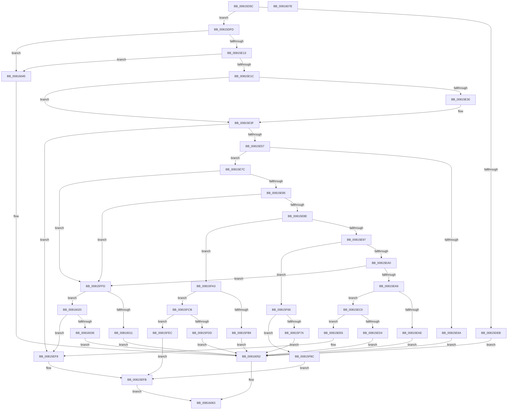

# SdbpGetRegistryMatchingAttributes

- RVA: `0x00815D5C`–`0x0081607F` (길이 `803` bytes)
- VA: `0x0000000140815D5C`
- 실행 섹션: `PAGE`
- PDB 이름 있음: `예`; PDB Function 태그: `아니요`
- unwind 정보 RVA: `0x000AFEC4`
- 디코드: `200`개 명령, `803/803` bytes 표시
- 미해석 바이트: `0` (있으면 어셈블리에 `.byte`로 보존)

> 이 문서는 커널 이미지의 기계어와 PDB 기호를 분석해 생성했습니다. 4번과 5번은 함수 원형과 자료형을 바이너리 사용 방식에서 추정한 C 해석이며 원본 소스 복구 결과는 아닙니다.

## 1. Dependencies

- 직접 호출 지점: **16**; 고유 호출 대상: **7**
- 직접 호출자로 확인된 함수: **2**
- RIP 상대 이미지 참조: **10**

### Outgoing calls
- `0x00815DE2` → [SdbFindFirstTag](../95/SdbFindFirstTag_function_0095E34C.md) (function, `0x0095E34C`)
- `0x00815E02` → [SdbGetStringTagPtr](../95/SdbGetStringTagPtr_function_0095DDA8.md) (function, `0x0095DDA8`)
- `0x00815E27` → [SdbFindFirstTag](../95/SdbFindFirstTag_function_0095E34C.md) (function, `0x0095E34C`)
- `0x00815E35` → [SdbGetStringTagPtr](../95/SdbGetStringTagPtr_function_0095DDA8.md) (function, `0x0095DDA8`)
- `0x00815E4A` → [SdbFindFirstTag](../95/SdbFindFirstTag_function_0095E34C.md) (function, `0x0095E34C`)
- `0x00815E5F` → [SdbReadDWORDTag](../95/SdbReadDWORDTag_function_0095D408.md) (function, `0x0095D408`)
- `0x00815ECB` → [SdbFindFirstTag](../95/SdbFindFirstTag_function_0095E34C.md) (function, `0x0095E34C`)
- `0x00815EEE` → [SdbReadQWORDTag](SdbReadQWORDTag_function_0081706C.md) (function, `0x0081706C`)
- `0x00815F71` → [SdbFindFirstTag](../95/SdbFindFirstTag_function_0095E34C.md) (function, `0x0095E34C`)
- `0x00815F94` → [SdbReadDWORDTag](../95/SdbReadDWORDTag_function_0095D408.md) (function, `0x0095D408`)
- `0x00815FAE` → [SdbFindFirstTag](../95/SdbFindFirstTag_function_0095E34C.md) (function, `0x0095E34C`)
- `0x00815FD0` → [SdbGetBinaryTagData](SdbGetBinaryTagData_function_00816F8C.md) (function, `0x00816F8C`)
- `0x00815FF1` → [SdbGetTagDataSize](../95/SdbGetTagDataSize_function_0095E230.md) (function, `0x0095E230`)
- `0x00816008` → [SdbFindFirstTag](../95/SdbFindFirstTag_function_0095E34C.md) (function, `0x0095E34C`)
- `0x00816025` → [SdbGetStringTagPtr](../95/SdbGetStringTagPtr_function_0095DDA8.md) (function, `0x0095DDA8`)
- `0x0081605E` → [AslLogCallPrintf](../95/AslLogCallPrintf_function_0095E4EC.md) (function, `0x0095E4EC`)

### Direct callers
- [SdbpCheckMatchingRegistry](SdbpCheckMatchingRegistry_function_00814320.md) at `0x008143A0`
- [SdbpCheckMatchingWildcardRegistry](SdbpCheckMatchingWildcardRegistry_function_00815110.md) at `0x00815190`

### Static image references
- `0x00815DEB` → RVA `0x0003C6D8` (`.rdata`; read)
- `0x00815E6A` → RVA `0x0003C678` (`.rdata`; read)
- `0x00815EAE` → RVA `0x0003C598` (`.rdata`; read)
- `0x00815ED4` → RVA `0x0003C5E0` (`.rdata`; read)
- `0x00815F7A` → RVA `0x0003C608` (`.rdata`; read)
- `0x00815FB9` → RVA `0x0003C5B8` (`.rdata`; read)
- `0x00815FDD` → RVA `0x0003C630` (`.rdata`; read)
- `0x00816011` → RVA `0x0003C650` (`.rdata`; read)
- `0x00816045` → RVA `0x0003C698` (`.rdata`; read)
- `0x00816052` → RVA `0x0003C6B0` (`.rdata`; read)

## 2. Other-region calls and transfers

- 다른 실행 섹션으로 향하는 call: **0**
- 별도 외부 분기/꼬리 이동을 확인하지 못했습니다.

## 3. Assembly (complete function range)

```asm
00815D5C  48 89 5C 24 08                  mov qword ptr [rsp + 8], rbx
00815D61  4C 89 4C 24 20                  mov qword ptr [rsp + 0x20], r9
00815D66  4C 89 44 24 18                  mov qword ptr [rsp + 0x18], r8
00815D6B  55                              push rbp
00815D6C  56                              push rsi
00815D6D  57                              push rdi
00815D6E  41 54                           push r12
00815D70  41 55                           push r13
00815D72  41 56                           push r14
00815D74  41 57                           push r15
00815D76  48 83 EC 40                     sub rsp, 0x40
00815D7A  48 8B 84 24 A0 00 00 00         mov rax, qword ptr [rsp + 0xa0]
00815D82  33 DB                           xor ebx, ebx
00815D84  49 89 18                        mov qword ptr [r8], rbx
00815D87  8B F2                           mov esi, edx
00815D89  41 B8 01 60 00 00               mov r8d, 0x6001
00815D8F  48 89 5C 24 28                  mov qword ptr [rsp + 0x28], rbx
00815D94  48 8B F9                        mov rdi, rcx
00815D97  48 89 5C 24 30                  mov qword ptr [rsp + 0x30], rbx
00815D9C  89 18                           mov dword ptr [rax], ebx
00815D9E  8B EB                           mov ebp, ebx
00815DA0  48 8B 84 24 A8 00 00 00         mov rax, qword ptr [rsp + 0xa8]
00815DA8  44 8B EB                        mov r13d, ebx
00815DAB  44 8B E3                        mov r12d, ebx
00815DAE  49 89 19                        mov qword ptr [r9], rbx
00815DB1  44 8B F3                        mov r14d, ebx
00815DB4  48 89 18                        mov qword ptr [rax], rbx
00815DB7  48 8B 84 24 B0 00 00 00         mov rax, qword ptr [rsp + 0xb0]
00815DBF  89 18                           mov dword ptr [rax], ebx
00815DC1  48 8B 84 24 B8 00 00 00         mov rax, qword ptr [rsp + 0xb8]
00815DC9  48 89 18                        mov qword ptr [rax], rbx
00815DCC  48 8B 84 24 C0 00 00 00         mov rax, qword ptr [rsp + 0xc0]
00815DD4  48 89 18                        mov qword ptr [rax], rbx
00815DD7  48 8B 84 24 C8 00 00 00         mov rax, qword ptr [rsp + 0xc8]
00815DDF  48 89 18                        mov qword ptr [rax], rbx
00815DE2  E8 65 85 14 00                  call 0x14095e34c
00815DE7  85 C0                           test eax, eax
00815DE9  75 12                           jne 0x140815dfd
00815DEB  4C 8D 0D E6 68 82 FF            lea r9, [rip - 0x7d971a]
00815DF2  41 B8 05 04 00 00               mov r8d, 0x405
00815DF8  E9 55 02 00 00                  jmp 0x140816052
00815DFD  8B D0                           mov edx, eax
00815DFF  48 8B CF                        mov rcx, rdi
00815E02  E8 A1 7F 14 00                  call 0x14095dda8
00815E07  4C 8B F8                        mov r15, rax
00815E0A  48 85 C0                        test rax, rax
00815E0D  0F 84 32 02 00 00               je 0x140816045
00815E13  66 39 18                        cmp word ptr [rax], bx
00815E16  0F 84 29 02 00 00               je 0x140816045
00815E1C  41 B8 30 60 00 00               mov r8d, 0x6030
00815E22  8B D6                           mov edx, esi
00815E24  48 8B CF                        mov rcx, rdi
00815E27  E8 20 85 14 00                  call 0x14095e34c
00815E2C  85 C0                           test eax, eax
00815E2E  74 0F                           je 0x140815e3f
00815E30  8B D0                           mov edx, eax
00815E32  48 8B CF                        mov rcx, rdi
00815E35  E8 6E 7F 14 00                  call 0x14095dda8
00815E3A  48 89 44 24 28                  mov qword ptr [rsp + 0x28], rax
00815E3F  41 B8 51 40 00 00               mov r8d, 0x4051
00815E45  8B D6                           mov edx, esi
00815E47  48 8B CF                        mov rcx, rdi
00815E4A  E8 FD 84 14 00                  call 0x14095e34c
00815E4F  85 C0                           test eax, eax
00815E51  0F 84 A1 00 00 00               je 0x140815ef8
00815E57  45 33 C0                        xor r8d, r8d
00815E5A  8B D0                           mov edx, eax
00815E5C  48 8B CF                        mov rcx, rdi
00815E5F  E8 A4 75 14 00                  call 0x14095d408
00815E64  8B E8                           mov ebp, eax
00815E66  85 C0                           test eax, eax
00815E68  75 12                           jne 0x140815e7c
00815E6A  4C 8D 0D 07 68 82 FF            lea r9, [rip - 0x7d97f9]
00815E71  41 B8 1E 04 00 00               mov r8d, 0x41e
00815E77  E9 D6 01 00 00                  jmp 0x140816052
00815E7C  83 E8 01                        sub eax, 1
00815E7F  0F 84 78 01 00 00               je 0x140815ffd
00815E85  83 E8 01                        sub eax, 1
00815E88  0F 84 6F 01 00 00               je 0x140815ffd
00815E8E  83 E8 01                        sub eax, 1
00815E91  0F 84 0C 01 00 00               je 0x140815fa3
00815E97  83 E8 01                        sub eax, 1
00815E9A  0F 84 C6 00 00 00               je 0x140815f66
00815EA0  83 E8 03                        sub eax, 3
00815EA3  0F 84 54 01 00 00               je 0x140815ffd
00815EA9  83 F8 04                        cmp eax, 4
00815EAC  74 12                           je 0x140815ec0
00815EAE  4C 8D 0D E3 66 82 FF            lea r9, [rip - 0x7d991d]
00815EB5  41 B8 5A 04 00 00               mov r8d, 0x45a
00815EBB  E9 92 01 00 00                  jmp 0x140816052
00815EC0  41 B8 1B 50 00 00               mov r8d, 0x501b
00815EC6  8B D6                           mov edx, esi
00815EC8  48 8B CF                        mov rcx, rdi
00815ECB  E8 7C 84 14 00                  call 0x14095e34c
00815ED0  85 C0                           test eax, eax
00815ED2  75 12                           jne 0x140815ee6
00815ED4  4C 8D 0D 05 67 82 FF            lea r9, [rip - 0x7d98fb]
00815EDB  41 B8 43 04 00 00               mov r8d, 0x443
00815EE1  E9 6C 01 00 00                  jmp 0x140816052
00815EE6  45 33 C0                        xor r8d, r8d
00815EE9  8B D0                           mov edx, eax
00815EEB  48 8B CF                        mov rcx, rdi
00815EEE  E8 79 11 00 00                  call 0x14081706c
00815EF3  48 89 44 24 30                  mov qword ptr [rsp + 0x30], rax
00815EF8  48 8B C3                        mov rax, rbx
00815EFB  48 8B 8C 24 90 00 00 00         mov rcx, qword ptr [rsp + 0x90]
00815F03  41 BE 01 00 00 00               mov r14d, 1
00815F09  48 8B 94 24 98 00 00 00         mov rdx, qword ptr [rsp + 0x98]
00815F11  4C 89 39                        mov qword ptr [rcx], r15
00815F14  48 8B 4C 24 28                  mov rcx, qword ptr [rsp + 0x28]
00815F19  48 89 0A                        mov qword ptr [rdx], rcx
00815F1C  48 8B 8C 24 A0 00 00 00         mov rcx, qword ptr [rsp + 0xa0]
00815F24  48 8B 94 24 B8 00 00 00         mov rdx, qword ptr [rsp + 0xb8]
00815F2C  89 29                           mov dword ptr [rcx], ebp
00815F2E  48 8B 8C 24 A8 00 00 00         mov rcx, qword ptr [rsp + 0xa8]
00815F36  4C 89 29                        mov qword ptr [rcx], r13
00815F39  48 8B 8C 24 B0 00 00 00         mov rcx, qword ptr [rsp + 0xb0]
00815F41  89 19                           mov dword ptr [rcx], ebx
00815F43  48 8B 4C 24 30                  mov rcx, qword ptr [rsp + 0x30]
00815F48  48 89 0A                        mov qword ptr [rdx], rcx
00815F4B  48 8B 8C 24 C0 00 00 00         mov rcx, qword ptr [rsp + 0xc0]
00815F53  4C 89 21                        mov qword ptr [rcx], r12
00815F56  48 8B 8C 24 C8 00 00 00         mov rcx, qword ptr [rsp + 0xc8]
00815F5E  48 89 01                        mov qword ptr [rcx], rax
00815F61  E9 FD 00 00 00                  jmp 0x140816063
00815F66  41 B8 52 40 00 00               mov r8d, 0x4052
00815F6C  8B D6                           mov edx, esi
00815F6E  48 8B CF                        mov rcx, rdi
00815F71  E8 D6 83 14 00                  call 0x14095e34c
00815F76  85 C0                           test eax, eax
00815F78  75 12                           jne 0x140815f8c
00815F7A  4C 8D 0D 87 66 82 FF            lea r9, [rip - 0x7d9979]
00815F81  41 B8 39 04 00 00               mov r8d, 0x439
00815F87  E9 C6 00 00 00                  jmp 0x140816052
00815F8C  45 33 C0                        xor r8d, r8d
00815F8F  8B D0                           mov edx, eax
00815F91  48 8B CF                        mov rcx, rdi
00815F94  E8 6F 74 14 00                  call 0x14095d408
00815F99  8B D8                           mov ebx, eax
00815F9B  49 8B C4                        mov rax, r12
00815F9E  E9 58 FF FF FF                  jmp 0x140815efb
00815FA3  41 B8 12 90 00 00               mov r8d, 0x9012
00815FA9  8B D6                           mov edx, esi
00815FAB  48 8B CF                        mov rcx, rdi
00815FAE  E8 99 83 14 00                  call 0x14095e34c
00815FB3  8B F0                           mov esi, eax
00815FB5  85 C0                           test eax, eax
00815FB7  75 12                           jne 0x140815fcb
00815FB9  4C 8D 0D F8 65 82 FF            lea r9, [rip - 0x7d9a08]
00815FC0  41 B8 4D 04 00 00               mov r8d, 0x44d
00815FC6  E9 87 00 00 00                  jmp 0x140816052
00815FCB  8B D6                           mov edx, esi
00815FCD  48 8B CF                        mov rcx, rdi
00815FD0  E8 B7 0F 00 00                  call 0x140816f8c
00815FD5  4C 8B E0                        mov r12, rax
00815FD8  48 85 C0                        test rax, rax
00815FDB  75 0F                           jne 0x140815fec
00815FDD  4C 8D 0D 4C 66 82 FF            lea r9, [rip - 0x7d99b4]
00815FE4  41 B8 53 04 00 00               mov r8d, 0x453
00815FEA  EB 66                           jmp 0x140816052
00815FEC  8B D6                           mov edx, esi
00815FEE  48 8B CF                        mov rcx, rdi
00815FF1  E8 3A 82 14 00                  call 0x14095e230
00815FF6  8B C0                           mov eax, eax
00815FF8  E9 FE FE FF FF                  jmp 0x140815efb
00815FFD  41 B8 31 60 00 00               mov r8d, 0x6031
00816003  8B D6                           mov edx, esi
00816005  48 8B CF                        mov rcx, rdi
00816008  E8 3F 83 14 00                  call 0x14095e34c
0081600D  85 C0                           test eax, eax
0081600F  75 0F                           jne 0x140816020
00816011  4C 8D 0D 38 66 82 FF            lea r9, [rip - 0x7d99c8]
00816018  41 B8 2B 04 00 00               mov r8d, 0x42b
0081601E  EB 32                           jmp 0x140816052
00816020  8B D0                           mov edx, eax
00816022  48 8B CF                        mov rcx, rdi
00816025  E8 7E 7D 14 00                  call 0x14095dda8
0081602A  4C 8B E8                        mov r13, rax
0081602D  48 85 C0                        test rax, rax
00816030  0F 85 C2 FE FF FF               jne 0x140815ef8
00816036  4C 8D 0D F3 65 82 FF            lea r9, [rip - 0x7d9a0d]
0081603D  41 B8 31 04 00 00               mov r8d, 0x431
00816043  EB 0D                           jmp 0x140816052
00816045  4C 8D 0D 4C 66 82 FF            lea r9, [rip - 0x7d99b4]
0081604C  41 B8 0B 04 00 00               mov r8d, 0x40b
00816052  48 8D 15 57 66 82 FF            lea rdx, [rip - 0x7d99a9]
00816059  B9 01 00 00 00                  mov ecx, 1
0081605E  E8 89 84 14 00                  call 0x14095e4ec
00816063  48 8B 9C 24 80 00 00 00         mov rbx, qword ptr [rsp + 0x80]
0081606B  41 8B C6                        mov eax, r14d
0081606E  48 83 C4 40                     add rsp, 0x40
00816072  41 5F                           pop r15
00816074  41 5E                           pop r14
00816076  41 5D                           pop r13
00816078  41 5C                           pop r12
0081607A  5F                              pop rdi
0081607B  5E                              pop rsi
0081607C  5D                              pop rbp
0081607D  C3                              ret
0081607E  CC                              int3
```

## 4. C-style interpretation (structured pseudocode)

```c
__int64 __fastcall SdbpGetRegistryMatchingAttributes(__int64 a1, int a2, __int64 a3, __int64 a4, __int64 a5, __int64 a6, __int64 a7, __int64 a8, __int64 a9, __int64 a10)
{
    __int64 result;
    __int64 v_rbx;
    __int64 v_rsp;
    unsigned __int64 v_stack_m48;
    unsigned __int64 v_stack_m50;
    unsigned __int64 v_stack_p18;
    unsigned __int64 v_stack_p20;
    unsigned __int64 v_stack_p8;

    v_stack_p8 = v_rbx;
    v_stack_p20 = a4;
    v_stack_p18 = a3;
    v_rsp = (v_rsp) - (64);
    v_rbx = 0;
    *(unsigned __int64 *)(a3) = 0;
    v_stack_m50 = 0;
    v_stack_m48 = 0;
    *(unsigned int *)(a5) = 0;
    *(unsigned __int64 *)(a4) = 0;
    *(unsigned __int64 *)(a6) = 0;
    *(unsigned int *)(a7) = 0;
    *(unsigned __int64 *)(a8) = 0;
    *(unsigned __int64 *)(a9) = 0;
    *(unsigned __int64 *)(a10) = 0;
    result = SdbFindFirstTag(a1, a2, (unsigned int)(0x6001ULL), a4);
    if ((unsigned int)(result) != 0) goto loc_00815DFD;
    goto loc_00816052;
loc_00815DFD:
    result = SdbGetStringTagPtr(a1, (unsigned int)((unsigned int)(result)), (unsigned int)(0x405ULL), v_rip - 8230682);
    if (result == 0) goto loc_00816045;
    if ((*(unsigned __int16 *)(result)) == 0) goto loc_00816045;
    result = SdbFindFirstTag(a1, (unsigned int)((unsigned int)((unsigned int)(a2))), (unsigned int)(0x6030ULL), v_rip - 8230682);
    if ((unsigned int)(result) != 0) {
        a2 = (unsigned int)(result);
        a1 = a1;
        result = SdbGetStringTagPtr(a1, a2, (unsigned int)(0x6030ULL), v_rip - 8230682);
        v_stack_m50 = result;
    }
    result = SdbFindFirstTag(a1, (unsigned int)((unsigned int)((unsigned int)(a2))), (unsigned int)(0x4051ULL), v_rip - 8230682);
    if ((unsigned int)(result) == 0) goto loc_00815EF8;
    a3 = 0;
    result = SdbReadDWORDTag(a1, (unsigned int)((unsigned int)(result)), a3, v_rip - 8230682);
    if ((unsigned int)(result) != 0) goto loc_00815E7C;
    goto loc_00816052;
loc_00815E7C:
    result = (unsigned int)((result) - (1));
    if (condition_is_equal) goto loc_00815FFD;
    result = (unsigned int)((result) - (1));
    if (condition_is_equal) goto loc_00815FFD;
    result = (unsigned int)((result) - (1));
    if (condition_is_equal) goto loc_00815FA3;
    result = (unsigned int)((result) - (1));
    if (condition_is_equal) goto loc_00815F66;
    result = (unsigned int)((result) - (3));
    if (condition_is_equal) goto loc_00815FFD;
    if (((unsigned int)(result)) == 4) goto loc_00815EC0;
    goto loc_00816052;
loc_00815EC0:
    result = SdbFindFirstTag(a1, (unsigned int)((unsigned int)((unsigned int)(a2))), (unsigned int)(0x501BULL), v_rip - 8231197);
    if ((unsigned int)(result) != 0) goto loc_00815EE6;
    goto loc_00816052;
loc_00815EE6:
    a3 = 0;
    result = SdbReadQWORDTag(a1, (unsigned int)((unsigned int)(result)), a3, v_rip - 8231163);
    v_stack_m48 = result;
loc_00815EF8:
loc_00815EFB:
    *(unsigned __int64 *)(v_stack_p18) = result;
    *(unsigned __int64 *)(v_stack_p20) = v_stack_m50;
    *(unsigned int *)(a5) = (unsigned int)((unsigned int)((unsigned int)(result)));
    *(unsigned __int64 *)(a6) = 0;
    *(unsigned int *)(a7) = 0;
    *(unsigned __int64 *)(a8) = v_stack_m48;
    *(unsigned __int64 *)(a9) = 0;
    *(unsigned __int64 *)(a10) = 0;
    goto loc_00816063;
loc_00815F66:
    result = SdbFindFirstTag(a1, (unsigned int)((unsigned int)((unsigned int)(a2))), (unsigned int)(0x4052ULL), v_rip - 8231163);
    if ((unsigned int)(result) != 0) goto loc_00815F8C;
    goto loc_00816052;
loc_00815F8C:
    a3 = 0;
    result = SdbReadDWORDTag(a1, (unsigned int)((unsigned int)(result)), a3, v_rip - 8231289);
    goto loc_00815EFB;
loc_00815FA3:
    result = SdbFindFirstTag(a1, (unsigned int)((unsigned int)((unsigned int)(a2))), (unsigned int)(0x9012ULL), v_rip - 8231289);
    if ((unsigned int)(result) != 0) goto loc_00815FCB;
    goto loc_00816052;
loc_00815FCB:
    result = SdbGetBinaryTagData(a1, (unsigned int)((unsigned int)((unsigned int)((unsigned int)(result)))), (unsigned int)(0x44DULL), v_rip - 8231432);
    if (result != 0) goto loc_00815FEC;
    goto loc_00816052;
loc_00815FEC:
    result = SdbGetTagDataSize(a1, (unsigned int)((unsigned int)((unsigned int)((unsigned int)(result)))), (unsigned int)(0x453ULL), v_rip - 8231348);
    goto loc_00815EFB;
loc_00815FFD:
    result = SdbFindFirstTag(a1, (unsigned int)((unsigned int)((unsigned int)((unsigned int)(result)))), (unsigned int)(0x6031ULL), v_rip - 8231348);
    if ((unsigned int)(result) != 0) goto loc_00816020;
    goto loc_00816052;
loc_00816020:
    result = SdbGetStringTagPtr(a1, (unsigned int)((unsigned int)(result)), (unsigned int)(0x42BULL), v_rip - 8231368);
    if (result != 0) goto loc_00815EF8;
    goto loc_00816052;
loc_00816045:
loc_00816052:
    result = AslLogCallPrintf(1, v_rip - 8231337, (unsigned int)(0x40BULL), v_rip - 8231348);
loc_00816063:
    v_rsp = (v_rsp) + (64);
    return 1;
}
```

## 5. (Beta) C Style

```c
int64_t SdbpGetRegistryMatchingAttributes(int64_t Arg1, int32_t Arg2, void *Arg3, void *Arg4, void *Arg5, void *Arg6, void *Arg7, void *Arg8, void *Arg9, void *Arg10)
{
    uint8_t *arg3 = (uint8_t *)Arg3;
    uint8_t *arg4 = (uint8_t *)Arg4;
    uint8_t *arg5 = (uint8_t *)Arg5;
    uint8_t *arg6 = (uint8_t *)Arg6;
    uint8_t *arg7 = (uint8_t *)Arg7;
    uint8_t *arg8 = (uint8_t *)Arg8;
    uint8_t *arg9 = (uint8_t *)Arg9;
    uint8_t *arg10 = (uint8_t *)Arg10;

    int64_t result;
    int64_t local_rbx;
    int64_t local_rsp;
    uint64_t v_stack_m48;
    uint64_t v_stack_m50;
    uint64_t v_stack_p18;
    uint64_t v_stack_p20;
    uint64_t v_stack_p8;

    v_stack_p8 = local_rbx;
    v_stack_p20 = Arg4;
    v_stack_p18 = Arg3;
    local_rsp = (local_rsp) - (64);
    local_rbx = 0;
    *(uint64_t *)(arg3) = 0;
    v_stack_m50 = 0;
    v_stack_m48 = 0;
    *(uint32_t *)(arg5) = 0;
    *(uint64_t *)(arg4) = 0;
    *(uint64_t *)(arg6) = 0;
    *(uint32_t *)(arg7) = 0;
    *(uint64_t *)(arg8) = 0;
    *(uint64_t *)(arg9) = 0;
    *(uint64_t *)(arg10) = 0;
    result = SdbFindFirstTag(Arg1, Arg2, (uint32_t)(0x6001ULL), Arg4);
    if ((uint32_t)(result) != 0) goto loc_00815DFD;
    goto loc_00816052;
loc_00815DFD:
    result = SdbGetStringTagPtr(Arg1, (uint32_t)((uint32_t)(result)), (uint32_t)(0x405ULL), v_rip - 8230682);
    if (result == 0) goto loc_00816045;
    if ((*(uint16_t *)(result)) == 0) goto loc_00816045;
    result = SdbFindFirstTag(Arg1, (uint32_t)((uint32_t)((uint32_t)(Arg2))), (uint32_t)(0x6030ULL), v_rip - 8230682);
    if ((uint32_t)(result) != 0) {
        Arg2 = (uint32_t)(result);
        Arg1 = Arg1;
        result = SdbGetStringTagPtr(Arg1, Arg2, (uint32_t)(0x6030ULL), v_rip - 8230682);
        v_stack_m50 = result;
    }
    result = SdbFindFirstTag(Arg1, (uint32_t)((uint32_t)((uint32_t)(Arg2))), (uint32_t)(0x4051ULL), v_rip - 8230682);
    if ((uint32_t)(result) == 0) goto loc_00815EF8;
    Arg3 = 0;
    result = SdbReadDWORDTag(Arg1, (uint32_t)((uint32_t)(result)), Arg3, v_rip - 8230682);
    if ((uint32_t)(result) != 0) goto loc_00815E7C;
    goto loc_00816052;
loc_00815E7C:
    result = (uint32_t)((result) - (1));
    if (condition_is_equal) goto loc_00815FFD;
    result = (uint32_t)((result) - (1));
    if (condition_is_equal) goto loc_00815FFD;
    result = (uint32_t)((result) - (1));
    if (condition_is_equal) goto loc_00815FA3;
    result = (uint32_t)((result) - (1));
    if (condition_is_equal) goto loc_00815F66;
    result = (uint32_t)((result) - (3));
    if (condition_is_equal) goto loc_00815FFD;
    if (((uint32_t)(result)) == 4) goto loc_00815EC0;
    goto loc_00816052;
loc_00815EC0:
    result = SdbFindFirstTag(Arg1, (uint32_t)((uint32_t)((uint32_t)(Arg2))), (uint32_t)(0x501BULL), v_rip - 8231197);
    if ((uint32_t)(result) != 0) goto loc_00815EE6;
    goto loc_00816052;
loc_00815EE6:
    Arg3 = 0;
    result = SdbReadQWORDTag(Arg1, (uint32_t)((uint32_t)(result)), Arg3, v_rip - 8231163);
    v_stack_m48 = result;
loc_00815EF8:
loc_00815EFB:
    *(uint64_t *)(v_stack_p18) = result;
    *(uint64_t *)(v_stack_p20) = v_stack_m50;
    *(uint32_t *)(arg5) = (uint32_t)((uint32_t)((uint32_t)(result)));
    *(uint64_t *)(arg6) = 0;
    *(uint32_t *)(arg7) = 0;
    *(uint64_t *)(arg8) = v_stack_m48;
    *(uint64_t *)(arg9) = 0;
    *(uint64_t *)(arg10) = 0;
    goto loc_00816063;
loc_00815F66:
    result = SdbFindFirstTag(Arg1, (uint32_t)((uint32_t)((uint32_t)(Arg2))), (uint32_t)(0x4052ULL), v_rip - 8231163);
    if ((uint32_t)(result) != 0) goto loc_00815F8C;
    goto loc_00816052;
loc_00815F8C:
    Arg3 = 0;
    result = SdbReadDWORDTag(Arg1, (uint32_t)((uint32_t)(result)), Arg3, v_rip - 8231289);
    goto loc_00815EFB;
loc_00815FA3:
    result = SdbFindFirstTag(Arg1, (uint32_t)((uint32_t)((uint32_t)(Arg2))), (uint32_t)(0x9012ULL), v_rip - 8231289);
    if ((uint32_t)(result) != 0) goto loc_00815FCB;
    goto loc_00816052;
loc_00815FCB:
    result = SdbGetBinaryTagData(Arg1, (uint32_t)((uint32_t)((uint32_t)((uint32_t)(result)))), (uint32_t)(0x44DULL), v_rip - 8231432);
    if (result != 0) goto loc_00815FEC;
    goto loc_00816052;
loc_00815FEC:
    result = SdbGetTagDataSize(Arg1, (uint32_t)((uint32_t)((uint32_t)((uint32_t)(result)))), (uint32_t)(0x453ULL), v_rip - 8231348);
    goto loc_00815EFB;
loc_00815FFD:
    result = SdbFindFirstTag(Arg1, (uint32_t)((uint32_t)((uint32_t)((uint32_t)(result)))), (uint32_t)(0x6031ULL), v_rip - 8231348);
    if ((uint32_t)(result) != 0) goto loc_00816020;
    goto loc_00816052;
loc_00816020:
    result = SdbGetStringTagPtr(Arg1, (uint32_t)((uint32_t)(result)), (uint32_t)(0x42BULL), v_rip - 8231368);
    if (result != 0) goto loc_00815EF8;
    goto loc_00816052;
loc_00816045:
loc_00816052:
    result = AslLogCallPrintf(1, v_rip - 8231337, (uint32_t)(0x40BULL), v_rip - 8231348);
loc_00816063:
    local_rsp = (local_rsp) + (64);
    return 1;
}
```

### 관측된 메모리 오프셋

구조체 형식이 확인되지 않은 접근은 인자 기준의 오프셋으로만 기록했습니다.

| 기준 인자 | 오프셋 표현 | 폭 (bit) | 접근 |
|---|---:|---:|---|
| `Arg3` | `+ 0x0` | `64` | `W` |
| `Arg4` | `+ 0x0` | `64` | `W` |
| `Arg5` | `+ 0x0` | `32` | `W` |
| `Arg6` | `+ 0x0` | `64` | `W` |
| `Arg7` | `+ 0x0` | `32` | `W` |
| `Arg8` | `+ 0x0` | `64` | `W` |
| `Arg9` | `+ 0x0` | `64` | `W` |
| `Arg10` | `+ 0x0` | `64` | `W` |

## 6. Execution-region graph

[열기: 2D/3D 그래프와 함수 탐색 컨트롤 패널](../../../control-panel.html?section=page&rva=0x00815D5C&view=graph)

- 2D 그래프는 위에서 아래로 흐르고, 3D 그래프는 빈 공간을 드래그해 회전합니다. Shift+드래그는 이동, 휠은 확대·축소, 함수 노드 선택은 대상 보고서 이동입니다.

### Static fallback


