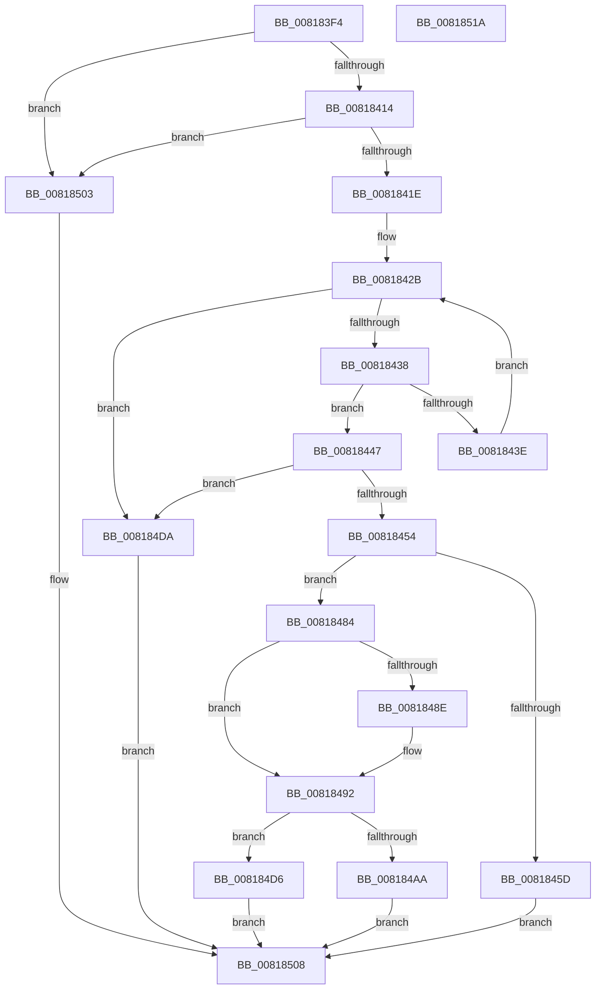

# SdbpGetSystemSdbFilePath

- RVA: `0x008183F4`–`0x0081851B` (길이 `295` bytes)
- VA: `0x00000001408183F4`
- 실행 섹션: `PAGE`
- PDB 이름 있음: `예`; PDB Function 태그: `아니요`
- unwind 정보 RVA: `0x00086C28`
- 디코드: `72`개 명령, `295/295` bytes 표시
- 미해석 바이트: `0` (있으면 어셈블리에 `.byte`로 보존)

> 이 문서는 커널 이미지의 기계어와 PDB 기호를 분석해 생성했습니다. 4번과 5번은 함수 원형과 자료형을 바이너리 사용 방식에서 추정한 C 해석이며 원본 소스 복구 결과는 아닙니다.

## 1. Dependencies

- 직접 호출 지점: **4**; 고유 호출 대상: **2**
- 직접 호출자로 확인된 함수: **2**
- RIP 상대 이미지 참조: **5**

### Outgoing calls
- `0x00818475` → [AslLogCallPrintf](../95/AslLogCallPrintf_function_0095E4EC.md) (function, `0x0095E4EC`)
- `0x0081849F` → [guard_dispatch_icall](../../text/6B/guard_dispatch_icall_function_006BAAD0.md) (function, `0x006BAAD0`)
- `0x008184CF` → [AslLogCallPrintf](../95/AslLogCallPrintf_function_0095E4EC.md) (function, `0x0095E4EC`)
- `0x008184F7` → [AslLogCallPrintf](../95/AslLogCallPrintf_function_0095E4EC.md) (function, `0x0095E4EC`)

### Direct callers
- [SdbGetPathCustomSdb](SdbGetPathCustomSdb_function_0081795C.md) at `0x008179E6`
- [SdbGetPathSystemSdb](SdbGetPathSystemSdb_function_00817A2C.md) at `0x00817A3B`

### Static image references
- `0x00818424` → RVA `0x00009900` (`.rdata`; read)
- `0x0081845D` → RVA `0x0003DAE0` (`.rdata`; read)
- `0x0081846A` → RVA `0x0003DAC0` (`.rdata`; read)
- `0x008184AE` → RVA `0x0003DB18` (`.rdata`; read)
- `0x008184DA` → RVA `0x0003DA88` (`.rdata`; read)

## 2. Other-region calls and transfers

- 다른 실행 섹션으로 향하는 call: **1**
  - `0x0081849F` → [guard_dispatch_icall](../../text/6B/guard_dispatch_icall_function_006BAAD0.md) (`PAGE` → `.text`)
- 별도 외부 분기/꼬리 이동을 확인하지 못했습니다.

## 3. Assembly (complete function range)

```asm
008183F4  48 89 5C 24 08                  mov qword ptr [rsp + 8], rbx
008183F9  48 89 74 24 10                  mov qword ptr [rsp + 0x10], rsi
008183FE  57                              push rdi
008183FF  48 83 EC 40                     sub rsp, 0x40
00818403  33 F6                           xor esi, esi
00818405  41 8B F8                        mov edi, r8d
00818408  66 89 31                        mov word ptr [rcx], si
0081840B  45 85 C0                        test r8d, r8d
0081840E  0F 84 EF 00 00 00               je 0x140818503
00818414  41 83 F8 0D                     cmp r8d, 0xd
00818418  0F 8D E5 00 00 00               jge 0x140818503
0081841E  8D 46 01                        lea eax, [rsi + 1]
00818421  8D 56 20                        lea edx, [rsi + 0x20]
00818424  4C 8D 05 D5 14 7F FF            lea r8, [rip - 0x80eb2b]
0081842B  48 81 FA A0 01 00 00            cmp rdx, 0x1a0
00818432  0F 83 A2 00 00 00               jae 0x1408184da
00818438  42 39 3C 02                     cmp dword ptr [rdx + r8], edi
0081843C  74 09                           je 0x140818447
0081843E  48 FF C0                        inc rax
00818441  48 83 C2 20                     add rdx, 0x20
00818445  EB E4                           jmp 0x14081842b
00818447  48 C1 E0 05                     shl rax, 5
0081844B  49 03 C0                        add rax, r8
0081844E  0F 84 86 00 00 00               je 0x1408184da
00818454  4C 8B 50 10                     mov r10, qword ptr [rax + 0x10]
00818458  4D 85 D2                        test r10, r10
0081845B  75 27                           jne 0x140818484
0081845D  4C 8D 0D 7C 56 82 FF            lea r9, [rip - 0x7da984]
00818464  41 B8 77 05 00 00               mov r8d, 0x577
0081846A  48 8D 15 4F 56 82 FF            lea rdx, [rip - 0x7da9b1]
00818471  41 8D 4A 01                     lea ecx, [r10 + 1]
00818475  E8 72 60 14 00                  call 0x14095e4ec
0081847A  BB E5 00 00 C0                  mov ebx, 0xc00000e5
0081847F  E9 84 00 00 00                  jmp 0x140818508
00818484  4C 8B 44 24 70                  mov r8, qword ptr [rsp + 0x70]
00818489  4D 85 C0                        test r8, r8
0081848C  75 04                           jne 0x140818492
0081848E  4C 8B 40 08                     mov r8, qword ptr [rax + 8]
00818492  4C 8B 4C 24 78                  mov r9, qword ptr [rsp + 0x78]
00818497  BA 04 01 00 00                  mov edx, 0x104
0081849C  49 8B C2                        mov rax, r10
0081849F  E8 2C 26 EA FF                  call 0x1406baad0
008184A4  8B D8                           mov ebx, eax
008184A6  85 C0                           test eax, eax
008184A8  79 2C                           jns 0x1408184d6
008184AA  89 44 24 30                     mov dword ptr [rsp + 0x30], eax
008184AE  4C 8D 0D 63 56 82 FF            lea r9, [rip - 0x7da99d]
008184B5  89 74 24 28                     mov dword ptr [rsp + 0x28], esi
008184B9  48 8D 15 00 56 82 FF            lea rdx, [rip - 0x7daa00]
008184C0  41 B8 81 05 00 00               mov r8d, 0x581
008184C6  89 7C 24 20                     mov dword ptr [rsp + 0x20], edi
008184CA  B9 01 00 00 00                  mov ecx, 1
008184CF  E8 18 60 14 00                  call 0x14095e4ec
008184D4  EB 32                           jmp 0x140818508
008184D6  8B DE                           mov ebx, esi
008184D8  EB 2E                           jmp 0x140818508
008184DA  4C 8D 0D A7 55 82 FF            lea r9, [rip - 0x7daa59]
008184E1  89 7C 24 20                     mov dword ptr [rsp + 0x20], edi
008184E5  41 B8 69 05 00 00               mov r8d, 0x569
008184EB  48 8D 15 CE 55 82 FF            lea rdx, [rip - 0x7daa32]
008184F2  B9 01 00 00 00                  mov ecx, 1
008184F7  E8 F0 5F 14 00                  call 0x14095e4ec
008184FC  BB 25 02 00 C0                  mov ebx, 0xc0000225
00818501  EB 05                           jmp 0x140818508
00818503  BB F1 00 00 C0                  mov ebx, 0xc00000f1
00818508  48 8B 74 24 58                  mov rsi, qword ptr [rsp + 0x58]
0081850D  8B C3                           mov eax, ebx
0081850F  48 8B 5C 24 50                  mov rbx, qword ptr [rsp + 0x50]
00818514  48 83 C4 40                     add rsp, 0x40
00818518  5F                              pop rdi
00818519  C3                              ret
0081851A  CC                              int3
```

## 4. C-style interpretation (structured pseudocode)

```c
__int64 __fastcall SdbpGetSystemSdbFilePath(__int64 a1, __int64 a2, int a3, __int64 a4, __int64 a5, __int64 a6)
{
    __int64 result;
    __int64 v_rsi;
    __int64 v_rsp;
    unsigned int v_stack_m18;
    unsigned int v_stack_m20;
    unsigned int v_stack_m28;
    unsigned __int64 v_stack_p10;
    unsigned __int64 v_stack_p8;

    v_stack_p8 = v_rbx;
    v_stack_p10 = v_rsi;
    v_rsp = (v_rsp) - (64);
    v_rsi = 0;
    *(unsigned __int16 *)(a1) = 0;
    if (a3 == 0) goto loc_00818503;
    if (a3 >= 13) goto loc_00818503;
loc_0081842B:
    if ((v_rsi + 32) >= 416) goto loc_008184DA;
    if ((*(unsigned int *)(v_rsi + 32 + v_rip - 8448811 * 1)) == ((unsigned int)((unsigned int)(a3)))) goto loc_00818447;
    result = (v_rsi + 1) + 1;
    a2 = (v_rsi + 32) + (32);
    goto loc_0081842B;
loc_00818447:
    result = (result) << (5);
    result = (result) + (v_rip - 8448811);
    if (condition_is_equal) goto loc_008184DA;
    if (*(unsigned __int64 *)(result + 16) != 0) goto loc_00818484;
    result = AslLogCallPrintf(*(unsigned __int64 *)(result + 16) + 1, v_rip - 8235441, (unsigned int)(0x577ULL), v_rip - 8235396);
    goto loc_00818508;
loc_00818484:
    if (a5 == 0) {
        a3 = *(unsigned __int64 *)(result + 8);
    }
    result = guard_dispatch_icall(*(unsigned __int64 *)(result + 16) + 1, 260, a3, a6);
    if (!sign_flag) goto loc_008184D6;
    v_stack_m18 = (unsigned int)(result);
    v_stack_m20 = 0;
    v_stack_m28 = (unsigned int)((unsigned int)(a3));
    result = AslLogCallPrintf(1, v_rip - 8235520, (unsigned int)(0x581ULL), v_rip - 8235421);
    goto loc_00818508;
loc_008184D6:
    goto loc_00818508;
loc_008184DA:
    v_stack_m28 = (unsigned int)((unsigned int)(a3));
    result = AslLogCallPrintf(1, v_rip - 8235570, (unsigned int)(0x569ULL), v_rip - 8235609);
    goto loc_00818508;
loc_00818503:
loc_00818508:
    v_rsp = (v_rsp) + (64);
    return (unsigned int)((unsigned int)((unsigned int)(0xC00000F1ULL)));
}
```

## 5. (Beta) C Style

```c
int64_t SdbpGetSystemSdbFilePath(void *Arg1, int64_t Arg2, int32_t Arg3, int64_t Arg4, int64_t Arg5, int64_t Arg6)
{
    uint8_t *arg1 = (uint8_t *)Arg1;

    int64_t result;
    int64_t local_rsi;
    int64_t local_rsp;
    uint32_t v_stack_m18;
    uint32_t v_stack_m20;
    uint32_t v_stack_m28;
    uint64_t v_stack_p10;
    uint64_t v_stack_p8;

    v_stack_p8 = local_rbx;
    v_stack_p10 = local_rsi;
    local_rsp = (local_rsp) - (64);
    local_rsi = 0;
    *(uint16_t *)(arg1) = 0;
    if (Arg3 == 0) goto loc_00818503;
    if (Arg3 >= 13) goto loc_00818503;
loc_0081842B:
    if ((local_rsi + 32) >= 416) goto loc_008184DA;
    if ((*(uint32_t *)(local_rsi + 0x20 + v_rip - 0x80EB2B * 1)) == ((uint32_t)((uint32_t)(Arg3)))) goto loc_00818447;
    result = (local_rsi + 1) + 1;
    Arg2 = (local_rsi + 32) + (32);
    goto loc_0081842B;
loc_00818447:
    result = (result) << (5);
    result = (result) + (v_rip - 8448811);
    if (condition_is_equal) goto loc_008184DA;
    if (*(uint64_t *)(result + 0x10) != 0) goto loc_00818484;
    result = AslLogCallPrintf(*(uint64_t *)(result + 0x10) + 1, v_rip - 8235441, (uint32_t)(0x577ULL), v_rip - 8235396);
    goto loc_00818508;
loc_00818484:
    if (Arg5 == 0) {
        Arg3 = *(uint64_t *)(result + 0x8);
    }
    result = guard_dispatch_icall(*(uint64_t *)(result + 0x10) + 1, 260, Arg3, Arg6);
    if (!sign_flag) goto loc_008184D6;
    v_stack_m18 = (uint32_t)(result);
    v_stack_m20 = 0;
    v_stack_m28 = (uint32_t)((uint32_t)(Arg3));
    result = AslLogCallPrintf(1, v_rip - 8235520, (uint32_t)(0x581ULL), v_rip - 8235421);
    goto loc_00818508;
loc_008184D6:
    goto loc_00818508;
loc_008184DA:
    v_stack_m28 = (uint32_t)((uint32_t)(Arg3));
    result = AslLogCallPrintf(1, v_rip - 8235570, (uint32_t)(0x569ULL), v_rip - 8235609);
    goto loc_00818508;
loc_00818503:
loc_00818508:
    local_rsp = (local_rsp) + (64);
    return (uint32_t)((uint32_t)((uint32_t)(0xC00000F1ULL)));
}
```

### 관측된 메모리 오프셋

구조체 형식이 확인되지 않은 접근은 인자 기준의 오프셋으로만 기록했습니다.

| 기준 인자 | 오프셋 표현 | 폭 (bit) | 접근 |
|---|---:|---:|---|
| `Arg1` | `+ 0x0` | `16` | `W` |

## 6. Execution-region graph

[열기: 2D/3D 그래프와 함수 탐색 컨트롤 패널](../../../control-panel.html?section=page&rva=0x008183F4&view=graph)

- 2D 그래프는 위에서 아래로 흐르고, 3D 그래프는 빈 공간을 드래그해 회전합니다. Shift+드래그는 이동, 휠은 확대·축소, 함수 노드 선택은 대상 보고서 이동입니다.

### Static fallback


