# SdbpGetVelocityState

- RVA: `0x00816088`–`0x0081620A` (길이 `386` bytes)
- VA: `0x0000000140816088`
- 실행 섹션: `PAGE`
- PDB 이름 있음: `예`; PDB Function 태그: `아니요`
- unwind 정보 RVA: `0x0005FEF8`
- 디코드: `105`개 명령, `386/386` bytes 표시
- 미해석 바이트: `0` (있으면 어셈블리에 `.byte`로 보존)

> 이 문서는 커널 이미지의 기계어와 PDB 기호를 분석해 생성했습니다. 4번과 5번은 함수 원형과 자료형을 바이너리 사용 방식에서 추정한 C 해석이며 원본 소스 복구 결과는 아닙니다.

## 1. Dependencies

- 직접 호출 지점: **27**; 고유 호출 대상: **26**
- 직접 호출자로 확인된 함수: **1**
- RIP 상대 이미지 참조: **3**

### Outgoing calls
- `0x008160C3` → [wcsicmp](../../text/50/wcsicmp_function_00500080.md) (function, `0x00500080`)
- `0x008160F9` → [Feature_CompatPreallocatedVelocity55922052__private_IsEnabledDeviceUsageNoInline](../../text/69/Feature_CompatPreallocatedVelocity55922052__private_IsEnabledDeviceUsageNoInline_function_0069C0B4.md) (function, `0x0069C0B4`)
- `0x00816108` → [Feature_CompatPreallocatedVelocity55922053__private_IsEnabledDeviceUsageNoInline](../../text/69/Feature_CompatPreallocatedVelocity55922053__private_IsEnabledDeviceUsageNoInline_function_0069C108.md) (function, `0x0069C108`)
- `0x0081610F` → [Feature_CompatPreallocatedVelocity55922054__private_IsEnabledDeviceUsageNoInline](../../text/69/Feature_CompatPreallocatedVelocity55922054__private_IsEnabledDeviceUsageNoInline_function_0069C15C.md) (function, `0x0069C15C`)
- `0x00816116` → [Feature_CompatPreallocatedVelocity55922055__private_IsEnabledDeviceUsageNoInline](../../text/69/Feature_CompatPreallocatedVelocity55922055__private_IsEnabledDeviceUsageNoInline_function_0069C1B0.md) (function, `0x0069C1B0`)
- `0x0081611D` → [Feature_CompatPreallocatedVelocity55922056__private_IsEnabledDeviceUsageNoInline](../../text/69/Feature_CompatPreallocatedVelocity55922056__private_IsEnabledDeviceUsageNoInline_function_0069C204.md) (function, `0x0069C204`)
- `0x00816124` → [Feature_CompatPreallocatedVelocity55922057__private_IsEnabledDeviceUsageNoInline](../../text/69/Feature_CompatPreallocatedVelocity55922057__private_IsEnabledDeviceUsageNoInline_function_0069C258.md) (function, `0x0069C258`)
- `0x0081612B` → [Feature_CompatPreallocatedVelocity55922058__private_IsEnabledDeviceUsageNoInline](../../text/69/Feature_CompatPreallocatedVelocity55922058__private_IsEnabledDeviceUsageNoInline_function_0069C2AC.md) (function, `0x0069C2AC`)
- `0x00816132` → [Feature_CompatPreallocatedVelocity55922060__private_IsEnabledDeviceUsageNoInline](../../text/69/Feature_CompatPreallocatedVelocity55922060__private_IsEnabledDeviceUsageNoInline_function_0069C300.md) (function, `0x0069C300`)
- `0x00816139` → [Feature_CompatPreallocatedVelocity55922061__private_IsEnabledDeviceUsageNoInline](../../text/69/Feature_CompatPreallocatedVelocity55922061__private_IsEnabledDeviceUsageNoInline_function_0069C354.md) (function, `0x0069C354`)
- `0x00816140` → [Feature_CompatPreallocatedVelocity55922062__private_IsEnabledDeviceUsageNoInline](../../text/69/Feature_CompatPreallocatedVelocity55922062__private_IsEnabledDeviceUsageNoInline_function_0069C3A8.md) (function, `0x0069C3A8`)
- `0x00816147` → [Feature_CompatPreallocatedVelocity55922063__private_IsEnabledDeviceUsageNoInline](../../text/69/Feature_CompatPreallocatedVelocity55922063__private_IsEnabledDeviceUsageNoInline_function_0069C3FC.md) (function, `0x0069C3FC`)
- `0x0081614E` → [Feature_CompatPreallocatedVelocity55922064__private_IsEnabledDeviceUsageNoInline](../../text/69/Feature_CompatPreallocatedVelocity55922064__private_IsEnabledDeviceUsageNoInline_function_0069C450.md) (function, `0x0069C450`)
- `0x00816155` → [Feature_CompatPreallocatedVelocity55922065__private_IsEnabledDeviceUsageNoInline](../../text/69/Feature_CompatPreallocatedVelocity55922065__private_IsEnabledDeviceUsageNoInline_function_0069C4A4.md) (function, `0x0069C4A4`)
- `0x0081615C` → [Feature_CompatPreallocatedVelocity55922067__private_IsEnabledDeviceUsageNoInline](../../text/69/Feature_CompatPreallocatedVelocity55922067__private_IsEnabledDeviceUsageNoInline_function_0069C4F8.md) (function, `0x0069C4F8`)
- `0x00816163` → [Feature_CompatPreallocatedVelocity55922068__private_IsEnabledDeviceUsageNoInline](../../text/69/Feature_CompatPreallocatedVelocity55922068__private_IsEnabledDeviceUsageNoInline_function_0069C54C.md) (function, `0x0069C54C`)
- `0x0081616A` → [Feature_CompatPreallocatedVelocity55922069__private_IsEnabledDeviceUsageNoInline](../../text/69/Feature_CompatPreallocatedVelocity55922069__private_IsEnabledDeviceUsageNoInline_function_0069C5A0.md) (function, `0x0069C5A0`)
- `0x00816171` → [Feature_CompatPreallocatedVelocity55922070__private_IsEnabledDeviceUsageNoInline](../../text/69/Feature_CompatPreallocatedVelocity55922070__private_IsEnabledDeviceUsageNoInline_function_0069C5F4.md) (function, `0x0069C5F4`)
- `0x00816178` → [Feature_CompatPreallocatedVelocity55922071__private_IsEnabledDeviceUsageNoInline](../../text/69/Feature_CompatPreallocatedVelocity55922071__private_IsEnabledDeviceUsageNoInline_function_0069C648.md) (function, `0x0069C648`)
- `0x00816182` → [Feature_CompatPreallocatedVelocity55922072__private_IsEnabledDeviceUsageNoInline](../../text/69/Feature_CompatPreallocatedVelocity55922072__private_IsEnabledDeviceUsageNoInline_function_0069C69C.md) (function, `0x0069C69C`)
- `0x0081618C` → [Feature_CompatPreallocatedVelocity55922073__private_IsEnabledDeviceUsageNoInline](../../text/69/Feature_CompatPreallocatedVelocity55922073__private_IsEnabledDeviceUsageNoInline_function_0069C6F0.md) (function, `0x0069C6F0`)
- `0x00816196` → [Feature_CompatPreallocatedVelocity55922074__private_IsEnabledDeviceUsageNoInline](../../text/69/Feature_CompatPreallocatedVelocity55922074__private_IsEnabledDeviceUsageNoInline_function_0069C744.md) (function, `0x0069C744`)
- `0x008161A0` → [Feature_CompatPreallocatedVelocity55922075__private_IsEnabledDeviceUsageNoInline](../../text/69/Feature_CompatPreallocatedVelocity55922075__private_IsEnabledDeviceUsageNoInline_function_0069C798.md) (function, `0x0069C798`)
- `0x008161AA` → [Feature_CompatPreallocatedVelocity55922076__private_IsEnabledDeviceUsageNoInline](../../text/69/Feature_CompatPreallocatedVelocity55922076__private_IsEnabledDeviceUsageNoInline_function_0069C7EC.md) (function, `0x0069C7EC`)
- `0x008161B4` → [Feature_CompatPreallocatedVelocity55922077__private_IsEnabledDeviceUsageNoInline](../../text/69/Feature_CompatPreallocatedVelocity55922077__private_IsEnabledDeviceUsageNoInline_function_0069C840.md) (function, `0x0069C840`)
- `0x008161BE` → [Feature_CompatPreallocatedVelocity55922078__private_IsEnabledDeviceUsageNoInline](../../text/69/Feature_CompatPreallocatedVelocity55922078__private_IsEnabledDeviceUsageNoInline_function_0069C894.md) (function, `0x0069C894`)
- `0x008161D2` → [wcsicmp](../../text/50/wcsicmp_function_00500080.md) (function, `0x00500080`)

### Direct callers
- [SdbpCheckContainment](SdbpCheckContainment_function_00813D30.md) at `0x00813DDE`

### Static image references
- `0x008160AD` → RVA `0x0003C810` (`.rdata`; read)
- `0x008160E2` → RVA `0x00000000` (`image boundary/outside`; read)
- `0x008161C8` → RVA `0x0003C808` (`.rdata`; read)

## 2. Other-region calls and transfers

- 다른 실행 섹션으로 향하는 call: **27**
  - `0x008160C3` → [wcsicmp](../../text/50/wcsicmp_function_00500080.md) (`PAGE` → `.text`)
  - `0x008160F9` → [Feature_CompatPreallocatedVelocity55922052__private_IsEnabledDeviceUsageNoInline](../../text/69/Feature_CompatPreallocatedVelocity55922052__private_IsEnabledDeviceUsageNoInline_function_0069C0B4.md) (`PAGE` → `.text`)
  - `0x00816108` → [Feature_CompatPreallocatedVelocity55922053__private_IsEnabledDeviceUsageNoInline](../../text/69/Feature_CompatPreallocatedVelocity55922053__private_IsEnabledDeviceUsageNoInline_function_0069C108.md) (`PAGE` → `.text`)
  - `0x0081610F` → [Feature_CompatPreallocatedVelocity55922054__private_IsEnabledDeviceUsageNoInline](../../text/69/Feature_CompatPreallocatedVelocity55922054__private_IsEnabledDeviceUsageNoInline_function_0069C15C.md) (`PAGE` → `.text`)
  - `0x00816116` → [Feature_CompatPreallocatedVelocity55922055__private_IsEnabledDeviceUsageNoInline](../../text/69/Feature_CompatPreallocatedVelocity55922055__private_IsEnabledDeviceUsageNoInline_function_0069C1B0.md) (`PAGE` → `.text`)
  - `0x0081611D` → [Feature_CompatPreallocatedVelocity55922056__private_IsEnabledDeviceUsageNoInline](../../text/69/Feature_CompatPreallocatedVelocity55922056__private_IsEnabledDeviceUsageNoInline_function_0069C204.md) (`PAGE` → `.text`)
  - `0x00816124` → [Feature_CompatPreallocatedVelocity55922057__private_IsEnabledDeviceUsageNoInline](../../text/69/Feature_CompatPreallocatedVelocity55922057__private_IsEnabledDeviceUsageNoInline_function_0069C258.md) (`PAGE` → `.text`)
  - `0x0081612B` → [Feature_CompatPreallocatedVelocity55922058__private_IsEnabledDeviceUsageNoInline](../../text/69/Feature_CompatPreallocatedVelocity55922058__private_IsEnabledDeviceUsageNoInline_function_0069C2AC.md) (`PAGE` → `.text`)
  - `0x00816132` → [Feature_CompatPreallocatedVelocity55922060__private_IsEnabledDeviceUsageNoInline](../../text/69/Feature_CompatPreallocatedVelocity55922060__private_IsEnabledDeviceUsageNoInline_function_0069C300.md) (`PAGE` → `.text`)
  - `0x00816139` → [Feature_CompatPreallocatedVelocity55922061__private_IsEnabledDeviceUsageNoInline](../../text/69/Feature_CompatPreallocatedVelocity55922061__private_IsEnabledDeviceUsageNoInline_function_0069C354.md) (`PAGE` → `.text`)
  - `0x00816140` → [Feature_CompatPreallocatedVelocity55922062__private_IsEnabledDeviceUsageNoInline](../../text/69/Feature_CompatPreallocatedVelocity55922062__private_IsEnabledDeviceUsageNoInline_function_0069C3A8.md) (`PAGE` → `.text`)
  - `0x00816147` → [Feature_CompatPreallocatedVelocity55922063__private_IsEnabledDeviceUsageNoInline](../../text/69/Feature_CompatPreallocatedVelocity55922063__private_IsEnabledDeviceUsageNoInline_function_0069C3FC.md) (`PAGE` → `.text`)
  - `0x0081614E` → [Feature_CompatPreallocatedVelocity55922064__private_IsEnabledDeviceUsageNoInline](../../text/69/Feature_CompatPreallocatedVelocity55922064__private_IsEnabledDeviceUsageNoInline_function_0069C450.md) (`PAGE` → `.text`)
  - `0x00816155` → [Feature_CompatPreallocatedVelocity55922065__private_IsEnabledDeviceUsageNoInline](../../text/69/Feature_CompatPreallocatedVelocity55922065__private_IsEnabledDeviceUsageNoInline_function_0069C4A4.md) (`PAGE` → `.text`)
  - `0x0081615C` → [Feature_CompatPreallocatedVelocity55922067__private_IsEnabledDeviceUsageNoInline](../../text/69/Feature_CompatPreallocatedVelocity55922067__private_IsEnabledDeviceUsageNoInline_function_0069C4F8.md) (`PAGE` → `.text`)
  - `0x00816163` → [Feature_CompatPreallocatedVelocity55922068__private_IsEnabledDeviceUsageNoInline](../../text/69/Feature_CompatPreallocatedVelocity55922068__private_IsEnabledDeviceUsageNoInline_function_0069C54C.md) (`PAGE` → `.text`)
  - `0x0081616A` → [Feature_CompatPreallocatedVelocity55922069__private_IsEnabledDeviceUsageNoInline](../../text/69/Feature_CompatPreallocatedVelocity55922069__private_IsEnabledDeviceUsageNoInline_function_0069C5A0.md) (`PAGE` → `.text`)
  - `0x00816171` → [Feature_CompatPreallocatedVelocity55922070__private_IsEnabledDeviceUsageNoInline](../../text/69/Feature_CompatPreallocatedVelocity55922070__private_IsEnabledDeviceUsageNoInline_function_0069C5F4.md) (`PAGE` → `.text`)
  - `0x00816178` → [Feature_CompatPreallocatedVelocity55922071__private_IsEnabledDeviceUsageNoInline](../../text/69/Feature_CompatPreallocatedVelocity55922071__private_IsEnabledDeviceUsageNoInline_function_0069C648.md) (`PAGE` → `.text`)
  - `0x00816182` → [Feature_CompatPreallocatedVelocity55922072__private_IsEnabledDeviceUsageNoInline](../../text/69/Feature_CompatPreallocatedVelocity55922072__private_IsEnabledDeviceUsageNoInline_function_0069C69C.md) (`PAGE` → `.text`)
  - `0x0081618C` → [Feature_CompatPreallocatedVelocity55922073__private_IsEnabledDeviceUsageNoInline](../../text/69/Feature_CompatPreallocatedVelocity55922073__private_IsEnabledDeviceUsageNoInline_function_0069C6F0.md) (`PAGE` → `.text`)
  - `0x00816196` → [Feature_CompatPreallocatedVelocity55922074__private_IsEnabledDeviceUsageNoInline](../../text/69/Feature_CompatPreallocatedVelocity55922074__private_IsEnabledDeviceUsageNoInline_function_0069C744.md) (`PAGE` → `.text`)
  - `0x008161A0` → [Feature_CompatPreallocatedVelocity55922075__private_IsEnabledDeviceUsageNoInline](../../text/69/Feature_CompatPreallocatedVelocity55922075__private_IsEnabledDeviceUsageNoInline_function_0069C798.md) (`PAGE` → `.text`)
  - `0x008161AA` → [Feature_CompatPreallocatedVelocity55922076__private_IsEnabledDeviceUsageNoInline](../../text/69/Feature_CompatPreallocatedVelocity55922076__private_IsEnabledDeviceUsageNoInline_function_0069C7EC.md) (`PAGE` → `.text`)
  - `0x008161B4` → [Feature_CompatPreallocatedVelocity55922077__private_IsEnabledDeviceUsageNoInline](../../text/69/Feature_CompatPreallocatedVelocity55922077__private_IsEnabledDeviceUsageNoInline_function_0069C840.md) (`PAGE` → `.text`)
  - `0x008161BE` → [Feature_CompatPreallocatedVelocity55922078__private_IsEnabledDeviceUsageNoInline](../../text/69/Feature_CompatPreallocatedVelocity55922078__private_IsEnabledDeviceUsageNoInline_function_0069C894.md) (`PAGE` → `.text`)
  - `0x008161D2` → [wcsicmp](../../text/50/wcsicmp_function_00500080.md) (`PAGE` → `.text`)
- 별도 외부 분기/꼬리 이동을 확인하지 못했습니다.

## 3. Assembly (complete function range)

```asm
00816088  48 8B C4                        mov rax, rsp
0081608B  48 89 58 08                     mov qword ptr [rax + 8], rbx
0081608F  48 89 68 10                     mov qword ptr [rax + 0x10], rbp
00816093  48 89 70 18                     mov qword ptr [rax + 0x18], rsi
00816097  48 89 78 20                     mov qword ptr [rax + 0x20], rdi
0081609B  41 54                           push r12
0081609D  41 56                           push r14
0081609F  41 57                           push r15
008160A1  48 83 EC 20                     sub rsp, 0x20
008160A5  33 DB                           xor ebx, ebx
008160A7  4C 8B FA                        mov r15, rdx
008160AA  4C 8B E1                        mov r12, rcx
008160AD  48 8D 15 5C 67 82 FF            lea rdx, [rip - 0x7d98a4]
008160B4  49 8B C8                        mov rcx, r8
008160B7  41 8B E9                        mov ebp, r9d
008160BA  49 8B F0                        mov rsi, r8
008160BD  44 8B F3                        mov r14d, ebx
008160C0  8D 7B 01                        lea edi, [rbx + 1]
008160C3  E8 B8 9F CE FF                  call 0x140500080
008160C8  85 C0                           test eax, eax
008160CA  0F 85 F8 00 00 00               jne 0x1408161c8
008160D0  8D 85 7C B2 AA FC               lea eax, [rbp - 0x3554d84]
008160D6  44 8B F7                        mov r14d, edi
008160D9  83 F8 1A                        cmp eax, 0x1a
008160DC  0F 87 FC 00 00 00               ja 0x1408161de
008160E2  48 8D 15 17 9F 7E FF            lea rdx, [rip - 0x8160e9]
008160E9  8B 8C 82 00 33 04 00            mov ecx, dword ptr [rdx + rax*4 + 0x43300]
008160F0  48 03 CA                        add rcx, rdx
008160F3  FF E1                           jmp rcx
008160F5  CC                              int3
008160F6  CC                              int3
008160F7  CC                              int3
008160F8  CC                              int3
008160F9  E8 B6 5F E8 FF                  call 0x14069c0b4
008160FE  85 C0                           test eax, eax
00816100  0F 95 C3                        setne bl
00816103  E9 D8 00 00 00                  jmp 0x1408161e0
00816108  E8 FB 5F E8 FF                  call 0x14069c108
0081610D  EB EF                           jmp 0x1408160fe
0081610F  E8 48 60 E8 FF                  call 0x14069c15c
00816114  EB E8                           jmp 0x1408160fe
00816116  E8 95 60 E8 FF                  call 0x14069c1b0
0081611B  EB E1                           jmp 0x1408160fe
0081611D  E8 E2 60 E8 FF                  call 0x14069c204
00816122  EB DA                           jmp 0x1408160fe
00816124  E8 2F 61 E8 FF                  call 0x14069c258
00816129  EB D3                           jmp 0x1408160fe
0081612B  E8 7C 61 E8 FF                  call 0x14069c2ac
00816130  EB CC                           jmp 0x1408160fe
00816132  E8 C9 61 E8 FF                  call 0x14069c300
00816137  EB C5                           jmp 0x1408160fe
00816139  E8 16 62 E8 FF                  call 0x14069c354
0081613E  EB BE                           jmp 0x1408160fe
00816140  E8 63 62 E8 FF                  call 0x14069c3a8
00816145  EB B7                           jmp 0x1408160fe
00816147  E8 B0 62 E8 FF                  call 0x14069c3fc
0081614C  EB B0                           jmp 0x1408160fe
0081614E  E8 FD 62 E8 FF                  call 0x14069c450
00816153  EB A9                           jmp 0x1408160fe
00816155  E8 4A 63 E8 FF                  call 0x14069c4a4
0081615A  EB A2                           jmp 0x1408160fe
0081615C  E8 97 63 E8 FF                  call 0x14069c4f8
00816161  EB 9B                           jmp 0x1408160fe
00816163  E8 E4 63 E8 FF                  call 0x14069c54c
00816168  EB 94                           jmp 0x1408160fe
0081616A  E8 31 64 E8 FF                  call 0x14069c5a0
0081616F  EB 8D                           jmp 0x1408160fe
00816171  E8 7E 64 E8 FF                  call 0x14069c5f4
00816176  EB 86                           jmp 0x1408160fe
00816178  E8 CB 64 E8 FF                  call 0x14069c648
0081617D  E9 7C FF FF FF                  jmp 0x1408160fe
00816182  E8 15 65 E8 FF                  call 0x14069c69c
00816187  E9 72 FF FF FF                  jmp 0x1408160fe
0081618C  E8 5F 65 E8 FF                  call 0x14069c6f0
00816191  E9 68 FF FF FF                  jmp 0x1408160fe
00816196  E8 A9 65 E8 FF                  call 0x14069c744
0081619B  E9 5E FF FF FF                  jmp 0x1408160fe
008161A0  E8 F3 65 E8 FF                  call 0x14069c798
008161A5  E9 54 FF FF FF                  jmp 0x1408160fe
008161AA  E8 3D 66 E8 FF                  call 0x14069c7ec
008161AF  E9 4A FF FF FF                  jmp 0x1408160fe
008161B4  E8 87 66 E8 FF                  call 0x14069c840
008161B9  E9 40 FF FF FF                  jmp 0x1408160fe
008161BE  E8 D1 66 E8 FF                  call 0x14069c894
008161C3  E9 36 FF FF FF                  jmp 0x1408160fe
008161C8  48 8D 15 39 66 82 FF            lea rdx, [rip - 0x7d99c7]
008161CF  48 8B CE                        mov rcx, rsi
008161D2  E8 A9 9E CE FF                  call 0x140500080
008161D7  85 C0                           test eax, eax
008161D9  75 03                           jne 0x1408161de
008161DB  44 8B F7                        mov r14d, edi
008161DE  8B FB                           mov edi, ebx
008161E0  48 8B 6C 24 48                  mov rbp, qword ptr [rsp + 0x48]
008161E5  41 8B C6                        mov eax, r14d
008161E8  48 8B 74 24 50                  mov rsi, qword ptr [rsp + 0x50]
008161ED  41 89 3C 24                     mov dword ptr [r12], edi
008161F1  48 8B 7C 24 58                  mov rdi, qword ptr [rsp + 0x58]
008161F6  41 89 1F                        mov dword ptr [r15], ebx
008161F9  48 8B 5C 24 40                  mov rbx, qword ptr [rsp + 0x40]
008161FE  48 83 C4 20                     add rsp, 0x20
00816202  41 5F                           pop r15
00816204  41 5E                           pop r14
00816206  41 5C                           pop r12
00816208  C3                              ret
00816209  CC                              int3
```

## 4. C-style interpretation (structured pseudocode)

```c
__int64 __fastcall SdbpGetVelocityState(__int64 a1, __int64 a2, __int64 a3, int a4)
{
    __int64 result;
    __int64 v_r14;
    __int64 v_rbx;
    __int64 v_rsp;
    unsigned __int64 v_stack_p10;
    unsigned __int64 v_stack_p18;
    unsigned __int64 v_stack_p20;
    unsigned __int64 v_stack_p8;

    *(unsigned __int64 *)(v_rsp + 8) = v_rbx;
    *(unsigned __int64 *)(v_rsp + 16) = v_rbp;
    *(unsigned __int64 *)(v_rsp + 24) = v_rsi;
    *(unsigned __int64 *)(v_rsp + 32) = v_rdi;
    v_rsp = (v_rsp) - (32);
    v_rbx = 0;
    result = wcsicmp(a3, v_rip - 8231076, a3, a4);
    if ((unsigned int)(result) != 0) goto loc_008161C8;
    if (((unsigned int)((unsigned int)(a4) - 55922052)) > 26) goto loc_008161DE;
    a1 = ((unsigned int)(*(unsigned int *)(v_rip - 8478953 + (unsigned int)(a4) - 55922052 * 4 + 275200))) + (v_rip - 8478953);
loc_008161C8:
    result = wcsicmp(a3, v_rip - 8231367, a3, a4);
    v_r14 = (unsigned int)((unsigned int)(v_rbx + 1));
    if ((unsigned int)(result) == 0) {
        v_r14 = (unsigned int)(v_rbx + 1);
    }
loc_008161E0:
    *(unsigned int *)(a1) = 0;
    *(unsigned int *)(a2) = 0;
    v_rsp = (v_rsp) + (32);
    return (unsigned int)((unsigned int)(v_r14));
}
```

## 5. (Beta) C Style

```c
int64_t SdbpGetVelocityState(void *Arg1, void *Arg2, int64_t Arg3, void *Arg4)
{
    uint8_t *arg1 = (uint8_t *)Arg1;
    uint8_t *arg2 = (uint8_t *)Arg2;
    uint8_t *arg4 = (uint8_t *)Arg4;

    int64_t result;
    int64_t local_r14;
    int64_t local_rbx;
    int64_t local_rsp;
    uint64_t v_stack_p10;
    uint64_t v_stack_p18;
    uint64_t v_stack_p20;
    uint64_t v_stack_p8;

    *(uint64_t *)(local_rsp + 0x8) = local_rbx;
    *(uint64_t *)(local_rsp + 0x10) = local_rbp;
    *(uint64_t *)(local_rsp + 0x18) = local_rsi;
    *(uint64_t *)(local_rsp + 0x20) = local_rdi;
    local_rsp = (local_rsp) - (32);
    local_rbx = 0;
    result = wcsicmp(Arg3, v_rip - 8231076, Arg3, Arg4);
    if ((uint32_t)(result) != 0) goto loc_008161C8;
    if (((uint32_t)((uint32_t)(Arg4) - 55922052)) > 26) goto loc_008161DE;
    Arg1 = ((uint32_t)(*(uint32_t *)(v_rip - 0x8160E9 + (uint32_t)(arg4) - 0x3554D84 * 4 + 0x43300))) + (v_rip - 8478953);
loc_008161C8:
    result = wcsicmp(Arg3, v_rip - 8231367, Arg3, Arg4);
    local_r14 = (uint32_t)((uint32_t)(local_rbx + 1));
    if ((uint32_t)(result) == 0) {
        local_r14 = (uint32_t)(local_rbx + 1);
    }
loc_008161E0:
    *(uint32_t *)(arg1) = 0;
    *(uint32_t *)(arg2) = 0;
    local_rsp = (local_rsp) + (32);
    return (uint32_t)((uint32_t)(local_r14));
}
```

### 관측된 메모리 오프셋

구조체 형식이 확인되지 않은 접근은 인자 기준의 오프셋으로만 기록했습니다.

| 기준 인자 | 오프셋 표현 | 폭 (bit) | 접근 |
|---|---:|---:|---|
| `Arg1` | `+ 0x0` | `32` | `W` |
| `Arg2` | `+ 0x0` | `32` | `W` |
| `Arg4` | `- 0x3554D84` | `32` | `R` |

## 6. Execution-region graph

[열기: 2D/3D 그래프와 함수 탐색 컨트롤 패널](../../../control-panel.html?section=page&rva=0x00816088&view=graph)

- 2D 그래프는 위에서 아래로 흐르고, 3D 그래프는 빈 공간을 드래그해 회전합니다. Shift+드래그는 이동, 휠은 확대·축소, 함수 노드 선택은 대상 보고서 이동입니다.

### Static fallback

```mermaid
flowchart TD
  bb_00816088[BB_00816088]
  bb_008160D0[BB_008160D0]
  bb_008160E2[BB_008160E2]
  bb_008160F5[BB_008160F5]
  bb_008160FE[BB_008160FE]
  bb_00816108[BB_00816108]
  bb_0081610F[BB_0081610F]
  bb_00816116[BB_00816116]
  bb_0081611D[BB_0081611D]
  bb_00816124[BB_00816124]
  bb_0081612B[BB_0081612B]
  bb_00816132[BB_00816132]
  bb_00816139[BB_00816139]
  bb_00816140[BB_00816140]
  bb_00816147[BB_00816147]
  bb_0081614E[BB_0081614E]
  bb_00816155[BB_00816155]
  bb_0081615C[BB_0081615C]
  bb_00816163[BB_00816163]
  bb_0081616A[BB_0081616A]
  bb_00816171[BB_00816171]
  bb_00816178[BB_00816178]
  bb_00816182[BB_00816182]
  bb_0081618C[BB_0081618C]
  bb_00816196[BB_00816196]
  bb_008161A0[BB_008161A0]
  bb_008161AA[BB_008161AA]
  bb_008161B4[BB_008161B4]
  bb_008161BE[BB_008161BE]
  bb_008161C8[BB_008161C8]
  bb_008161DB[BB_008161DB]
  bb_008161DE[BB_008161DE]
  bb_008161E0[BB_008161E0]
  bb_00816209[BB_00816209]
  bb_00816088 -->|branch| bb_008161C8
  bb_00816088 -->|fallthrough| bb_008160D0
  bb_008160D0 -->|branch| bb_008161DE
  bb_008160D0 -->|fallthrough| bb_008160E2
  bb_008160F5 -->|flow| bb_008160FE
  bb_008160FE -->|branch| bb_008161E0
  bb_00816108 -->|branch| bb_008160FE
  bb_0081610F -->|branch| bb_008160FE
  bb_00816116 -->|branch| bb_008160FE
  bb_0081611D -->|branch| bb_008160FE
  bb_00816124 -->|branch| bb_008160FE
  bb_0081612B -->|branch| bb_008160FE
  bb_00816132 -->|branch| bb_008160FE
  bb_00816139 -->|branch| bb_008160FE
  bb_00816140 -->|branch| bb_008160FE
  bb_00816147 -->|branch| bb_008160FE
  bb_0081614E -->|branch| bb_008160FE
  bb_00816155 -->|branch| bb_008160FE
  bb_0081615C -->|branch| bb_008160FE
  bb_00816163 -->|branch| bb_008160FE
  bb_0081616A -->|branch| bb_008160FE
  bb_00816171 -->|branch| bb_008160FE
  bb_00816178 -->|branch| bb_008160FE
  bb_00816182 -->|branch| bb_008160FE
  bb_0081618C -->|branch| bb_008160FE
  bb_00816196 -->|branch| bb_008160FE
  bb_008161A0 -->|branch| bb_008160FE
  bb_008161AA -->|branch| bb_008160FE
  bb_008161B4 -->|branch| bb_008160FE
  bb_008161BE -->|branch| bb_008160FE
  bb_008161C8 -->|branch| bb_008161DE
  bb_008161C8 -->|fallthrough| bb_008161DB
  bb_008161DB -->|flow| bb_008161DE
  bb_008161DE -->|flow| bb_008161E0
```


