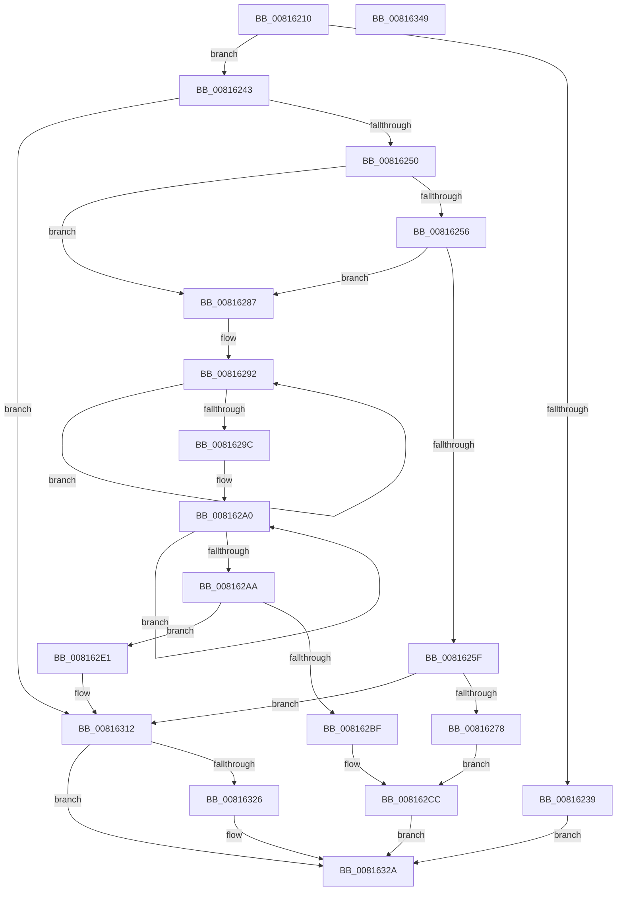

# SdbpInitializeSearchDBContext

- RVA: `0x00816210`–`0x0081634A` (길이 `314` bytes)
- VA: `0x0000000140816210`
- 실행 섹션: `PAGE`
- PDB 이름 있음: `예`; PDB Function 태그: `아니요`
- unwind 정보 RVA: `0x0005FEF8`
- 디코드: `87`개 명령, `314/314` bytes 표시
- 미해석 바이트: `0` (있으면 어셈블리에 `.byte`로 보존)

> 이 문서는 커널 이미지의 기계어와 PDB 기호를 분석해 생성했습니다. 4번과 5번은 함수 원형과 자료형을 바이너리 사용 방식에서 추정한 C 해석이며 원본 소스 복구 결과는 아닙니다.

## 1. Dependencies

- 직접 호출 지점: **6**; 고유 호출 대상: **5**
- 직접 호출자로 확인된 함수: **4**
- RIP 상대 이미지 참조: **3**

### Outgoing calls
- `0x00816267` → [SdbpGetProcessHistory](SdbpGetProcessHistory_function_00817250.md) (function, `0x00817250`)
- `0x008162B2` → [AslAlloc](../95/AslAlloc_function_0095BD34.md) (function, `0x0095BD34`)
- `0x008162D8` → [AslLogCallPrintf](../95/AslLogCallPrintf_function_0095E4EC.md) (function, `0x0095E4EC`)
- `0x008162F1` → [memcpy](../../text/6C/memcpy_function_006C6840.md) (function, `0x006C6840`)
- `0x00816304` → [memcpy](../../text/6C/memcpy_function_006C6840.md) (function, `0x006C6840`)
- `0x0081631D` → [SdbpCreateSearchPathPartsFromPath](../95/SdbpCreateSearchPathPartsFromPath_function_0095A238.md) (function, `0x0095A238`)

### Direct callers
- [SdbpCheckMatchingDir](SdbpCheckMatchingDir_function_00813EF0.md) at `0x00813F8B`
- [SdbpCheckMatchingFiles](SdbpCheckMatchingFiles_function_00814080.md) at `0x0081419D`
- [SdbpCheckMatchingTextEntry](SdbpCheckMatchingTextEntry_function_00814A70.md) at `0x00814AD4`
- [SdbpCheckMatchingWildcardFiles](SdbpCheckMatchingWildcardFiles_function_00814E30.md) at `0x00814F0A`

### Static image references
- `0x00816278` → RVA `0x0003C140` (`.rdata`; read)
- `0x008162BF` → RVA `0x0003C188` (`.rdata`; read)
- `0x008162CC` → RVA `0x0003C168` (`.rdata`; read)

## 2. Other-region calls and transfers

- 다른 실행 섹션으로 향하는 call: **2**
  - `0x008162F1` → [memcpy](../../text/6C/memcpy_function_006C6840.md) (`PAGE` → `.text`)
  - `0x00816304` → [memcpy](../../text/6C/memcpy_function_006C6840.md) (`PAGE` → `.text`)
- 별도 외부 분기/꼬리 이동을 확인하지 못했습니다.

## 3. Assembly (complete function range)

```asm
00816210  48 8B C4                        mov rax, rsp
00816213  48 89 58 08                     mov qword ptr [rax + 8], rbx
00816217  48 89 68 10                     mov qword ptr [rax + 0x10], rbp
0081621B  48 89 70 18                     mov qword ptr [rax + 0x18], rsi
0081621F  48 89 78 20                     mov qword ptr [rax + 0x20], rdi
00816223  41 54                           push r12
00816225  41 56                           push r14
00816227  41 57                           push r15
00816229  48 83 EC 20                     sub rsp, 0x20
0081622D  45 33 E4                        xor r12d, r12d
00816230  4C 8B F1                        mov r14, rcx
00816233  4C 39 61 48                     cmp qword ptr [rcx + 0x48], r12
00816237  74 0A                           je 0x140816243
00816239  41 8D 44 24 01                  lea eax, [r12 + 1]
0081623E  E9 E7 00 00 00                  jmp 0x14081632a
00816243  4C 8B 79 40                     mov r15, qword ptr [rcx + 0x40]
00816247  4D 85 FF                        test r15, r15
0081624A  0F 85 C2 00 00 00               jne 0x140816312
00816250  8B 01                           mov eax, dword ptr [rcx]
00816252  A8 02                           test al, 2
00816254  75 31                           jne 0x140816287
00816256  48 8B 49 38                     mov rcx, qword ptr [rcx + 0x38]
0081625A  48 85 C9                        test rcx, rcx
0081625D  74 28                           je 0x140816287
0081625F  4D 8B 46 28                     mov r8, qword ptr [r14 + 0x28]
00816263  49 8B 56 20                     mov rdx, qword ptr [r14 + 0x20]
00816267  E8 E4 0F 00 00                  call 0x140817250
0081626C  4C 8B F8                        mov r15, rax
0081626F  48 85 C0                        test rax, rax
00816272  0F 85 9A 00 00 00               jne 0x140816312
00816278  4C 8D 0D C1 5E 82 FF            lea r9, [rip - 0x7da13f]
0081627F  41 B8 49 02 00 00               mov r8d, 0x249
00816285  EB 45                           jmp 0x1408162cc
00816287  49 8B 46 20                     mov rax, qword ptr [r14 + 0x20]
0081628B  48 83 CB FF                     or rbx, 0xffffffffffffffff
0081628F  48 8B FB                        mov rdi, rbx
00816292  48 FF C7                        inc rdi
00816295  66 44 39 24 78                  cmp word ptr [rax + rdi*2], r12w
0081629A  75 F6                           jne 0x140816292
0081629C  49 8B 46 28                     mov rax, qword ptr [r14 + 0x28]
008162A0  48 FF C3                        inc rbx
008162A3  66 44 39 24 58                  cmp word ptr [rax + rbx*2], r12w
008162A8  75 F6                           jne 0x1408162a0
008162AA  8D 57 01                        lea edx, [rdi + 1]
008162AD  03 D3                           add edx, ebx
008162AF  48 03 D2                        add rdx, rdx
008162B2  E8 7D 5A 14 00                  call 0x14095bd34
008162B7  4C 8B F8                        mov r15, rax
008162BA  48 85 C0                        test rax, rax
008162BD  75 22                           jne 0x1408162e1
008162BF  4C 8D 0D C2 5E 82 FF            lea r9, [rip - 0x7da13e]
008162C6  41 B8 3A 02 00 00               mov r8d, 0x23a
008162CC  48 8D 15 95 5E 82 FF            lea rdx, [rip - 0x7da16b]
008162D3  B9 01 00 00 00                  mov ecx, 1
008162D8  E8 0F 82 14 00                  call 0x14095e4ec
008162DD  33 C0                           xor eax, eax
008162DF  EB 49                           jmp 0x14081632a
008162E1  49 8B 56 20                     mov rdx, qword ptr [r14 + 0x20]
008162E5  49 8B CF                        mov rcx, r15
008162E8  8B F7                           mov esi, edi
008162EA  48 8D 3C 36                     lea rdi, [rsi + rsi]
008162EE  4C 8B C7                        mov r8, rdi
008162F1  E8 4A 05 EB FF                  call 0x1406c6840
008162F6  49 8B 56 28                     mov rdx, qword ptr [r14 + 0x28]
008162FA  4A 8D 0C 3F                     lea rcx, [rdi + r15]
008162FE  8B DB                           mov ebx, ebx
00816300  4C 8D 04 1B                     lea r8, [rbx + rbx]
00816304  E8 37 05 EB FF                  call 0x1406c6840
00816309  48 8D 04 33                     lea rax, [rbx + rsi]
0081630D  66 45 89 24 47                  mov word ptr [r15 + rax*2], r12w
00816312  49 8D 56 48                     lea rdx, [r14 + 0x48]
00816316  4D 89 7E 40                     mov qword ptr [r14 + 0x40], r15
0081631A  49 8B CF                        mov rcx, r15
0081631D  E8 16 3F 14 00                  call 0x14095a238
00816322  85 C0                           test eax, eax
00816324  74 04                           je 0x14081632a
00816326  41 83 0E 01                     or dword ptr [r14], 1
0081632A  48 8B 5C 24 40                  mov rbx, qword ptr [rsp + 0x40]
0081632F  48 8B 6C 24 48                  mov rbp, qword ptr [rsp + 0x48]
00816334  48 8B 74 24 50                  mov rsi, qword ptr [rsp + 0x50]
00816339  48 8B 7C 24 58                  mov rdi, qword ptr [rsp + 0x58]
0081633E  48 83 C4 20                     add rsp, 0x20
00816342  41 5F                           pop r15
00816344  41 5E                           pop r14
00816346  41 5C                           pop r12
00816348  C3                              ret
00816349  CC                              int3
```

## 4. C-style interpretation (structured pseudocode)

```c
__int64 __fastcall SdbpInitializeSearchDBContext(__int64 a1)
{
    __int64 result;
    __int64 v_r12;
    __int64 v_rbx;
    __int64 v_rdi;
    __int64 v_rsp;
    unsigned __int64 v_stack_p10;
    unsigned __int64 v_stack_p18;
    unsigned __int64 v_stack_p20;
    unsigned __int64 v_stack_p8;

    *(unsigned __int64 *)(v_rsp + 8) = v_rbx;
    *(unsigned __int64 *)(v_rsp + 16) = v_rbp;
    *(unsigned __int64 *)(v_rsp + 24) = v_rsi;
    *(unsigned __int64 *)(v_rsp + 32) = v_rdi;
    v_rsp = (v_rsp) - (32);
    v_r12 = 0;
    if ((*(unsigned __int64 *)(a1 + 72)) == 0) goto loc_00816243;
    goto loc_0081632A;
loc_00816243:
    if (*(unsigned __int64 *)(a1 + 64) != 0) goto loc_00816312;
    if ((((unsigned __int8)((unsigned int)(*(unsigned int *)(a1)))) & (2)) != 0) goto loc_00816287;
    if (*(unsigned __int64 *)(a1 + 56) == 0) goto loc_00816287;
    result = SdbpGetProcessHistory(*(unsigned __int64 *)(a1 + 56), *(unsigned __int64 *)(a1 + 32), *(unsigned __int64 *)(a1 + 40), a4);
    if (result != 0) goto loc_00816312;
    goto loc_008162CC;
loc_00816287:
    v_rbx = (v_rbx) | (-1);
loc_00816292:
    v_rdi = (v_rbx) + 1;
    if ((*(unsigned __int16 *)(*(unsigned __int64 *)(a1 + 32) + v_rdi * 2)) != 0) goto loc_00816292;
loc_008162A0:
    v_rbx = (v_rbx) + 1;
    if ((*(unsigned __int16 *)(*(unsigned __int64 *)(a1 + 40) + v_rbx * 2)) != 0) goto loc_008162A0;
    a2 = (unsigned int)((v_rdi + 1) + ((unsigned int)(v_rbx)));
    a2 = (a2) + (a2);
    result = AslAlloc(*(unsigned __int64 *)(a1 + 56), a2, 585, v_rip - 8233279);
    if (result != 0) goto loc_008162E1;
loc_008162CC:
    result = AslLogCallPrintf(1, v_rip - 8233323, 570, v_rip - 8233278);
    result = 0;
    goto loc_0081632A;
loc_008162E1:
    result = memcpy(0, *(unsigned __int64 *)(a1 + 32), (unsigned int)((unsigned int)(v_rdi)) + (unsigned int)((unsigned int)(v_rdi)) * 1, v_rip - 8233278);
    result = memcpy((unsigned int)((unsigned int)(v_rdi)) + (unsigned int)((unsigned int)(v_rdi)) * 1 + result * 1, *(unsigned __int64 *)(a1 + 40), (unsigned int)((unsigned int)(v_rbx)) + (unsigned int)((unsigned int)(v_rbx)) * 1, v_rip - 8233278);
    *(unsigned __int16 *)(result + (unsigned int)((unsigned int)(v_rbx)) + (unsigned int)((unsigned int)(v_rdi)) * 1 * 2) = 0;
loc_00816312:
    *(unsigned __int64 *)(a1 + 64) = result;
    result = SdbpCreateSearchPathPartsFromPath(result, a1 + 72, (unsigned int)((unsigned int)(v_rbx)) + (unsigned int)((unsigned int)(v_rbx)) * 1, v_rip - 8233278);
    if ((unsigned int)(result) != 0) {
    }
    v_rsp = (v_rsp) + (32);
    return result;
}
```

## 5. (Beta) C Style

```c
int64_t SdbpInitializeSearchDBContext(void *Arg1)
{
    uint8_t *arg1 = (uint8_t *)Arg1;

    int64_t result;
    int64_t local_r12;
    int64_t local_rbx;
    int64_t local_rdi;
    int64_t local_rsp;
    uint64_t v_stack_p10;
    uint64_t v_stack_p18;
    uint64_t v_stack_p20;
    uint64_t v_stack_p8;

    *(uint64_t *)(local_rsp + 0x8) = local_rbx;
    *(uint64_t *)(local_rsp + 0x10) = local_rbp;
    *(uint64_t *)(local_rsp + 0x18) = local_rsi;
    *(uint64_t *)(local_rsp + 0x20) = local_rdi;
    local_rsp = (local_rsp) - (32);
    local_r12 = 0;
    if ((*(uint64_t *)(arg1 + 0x48)) == 0) goto loc_00816243;
    goto loc_0081632A;
loc_00816243:
    if (*(uint64_t *)(arg1 + 0x40) != 0) goto loc_00816312;
    if ((((uint8_t)((uint32_t)(*(uint32_t *)(arg1)))) & (2)) != 0) goto loc_00816287;
    if (*(uint64_t *)(arg1 + 0x38) == 0) goto loc_00816287;
    result = SdbpGetProcessHistory(*(uint64_t *)(arg1 + 0x38), *(uint64_t *)(arg1 + 0x20), *(uint64_t *)(arg1 + 0x28), a4);
    if (result != 0) goto loc_00816312;
    goto loc_008162CC;
loc_00816287:
    local_rbx = (local_rbx) | (-1);
loc_00816292:
    local_rdi = (local_rbx) + 1;
    if ((*(uint16_t *)(*(uint64_t *)(arg1 + 0x20) + local_rdi * 2)) != 0) goto loc_00816292;
loc_008162A0:
    local_rbx = (local_rbx) + 1;
    if ((*(uint16_t *)(*(uint64_t *)(arg1 + 0x28) + local_rbx * 2)) != 0) goto loc_008162A0;
    a2 = (uint32_t)((local_rdi + 1) + ((uint32_t)(local_rbx)));
    a2 = (a2) + (a2);
    result = AslAlloc(*(uint64_t *)(arg1 + 0x38), a2, 585, v_rip - 8233279);
    if (result != 0) goto loc_008162E1;
loc_008162CC:
    result = AslLogCallPrintf(1, v_rip - 8233323, 570, v_rip - 8233278);
    result = 0;
    goto loc_0081632A;
loc_008162E1:
    result = memcpy(0, *(uint64_t *)(arg1 + 0x20), (uint32_t)((uint32_t)(local_rdi)) + (uint32_t)((uint32_t)(local_rdi)) * 1, v_rip - 8233278);
    result = memcpy((uint32_t)((uint32_t)(local_rdi)) + (uint32_t)((uint32_t)(local_rdi)) * 1 + result * 1, *(uint64_t *)(arg1 + 0x28), (uint32_t)((uint32_t)(local_rbx)) + (uint32_t)((uint32_t)(local_rbx)) * 1, v_rip - 8233278);
    *(uint16_t *)(result + (uint32_t)((uint32_t)(local_rbx)) + (uint32_t)((uint32_t)(local_rdi)) * 1 * 2) = 0;
loc_00816312:
    *(uint64_t *)(arg1 + 0x40) = result;
    result = SdbpCreateSearchPathPartsFromPath(result, Arg1 + 72, (uint32_t)((uint32_t)(local_rbx)) + (uint32_t)((uint32_t)(local_rbx)) * 1, v_rip - 8233278);
    if ((uint32_t)(result) != 0) {
    }
    local_rsp = (local_rsp) + (32);
    return result;
}
```

### 관측된 메모리 오프셋

구조체 형식이 확인되지 않은 접근은 인자 기준의 오프셋으로만 기록했습니다.

| 기준 인자 | 오프셋 표현 | 폭 (bit) | 접근 |
|---|---:|---:|---|
| `Arg1` | `+ 0x0` | `32` | `R` |
| `Arg1` | `+ 0x0` | `32` | `R/W` |
| `Arg1` | `+ 0x20` | `64` | `R` |
| `Arg1` | `+ 0x28` | `64` | `R` |
| `Arg1` | `+ 0x38` | `64` | `R` |
| `Arg1` | `+ 0x40` | `64` | `R` |
| `Arg1` | `+ 0x40` | `64` | `W` |
| `Arg1` | `+ 0x48` | `64` | `R` |

## 6. Execution-region graph

[열기: 2D/3D 그래프와 함수 탐색 컨트롤 패널](../../../control-panel.html?section=page&rva=0x00816210&view=graph)

- 2D 그래프는 위에서 아래로 흐르고, 3D 그래프는 빈 공간을 드래그해 회전합니다. Shift+드래그는 이동, 휠은 확대·축소, 함수 노드 선택은 대상 보고서 이동입니다.

### Static fallback


