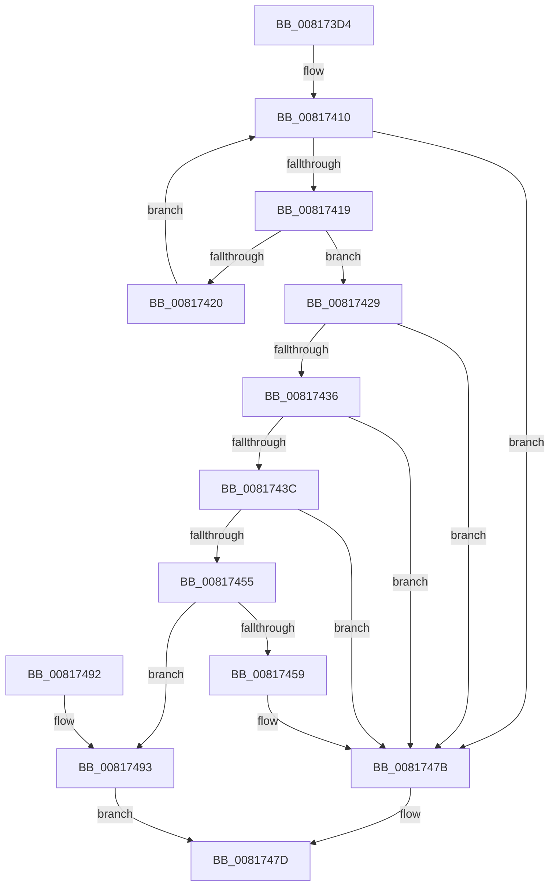

# SdbpIsEntryIdAvailableInOtherDb

- RVA: `0x008173D4`–`0x0081749A` (길이 `198` bytes)
- VA: `0x00000001408173D4`
- 실행 섹션: `PAGE`
- PDB 이름 있음: `예`; PDB Function 태그: `아니요`
- unwind 정보 RVA: `0x000D9AD0`
- 디코드: `55`개 명령, `198/198` bytes 표시
- 미해석 바이트: `0` (있으면 어셈블리에 `.byte`로 보존)

> 이 문서는 커널 이미지의 기계어와 PDB 기호를 분석해 생성했습니다. 4번과 5번은 함수 원형과 자료형을 바이너리 사용 방식에서 추정한 C 해석이며 원본 소스 복구 결과는 아닙니다.

## 1. Dependencies

- 직접 호출 지점: **3**; 고유 호출 대상: **3**
- 직접 호출자로 확인된 함수: **1**
- RIP 상대 이미지 참조: **3**

### Outgoing calls
- `0x008173FE` → [SdbGetTagFromTagID](../95/SdbGetTagFromTagID_function_0095E3C0.md) (function, `0x0095E3C0`)
- `0x00817449` → [SdbMergeIsEntryUpdated](SdbMergeIsEntryUpdated_function_00819158.md) (function, `0x00819158`)
- `0x00817476` → [AslLogCallPrintf](../95/AslLogCallPrintf_function_0095E4EC.md) (function, `0x0095E4EC`)

### Direct callers
- [SdbpCheckKObject](../95/SdbpCheckKObject_function_00959F04.md) at `0x0095A035`

### Static image references
- `0x00817406` → RVA `0x0003D4A0` (`.rdata`; read)
- `0x00817459` → RVA `0x0003D448` (`.rdata`; read)
- `0x0081746A` → RVA `0x0003D480` (`.rdata`; read)

## 2. Other-region calls and transfers

- 다른 실행 섹션으로 향하는 call: **0**
- 별도 외부 분기/꼬리 이동을 확인하지 못했습니다.

## 3. Assembly (complete function range)

```asm
008173D4  48 8B C4                        mov rax, rsp
008173D7  48 89 58 08                     mov qword ptr [rax + 8], rbx
008173DB  48 89 68 10                     mov qword ptr [rax + 0x10], rbp
008173DF  48 89 70 18                     mov qword ptr [rax + 0x18], rsi
008173E3  66 44 89 48 20                  mov word ptr [rax + 0x20], r9w
008173E8  57                              push rdi
008173E9  48 83 EC 30                     sub rsp, 0x30
008173ED  48 8B F2                        mov rsi, rdx
008173F0  33 ED                           xor ebp, ebp
008173F2  41 8B D0                        mov edx, r8d
008173F5  89 68 20                        mov dword ptr [rax + 0x20], ebp
008173F8  41 8B D8                        mov ebx, r8d
008173FB  48 8B F9                        mov rdi, rcx
008173FE  E8 BD 6F 14 00                  call 0x14095e3c0
00817403  44 8B D5                        mov r10d, ebp
00817406  48 8D 0D 93 60 82 FF            lea rcx, [rip - 0x7d9f6d]
0081740D  44 8B CD                        mov r9d, ebp
00817410  49 81 F9 5E 01 00 00            cmp r9, 0x15e
00817417  73 62                           jae 0x14081747b
00817419  66 41 39 04 09                  cmp word ptr [r9 + rcx], ax
0081741E  74 09                           je 0x140817429
00817420  49 FF C2                        inc r10
00817423  49 83 C1 0A                     add r9, 0xa
00817427  EB E7                           jmp 0x140817410
00817429  4B 8D 04 92                     lea rax, [r10 + r10*4]
0081742D  48 8D 0C 41                     lea rcx, [rcx + rax*2]
00817431  48 85 C9                        test rcx, rcx
00817434  74 45                           je 0x14081747b
00817436  66 39 69 02                     cmp word ptr [rcx + 2], bp
0081743A  74 3F                           je 0x14081747b
0081743C  4C 8D 4C 24 58                  lea r9, [rsp + 0x58]
00817441  4C 8B C6                        mov r8, rsi
00817444  8B D3                           mov edx, ebx
00817446  48 8B CF                        mov rcx, rdi
00817449  E8 0A 1D 00 00                  call 0x140819158
0081744E  3D 25 02 00 C0                  cmp eax, 0xc0000225
00817453  74 26                           je 0x14081747b
00817455  85 C0                           test eax, eax
00817457  79 3A                           jns 0x140817493
00817459  4C 8D 0D E8 5F 82 FF            lea r9, [rip - 0x7da018]
00817460  89 5C 24 20                     mov dword ptr [rsp + 0x20], ebx
00817464  41 B8 3E 0E 00 00               mov r8d, 0xe3e
0081746A  48 8D 15 0F 60 82 FF            lea rdx, [rip - 0x7d9ff1]
00817471  B9 01 00 00 00                  mov ecx, 1
00817476  E8 71 70 14 00                  call 0x14095e4ec
0081747B  33 C0                           xor eax, eax
0081747D  48 8B 5C 24 40                  mov rbx, qword ptr [rsp + 0x40]
00817482  48 8B 6C 24 48                  mov rbp, qword ptr [rsp + 0x48]
00817487  48 8B 74 24 50                  mov rsi, qword ptr [rsp + 0x50]
0081748C  48 83 C4 30                     add rsp, 0x30
00817490  5F                              pop rdi
00817491  C3                              ret
00817492  CC                              int3
00817493  B8 01 00 00 00                  mov eax, 1
00817498  EB E3                           jmp 0x14081747d
```

## 4. C-style interpretation (structured pseudocode)

```c
__int64 __fastcall SdbpIsEntryIdAvailableInOtherDb(__int64 a1, __int64 a2, int a3, unsigned __int16 a4)
{
    __int64 result;
    __int64 v_r10;
    __int64 v_rbp;
    __int64 v_rsp;
    unsigned int v_stack_m18;
    unsigned __int64 v_stack_p10;
    unsigned __int64 v_stack_p18;
    unsigned __int64 v_stack_p20;
    unsigned __int64 v_stack_p8;

    *(unsigned __int64 *)(v_rsp + 8) = v_rbx;
    *(unsigned __int64 *)(v_rsp + 16) = v_rbp;
    *(unsigned __int64 *)(v_rsp + 24) = v_rsi;
    *(unsigned __int16 *)(v_rsp + 32) = a4;
    v_rsp = (v_rsp) - (48);
    v_rbp = 0;
    *(unsigned int *)(v_rsp + 32) = 0;
    result = SdbGetTagFromTagID(a1, (unsigned int)(a3), a3, a4);
loc_00817410:
    if (0 >= 350) goto loc_0081747B;
    if ((*(unsigned __int16 *)(0 + v_rip - 8232813 * 1)) == ((unsigned __int16)(result))) goto loc_00817429;
    v_r10 = (0) + 1;
    a4 = (0) + (10);
    goto loc_00817410;
loc_00817429:
    if (v_rip - 8232813 + v_r10 + v_r10 * 4 * 2 == 0) goto loc_0081747B;
    if ((*(unsigned __int16 *)(v_rip - 8232813 + v_r10 + v_r10 * 4 * 2 + 2)) == 0) goto loc_0081747B;
    result = SdbMergeIsEntryUpdated(a1, (unsigned int)((unsigned int)((unsigned int)(a3))), a2, v_stack_p20);
    if (((unsigned int)(result)) == 0xC0000225ULL) goto loc_0081747B;
    if (!sign_flag) goto loc_00817493;
    v_stack_m18 = (unsigned int)((unsigned int)(a3));
    result = AslLogCallPrintf(1, v_rip - 8232945, (unsigned int)(0xE3EULL), v_rip - 8232984);
loc_0081747B:
    result = 0;
loc_0081747D:
    v_rsp = (v_rsp) + (48);
    return result;
loc_00817493:
    goto loc_0081747D;
}
```

## 5. (Beta) C Style

```c
int64_t SdbpIsEntryIdAvailableInOtherDb(int64_t Arg1, int64_t Arg2, int32_t Arg3, uint16_t Arg4)
{
    int64_t result;
    int64_t local_r10;
    int64_t local_rbp;
    int64_t local_rsp;
    uint32_t v_stack_m18;
    uint64_t v_stack_p10;
    uint64_t v_stack_p18;
    uint64_t v_stack_p20;
    uint64_t v_stack_p8;

    *(uint64_t *)(local_rsp + 0x8) = local_rbx;
    *(uint64_t *)(local_rsp + 0x10) = local_rbp;
    *(uint64_t *)(local_rsp + 0x18) = local_rsi;
    *(uint16_t *)(local_rsp + 0x20) = Arg4;
    local_rsp = (local_rsp) - (48);
    local_rbp = 0;
    *(uint32_t *)(local_rsp + 0x20) = 0;
    result = SdbGetTagFromTagID(Arg1, (uint32_t)(Arg3), Arg3, Arg4);
loc_00817410:
    if (0 >= 350) goto loc_0081747B;
    if ((*(uint16_t *)(0 + v_rip - 0x7D9F6D * 1)) == ((uint16_t)(result))) goto loc_00817429;
    local_r10 = (0) + 1;
    Arg4 = (0) + (10);
    goto loc_00817410;
loc_00817429:
    if (v_rip - 8232813 + local_r10 + local_r10 * 4 * 2 == 0) goto loc_0081747B;
    if ((*(uint16_t *)(v_rip - 0x7D9F6D + local_r10 + local_r10 * 4 * 2 + 0x2)) == 0) goto loc_0081747B;
    result = SdbMergeIsEntryUpdated(Arg1, (uint32_t)((uint32_t)((uint32_t)(Arg3))), Arg2, v_stack_p20);
    if (((uint32_t)(result)) == 0xC0000225ULL) goto loc_0081747B;
    if (!sign_flag) goto loc_00817493;
    v_stack_m18 = (uint32_t)((uint32_t)(Arg3));
    result = AslLogCallPrintf(1, v_rip - 8232945, (uint32_t)(0xE3EULL), v_rip - 8232984);
loc_0081747B:
    result = 0;
loc_0081747D:
    local_rsp = (local_rsp) + (48);
    return result;
loc_00817493:
    goto loc_0081747D;
}
```

## 6. Execution-region graph

[열기: 2D/3D 그래프와 함수 탐색 컨트롤 패널](../../../control-panel.html?section=page&rva=0x008173D4&view=graph)

- 2D 그래프는 위에서 아래로 흐르고, 3D 그래프는 빈 공간을 드래그해 회전합니다. Shift+드래그는 이동, 휠은 확대·축소, 함수 노드 선택은 대상 보고서 이동입니다.

### Static fallback


