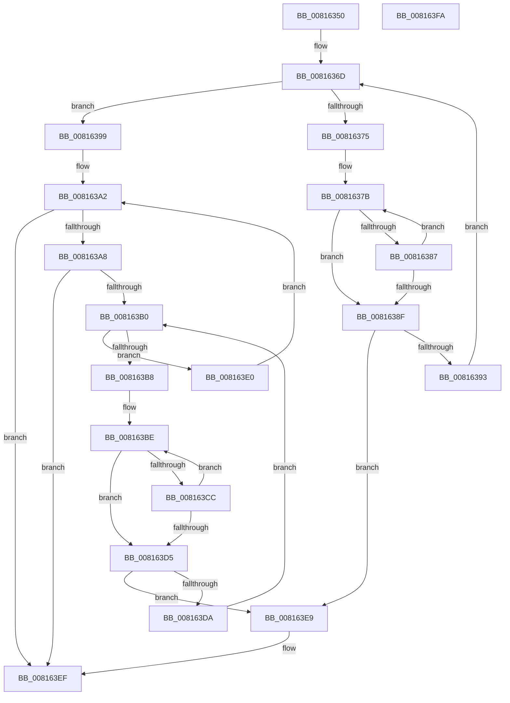

# SdbpIsSdbCapabilityPresent

- RVA: `0x00816350`–`0x008163FB` (길이 `171` bytes)
- VA: `0x0000000140816350`
- 실행 섹션: `PAGE`
- PDB 이름 있음: `예`; PDB Function 태그: `아니요`
- unwind 정보 RVA: `0x000950EC`
- 디코드: `54`개 명령, `171/171` bytes 표시
- 미해석 바이트: `0` (있으면 어셈블리에 `.byte`로 보존)

> 이 문서는 커널 이미지의 기계어와 PDB 기호를 분석해 생성했습니다. 4번과 5번은 함수 원형과 자료형을 바이너리 사용 방식에서 추정한 C 해석이며 원본 소스 복구 결과는 아닙니다.

## 1. Dependencies

- 직접 호출 지점: **0**; 고유 호출 대상: **0**
- 직접 호출자로 확인된 함수: **2**
- RIP 상대 이미지 참조: **1**

### Outgoing calls
- 직접 디코드된 call 명령이 없습니다.

### Direct callers
- [SdbpCheckSdbCapability](SdbpCheckSdbCapability_function_00815570.md) at `0x008155E1`
- [SdbpMatchList](SdbpMatchList_function_00816734.md) at `0x00816866`

### Static image references
- `0x0081635D` → RVA `0x0000BFA0` (`.rdata`; read)

## 2. Other-region calls and transfers

- 다른 실행 섹션으로 향하는 call: **0**
- 별도 외부 분기/꼬리 이동을 확인하지 못했습니다.

## 3. Assembly (complete function range)

```asm
00816350  48 89 5C 24 08                  mov qword ptr [rsp + 8], rbx
00816355  48 89 7C 24 10                  mov qword ptr [rsp + 0x10], rdi
0081635A  83 21 00                        and dword ptr [rcx], 0
0081635D  4C 8D 0D 3C 5C 7F FF            lea r9, [rip - 0x80a3c4]
00816364  49 8B F8                        mov rdi, r8
00816367  4C 8B D2                        mov r10, rdx
0081636A  48 8B D9                        mov rbx, rcx
0081636D  49 8B 01                        mov rax, qword ptr [r9]
00816370  48 85 C0                        test rax, rax
00816373  74 24                           je 0x140816399
00816375  4C 8B C7                        mov r8, rdi
00816378  4C 2B C0                        sub r8, rax
0081637B  0F B7 08                        movzx ecx, word ptr [rax]
0081637E  42 0F B7 14 00                  movzx edx, word ptr [rax + r8]
00816383  2B CA                           sub ecx, edx
00816385  75 08                           jne 0x14081638f
00816387  48 83 C0 02                     add rax, 2
0081638B  85 D2                           test edx, edx
0081638D  75 EC                           jne 0x14081637b
0081638F  85 C9                           test ecx, ecx
00816391  74 56                           je 0x1408163e9
00816393  49 83 C1 08                     add r9, 8
00816397  EB D4                           jmp 0x14081636d
00816399  33 D2                           xor edx, edx
0081639B  4D 8D 82 50 06 00 00            lea r8, [r10 + 0x650]
008163A2  48 83 FA 10                     cmp rdx, 0x10
008163A6  73 47                           jae 0x1408163ef
008163A8  49 8B 08                        mov rcx, qword ptr [r8]
008163AB  48 85 C9                        test rcx, rcx
008163AE  74 3F                           je 0x1408163ef
008163B0  48 8B 01                        mov rax, qword ptr [rcx]
008163B3  48 85 C0                        test rax, rax
008163B6  74 28                           je 0x1408163e0
008163B8  4C 8B DF                        mov r11, rdi
008163BB  4C 2B D8                        sub r11, rax
008163BE  44 0F B7 08                     movzx r9d, word ptr [rax]
008163C2  46 0F B7 14 18                  movzx r10d, word ptr [rax + r11]
008163C7  45 2B CA                        sub r9d, r10d
008163CA  75 09                           jne 0x1408163d5
008163CC  48 83 C0 02                     add rax, 2
008163D0  45 85 D2                        test r10d, r10d
008163D3  75 E9                           jne 0x1408163be
008163D5  45 85 C9                        test r9d, r9d
008163D8  74 0F                           je 0x1408163e9
008163DA  48 83 C1 08                     add rcx, 8
008163DE  EB D0                           jmp 0x1408163b0
008163E0  48 FF C2                        inc rdx
008163E3  49 83 C0 08                     add r8, 8
008163E7  EB B9                           jmp 0x1408163a2
008163E9  C7 03 01 00 00 00               mov dword ptr [rbx], 1
008163EF  48 8B 5C 24 08                  mov rbx, qword ptr [rsp + 8]
008163F4  48 8B 7C 24 10                  mov rdi, qword ptr [rsp + 0x10]
008163F9  C3                              ret
008163FA  CC                              int3
```

## 4. C-style interpretation (structured pseudocode)

```c
__int64 __fastcall SdbpIsSdbCapabilityPresent(__int64 a1, __int64 a2, __int64 a3)
{
    __int64 result;
    __int64 v_r11;
    unsigned __int64 v_stack_p10;
    unsigned __int64 v_stack_p8;

    v_stack_p8 = v_rbx;
    v_stack_p10 = v_rdi;
loc_0081636D:
    if (*(unsigned __int64 *)(v_rip - 8430532) == 0) goto loc_00816399;
    a3 = (a3) - (*(unsigned __int64 *)(v_rip - 8430532));
loc_0081637B:
    a1 = (unsigned int)((*(unsigned __int16 *)(*(unsigned __int64 *)(v_rip - 8430532))) - ((unsigned int)(*(unsigned __int16 *)(*(unsigned __int64 *)(v_rip - 8430532) + a3 * 1))));
    if (condition_is_not_equal) goto loc_0081638F;
    result = (*(unsigned __int64 *)(v_rip - 8430532)) + (2);
    if ((unsigned int)(*(unsigned __int16 *)(*(unsigned __int64 *)(v_rip - 8430532) + a3 * 1)) != 0) goto loc_0081637B;
loc_0081638F:
    if ((unsigned int)(a1) == 0) goto loc_008163E9;
    a4 = (v_rip - 8430532) + (8);
    goto loc_0081636D;
loc_00816399:
    a2 = 0;
loc_008163A2:
    if (0 >= 16) goto loc_008163EF;
    if (*(unsigned __int64 *)(a2 + 1616) == 0) goto loc_008163EF;
loc_008163B0:
    if (*(unsigned __int64 *)(*(unsigned __int64 *)(a2 + 1616)) == 0) goto loc_008163E0;
    v_r11 = (a3) - (*(unsigned __int64 *)(*(unsigned __int64 *)(a2 + 1616)));
loc_008163BE:
    a4 = (unsigned int)((*(unsigned __int16 *)(*(unsigned __int64 *)(*(unsigned __int64 *)(a2 + 1616)))) - ((unsigned int)(*(unsigned __int16 *)(*(unsigned __int64 *)(*(unsigned __int64 *)(a2 + 1616)) + v_r11 * 1))));
    if (condition_is_not_equal) goto loc_008163D5;
    result = (*(unsigned __int64 *)(*(unsigned __int64 *)(a2 + 1616))) + (2);
    if ((unsigned int)(*(unsigned __int16 *)(*(unsigned __int64 *)(*(unsigned __int64 *)(a2 + 1616)) + v_r11 * 1)) != 0) goto loc_008163BE;
loc_008163D5:
    if ((unsigned int)(a4) == 0) goto loc_008163E9;
    a1 = (*(unsigned __int64 *)(a2 + 1616)) + (8);
    goto loc_008163B0;
loc_008163E0:
    a2 = (a2) + 1;
    a3 = (a2 + 1616) + (8);
    goto loc_008163A2;
loc_008163E9:
    *(unsigned int *)(a1) = 1;
loc_008163EF:
    return result;
}
```

## 5. (Beta) C Style

```c
int64_t SdbpIsSdbCapabilityPresent(void *Arg1, void *Arg2, int64_t Arg3)
{
    uint8_t *arg1 = (uint8_t *)Arg1;
    uint8_t *arg2 = (uint8_t *)Arg2;

    int64_t result;
    int64_t local_r11;
    uint64_t v_stack_p10;
    uint64_t v_stack_p8;

    v_stack_p8 = local_rbx;
    v_stack_p10 = local_rdi;
loc_0081636D:
    if (*(uint64_t *)(v_rip - 0x80A3C4) == 0) goto loc_00816399;
    Arg3 = (Arg3) - (*(uint64_t *)(v_rip - 0x80A3C4));
loc_0081637B:
    Arg1 = (uint32_t)((*(uint16_t *)(*(uint64_t *)(v_rip - 0x80A3C4))) - ((uint32_t)(*(uint16_t *)(*(uint64_t *)(v_rip - 0x80A3C4) + Arg3 * 1))));
    if (condition_is_not_equal) goto loc_0081638F;
    result = (*(uint64_t *)(v_rip - 0x80A3C4)) + (2);
    if ((uint32_t)(*(uint16_t *)(*(uint64_t *)(v_rip - 0x80A3C4) + Arg3 * 1)) != 0) goto loc_0081637B;
loc_0081638F:
    if ((uint32_t)(Arg1) == 0) goto loc_008163E9;
    a4 = (v_rip - 8430532) + (8);
    goto loc_0081636D;
loc_00816399:
    Arg2 = 0;
loc_008163A2:
    if (0 >= 16) goto loc_008163EF;
    if (*(uint64_t *)(arg2 + 0x650) == 0) goto loc_008163EF;
loc_008163B0:
    if (*(uint64_t *)(*(uint64_t *)(arg2 + 0x650)) == 0) goto loc_008163E0;
    local_r11 = (Arg3) - (*(uint64_t *)(*(uint64_t *)(arg2 + 0x650)));
loc_008163BE:
    a4 = (uint32_t)((*(uint16_t *)(*(uint64_t *)(*(uint64_t *)(arg2 + 0x650)))) - ((uint32_t)(*(uint16_t *)(*(uint64_t *)(*(uint64_t *)(arg2 + 0x650)) + local_r11 * 1))));
    if (condition_is_not_equal) goto loc_008163D5;
    result = (*(uint64_t *)(*(uint64_t *)(arg2 + 0x650))) + (2);
    if ((uint32_t)(*(uint16_t *)(*(uint64_t *)(*(uint64_t *)(arg2 + 0x650)) + local_r11 * 1)) != 0) goto loc_008163BE;
loc_008163D5:
    if ((uint32_t)(a4) == 0) goto loc_008163E9;
    Arg1 = (*(uint64_t *)(arg2 + 0x650)) + (8);
    goto loc_008163B0;
loc_008163E0:
    Arg2 = (Arg2) + 1;
    Arg3 = (Arg2 + 1616) + (8);
    goto loc_008163A2;
loc_008163E9:
    *(uint32_t *)(arg1) = 1;
loc_008163EF:
    return result;
}
```

### 관측된 메모리 오프셋

구조체 형식이 확인되지 않은 접근은 인자 기준의 오프셋으로만 기록했습니다.

| 기준 인자 | 오프셋 표현 | 폭 (bit) | 접근 |
|---|---:|---:|---|
| `Arg1` | `+ 0x0` | `32` | `R/W` |
| `Arg1` | `+ 0x0` | `32` | `W` |
| `Arg2` | `+ 0x0` | `64` | `R` |
| `Arg2` | `+ 0x650` | `64` | `R` |

## 6. Execution-region graph

[열기: 2D/3D 그래프와 함수 탐색 컨트롤 패널](../../../control-panel.html?section=page&rva=0x00816350&view=graph)

- 2D 그래프는 위에서 아래로 흐르고, 3D 그래프는 빈 공간을 드래그해 회전합니다. Shift+드래그는 이동, 휠은 확대·축소, 함수 노드 선택은 대상 보고서 이동입니다.

### Static fallback


