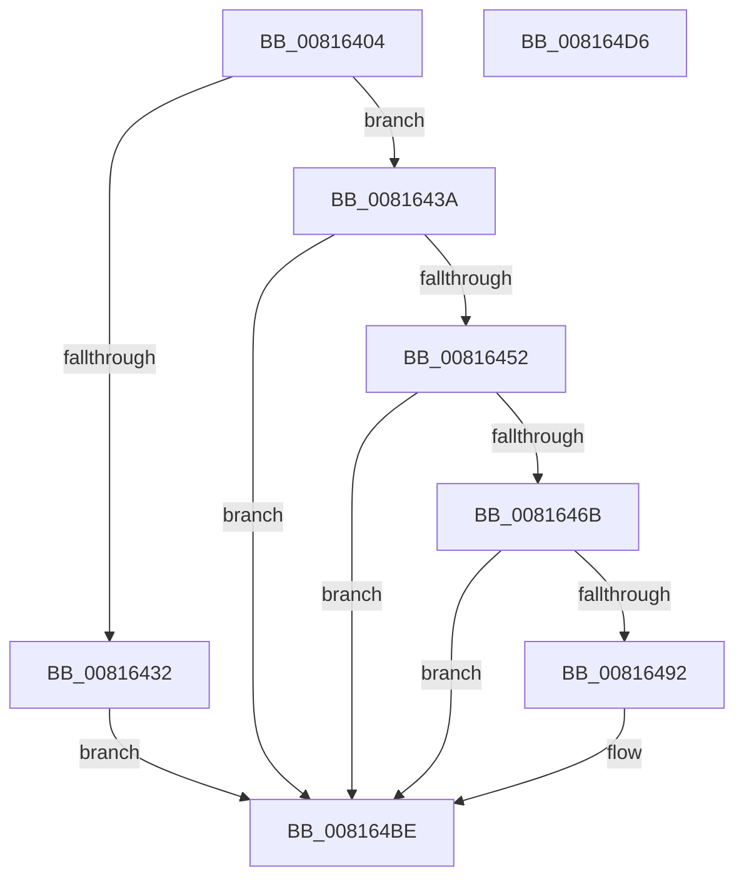

# SdbpMatchAcpi

- RVA: `0x00816404`–`0x008164D7` (길이 `211` bytes)
- VA: `0x0000000140816404`
- 실행 섹션: `PAGE`
- PDB 이름 있음: `예`; PDB Function 태그: `아니요`
- unwind 정보 RVA: `0x0009B270`
- 디코드: `56`개 명령, `211/211` bytes 표시
- 미해석 바이트: `0` (있으면 어셈블리에 `.byte`로 보존)

> 이 문서는 커널 이미지의 기계어와 PDB 기호를 분석해 생성했습니다. 4번과 5번은 함수 원형과 자료형을 바이너리 사용 방식에서 추정한 C 해석이며 원본 소스 복구 결과는 아닙니다.

## 1. Dependencies

- 직접 호출 지점: **5**; 고유 호출 대상: **3**
- 직접 호출자로 확인된 함수: **1**
- RIP 상대 이미지 참조: **0**

### Outgoing calls
- `0x00816427` → [SdbFindFirstTag](../95/SdbFindFirstTag_function_0095E34C.md) (function, `0x0095E34C`)
- `0x00816449` → [SdbpMatchDeviceString](SdbpMatchDeviceString_function_008166C4.md) (function, `0x008166C4`)
- `0x00816462` → [SdbpMatchDeviceString](SdbpMatchDeviceString_function_008166C4.md) (function, `0x008166C4`)
- `0x00816489` → [SdbpMatchDeviceDWORD](SdbpMatchDeviceDWORD_function_00816638.md) (function, `0x00816638`)
- `0x008164AF` → [SdbpMatchDeviceDWORD](SdbpMatchDeviceDWORD_function_00816638.md) (function, `0x00816638`)

### Direct callers
- [SdbpCheckKObject](../95/SdbpCheckKObject_function_00959F04.md) at `0x00959FD7`

### Static image references
- 디코드된 RIP-relative 메모리 참조가 없습니다.

## 2. Other-region calls and transfers

- 다른 실행 섹션으로 향하는 call: **0**
- 별도 외부 분기/꼬리 이동을 확인하지 못했습니다.

## 3. Assembly (complete function range)

```asm
00816404  48 89 5C 24 08                  mov qword ptr [rsp + 8], rbx
00816409  48 89 74 24 10                  mov qword ptr [rsp + 0x10], rsi
0081640E  48 89 7C 24 18                  mov qword ptr [rsp + 0x18], rdi
00816413  41 56                           push r14
00816415  48 83 EC 30                     sub rsp, 0x30
00816419  4D 8B F0                        mov r14, r8
0081641C  48 8B F9                        mov rdi, rcx
0081641F  41 B8 1F 70 00 00               mov r8d, 0x701f
00816425  33 DB                           xor ebx, ebx
00816427  E8 20 7F 14 00                  call 0x14095e34c
0081642C  8B F0                           mov esi, eax
0081642E  85 C0                           test eax, eax
00816430  75 08                           jne 0x14081643a
00816432  8D 58 01                        lea ebx, [rax + 1]
00816435  E9 84 00 00 00                  jmp 0x1408164be
0081643A  49 8B 16                        mov rdx, qword ptr [r14]
0081643D  41 B9 25 60 00 00               mov r9d, 0x6025
00816443  44 8B C6                        mov r8d, esi
00816446  48 8B CF                        mov rcx, rdi
00816449  E8 76 02 00 00                  call 0x1408166c4
0081644E  85 C0                           test eax, eax
00816450  74 6C                           je 0x1408164be
00816452  49 8B 56 08                     mov rdx, qword ptr [r14 + 8]
00816456  41 B9 26 60 00 00               mov r9d, 0x6026
0081645C  44 8B C6                        mov r8d, esi
0081645F  48 8B CF                        mov rcx, rdi
00816462  E8 5D 02 00 00                  call 0x1408166c4
00816467  85 C0                           test eax, eax
00816469  74 53                           je 0x1408164be
0081646B  41 8B 56 2C                     mov edx, dword ptr [r14 + 0x2c]
0081646F  41 B9 34 40 00 00               mov r9d, 0x4034
00816475  66 C7 44 24 28 36 40            mov word ptr [rsp + 0x28], 0x4036
0081647C  44 8B C6                        mov r8d, esi
0081647F  48 8B CF                        mov rcx, rdi
00816482  66 C7 44 24 20 35 40            mov word ptr [rsp + 0x20], 0x4035
00816489  E8 AA 01 00 00                  call 0x140816638
0081648E  85 C0                           test eax, eax
00816490  74 2C                           je 0x1408164be
00816492  41 8B 56 30                     mov edx, dword ptr [r14 + 0x30]
00816496  66 41 B9 40 40                  mov r9w, 0x4040
0081649B  66 C7 44 24 28 42 40            mov word ptr [rsp + 0x28], 0x4042
008164A2  44 8B C6                        mov r8d, esi
008164A5  48 8B CF                        mov rcx, rdi
008164A8  66 C7 44 24 20 41 40            mov word ptr [rsp + 0x20], 0x4041
008164AF  E8 84 01 00 00                  call 0x140816638
008164B4  85 C0                           test eax, eax
008164B6  B9 01 00 00 00                  mov ecx, 1
008164BB  0F 45 D9                        cmovne ebx, ecx
008164BE  48 8B 74 24 48                  mov rsi, qword ptr [rsp + 0x48]
008164C3  8B C3                           mov eax, ebx
008164C5  48 8B 5C 24 40                  mov rbx, qword ptr [rsp + 0x40]
008164CA  48 8B 7C 24 50                  mov rdi, qword ptr [rsp + 0x50]
008164CF  48 83 C4 30                     add rsp, 0x30
008164D3  41 5E                           pop r14
008164D5  C3                              ret
008164D6  CC                              int3
```

## 4. C-style interpretation (structured pseudocode)

```c
__int64 __fastcall SdbpMatchAcpi(__int64 a1, __int64 a2, __int64 a3)
{
    __int64 result;
    __int64 v_rbx;
    __int64 v_rsp;
    unsigned __int16 v_stack_m10;
    unsigned __int16 v_stack_m18;
    unsigned __int64 v_stack_p10;
    unsigned __int64 v_stack_p18;
    unsigned __int64 v_stack_p8;

    v_stack_p8 = v_rbx;
    v_stack_p10 = v_rsi;
    v_stack_p18 = v_rdi;
    v_rsp = (v_rsp) - (48);
    v_rbx = 0;
    result = SdbFindFirstTag(a1, a2, (unsigned int)(0x701FULL), a4);
    if ((unsigned int)(result) != 0) goto loc_0081643A;
    goto loc_008164BE;
loc_0081643A:
    result = SdbpMatchDeviceString(a1, *(unsigned __int64 *)(a3), (unsigned int)((unsigned int)((unsigned int)((unsigned int)(result)))), (unsigned int)(0x6025ULL));
    if ((unsigned int)(result) == 0) goto loc_008164BE;
    result = SdbpMatchDeviceString(a1, *(unsigned __int64 *)(a3 + 8), (unsigned int)((unsigned int)((unsigned int)((unsigned int)(result)))), (unsigned int)(0x6026ULL));
    if ((unsigned int)(result) == 0) goto loc_008164BE;
    v_stack_m10 = 0x4036ULL;
    v_stack_m18 = 0x4035ULL;
    result = SdbpMatchDeviceDWORD(a1, (unsigned int)(*(unsigned int *)(a3 + 44)), (unsigned int)((unsigned int)((unsigned int)((unsigned int)(result)))), (unsigned int)(0x4034ULL));
    v_rbx = result + 1;
    if ((unsigned int)(result) != 0) {
        a2 = *(unsigned int *)(a3 + 48);
        a4 = 0x4040ULL;
        v_stack_m10 = 0x4042ULL;
        a3 = (unsigned int)((unsigned int)((unsigned int)(result)));
        a1 = a1;
        v_stack_m18 = 0x4041ULL;
        result = SdbpMatchDeviceDWORD(a1, a2, a3, a4);
        a1 = 1;
        v_rbx = result + 1;
        if ((unsigned int)(result) != 0) { v_rbx = (unsigned int)(a1); }
    }
    v_rsp = (v_rsp) + (48);
    return (unsigned int)((unsigned int)(v_rbx));
}
```

## 5. (Beta) C Style

```c
int64_t SdbpMatchAcpi(int64_t Arg1, int64_t Arg2, void *Arg3)
{
    uint8_t *arg3 = (uint8_t *)Arg3;

    int64_t result;
    int64_t local_rbx;
    int64_t local_rsp;
    uint16_t v_stack_m10;
    uint16_t v_stack_m18;
    uint64_t v_stack_p10;
    uint64_t v_stack_p18;
    uint64_t v_stack_p8;

    v_stack_p8 = local_rbx;
    v_stack_p10 = local_rsi;
    v_stack_p18 = local_rdi;
    local_rsp = (local_rsp) - (48);
    local_rbx = 0;
    result = SdbFindFirstTag(Arg1, Arg2, (uint32_t)(0x701FULL), a4);
    if ((uint32_t)(result) != 0) goto loc_0081643A;
    goto loc_008164BE;
loc_0081643A:
    result = SdbpMatchDeviceString(Arg1, *(uint64_t *)(arg3), (uint32_t)((uint32_t)((uint32_t)((uint32_t)(result)))), (uint32_t)(0x6025ULL));
    if ((uint32_t)(result) == 0) goto loc_008164BE;
    result = SdbpMatchDeviceString(Arg1, *(uint64_t *)(arg3 + 0x8), (uint32_t)((uint32_t)((uint32_t)((uint32_t)(result)))), (uint32_t)(0x6026ULL));
    if ((uint32_t)(result) == 0) goto loc_008164BE;
    v_stack_m10 = 0x4036ULL;
    v_stack_m18 = 0x4035ULL;
    result = SdbpMatchDeviceDWORD(Arg1, (uint32_t)(*(uint32_t *)(arg3 + 0x2C)), (uint32_t)((uint32_t)((uint32_t)((uint32_t)(result)))), (uint32_t)(0x4034ULL));
    local_rbx = result + 1;
    if ((uint32_t)(result) != 0) {
        Arg2 = *(uint32_t *)(arg3 + 0x30);
        a4 = 0x4040ULL;
        v_stack_m10 = 0x4042ULL;
        Arg3 = (uint32_t)((uint32_t)((uint32_t)(result)));
        Arg1 = Arg1;
        v_stack_m18 = 0x4041ULL;
        result = SdbpMatchDeviceDWORD(Arg1, Arg2, Arg3, a4);
        Arg1 = 1;
        local_rbx = result + 1;
        if ((uint32_t)(result) != 0) { local_rbx = (uint32_t)(Arg1); }
    }
    local_rsp = (local_rsp) + (48);
    return (uint32_t)((uint32_t)(local_rbx));
}
```

### 관측된 메모리 오프셋

구조체 형식이 확인되지 않은 접근은 인자 기준의 오프셋으로만 기록했습니다.

| 기준 인자 | 오프셋 표현 | 폭 (bit) | 접근 |
|---|---:|---:|---|
| `Arg3` | `+ 0x0` | `64` | `R` |
| `Arg3` | `+ 0x8` | `64` | `R` |
| `Arg3` | `+ 0x2C` | `32` | `R` |
| `Arg3` | `+ 0x30` | `32` | `R` |

## 6. Execution-region graph

[열기: 2D/3D 그래프와 함수 탐색 컨트롤 패널](../../../control-panel.html?section=page&rva=0x00816404&view=graph)

- 2D 그래프는 위에서 아래로 흐르고, 3D 그래프는 빈 공간을 드래그해 회전합니다. Shift+드래그는 이동, 휠은 확대·축소, 함수 노드 선택은 대상 보고서 이동입니다.

### Static fallback


