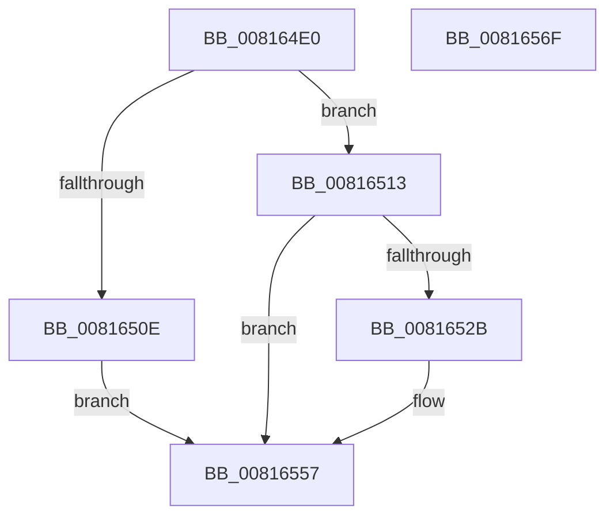

# SdbpMatchBios

- RVA: `0x008164E0`–`0x00816570` (길이 `144` bytes)
- VA: `0x00000001408164E0`
- 실행 섹션: `PAGE`
- PDB 이름 있음: `예`; PDB Function 태그: `아니요`
- unwind 정보 RVA: `0x0009B270`
- 디코드: `40`개 명령, `144/144` bytes 표시
- 미해석 바이트: `0` (있으면 어셈블리에 `.byte`로 보존)

> 이 문서는 커널 이미지의 기계어와 PDB 기호를 분석해 생성했습니다. 4번과 5번은 함수 원형과 자료형을 바이너리 사용 방식에서 추정한 C 해석이며 원본 소스 복구 결과는 아닙니다.

## 1. Dependencies

- 직접 호출 지점: **3**; 고유 호출 대상: **3**
- 직접 호출자로 확인된 함수: **1**
- RIP 상대 이미지 참조: **0**

### Outgoing calls
- `0x00816503` → [SdbFindFirstTag](../95/SdbFindFirstTag_function_0095E34C.md) (function, `0x0095E34C`)
- `0x00816522` → [SdbpMatchDeviceString](SdbpMatchDeviceString_function_008166C4.md) (function, `0x008166C4`)
- `0x00816548` → [SdbpMatchDeviceDWORD](SdbpMatchDeviceDWORD_function_00816638.md) (function, `0x00816638`)

### Direct callers
- [SdbpCheckKObject](../95/SdbpCheckKObject_function_00959F04.md) at `0x0095A001`

### Static image references
- 디코드된 RIP-relative 메모리 참조가 없습니다.

## 2. Other-region calls and transfers

- 다른 실행 섹션으로 향하는 call: **0**
- 별도 외부 분기/꼬리 이동을 확인하지 못했습니다.

## 3. Assembly (complete function range)

```asm
008164E0  48 89 5C 24 08                  mov qword ptr [rsp + 8], rbx
008164E5  48 89 74 24 10                  mov qword ptr [rsp + 0x10], rsi
008164EA  48 89 7C 24 18                  mov qword ptr [rsp + 0x18], rdi
008164EF  41 56                           push r14
008164F1  48 83 EC 30                     sub rsp, 0x30
008164F5  4D 8B F0                        mov r14, r8
008164F8  48 8B F9                        mov rdi, rcx
008164FB  41 B8 20 70 00 00               mov r8d, 0x7020
00816501  33 DB                           xor ebx, ebx
00816503  E8 44 7E 14 00                  call 0x14095e34c
00816508  8B F0                           mov esi, eax
0081650A  85 C0                           test eax, eax
0081650C  75 05                           jne 0x140816513
0081650E  8D 58 01                        lea ebx, [rax + 1]
00816511  EB 44                           jmp 0x140816557
00816513  49 8B 16                        mov rdx, qword ptr [r14]
00816516  41 B9 25 60 00 00               mov r9d, 0x6025
0081651C  44 8B C6                        mov r8d, esi
0081651F  48 8B CF                        mov rcx, rdi
00816522  E8 9D 01 00 00                  call 0x1408166c4
00816527  85 C0                           test eax, eax
00816529  74 2C                           je 0x140816557
0081652B  41 8B 56 28                     mov edx, dword ptr [r14 + 0x28]
0081652F  66 41 B9 37 40                  mov r9w, 0x4037
00816534  66 C7 44 24 28 39 40            mov word ptr [rsp + 0x28], 0x4039
0081653B  44 8B C6                        mov r8d, esi
0081653E  48 8B CF                        mov rcx, rdi
00816541  66 C7 44 24 20 38 40            mov word ptr [rsp + 0x20], 0x4038
00816548  E8 EB 00 00 00                  call 0x140816638
0081654D  85 C0                           test eax, eax
0081654F  B9 01 00 00 00                  mov ecx, 1
00816554  0F 45 D9                        cmovne ebx, ecx
00816557  48 8B 74 24 48                  mov rsi, qword ptr [rsp + 0x48]
0081655C  8B C3                           mov eax, ebx
0081655E  48 8B 5C 24 40                  mov rbx, qword ptr [rsp + 0x40]
00816563  48 8B 7C 24 50                  mov rdi, qword ptr [rsp + 0x50]
00816568  48 83 C4 30                     add rsp, 0x30
0081656C  41 5E                           pop r14
0081656E  C3                              ret
0081656F  CC                              int3
```

## 4. C-style interpretation (structured pseudocode)

```c
__int64 __fastcall SdbpMatchBios(__int64 a1, __int64 a2, __int64 a3)
{
    __int64 result;
    __int64 v_rbx;
    __int64 v_rsp;
    unsigned __int16 v_stack_m10;
    unsigned __int16 v_stack_m18;
    unsigned __int64 v_stack_p10;
    unsigned __int64 v_stack_p18;
    unsigned __int64 v_stack_p8;

    v_stack_p8 = v_rbx;
    v_stack_p10 = v_rsi;
    v_stack_p18 = v_rdi;
    v_rsp = (v_rsp) - (48);
    v_rbx = 0;
    result = SdbFindFirstTag(a1, a2, (unsigned int)(0x7020ULL), a4);
    if ((unsigned int)(result) != 0) goto loc_00816513;
    goto loc_00816557;
loc_00816513:
    result = SdbpMatchDeviceString(a1, *(unsigned __int64 *)(a3), (unsigned int)((unsigned int)((unsigned int)((unsigned int)(result)))), (unsigned int)(0x6025ULL));
    v_rbx = result + 1;
    if ((unsigned int)(result) != 0) {
        a2 = *(unsigned int *)(a3 + 40);
        a4 = 0x4037ULL;
        v_stack_m10 = 0x4039ULL;
        a3 = (unsigned int)((unsigned int)((unsigned int)(result)));
        a1 = a1;
        v_stack_m18 = 0x4038ULL;
        result = SdbpMatchDeviceDWORD(a1, a2, a3, a4);
        a1 = 1;
        v_rbx = result + 1;
        if ((unsigned int)(result) != 0) { v_rbx = (unsigned int)(a1); }
    }
    v_rsp = (v_rsp) + (48);
    return (unsigned int)((unsigned int)(v_rbx));
}
```

## 5. (Beta) C Style

```c
int64_t SdbpMatchBios(int64_t Arg1, int64_t Arg2, void *Arg3)
{
    uint8_t *arg3 = (uint8_t *)Arg3;

    int64_t result;
    int64_t local_rbx;
    int64_t local_rsp;
    uint16_t v_stack_m10;
    uint16_t v_stack_m18;
    uint64_t v_stack_p10;
    uint64_t v_stack_p18;
    uint64_t v_stack_p8;

    v_stack_p8 = local_rbx;
    v_stack_p10 = local_rsi;
    v_stack_p18 = local_rdi;
    local_rsp = (local_rsp) - (48);
    local_rbx = 0;
    result = SdbFindFirstTag(Arg1, Arg2, (uint32_t)(0x7020ULL), a4);
    if ((uint32_t)(result) != 0) goto loc_00816513;
    goto loc_00816557;
loc_00816513:
    result = SdbpMatchDeviceString(Arg1, *(uint64_t *)(arg3), (uint32_t)((uint32_t)((uint32_t)((uint32_t)(result)))), (uint32_t)(0x6025ULL));
    local_rbx = result + 1;
    if ((uint32_t)(result) != 0) {
        Arg2 = *(uint32_t *)(arg3 + 0x28);
        a4 = 0x4037ULL;
        v_stack_m10 = 0x4039ULL;
        Arg3 = (uint32_t)((uint32_t)((uint32_t)(result)));
        Arg1 = Arg1;
        v_stack_m18 = 0x4038ULL;
        result = SdbpMatchDeviceDWORD(Arg1, Arg2, Arg3, a4);
        Arg1 = 1;
        local_rbx = result + 1;
        if ((uint32_t)(result) != 0) { local_rbx = (uint32_t)(Arg1); }
    }
    local_rsp = (local_rsp) + (48);
    return (uint32_t)((uint32_t)(local_rbx));
}
```

### 관측된 메모리 오프셋

구조체 형식이 확인되지 않은 접근은 인자 기준의 오프셋으로만 기록했습니다.

| 기준 인자 | 오프셋 표현 | 폭 (bit) | 접근 |
|---|---:|---:|---|
| `Arg3` | `+ 0x0` | `64` | `R` |
| `Arg3` | `+ 0x28` | `32` | `R` |

## 6. Execution-region graph

[열기: 2D/3D 그래프와 함수 탐색 컨트롤 패널](../../../control-panel.html?section=page&rva=0x008164E0&view=graph)

- 2D 그래프는 위에서 아래로 흐르고, 3D 그래프는 빈 공간을 드래그해 회전합니다. Shift+드래그는 이동, 휠은 확대·축소, 함수 노드 선택은 대상 보고서 이동입니다.

### Static fallback


