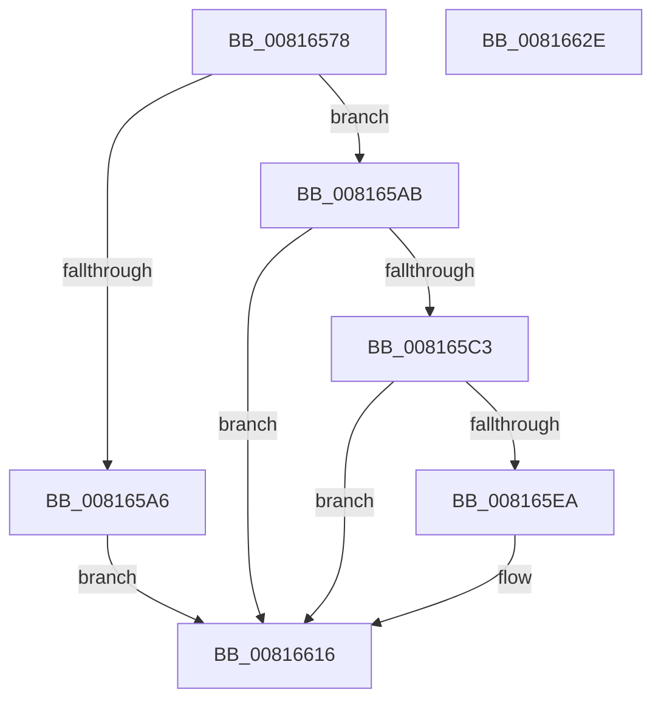

# SdbpMatchCpu

- RVA: `0x00816578`–`0x0081662F` (길이 `183` bytes)
- VA: `0x0000000140816578`
- 실행 섹션: `PAGE`
- PDB 이름 있음: `예`; PDB Function 태그: `아니요`
- unwind 정보 RVA: `0x0009B270`
- 디코드: `49`개 명령, `183/183` bytes 표시
- 미해석 바이트: `0` (있으면 어셈블리에 `.byte`로 보존)

> 이 문서는 커널 이미지의 기계어와 PDB 기호를 분석해 생성했습니다. 4번과 5번은 함수 원형과 자료형을 바이너리 사용 방식에서 추정한 C 해석이며 원본 소스 복구 결과는 아닙니다.

## 1. Dependencies

- 직접 호출 지점: **4**; 고유 호출 대상: **3**
- 직접 호출자로 확인된 함수: **1**
- RIP 상대 이미지 참조: **0**

### Outgoing calls
- `0x0081659B` → [SdbFindFirstTag](../95/SdbFindFirstTag_function_0095E34C.md) (function, `0x0095E34C`)
- `0x008165BA` → [SdbpMatchDeviceString](SdbpMatchDeviceString_function_008166C4.md) (function, `0x008166C4`)
- `0x008165E1` → [SdbpMatchDeviceDWORD](SdbpMatchDeviceDWORD_function_00816638.md) (function, `0x00816638`)
- `0x00816607` → [SdbpMatchDeviceDWORD](SdbpMatchDeviceDWORD_function_00816638.md) (function, `0x00816638`)

### Direct callers
- [SdbpCheckKObject](../95/SdbpCheckKObject_function_00959F04.md) at `0x0095A016`

### Static image references
- 디코드된 RIP-relative 메모리 참조가 없습니다.

## 2. Other-region calls and transfers

- 다른 실행 섹션으로 향하는 call: **0**
- 별도 외부 분기/꼬리 이동을 확인하지 못했습니다.

## 3. Assembly (complete function range)

```asm
00816578  48 89 5C 24 08                  mov qword ptr [rsp + 8], rbx
0081657D  48 89 74 24 10                  mov qword ptr [rsp + 0x10], rsi
00816582  48 89 7C 24 18                  mov qword ptr [rsp + 0x18], rdi
00816587  41 56                           push r14
00816589  48 83 EC 30                     sub rsp, 0x30
0081658D  4D 8B F0                        mov r14, r8
00816590  48 8B F9                        mov rdi, rcx
00816593  41 B8 21 70 00 00               mov r8d, 0x7021
00816599  33 DB                           xor ebx, ebx
0081659B  E8 AC 7D 14 00                  call 0x14095e34c
008165A0  8B F0                           mov esi, eax
008165A2  85 C0                           test eax, eax
008165A4  75 05                           jne 0x1408165ab
008165A6  8D 58 01                        lea ebx, [rax + 1]
008165A9  EB 6B                           jmp 0x140816616
008165AB  49 8B 16                        mov rdx, qword ptr [r14]
008165AE  41 B9 25 60 00 00               mov r9d, 0x6025
008165B4  44 8B C6                        mov r8d, esi
008165B7  48 8B CF                        mov rcx, rdi
008165BA  E8 05 01 00 00                  call 0x1408166c4
008165BF  85 C0                           test eax, eax
008165C1  74 53                           je 0x140816616
008165C3  41 8B 56 20                     mov edx, dword ptr [r14 + 0x20]
008165C7  41 B9 3A 40 00 00               mov r9d, 0x403a
008165CD  66 C7 44 24 28 3C 40            mov word ptr [rsp + 0x28], 0x403c
008165D4  44 8B C6                        mov r8d, esi
008165D7  48 8B CF                        mov rcx, rdi
008165DA  66 C7 44 24 20 3B 40            mov word ptr [rsp + 0x20], 0x403b
008165E1  E8 52 00 00 00                  call 0x140816638
008165E6  85 C0                           test eax, eax
008165E8  74 2C                           je 0x140816616
008165EA  41 8B 56 24                     mov edx, dword ptr [r14 + 0x24]
008165EE  66 41 B9 3D 40                  mov r9w, 0x403d
008165F3  66 C7 44 24 28 3F 40            mov word ptr [rsp + 0x28], 0x403f
008165FA  44 8B C6                        mov r8d, esi
008165FD  48 8B CF                        mov rcx, rdi
00816600  66 C7 44 24 20 3E 40            mov word ptr [rsp + 0x20], 0x403e
00816607  E8 2C 00 00 00                  call 0x140816638
0081660C  85 C0                           test eax, eax
0081660E  B9 01 00 00 00                  mov ecx, 1
00816613  0F 45 D9                        cmovne ebx, ecx
00816616  48 8B 74 24 48                  mov rsi, qword ptr [rsp + 0x48]
0081661B  8B C3                           mov eax, ebx
0081661D  48 8B 5C 24 40                  mov rbx, qword ptr [rsp + 0x40]
00816622  48 8B 7C 24 50                  mov rdi, qword ptr [rsp + 0x50]
00816627  48 83 C4 30                     add rsp, 0x30
0081662B  41 5E                           pop r14
0081662D  C3                              ret
0081662E  CC                              int3
```

## 4. C-style interpretation (structured pseudocode)

```c
__int64 __fastcall SdbpMatchCpu(__int64 a1, __int64 a2, __int64 a3)
{
    __int64 result;
    __int64 v_rbx;
    __int64 v_rsp;
    unsigned __int16 v_stack_m10;
    unsigned __int16 v_stack_m18;
    unsigned __int64 v_stack_p10;
    unsigned __int64 v_stack_p18;
    unsigned __int64 v_stack_p8;

    v_stack_p8 = v_rbx;
    v_stack_p10 = v_rsi;
    v_stack_p18 = v_rdi;
    v_rsp = (v_rsp) - (48);
    v_rbx = 0;
    result = SdbFindFirstTag(a1, a2, (unsigned int)(0x7021ULL), a4);
    if ((unsigned int)(result) != 0) goto loc_008165AB;
    goto loc_00816616;
loc_008165AB:
    result = SdbpMatchDeviceString(a1, *(unsigned __int64 *)(a3), (unsigned int)((unsigned int)((unsigned int)((unsigned int)(result)))), (unsigned int)(0x6025ULL));
    if ((unsigned int)(result) == 0) goto loc_00816616;
    v_stack_m10 = 0x403CULL;
    v_stack_m18 = 0x403BULL;
    result = SdbpMatchDeviceDWORD(a1, (unsigned int)(*(unsigned int *)(a3 + 32)), (unsigned int)((unsigned int)((unsigned int)((unsigned int)(result)))), (unsigned int)(0x403AULL));
    v_rbx = result + 1;
    if ((unsigned int)(result) != 0) {
        a2 = *(unsigned int *)(a3 + 36);
        a4 = 0x403DULL;
        v_stack_m10 = 0x403FULL;
        a3 = (unsigned int)((unsigned int)((unsigned int)(result)));
        a1 = a1;
        v_stack_m18 = 0x403EULL;
        result = SdbpMatchDeviceDWORD(a1, a2, a3, a4);
        a1 = 1;
        v_rbx = result + 1;
        if ((unsigned int)(result) != 0) { v_rbx = (unsigned int)(a1); }
    }
    v_rsp = (v_rsp) + (48);
    return (unsigned int)((unsigned int)(v_rbx));
}
```

## 5. (Beta) C Style

```c
int64_t SdbpMatchCpu(int64_t Arg1, int64_t Arg2, void *Arg3)
{
    uint8_t *arg3 = (uint8_t *)Arg3;

    int64_t result;
    int64_t local_rbx;
    int64_t local_rsp;
    uint16_t v_stack_m10;
    uint16_t v_stack_m18;
    uint64_t v_stack_p10;
    uint64_t v_stack_p18;
    uint64_t v_stack_p8;

    v_stack_p8 = local_rbx;
    v_stack_p10 = local_rsi;
    v_stack_p18 = local_rdi;
    local_rsp = (local_rsp) - (48);
    local_rbx = 0;
    result = SdbFindFirstTag(Arg1, Arg2, (uint32_t)(0x7021ULL), a4);
    if ((uint32_t)(result) != 0) goto loc_008165AB;
    goto loc_00816616;
loc_008165AB:
    result = SdbpMatchDeviceString(Arg1, *(uint64_t *)(arg3), (uint32_t)((uint32_t)((uint32_t)((uint32_t)(result)))), (uint32_t)(0x6025ULL));
    if ((uint32_t)(result) == 0) goto loc_00816616;
    v_stack_m10 = 0x403CULL;
    v_stack_m18 = 0x403BULL;
    result = SdbpMatchDeviceDWORD(Arg1, (uint32_t)(*(uint32_t *)(arg3 + 0x20)), (uint32_t)((uint32_t)((uint32_t)((uint32_t)(result)))), (uint32_t)(0x403AULL));
    local_rbx = result + 1;
    if ((uint32_t)(result) != 0) {
        Arg2 = *(uint32_t *)(arg3 + 0x24);
        a4 = 0x403DULL;
        v_stack_m10 = 0x403FULL;
        Arg3 = (uint32_t)((uint32_t)((uint32_t)(result)));
        Arg1 = Arg1;
        v_stack_m18 = 0x403EULL;
        result = SdbpMatchDeviceDWORD(Arg1, Arg2, Arg3, a4);
        Arg1 = 1;
        local_rbx = result + 1;
        if ((uint32_t)(result) != 0) { local_rbx = (uint32_t)(Arg1); }
    }
    local_rsp = (local_rsp) + (48);
    return (uint32_t)((uint32_t)(local_rbx));
}
```

### 관측된 메모리 오프셋

구조체 형식이 확인되지 않은 접근은 인자 기준의 오프셋으로만 기록했습니다.

| 기준 인자 | 오프셋 표현 | 폭 (bit) | 접근 |
|---|---:|---:|---|
| `Arg3` | `+ 0x0` | `64` | `R` |
| `Arg3` | `+ 0x20` | `32` | `R` |
| `Arg3` | `+ 0x24` | `32` | `R` |

## 6. Execution-region graph

[열기: 2D/3D 그래프와 함수 탐색 컨트롤 패널](../../../control-panel.html?section=page&rva=0x00816578&view=graph)

- 2D 그래프는 위에서 아래로 흐르고, 3D 그래프는 빈 공간을 드래그해 회전합니다. Shift+드래그는 이동, 휠은 확대·축소, 함수 노드 선택은 대상 보고서 이동입니다.

### Static fallback


