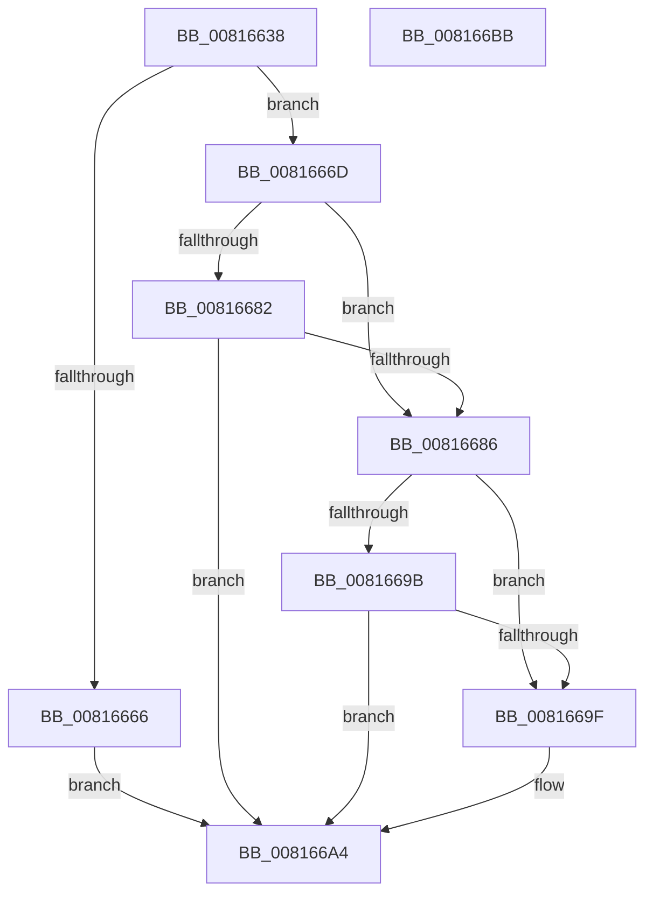

# SdbpMatchDeviceDWORD

- RVA: `0x00816638`–`0x008166BC` (길이 `132` bytes)
- VA: `0x0000000140816638`
- 실행 섹션: `PAGE`
- PDB 이름 있음: `예`; PDB Function 태그: `아니요`
- unwind 정보 RVA: `0x0005C954`
- 디코드: `42`개 명령, `132/132` bytes 표시
- 미해석 바이트: `0` (있으면 어셈블리에 `.byte`로 보존)

> 이 문서는 커널 이미지의 기계어와 PDB 기호를 분석해 생성했습니다. 4번과 5번은 함수 원형과 자료형을 바이너리 사용 방식에서 추정한 C 해석이며 원본 소스 복구 결과는 아닙니다.

## 1. Dependencies

- 직접 호출 지점: **3**; 고유 호출 대상: **1**
- 직접 호출자로 확인된 함수: **4**
- RIP 상대 이미지 참조: **0**

### Outgoing calls
- `0x0081665C` → [SdbpGetDeviceDWORD](SdbpGetDeviceDWORD_function_008159B0.md) (function, `0x008159B0`)
- `0x00816678` → [SdbpGetDeviceDWORD](SdbpGetDeviceDWORD_function_008159B0.md) (function, `0x008159B0`)
- `0x00816691` → [SdbpGetDeviceDWORD](SdbpGetDeviceDWORD_function_008159B0.md) (function, `0x008159B0`)

### Direct callers
- [SdbpMatchAcpi](SdbpMatchAcpi_function_00816404.md) at `0x00816489`
- [SdbpMatchAcpi](SdbpMatchAcpi_function_00816404.md) at `0x008164AF`
- [SdbpMatchBios](SdbpMatchBios_function_008164E0.md) at `0x00816548`
- [SdbpMatchCpu](SdbpMatchCpu_function_00816578.md) at `0x008165E1`
- [SdbpMatchCpu](SdbpMatchCpu_function_00816578.md) at `0x00816607`
- [SdbpMatchOem](SdbpMatchOem_function_008168C8.md) at `0x00816949`

### Static image references
- 디코드된 RIP-relative 메모리 참조가 없습니다.

## 2. Other-region calls and transfers

- 다른 실행 섹션으로 향하는 call: **0**
- 별도 외부 분기/꼬리 이동을 확인하지 못했습니다.

## 3. Assembly (complete function range)

```asm
00816638  48 89 5C 24 08                  mov qword ptr [rsp + 8], rbx
0081663D  48 89 6C 24 10                  mov qword ptr [rsp + 0x10], rbp
00816642  48 89 74 24 18                  mov qword ptr [rsp + 0x18], rsi
00816647  57                              push rdi
00816648  48 83 EC 20                     sub rsp, 0x20
0081664C  41 8B F0                        mov esi, r8d
0081664F  8B FA                           mov edi, edx
00816651  8B D6                           mov edx, esi
00816653  45 0F B7 C1                     movzx r8d, r9w
00816657  48 8B E9                        mov rbp, rcx
0081665A  33 DB                           xor ebx, ebx
0081665C  E8 4F F3 FF FF                  call 0x1408159b0
00816661  83 F8 FF                        cmp eax, -1
00816664  74 07                           je 0x14081666d
00816666  3B C7                           cmp eax, edi
00816668  0F 94 C3                        sete bl
0081666B  EB 37                           jmp 0x1408166a4
0081666D  44 0F B7 44 24 50               movzx r8d, word ptr [rsp + 0x50]
00816673  8B D6                           mov edx, esi
00816675  48 8B CD                        mov rcx, rbp
00816678  E8 33 F3 FF FF                  call 0x1408159b0
0081667D  83 F8 FF                        cmp eax, -1
00816680  74 04                           je 0x140816686
00816682  3B C7                           cmp eax, edi
00816684  72 1E                           jb 0x1408166a4
00816686  44 0F B7 44 24 58               movzx r8d, word ptr [rsp + 0x58]
0081668C  8B D6                           mov edx, esi
0081668E  48 8B CD                        mov rcx, rbp
00816691  E8 1A F3 FF FF                  call 0x1408159b0
00816696  83 F8 FF                        cmp eax, -1
00816699  74 04                           je 0x14081669f
0081669B  3B C7                           cmp eax, edi
0081669D  77 05                           ja 0x1408166a4
0081669F  BB 01 00 00 00                  mov ebx, 1
008166A4  48 8B 6C 24 38                  mov rbp, qword ptr [rsp + 0x38]
008166A9  8B C3                           mov eax, ebx
008166AB  48 8B 5C 24 30                  mov rbx, qword ptr [rsp + 0x30]
008166B0  48 8B 74 24 40                  mov rsi, qword ptr [rsp + 0x40]
008166B5  48 83 C4 20                     add rsp, 0x20
008166B9  5F                              pop rdi
008166BA  C3                              ret
008166BB  CC                              int3
```

## 4. C-style interpretation (structured pseudocode)

```c
__int64 __fastcall SdbpMatchDeviceDWORD(__int64 a1, int a2, int a3, unsigned __int16 a4, unsigned __int16 a5, unsigned __int16 a6)
{
    __int64 result;
    __int64 v_rbx;
    __int64 v_rsp;
    unsigned __int64 v_stack_p10;
    unsigned __int64 v_stack_p18;
    unsigned __int64 v_stack_p8;

    v_stack_p8 = v_rbx;
    v_stack_p10 = v_rbp;
    v_stack_p18 = v_rsi;
    v_rsp = (v_rsp) - (32);
    v_rbx = 0;
    result = SdbpGetDeviceDWORD(a1, (unsigned int)((unsigned int)((unsigned int)(a3))), a4, a4);
    if (((unsigned int)(result)) == -1) goto loc_0081666D;
    v_rbx = (((unsigned int)(result)) == ((unsigned int)((unsigned int)(a2)))) ? 1 : 0;
    goto loc_008166A4;
loc_0081666D:
    result = SdbpGetDeviceDWORD(a1, (unsigned int)((unsigned int)((unsigned int)(a3))), a5, a4);
    if (((unsigned int)(result)) == -1) goto loc_00816686;
    if (((unsigned int)(result)) < ((unsigned int)((unsigned int)(a2)))) goto loc_008166A4;
loc_00816686:
    result = SdbpGetDeviceDWORD(a1, (unsigned int)((unsigned int)((unsigned int)(a3))), a6, a4);
    if (((unsigned int)(result)) == -1) goto loc_0081669F;
    if (((unsigned int)(result)) <= ((unsigned int)((unsigned int)(a2)))) {
        v_rbx = 1;
    }
    v_rsp = (v_rsp) + (32);
    return (unsigned int)((unsigned int)(v_rbx));
}
```

## 5. (Beta) C Style

```c
int64_t SdbpMatchDeviceDWORD(int64_t Arg1, int32_t Arg2, int32_t Arg3, uint16_t Arg4, uint16_t Arg5, uint16_t Arg6)
{
    int64_t result;
    int64_t local_rbx;
    int64_t local_rsp;
    uint64_t v_stack_p10;
    uint64_t v_stack_p18;
    uint64_t v_stack_p8;

    v_stack_p8 = local_rbx;
    v_stack_p10 = local_rbp;
    v_stack_p18 = local_rsi;
    local_rsp = (local_rsp) - (32);
    local_rbx = 0;
    result = SdbpGetDeviceDWORD(Arg1, (uint32_t)((uint32_t)((uint32_t)(Arg3))), Arg4, Arg4);
    if (((uint32_t)(result)) == -1) goto loc_0081666D;
    local_rbx = (((uint32_t)(result)) == ((uint32_t)((uint32_t)(Arg2)))) ? 1 : 0;
    goto loc_008166A4;
loc_0081666D:
    result = SdbpGetDeviceDWORD(Arg1, (uint32_t)((uint32_t)((uint32_t)(Arg3))), Arg5, Arg4);
    if (((uint32_t)(result)) == -1) goto loc_00816686;
    if (((uint32_t)(result)) < ((uint32_t)((uint32_t)(Arg2)))) goto loc_008166A4;
loc_00816686:
    result = SdbpGetDeviceDWORD(Arg1, (uint32_t)((uint32_t)((uint32_t)(Arg3))), Arg6, Arg4);
    if (((uint32_t)(result)) == -1) goto loc_0081669F;
    if (((uint32_t)(result)) <= ((uint32_t)((uint32_t)(Arg2)))) {
        local_rbx = 1;
    }
    local_rsp = (local_rsp) + (32);
    return (uint32_t)((uint32_t)(local_rbx));
}
```

## 6. Execution-region graph

[열기: 2D/3D 그래프와 함수 탐색 컨트롤 패널](../../../control-panel.html?section=page&rva=0x00816638&view=graph)

- 2D 그래프는 위에서 아래로 흐르고, 3D 그래프는 빈 공간을 드래그해 회전합니다. Shift+드래그는 이동, 휠은 확대·축소, 함수 노드 선택은 대상 보고서 이동입니다.

### Static fallback


