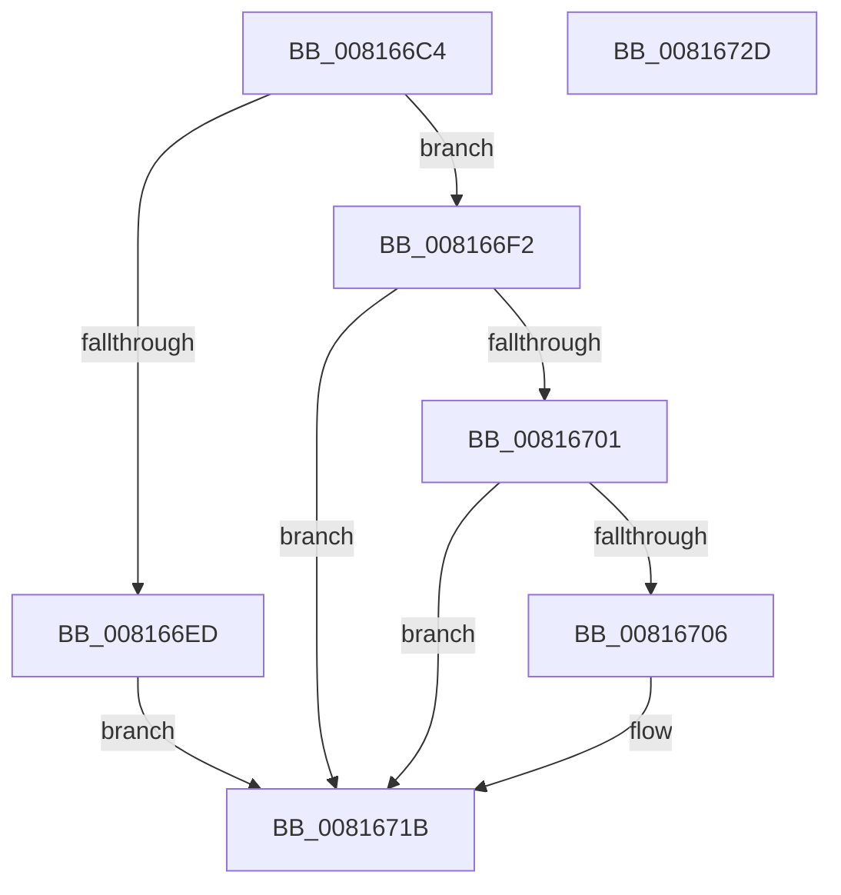

# SdbpMatchDeviceString

- RVA: `0x008166C4`–`0x0081672E` (길이 `106` bytes)
- VA: `0x00000001408166C4`
- 실행 섹션: `PAGE`
- PDB 이름 있음: `예`; PDB Function 태그: `아니요`
- unwind 정보 RVA: `0x00060BC4`
- 디코드: `35`개 명령, `106/106` bytes 표시
- 미해석 바이트: `0` (있으면 어셈블리에 `.byte`로 보존)

> 이 문서는 커널 이미지의 기계어와 PDB 기호를 분석해 생성했습니다. 4번과 5번은 함수 원형과 자료형을 바이너리 사용 방식에서 추정한 C 해석이며 원본 소스 복구 결과는 아닙니다.

## 1. Dependencies

- 직접 호출 지점: **3**; 고유 호출 대상: **3**
- 직접 호출자로 확인된 함수: **4**
- RIP 상대 이미지 참조: **0**

### Outgoing calls
- `0x008166E4` → [SdbFindFirstTag](../95/SdbFindFirstTag_function_0095E34C.md) (function, `0x0095E34C`)
- `0x008166F7` → [SdbGetStringTagPtr](../95/SdbGetStringTagPtr_function_0095DDA8.md) (function, `0x0095DDA8`)
- `0x0081670C` → [wcsicmp](../../text/50/wcsicmp_function_00500080.md) (function, `0x00500080`)

### Direct callers
- [SdbpMatchAcpi](SdbpMatchAcpi_function_00816404.md) at `0x00816449`
- [SdbpMatchAcpi](SdbpMatchAcpi_function_00816404.md) at `0x00816462`
- [SdbpMatchBios](SdbpMatchBios_function_008164E0.md) at `0x00816522`
- [SdbpMatchCpu](SdbpMatchCpu_function_00816578.md) at `0x008165BA`
- [SdbpMatchOem](SdbpMatchOem_function_008168C8.md) at `0x0081690A`
- [SdbpMatchOem](SdbpMatchOem_function_008168C8.md) at `0x00816923`

### Static image references
- 디코드된 RIP-relative 메모리 참조가 없습니다.

## 2. Other-region calls and transfers

- 다른 실행 섹션으로 향하는 call: **1**
  - `0x0081670C` → [wcsicmp](../../text/50/wcsicmp_function_00500080.md) (`PAGE` → `.text`)
- 별도 외부 분기/꼬리 이동을 확인하지 못했습니다.

## 3. Assembly (complete function range)

```asm
008166C4  48 89 5C 24 08                  mov qword ptr [rsp + 8], rbx
008166C9  48 89 74 24 10                  mov qword ptr [rsp + 0x10], rsi
008166CE  57                              push rdi
008166CF  48 83 EC 20                     sub rsp, 0x20
008166D3  41 8B C0                        mov eax, r8d
008166D6  48 8B FA                        mov rdi, rdx
008166D9  8B D0                           mov edx, eax
008166DB  45 0F B7 C1                     movzx r8d, r9w
008166DF  48 8B F1                        mov rsi, rcx
008166E2  33 DB                           xor ebx, ebx
008166E4  E8 63 7C 14 00                  call 0x14095e34c
008166E9  85 C0                           test eax, eax
008166EB  75 05                           jne 0x1408166f2
008166ED  8D 58 01                        lea ebx, [rax + 1]
008166F0  EB 29                           jmp 0x14081671b
008166F2  8B D0                           mov edx, eax
008166F4  48 8B CE                        mov rcx, rsi
008166F7  E8 AC 76 14 00                  call 0x14095dda8
008166FC  48 85 C0                        test rax, rax
008166FF  74 1A                           je 0x14081671b
00816701  48 85 FF                        test rdi, rdi
00816704  74 15                           je 0x14081671b
00816706  48 8B D7                        mov rdx, rdi
00816709  48 8B C8                        mov rcx, rax
0081670C  E8 6F 99 CE FF                  call 0x140500080
00816711  85 C0                           test eax, eax
00816713  B9 01 00 00 00                  mov ecx, 1
00816718  0F 44 D9                        cmove ebx, ecx
0081671B  48 8B 74 24 38                  mov rsi, qword ptr [rsp + 0x38]
00816720  8B C3                           mov eax, ebx
00816722  48 8B 5C 24 30                  mov rbx, qword ptr [rsp + 0x30]
00816727  48 83 C4 20                     add rsp, 0x20
0081672B  5F                              pop rdi
0081672C  C3                              ret
0081672D  CC                              int3
```

## 4. C-style interpretation (structured pseudocode)

```c
__int64 __fastcall SdbpMatchDeviceString(__int64 a1, __int64 a2, int a3, unsigned __int16 a4)
{
    __int64 result;
    __int64 v_rbx;
    __int64 v_rsp;
    unsigned __int64 v_stack_p10;
    unsigned __int64 v_stack_p8;

    v_stack_p8 = v_rbx;
    v_stack_p10 = v_rsi;
    v_rsp = (v_rsp) - (32);
    v_rbx = 0;
    result = SdbFindFirstTag(a1, (unsigned int)((unsigned int)((unsigned int)(a3))), a4, a4);
    if ((unsigned int)(result) != 0) goto loc_008166F2;
    goto loc_0081671B;
loc_008166F2:
    result = SdbGetStringTagPtr(a1, (unsigned int)((unsigned int)(result)), a4, a4);
    if (result == 0) goto loc_0081671B;
    v_rbx = result + 1;
    if (a2 != 0) {
        a2 = a2;
        a1 = result;
        result = wcsicmp(a1, a2, a4, a4);
        a1 = 1;
        v_rbx = result + 1;
        if ((unsigned int)(result) == 0) { v_rbx = (unsigned int)(a1); }
    }
    v_rsp = (v_rsp) + (32);
    return (unsigned int)((unsigned int)(v_rbx));
}
```

## 5. (Beta) C Style

```c
int64_t SdbpMatchDeviceString(int64_t Arg1, int64_t Arg2, int32_t Arg3, uint16_t Arg4)
{
    int64_t result;
    int64_t local_rbx;
    int64_t local_rsp;
    uint64_t v_stack_p10;
    uint64_t v_stack_p8;

    v_stack_p8 = local_rbx;
    v_stack_p10 = local_rsi;
    local_rsp = (local_rsp) - (32);
    local_rbx = 0;
    result = SdbFindFirstTag(Arg1, (uint32_t)((uint32_t)((uint32_t)(Arg3))), Arg4, Arg4);
    if ((uint32_t)(result) != 0) goto loc_008166F2;
    goto loc_0081671B;
loc_008166F2:
    result = SdbGetStringTagPtr(Arg1, (uint32_t)((uint32_t)(result)), Arg4, Arg4);
    if (result == 0) goto loc_0081671B;
    local_rbx = result + 1;
    if (Arg2 != 0) {
        Arg2 = Arg2;
        Arg1 = result;
        result = wcsicmp(Arg1, Arg2, Arg4, Arg4);
        Arg1 = 1;
        local_rbx = result + 1;
        if ((uint32_t)(result) == 0) { local_rbx = (uint32_t)(Arg1); }
    }
    local_rsp = (local_rsp) + (32);
    return (uint32_t)((uint32_t)(local_rbx));
}
```

## 6. Execution-region graph

[열기: 2D/3D 그래프와 함수 탐색 컨트롤 패널](../../../control-panel.html?section=page&rva=0x008166C4&view=graph)

- 2D 그래프는 위에서 아래로 흐르고, 3D 그래프는 빈 공간을 드래그해 회전합니다. Shift+드래그는 이동, 휠은 확대·축소, 함수 노드 선택은 대상 보고서 이동입니다.

### Static fallback


