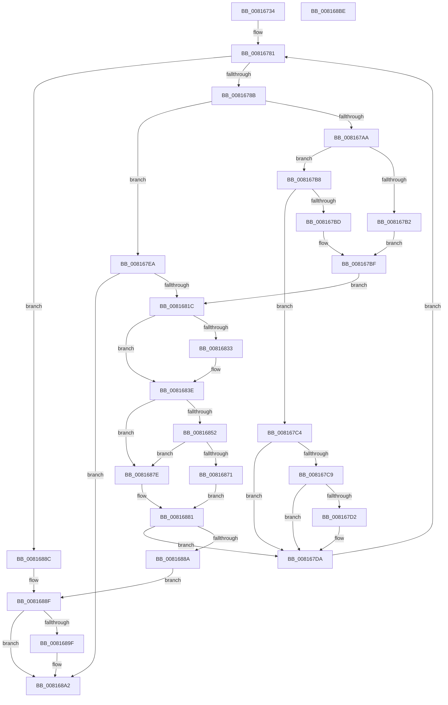

# SdbpMatchList

- RVA: `0x00816734`–`0x008168BF` (길이 `395` bytes)
- VA: `0x0000000140816734`
- 실행 섹션: `PAGE`
- PDB 이름 있음: `예`; PDB Function 태그: `아니요`
- unwind 정보 RVA: `0x000D99A8`
- 디코드: `123`개 명령, `395/395` bytes 표시
- 미해석 바이트: `0` (있으면 어셈블리에 `.byte`로 보존)

> 이 문서는 커널 이미지의 기계어와 PDB 기호를 분석해 생성했습니다. 4번과 5번은 함수 원형과 자료형을 바이너리 사용 방식에서 추정한 C 해석이며 원본 소스 복구 결과는 아닙니다.

## 1. Dependencies

- 직접 호출 지점: **9**; 고유 호출 대상: **8**
- 직접 호출자로 확인된 함수: **2**
- RIP 상대 이미지 참조: **0**

### Outgoing calls
- `0x00816778` → [SdbGetFirstChild](../95/SdbGetFirstChild_function_0095E610.md) (function, `0x0095E610`)
- `0x0081679D` → [SdbpFindMatcher](../AB/SdbpFindMatcher_function_00AB0434.md) (function, `0x00AB0434`)
- `0x008167C9` → [Feature_MissingMatcherBehaviorIgnoreAndDoNotCache__private_IsEnabledDeviceUsageNoInline](../../text/69/Feature_MissingMatcherBehaviorIgnoreAndDoNotCache__private_IsEnabledDeviceUsageNoInline_function_0069C8E8.md) (function, `0x0069C8E8`)
- `0x008167E3` → [SdbGetNextChild](../95/SdbGetNextChild_function_0095E520.md) (function, `0x0095E520`)
- `0x0081680D` → [guard_dispatch_icall](../../text/6B/guard_dispatch_icall_function_006BAAD0.md) (function, `0x006BAAD0`)
- `0x0081682A` → [SdbFindFirstTag](../95/SdbFindFirstTag_function_0095E34C.md) (function, `0x0095E34C`)
- `0x00816849` → [SdbFindFirstTag](../95/SdbFindFirstTag_function_0095E34C.md) (function, `0x0095E34C`)
- `0x00816857` → [SdbGetStringTagPtr](../95/SdbGetStringTagPtr_function_0095DDA8.md) (function, `0x0095DDA8`)
- `0x00816866` → [SdbpIsSdbCapabilityPresent](SdbpIsSdbCapabilityPresent_function_00816350.md) (function, `0x00816350`)

### Direct callers
- [SdbpMatchOne](SdbpMatchOne_function_00816980.md) at `0x008169D1`
- [SdbpCheckForMatch](../AB/SdbpCheckForMatch_function_00AB37BC.md) at `0x00AB3837`

### Static image references
- 디코드된 RIP-relative 메모리 참조가 없습니다.

## 2. Other-region calls and transfers

- 다른 실행 섹션으로 향하는 call: **2**
  - `0x008167C9` → [Feature_MissingMatcherBehaviorIgnoreAndDoNotCache__private_IsEnabledDeviceUsageNoInline](../../text/69/Feature_MissingMatcherBehaviorIgnoreAndDoNotCache__private_IsEnabledDeviceUsageNoInline_function_0069C8E8.md) (`PAGE` → `.text`)
  - `0x0081680D` → [guard_dispatch_icall](../../text/6B/guard_dispatch_icall_function_006BAAD0.md) (`PAGE` → `.text`)
- 별도 외부 분기/꼬리 이동을 확인하지 못했습니다.

## 3. Assembly (complete function range)

```asm
00816734  48 89 5C 24 10                  mov qword ptr [rsp + 0x10], rbx
00816739  48 89 7C 24 18                  mov qword ptr [rsp + 0x18], rdi
0081673E  48 89 4C 24 08                  mov qword ptr [rsp + 8], rcx
00816743  55                              push rbp
00816744  41 54                           push r12
00816746  41 55                           push r13
00816748  41 56                           push r14
0081674A  41 57                           push r15
0081674C  48 8B EC                        mov rbp, rsp
0081674F  48 83 EC 50                     sub rsp, 0x50
00816753  33 C0                           xor eax, eax
00816755  C7 45 68 01 00 00 00            mov dword ptr [rbp + 0x68], 1
0081675C  4C 8B FA                        mov r15, rdx
0081675F  89 45 F4                        mov dword ptr [rbp - 0xc], eax
00816762  8B 55 50                        mov edx, dword ptr [rbp + 0x50]
00816765  49 8B C9                        mov rcx, r9
00816768  48 89 45 F8                     mov qword ptr [rbp - 8], rax
0081676C  44 8B F0                        mov r14d, eax
0081676F  89 45 F0                        mov dword ptr [rbp - 0x10], eax
00816772  49 8B F9                        mov rdi, r9
00816775  4D 8B E0                        mov r12, r8
00816778  E8 93 7E 14 00                  call 0x14095e610
0081677D  4C 8B 6D 58                     mov r13, qword ptr [rbp + 0x58]
00816781  8B D8                           mov ebx, eax
00816783  85 C0                           test eax, eax
00816785  0F 84 01 01 00 00               je 0x14081688c
0081678B  4C 8B CF                        mov r9, rdi
0081678E  89 44 24 20                     mov dword ptr [rsp + 0x20], eax
00816792  4D 8B C4                        mov r8, r12
00816795  48 8D 55 F0                     lea rdx, [rbp - 0x10]
00816799  48 8D 4D F8                     lea rcx, [rbp - 8]
0081679D  E8 92 9C 29 00                  call 0x140ab0434
008167A2  4C 8B D0                        mov r10, rax
008167A5  48 85 C0                        test rax, rax
008167A8  75 40                           jne 0x1408167ea
008167AA  8B 45 F0                        mov eax, dword ptr [rbp - 0x10]
008167AD  83 F8 02                        cmp eax, 2
008167B0  75 06                           jne 0x1408167b8
008167B2  41 8D 42 01                     lea eax, [r10 + 1]
008167B6  EB 07                           jmp 0x1408167bf
008167B8  83 F8 03                        cmp eax, 3
008167BB  75 07                           jne 0x1408167c4
008167BD  33 C0                           xor eax, eax
008167BF  89 45 68                        mov dword ptr [rbp + 0x68], eax
008167C2  EB 58                           jmp 0x14081681c
008167C4  83 F8 04                        cmp eax, 4
008167C7  75 11                           jne 0x1408167da
008167C9  E8 1A 61 E8 FF                  call 0x14069c8e8
008167CE  85 C0                           test eax, eax
008167D0  74 08                           je 0x1408167da
008167D2  41 C7 45 50 01 00 00 00         mov dword ptr [r13 + 0x50], 1
008167DA  8B 55 50                        mov edx, dword ptr [rbp + 0x50]
008167DD  44 8B C3                        mov r8d, ebx
008167E0  48 8B CF                        mov rcx, rdi
008167E3  E8 38 7D 14 00                  call 0x14095e520
008167E8  EB 97                           jmp 0x140816781
008167EA  48 8B 45 F8                     mov rax, qword ptr [rbp - 8]
008167EE  48 8D 4D 68                     lea rcx, [rbp + 0x68]
008167F2  44 8B 4D 50                     mov r9d, dword ptr [rbp + 0x50]
008167F6  4C 8B C7                        mov r8, rdi
008167F9  48 89 44 24 30                  mov qword ptr [rsp + 0x30], rax
008167FE  49 8B D4                        mov rdx, r12
00816801  4C 89 6C 24 28                  mov qword ptr [rsp + 0x28], r13
00816806  49 8B C2                        mov rax, r10
00816809  89 5C 24 20                     mov dword ptr [rsp + 0x20], ebx
0081680D  E8 BE 42 EA FF                  call 0x1406baad0
00816812  8B C8                           mov ecx, eax
00816814  85 C0                           test eax, eax
00816816  0F 84 86 00 00 00               je 0x1408168a2
0081681C  41 B8 03 10 00 00               mov r8d, 0x1003
00816822  8B D3                           mov edx, ebx
00816824  48 8B CF                        mov rcx, rdi
00816827  41 FF C6                        inc r14d
0081682A  E8 1D 7B 14 00                  call 0x14095e34c
0081682F  85 C0                           test eax, eax
00816831  74 0B                           je 0x14081683e
00816833  33 C0                           xor eax, eax
00816835  39 45 68                        cmp dword ptr [rbp + 0x68], eax
00816838  0F 94 C0                        sete al
0081683B  89 45 68                        mov dword ptr [rbp + 0x68], eax
0081683E  41 B8 3C 60 00 00               mov r8d, 0x603c
00816844  8B D3                           mov edx, ebx
00816846  48 8B CF                        mov rcx, rdi
00816849  E8 FE 7A 14 00                  call 0x14095e34c
0081684E  85 C0                           test eax, eax
00816850  74 2C                           je 0x14081687e
00816852  8B D0                           mov edx, eax
00816854  48 8B CF                        mov rcx, rdi
00816857  E8 4C 75 14 00                  call 0x14095dda8
0081685C  4C 8B C0                        mov r8, rax
0081685F  48 8D 4D F4                     lea rcx, [rbp - 0xc]
00816863  49 8B D4                        mov rdx, r12
00816866  E8 E5 FA FF FF                  call 0x140816350
0081686B  83 7D F4 00                     cmp dword ptr [rbp - 0xc], 0
0081686F  74 0D                           je 0x14081687e
00816871  33 C0                           xor eax, eax
00816873  39 45 68                        cmp dword ptr [rbp + 0x68], eax
00816876  0F 94 C0                        sete al
00816879  89 45 68                        mov dword ptr [rbp + 0x68], eax
0081687C  EB 03                           jmp 0x140816881
0081687E  8B 45 68                        mov eax, dword ptr [rbp + 0x68]
00816881  3B 45 60                        cmp eax, dword ptr [rbp + 0x60]
00816884  0F 85 50 FF FF FF               jne 0x1408167da
0081688A  EB 03                           jmp 0x14081688f
0081688C  8B 45 68                        mov eax, dword ptr [rbp + 0x68]
0081688F  B9 01 00 00 00                  mov ecx, 1
00816894  48 8B 55 30                     mov rdx, qword ptr [rbp + 0x30]
00816898  89 02                           mov dword ptr [rdx], eax
0081689A  4D 85 FF                        test r15, r15
0081689D  74 03                           je 0x1408168a2
0081689F  45 89 37                        mov dword ptr [r15], r14d
008168A2  4C 8D 5C 24 50                  lea r11, [rsp + 0x50]
008168A7  8B C1                           mov eax, ecx
008168A9  49 8B 5B 38                     mov rbx, qword ptr [r11 + 0x38]
008168AD  49 8B 7B 40                     mov rdi, qword ptr [r11 + 0x40]
008168B1  49 8B E3                        mov rsp, r11
008168B4  41 5F                           pop r15
008168B6  41 5E                           pop r14
008168B8  41 5D                           pop r13
008168BA  41 5C                           pop r12
008168BC  5D                              pop rbp
008168BD  C3                              ret
008168BE  CC                              int3
```

## 4. C-style interpretation (structured pseudocode)

```c
__int64 __fastcall SdbpMatchList(__int64 a1, __int64 a2, __int64 a3, __int64 a4, unsigned int a5, __int64 a6, unsigned int a7, unsigned int a8)
{
    __int64 result;
    __int64 v_r14;
    __int64 v_rsp;
    unsigned __int64 v_stack_m28;
    unsigned __int64 v_stack_m30;
    unsigned int v_stack_m34;
    unsigned int v_stack_m38;
    unsigned __int64 v_stack_m48;
    unsigned __int64 v_stack_m50;
    unsigned int v_stack_m58;
    unsigned __int64 v_stack_p10;
    unsigned __int64 v_stack_p18;
    unsigned int v_stack_p40;
    unsigned __int64 v_stack_p8;

    v_stack_p10 = v_rbx;
    v_stack_p18 = v_rdi;
    v_stack_p8 = a1;
    v_rsp = (v_rsp) - (80);
    result = 0;
    v_stack_p40 = 1;
    v_stack_m34 = 0;
    v_stack_m30 = 0;
    v_stack_m38 = 0;
    result = SdbGetFirstChild(a4, (unsigned int)(a5), a3, a4);
loc_00816781:
    if ((unsigned int)(result) == 0) goto loc_0081688C;
    v_stack_m58 = (unsigned int)(result);
    result = SdbpFindMatcher(v_stack_m30, v_stack_m38, a3, a4);
    if (result != 0) goto loc_008167EA;
    if (((unsigned int)((unsigned int)(v_stack_m38))) != 2) goto loc_008167B8;
    goto loc_008167BF;
loc_008167B8:
    if (((unsigned int)(result + 1)) != 3) goto loc_008167C4;
    result = 0;
loc_008167BF:
    v_stack_p40 = 0;
    goto loc_0081681C;
loc_008167C4:
    if (0 != 4) goto loc_008167DA;
    result = Feature_MissingMatcherBehaviorIgnoreAndDoNotCache__private_IsEnabledDeviceUsageNoInline(v_stack_m30, v_stack_m38, a3, a4);
    if ((unsigned int)(result) != 0) {
        *(unsigned int *)(a6 + 80) = 1;
    }
    result = SdbGetNextChild(a4, (unsigned int)(a5), (unsigned int)((unsigned int)((unsigned int)((unsigned int)(result)))), a4);
    goto loc_00816781;
loc_008167EA:
    v_stack_m48 = v_stack_m30;
    v_stack_m50 = a6;
    v_stack_m58 = (unsigned int)((unsigned int)((unsigned int)(result)));
    result = guard_dispatch_icall(a8, a3, a4, (unsigned int)(a5));
    if ((unsigned int)(result) == 0) goto loc_008168A2;
loc_0081681C:
    v_r14 = (unsigned int)((0) + 1);
    result = SdbFindFirstTag(a4, (unsigned int)((unsigned int)((unsigned int)((unsigned int)(result)))), (unsigned int)(0x1003ULL), (unsigned int)(a5));
    if ((unsigned int)(result) != 0) {
        result = 0;
        result = (a8 == 0) ? 1 : 0;
        v_stack_p40 = (unsigned int)(result);
    }
    result = SdbFindFirstTag(a4, (unsigned int)((unsigned int)((unsigned int)((unsigned int)(result)))), (unsigned int)(0x603CULL), (unsigned int)(a5));
    if ((unsigned int)(result) == 0) goto loc_0081687E;
    result = SdbGetStringTagPtr(a4, (unsigned int)((unsigned int)(result)), (unsigned int)(0x603CULL), (unsigned int)(a5));
    result = SdbpIsSdbCapabilityPresent(v_stack_m34, a3, result, (unsigned int)(a5));
    if (v_stack_m34 == 0) goto loc_0081687E;
    result = 0;
    result = (a8 == 0) ? 1 : 0;
    v_stack_p40 = (unsigned int)(result);
    goto loc_00816881;
loc_0081687E:
loc_00816881:
    if (((unsigned int)((unsigned int)(a8))) != a7) goto loc_008167DA;
    goto loc_0081688F;
loc_0081688C:
loc_0081688F:
    *(unsigned int *)(v_stack_p8) = (unsigned int)((unsigned int)(a8));
    if (a2 != 0) {
        *(unsigned int *)(a2) = (unsigned int)(v_r14);
    }
    return 1;
}
```

## 5. (Beta) C Style

```c
int64_t SdbpMatchList(int64_t Arg1, int64_t Arg2, int64_t Arg3, int64_t Arg4, uint32_t Arg5, void *Arg6, uint32_t Arg7, uint32_t Arg8)
{
    uint8_t *arg6 = (uint8_t *)Arg6;

    int64_t result;
    int64_t local_r14;
    int64_t local_rsp;
    uint64_t v_stack_m28;
    uint64_t v_stack_m30;
    uint32_t v_stack_m34;
    uint32_t v_stack_m38;
    uint64_t v_stack_m48;
    uint64_t v_stack_m50;
    uint32_t v_stack_m58;
    uint64_t v_stack_p10;
    uint64_t v_stack_p18;
    uint32_t v_stack_p40;
    uint64_t v_stack_p8;

    v_stack_p10 = local_rbx;
    v_stack_p18 = local_rdi;
    v_stack_p8 = Arg1;
    local_rsp = (local_rsp) - (80);
    result = 0;
    v_stack_p40 = 1;
    v_stack_m34 = 0;
    v_stack_m30 = 0;
    v_stack_m38 = 0;
    result = SdbGetFirstChild(Arg4, (uint32_t)(Arg5), Arg3, Arg4);
loc_00816781:
    if ((uint32_t)(result) == 0) goto loc_0081688C;
    v_stack_m58 = (uint32_t)(result);
    result = SdbpFindMatcher(v_stack_m30, v_stack_m38, Arg3, Arg4);
    if (result != 0) goto loc_008167EA;
    if (((uint32_t)((uint32_t)(v_stack_m38))) != 2) goto loc_008167B8;
    goto loc_008167BF;
loc_008167B8:
    if (((uint32_t)(result + 1)) != 3) goto loc_008167C4;
    result = 0;
loc_008167BF:
    v_stack_p40 = 0;
    goto loc_0081681C;
loc_008167C4:
    if (0 != 4) goto loc_008167DA;
    result = Feature_MissingMatcherBehaviorIgnoreAndDoNotCache__private_IsEnabledDeviceUsageNoInline(v_stack_m30, v_stack_m38, Arg3, Arg4);
    if ((uint32_t)(result) != 0) {
        *(uint32_t *)(arg6 + 0x50) = 1;
    }
    result = SdbGetNextChild(Arg4, (uint32_t)(Arg5), (uint32_t)((uint32_t)((uint32_t)((uint32_t)(result)))), Arg4);
    goto loc_00816781;
loc_008167EA:
    v_stack_m48 = v_stack_m30;
    v_stack_m50 = Arg6;
    v_stack_m58 = (uint32_t)((uint32_t)((uint32_t)(result)));
    result = guard_dispatch_icall(Arg8, Arg3, Arg4, (uint32_t)(Arg5));
    if ((uint32_t)(result) == 0) goto loc_008168A2;
loc_0081681C:
    local_r14 = (uint32_t)((0) + 1);
    result = SdbFindFirstTag(Arg4, (uint32_t)((uint32_t)((uint32_t)((uint32_t)(result)))), (uint32_t)(0x1003ULL), (uint32_t)(Arg5));
    if ((uint32_t)(result) != 0) {
        result = 0;
        result = (Arg8 == 0) ? 1 : 0;
        v_stack_p40 = (uint32_t)(result);
    }
    result = SdbFindFirstTag(Arg4, (uint32_t)((uint32_t)((uint32_t)((uint32_t)(result)))), (uint32_t)(0x603CULL), (uint32_t)(Arg5));
    if ((uint32_t)(result) == 0) goto loc_0081687E;
    result = SdbGetStringTagPtr(Arg4, (uint32_t)((uint32_t)(result)), (uint32_t)(0x603CULL), (uint32_t)(Arg5));
    result = SdbpIsSdbCapabilityPresent(v_stack_m34, Arg3, result, (uint32_t)(Arg5));
    if (v_stack_m34 == 0) goto loc_0081687E;
    result = 0;
    result = (Arg8 == 0) ? 1 : 0;
    v_stack_p40 = (uint32_t)(result);
    goto loc_00816881;
loc_0081687E:
loc_00816881:
    if (((uint32_t)((uint32_t)(Arg8))) != Arg7) goto loc_008167DA;
    goto loc_0081688F;
loc_0081688C:
loc_0081688F:
    *(uint32_t *)(v_stack_p8) = (uint32_t)((uint32_t)(Arg8));
    if (Arg2 != 0) {
        *(uint32_t *)(Arg2) = (uint32_t)(local_r14);
    }
    return 1;
}
```

### 관측된 메모리 오프셋

구조체 형식이 확인되지 않은 접근은 인자 기준의 오프셋으로만 기록했습니다.

| 기준 인자 | 오프셋 표현 | 폭 (bit) | 접근 |
|---|---:|---:|---|
| `Arg6` | `+ 0x50` | `32` | `W` |

## 6. Execution-region graph

[열기: 2D/3D 그래프와 함수 탐색 컨트롤 패널](../../../control-panel.html?section=page&rva=0x00816734&view=graph)

- 2D 그래프는 위에서 아래로 흐르고, 3D 그래프는 빈 공간을 드래그해 회전합니다. Shift+드래그는 이동, 휠은 확대·축소, 함수 노드 선택은 대상 보고서 이동입니다.

### Static fallback


